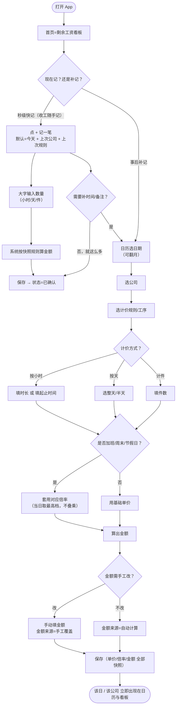
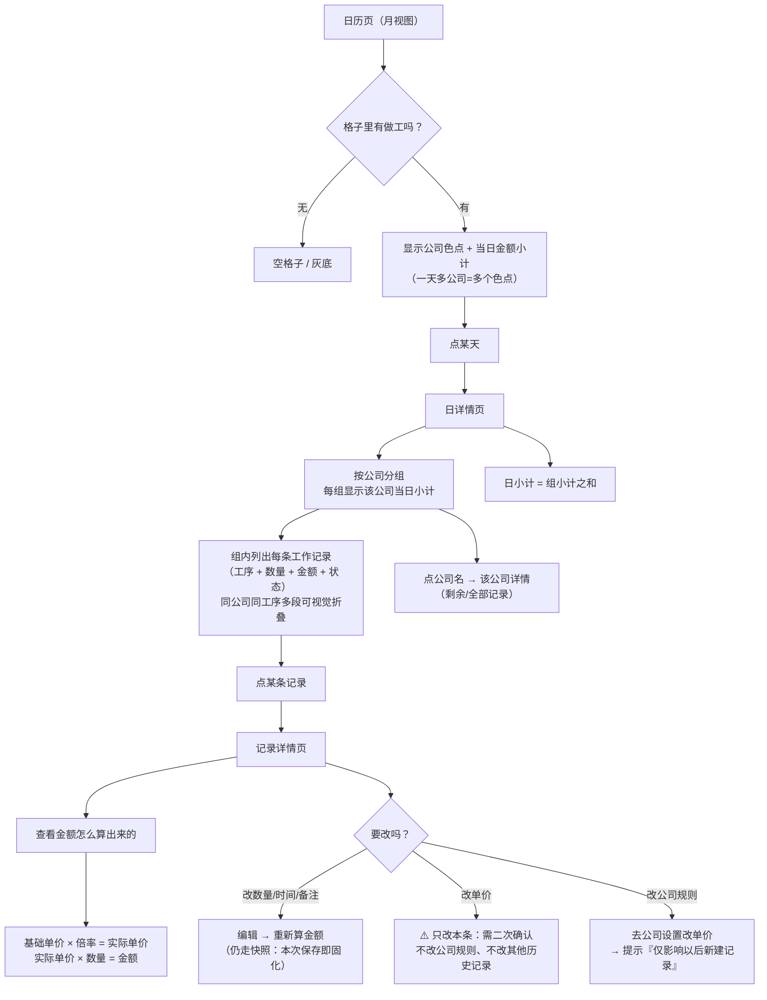
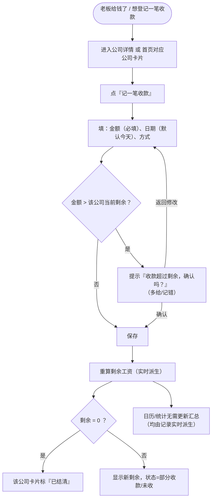
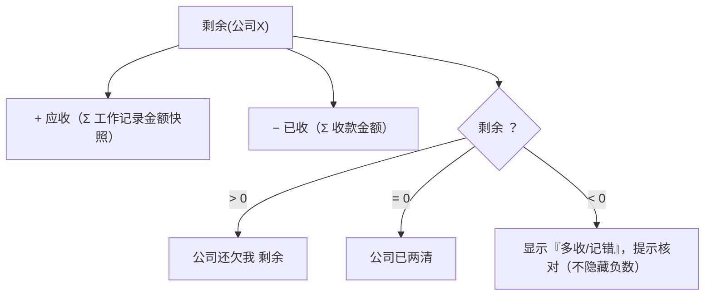
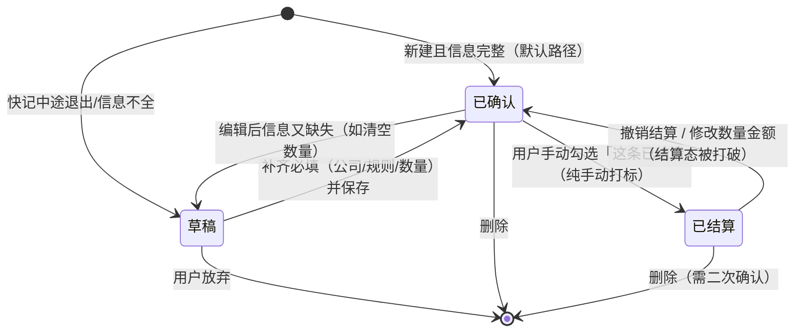
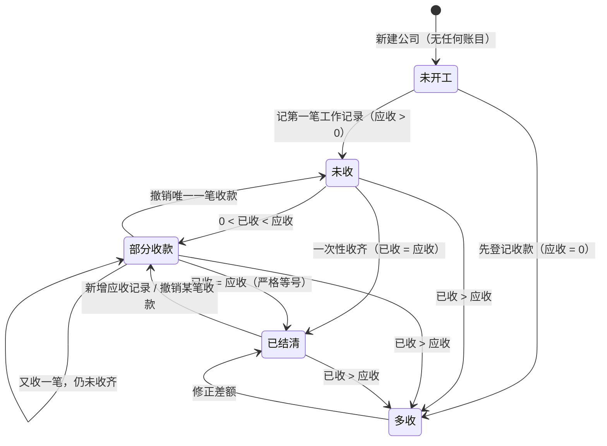

# 02 · 产品需求文档（PRD · v3.1 基础版）

> 本 PRD 的需求来源唯一：`01-需求理解与边界.md` 与 `00-开放问题.md`。文中凡标注 `[待确认]` 的条目同步登记在 `00-开放问题.md`，未关闭前不得视为已冻结。
> 本 PRD 不含技术选型、数据库 DDL、排期（超出本次范围）。
>
> **v3 修订说明（2026-09-30 · 用户范围裁剪）**：
> 1. **基础版只做场景 A（多公司、单价多变、快照）+ 场景 C（计件、收款零散、剩余对账）**。场景 B（借支 + 月结 + 欠薪）**整体后移二期**——借支、账期配置、逾期提醒、逐期核销、提成/扣款全部不进基础版（用户决策 D5，权威）。
> 2. 基础版**数据仅存本地、手机操作**（强化 D2/D3：完全不做云/账号/同步）；**数据导出备份（CSV/JSON + 导入恢复）进基础版**（用户决策 D6）。
> 3. **v2 的借支/账期/逐期核销/双口径设计整体平移至 §13「二期设计资产」，内容不删**；其中沉淀了主理人对 05 审查报告 F-01 及 N1~N3 的五条修复裁定（R-A~R-E），作为二期设计规则，**不得丢失**。
> 4. 按 05 审查报告修复仍在基础版适用的问题：S-01（A5 用户已显式确认）、S-02（§5.2 收款状态严格等号）、S-04（「已结算」纯手动打标 + 补 AC）、S-05（状态机补转移）、G-02/G-05/G-07/G-09 中基础版相关项。
> 5. **PM 保留意见（如实记录，见 §1.4）**：裁剪使基础版核心价值从「对账 + 欠薪感知」收窄为「对账」，欠薪感知整体延后；PM 不反对裁剪（降复杂度换更快交付是合理取舍），但建议二期尽快排期，并在基础版保留两个零成本锚点（见 §1.4）。

---

## 1. 产品定位与目标用户

### 1.1 一句话定位

给**受雇劳动者**（工人 / 零工 / 装修工 / 司机等）用的**个人双向台账**：
一边记「干了多少活、该拿多少」（**应收**），一边记「实际拿到多少」（**已收**），差额即「**剩余工资**」。
日历与统计都是**同一份记录的派生视图**，不另存汇总数据。

**它不是什么**：不是计时器（不追求秒级计时的精度），不是老板侧派工/排班系统（无派工、无协作编辑），不是考勤机对接工具。

**核心价值**：**对账**（这笔工资怎么算出来的、给了多少、还差多少）。
**欠薪感知**（哪家公司欠我多久了）：依赖账期/逾期机制，**v3 起整体属二期**（见 §1.4 保留意见与 §13.2）。

### 1.2 典型用户场景

> v3 范围裁定：**基础版服务场景 A 与场景 C**；场景 B 保留为用户画像与二期需求来源（其设计见 §13）。

**场景 A · 装修师傅老张（多公司并行、单价多变）—— ✅ 基础版**
老张同时在 3 个装修队干活。今天上午在 A 队按**时价 40 元/时**做了 4 小时（其中 1 小时算加班，1.5 倍）；下午去 B 队按**日价 300 元/天**做了半天；晚上回 A 队又干了 2 小时。收工后他掏出手机，在**一天里记 3 条**：A 队 4 小时、B 队半天、A 队 2 小时。月底 A 队说这个季度单价涨到 45 了，老张改公司单价——**已记的历史仍是 40 元算出来的金额**，不被篡改。
> 关键：一天多公司、一天多段不同单价、单价快照。

**场景 C · 货运司机小王（计件 + 收款零散）—— ✅ 基础版**
小王按趟计费，每趟 120 元，一天可能跑 5–8 趟；老板微信三天两头转钱，一次 300、一次 500。他**懒得每次收款都对账**，就在 App 里逐笔登记收款，App 自动把总的收款累加、算剩余。月底老板说"结清了"，小王一看剩余不是 0，把差额找老板要了回来。
> 关键：计件计价、多笔部分收款、剩余工资是唯一的对账口径。

**场景 B · 工地零工老李（借支 + 月结 + 欠薪）—— ⏳ 随二期（设计资产见 §13）**
老李跟 C 工地口头约定月结，每月 15 号发上月工资。上手第 3 天他找工头**借支 1000 元**买工具，工头说"发工资时扣"。到了 25 号工资还没发，老李打开 App，看到 C 工地那张卡**红了**：应收 8600、已收 0、借支未还 1000、剩余 7600、已逾期 10 天。
> 关键（二期）：借支独立记账、账期与逾期提醒、剩余工资含借支扣减。

### 1.3 目标用户特征汇总

| 维度 | 特征 | 对设计的要求 |
|------|------|------------|
| 人群 | 工地 / 装修 / 零工 / 司机等受雇劳动者 | 术语用大白话（"欠我多少"），不用财务黑话 |
| 设备 | **手机为主**（D3），常在户外、光线差、手上有活 | 主流程要**大字、少步、可单手**；开关屏即用 |
| 时机 | 「**收工随手记**」是最高频场景；也常在事后（当晚/周末）补记 | 必须同时支持**秒级快记**与**事后补记**两条路径 |
| 网络 | 工地常无网/弱网 | 本地优先，**离线可完整记账**（D2）；基础版数据仅存本地 |
| 数据安全 | 手机丢失/换机即丢账；担心账目外泄 | **导出备份进基础版**（D6）：本地数据可导出 CSV/JSON、可导入恢复 |
| 识字/文化 | 部分用户财务概念弱 | 只暴露"该拿 / 拿到 / 还差"三个词 |
| 戒备 | 担心 App 把账目泄露给别人 | 默认**账本私有**，无账号无上传（云备份属二期，见 §13.6） |

### 1.4 PM 保留意见（对 v3 范围裁剪，如实记录不得隐瞒）

> 纪律：质疑的是**取舍**不是人。

| # | 意见 | 说明 |
|---|------|------|
| 1 | **裁剪使基础版核心价值收窄** | v2 定位「核心价值 = 对账 + 欠薪感知」；基础版剔除账期/逾期后，**欠薪感知（哪家公司欠我多久）整体缺失**，用户只能看到"还差多少"、看不到"拖了多久"。PM 认为该取舍**可接受**（降复杂度、换更快交付、风险更小），但建议**二期尽快排期**，不宜长期停留在基础版 |
| 2 | **基础版保留两个零成本锚点**（已落入 §6.1，不新增机制） | ① 公司卡片显示**最近一次收款时间**（v2 已有）；② 长期未结清的公司卡片显示"**已 X 天未收款**"（纯派生：今天 − 最近一次收款日；不引入账期/逾期概念，不标红不推送）。用户若不要，删两行 UI 即可 |
| 3 | **导出备份是基础版唯一的"防丢"手段** | 基础版无云备份，本地数据丢失（手机丢失/误删/换机）即**不可恢复**——因此 D6 的导出备份在基础版为 **P0**（非 P1），并需 UI 主动提醒定期导出（见 A8 前提） |

---

## 2. 核心概念模型（基础版）

> 概念模型描述**业务实体与字段**（非数据库设计）。字段后 `(派生)` 表示该字段由其他数据实时算出、**不落库**（设计底线 1）。
> **借支记录、账期/周期实例、期级调整项（提成/扣款）不属基础版**，其 v2 全量设计平移至 §13 二期设计资产。

### 2.1 实体总览

```
用户(账本)  1 ── n  公司
公司       1 ── n  计价规则（含工序/岗位档）
公司       1 ── n  工作记录 / 收款记录
工作记录   1 ── 1  计价规则（快照引用，不随规则改动而变）
账本       1 ── n  节假日标记
```

### 2.2 公司 Company

| 字段 | 类型 | 释义 | 必填 |
|------|------|------|------|
| id | 标识 | 唯一标识 | 是 |
| 名称 | 文本 | 公司/工头/工地名，如"某某装饰"、"C 工地张工头" | 是 |
| 简称 | 文本 | 日历/卡片上显示的短名 | 否（默认取名称前 2 字） |
| 标记色 | 颜色 | 日历格子着色用，多公司并行时区分 | 否（系统分配） |
| 默认计价规则 | 引用 | 快记时的默认规则，减少选择 | 否 |
| 联系方式 | 文本 | 电话/微信，方便"要钱"时直接用 | 否 |
| 状态 | 枚举 | 启用 / 停用（停用后不出现在快记下拉，历史保留） | 是（默认启用） |
| 备注 | 文本 | 自由备注 | 否 |

> 结算方式/结算日/宽限期等账期字段**随二期**（完整定义见 §13.2），基础版公司模型不出现。

### 2.3 计价规则 PricingRule（含工序/岗位档）

> 一个公司下可有多条规则（对应不同工序/岗位/时段），如 A 队有"木工 40 元/时""拆墙 计件 15 元/㎡"。

| 字段 | 类型 | 释义 | 必填 |
|------|------|------|------|
| id | 标识 | 唯一标识 | 是 |
| 所属公司 | 引用 | 挂在哪家公司下 | 是 |
| 规则名 | 文本 | 如"砌墙""司机趟次""木工"（=工序/岗位） | 是 |
| 计价方式 | 枚举 | **按小时（时价）/ 按天（日价）/ 计件** | 是 |
| 基础单价 | 金额 | 每小时 / 每天 / 每件的单价 | 是 |
| 计价单位 | 文本 | 小时 / 天 / 件 / ㎡ / 趟（计件时用） | 条件必填（计件必填） |
| 标准工时/半天定义 | 数值 | 判定"加班"的阈值（如日价按 8 小时），半天是否=0.5 天 | 否 |
| 加班倍率 | 倍率 | 超出标准工时或标记加班的倍率（默认 1.5） | 否 |
| 周末倍率 | 倍率 | 周六/周日的基础倍率（默认 1.0，可由用户设） | 否 |
| 节假日倍率 | 倍率 | 法定/自定义节假日倍率（默认 1.0；配合节假日标记 §2.6） | 否 |
| 生效日期 | 日期 | 该规则的生效起点（仅用于提示，不改历史） | 否 |
| 状态 | 枚举 | 启用 / 停用 | 是 |

**倍率叠加顺序（需唯一，防止各处各算）**：
`实际单价 = 基础单价 × max(适用的加班倍率, 适用的周末倍率, 适用的节假日倍率)`
> 即**当日取最高档倍率，不叠乘**（如法定节假日加班 = 取节假日倍率，不再乘加班倍率）。此规则为默认执行口径，见 §8 Q12（`[已按默认执行·可改]`）。

> **提成规则 / 固定扣款项不属基础版**（用户已拍板其形态为**期级调整项**，按结算期计提，随二期实施），完整设计见 §13.5。

### 2.4 工作记录 WorkRecord（计薪单元）

> **粒度定义见 §8 Q2 结论**：一条记录 = **一个工作段**（一次连续工作），即 `归属日 × 公司 × 计价规则 × 单一单价快照`。一天多段 = 多条记录。

| 字段 | 类型 | 释义 | 必填 |
|------|------|------|------|
| id | 标识 | 唯一标识 | 是 |
| 归属日 | 日期 | 该记录计入哪一天（跨夜默认归**开始日**，可改，见 Q6） | 是 |
| 公司 | 引用 | 为哪家公司干的 | 是 |
| 计价规则 | 引用 | 用了哪条规则/工序 | 是 |
| 计价方式**快照** | 枚举 | 落库时固化当时的方式（时价/日价/计件） | 是（自动） |
| 数量**快照** | 数值 | 时长(小时) / 天数 / 件数 | 是 |
| 起止时间 | 时间 | 可选，用于自动算时长（支持跨夜） | 否 |
| 单价**快照** | 金额 | 落库时固化的实际单价（倍率已展开或随附） | 是（自动） |
| 倍率明细**快照** | 结构 | 固化当时用了哪个倍率（加班/周末/节假日及倍数） | 是（自动） |
| 金额**快照** | 金额 | 最终计入应收的金额（自动算或手工覆盖） | 是 |
| 金额来源 | 枚举 | **自动计算 / 手工覆盖** | 是（默认自动） |
| 备注 | 文本 | 干了什么活（大白话） | 否 |
| 状态 | 枚举 | **草稿 / 已确认 / 已结算**（见 §5.1；「已结算」= 纯手动打标） | 是（默认已确认） |
| 创建/更新时间 | 时间戳 | 审计用 | 是（自动） |

> **快照纪律（设计底线 2）**：`单价快照 / 倍率明细快照 / 金额快照 / 计价方式快照` 在记录落库时固化，**此后修改公司计价规则或单价，绝不回改本记录**（用户已显式确认，见 §9 A5）。

### 2.5 收款记录 PaymentRecord

| 字段 | 类型 | 释义 | 必填 |
|------|------|------|------|
| id | 标识 | 唯一标识 | 是 |
| 收款日期 | 日期 | 实际收到的日期 | 是 |
| 公司 | 引用 | 哪家公司给的 | 是 |
| 金额 | 金额 | 本次收到多少 | 是（>0） |
| 收款方式 | 枚举 | 现金 / 微信 / 支付宝 / 银行 / 其他 | 否 |
| 备注 | 文本 | 如"老板微信转的" | 否 |
| 创建时间 | 时间戳 | 审计用 | 是（自动） |

> 收款**可多笔、可部分**；不要求金额与某条工作记录一一对应。
> 「冲抵周期」字段**随二期**（完整定义见 §13.1/§13.2），基础版收款不挂周期。

### 2.6 节假日标记 HolidayMark

| 字段 | 类型 | 释义 |
|------|------|------|
| 日期 | 日期 | 哪一天 |
| 类型 | 枚举 | 法定节假日 / 调休上班 / 自定义 |
| 倍率 | 倍率 | 该日适用的倍率（默认取计价规则的节假日倍率） |
| 来源 | 枚举 | 用户手动（基础版）/ 系统日历（二期） |

> **去留判断（PM 裁定，见 00 台账 Q18）**：进基础版（P1）——实现成本低（标一天 + 当天新建记录套倍率），且与"倍率取最高档"机制天然咬合；历史记录不受影响（快照纪律）。

### 2.7 全局派生量（基础版唯一口径）

- **剩余工资(某公司)** = Σ工作记录金额 − Σ收款金额　← **基础版唯一算法（口径A-基础版）**
- **剩余工资(全局)** = Σ 各公司剩余
- **应收(某公司)** = Σ 全部「已确认/已结算」工作记录金额快照
- **月收入(派生)** = 该月工作记录金额合计（按归属日）
- **日历格子小计(派生)** = 该日全部工作记录金额合计

> 二期引入借支后，唯一算法扩展为 `剩余 = 应收 − 已收 − 借支未还`，且需满足与账期分解视图的恒等（完整推导见 §13.3）。

---

## 3. 功能清单（分层）

> 优先级：`P0` = 无它则核心价值不成立；`P1` = 显著提升，尽量进基础版；`P2` = 可延后。
> 前置依赖：该功能开工前必须已具备的能力。

### 3.1 基础版 MVP（场景 A + C）

| 编号 | 功能 | 优先级 | 前置依赖 | 验收要点 |
|------|------|--------|---------|---------|
| B1 | **公司管理**（增删改、启用停用、标记色；账期设置随二期） | P0 | — | 可建多家公司；停用后不出现在快记下拉、历史完好 |
| B2 | **计价规则配置**（时价/日价/计件 + 加班/周末/节假日倍率 + 多工序档；倍率取最高档口径唯一） | P0 | B1 | 一家公司可配多条规则；倍率叠加口径唯一 |
| B3 | **工作记录**（秒级快记 + 事后补记；自动算金额 + 手工覆盖；单价快照；一段一条；跨夜归开始日） | P0 | B1、B2 | 见 §7 AC-01~AC-12、AC-65~AC-68 |
| B4 | **收款记录**（多笔、部分收款） | P0 | B1 | 见 §7 AC-21~AC-25、AC-31~AC-33 |
| B5 | **剩余工资看板**（全局 + 按公司，唯一口径 `应收 − 已收`） | P0 | B3、B4 | 见 §7 AC-31~AC-33 |
| B6 | **日历视图**（月历、多公司着色、当日小计、三级下钻、日详情按公司分组 + 视觉折叠） | P0 | B3 | 见 §7 AC-34~AC-36 |
| B7 | **统计**（按公司 / 按月 / 按时间段 / 按计价方式） | P1 | B3 | 见 §7 AC-37~AC-38 |
| B8 | **数据导出备份**（全量导出 CSV/JSON + 导入恢复；基础版唯一防丢手段） | **P0**（D6；理由见 §1.4-3） | B1~B4 | 见 §7 AC-60~AC-64 |
| B9 | **本地存储 + 离线可用**（无账号、无上传，数据仅存本机） | P0 | — | 见 §7 AC-40、AC-43、AC-44 |
| B10 | **节假日手动标记**（把某天标为节假日/调休，影响当日新建记录倍率） | P1 | B2、B3 | 见 §7 AC-51（去留判断见 00 台账 Q18） |

### 3.2 二期清单（设计资产完整保留，见 §13）

| 编号 | 功能 | 说明 |
|------|------|------|
| E1 | **借支记录 + 逐期核销全套** | 冲抵周期 / 周期实例 / 冻结规则 / 切换点规则；设计含 05 报告 F-01 修复裁定 R-A~R-E（§13.1/§13.2） |
| E2 | **账期配置 + 周期实例生成 + 逾期提醒（轻量）** | 日结/周结/月结指定日/不定；含 R-A 周期闭合口径（§13.2）；「不定」公司自然月方案（Q16 随二期再议） |
| E3 | **提成 / 固定扣款（期级调整项）** | 用户已拍板"按结算期算"（与 Dev 原建议"按单条记录"相反）；期级计提 + 双口径同源纳入（§13.5） |
| E4 | **账期对账页（逐期核销视图）** | 各期应收/已收/借支核销/结余/是否结清（§13.3/§13.4） |
| E5 | **云备份 / 账号体系 / 多端同步** | 登录后可开启；冲突策略 Q8（§13.6） |
| E6 | **欠薪提醒/推送** | 到期、逾期阈值可配（依赖 E2） |
| E7 | **给老板看的 PDF/图片对账单** | 按公司 + 时间段，含明细与合计（§13.6） |
| E8 | **账目只读分享（工友）** | 三期候选（§13.6） |
| E9 | **法定节假日日历自动同步** | 替代 B10 手动标记（§13.6） |
| E10 | **多币种 / 高级统计与趋势 / 常用项模板 / 桌面小组件** | 三期候选（§13.6） |

---

## 4. 关键业务流程

### 4.1 录入流程（秒级快记 + 事后补记 两条路径）



**两条路径的差异（必须都支持，且互相可切换）**

| 维度 | 秒级快记 | 事后补记 |
|------|---------|---------|
| 触发 | 首页「+ 记一笔」 | 日历点某天 / 记录列表「+」 |
| 默认值 | 今天、上次公司、上次规则、上次数量 | 所选日期 |
| 步数 | ≤3 步（数量 → 保存） | 5–8 步（日期→公司→规则→数量→倍率→金额） |
| 适用 | 收工即记、一趟一趟记（场景 C） | 当晚/周末回忆补记（场景 A） |
| 共同底线 | 落库即快照单价与金额；均允许手工覆盖金额 | 同左 |

### 4.2 日历下钻流程（日 → 多公司 → 多记录 → 单条详情）



> 「视觉折叠、不合并存储」依 Q2/Q15 结论：一天同公司同工序多段仍为多条记录，仅详情页可折叠展示。

### 4.3 收款登记流程



**边界说明**：一笔收款**不强制**关联某条工作记录；**剩余 = 应收 − 已收**（基础版唯一口径）。「冲抵周期」随二期（§13.1）。

### 4.4 剩余工资计算流程（基础版 · 单一口径）

> **口径A-基础版（唯一算法）**：`剩余(公司) = Σ「已确认/已结算」工作记录金额快照 − Σ收款金额`
> **无借支项、无账期分解**；二期扩展口径与恒等设计见 §13.3。



> **纪律（设计底线 3）**：全产品**只有一个**剩余工资算法。日历、统计、看板、导出备份**都必须复用**该口径（AC-33 / AC-61）。

---

## 5. 状态机（基础版）

### 5.1 工作记录状态机（v3 修复 S-04/S-05）



| 状态 | 含义 | 是否计入应收 | 可编辑 | 可删除 |
|------|------|------------|--------|--------|
| **草稿** | 未填完（缺公司/规则/数量），占位用 | ❌ 不计入 | ✅ | ✅ |
| **已确认** | 信息完整、金额已定（自动或手工） | ✅ 计入 | ✅ | ✅ |
| **已结算** | 用户手动打标"这条已结清"（对账辅助） | ✅ 计入 | ✅（改后回"已确认"） | ✅（需二次确认） |

> **「已结算」打标规则（v3 简化，修复 S-04）**：**纯手动**——用户单条勾选，或撤销；**不做任何自动逐条冲抵**（基础版无账期，无"整期结清"批量打标，该能力随二期 E1/E4）。打标仅为对账辅助，**不改变剩余算法**（算法仍按公司总量相减）。验收见 AC-69。

### 5.2 收款记录状态机（公司维度 · v3 修复 S-02）

> v3 修复：判定**基于剩余（`应收 − 已收`）**；`已结清` 改为**严格等号**（`已收 = 应收`），消除与"多收"的矛盾；补 `部分收款→未收`（撤销唯一收款）、`未收→多收` 边界转移。



| 状态 | 判定（公司维度，派生） |
|------|----------------------|
| 未开工 | 应收 = 0 且 已收 = 0（新公司还没记任何账） |
| 未收 | 应收 > 0 且 已收 = 0 |
| 部分收款 | 0 < 已收 < 应收 |
| **已结清** | **已收 = 应收（严格等号；剩余 = 0）** |
| 多收/异常 | 已收 > 应收（剩余 < 0）→ **提示核对，不静默处理** |

> 二期引入借支后，本判定扩展为 `已收 = 应收 且 借支未还 = 0`（严格等号），见 §13.3。

### 5.3 二期状态机（设计资产保留）

**账期状态机 / 借支核销状态机**（v2 §5.3/§5.4 全量）平移至 §13.4，随 E1/E2/E4 实施。其中 v2 已知的「未到期→已结清缺失转移」「周期汇总状态枚举 5 项 vs 7 项不一致」等问题随二期启动时按 05 报告修复（S-08），并应用 R-A~R-E 规则。

---

## 6. 页面清单与信息架构

### 6.1 「打开 App 第一眼看到什么」

**答案：剩余工资看板。** 用户真正想知道的是「**各公司还欠我多少**」——这是核心价值。

首页布局（自上而下）：
1. **顶部大数字**：全局「**还欠我 ¥X,XXX**」（= Σ 各公司剩余）
2. **按公司卡片列表**，每张卡一行大字：
   - 公司名 + 标记色
   - **剩余 ¥X（最大字号）**
   - 小字：应收 ¥X · 已收 ¥X
   - 状态角标：`已结清` / `部分收款` / `多收·待核对`（判定见 §5.2）
   - 最近一次收款时间；若长期未收款，加小字「**已 X 天未收款**」（纯派生：今天 − 最近一次收款日；§1.4-2 锚点，不标红不推送）
3. **底部悬浮主按钮**：`+ 记一笔`（秒级快记入口）
4. 次级入口：`日历` / `统计` / `设置`（含导出备份）

> 「共 M 期未结」「逾期 N 天」等账期角标**随二期**（E2/E4）。

### 6.2 信息架构树

```
App
├─ 首页·剩余工资看板（默认）
│   ├─ 公司卡片 → 公司详情
│   └─ + 记一笔（秒级快记）
├─ 日历
│   └─ 日详情
│       ├─ 按公司分组 → 记录列表（可视觉折叠）
│       │   └─ 记录详情 / 编辑
│       └─ 该日合计
├─ 统计
│   ├─ 按公司 / 按月 / 按时间段 / 按计价方式
├─ 公司
│   ├─ 公司列表
│   └─ 公司详情
│       ├─ 基本信息（账期设置随二期）
│       ├─ 计价规则（多工序档）
│       ├─ 全部工作记录
│       ├─ 全部收款记录 → 记一笔收款
│       └─ 该公司剩余工资
└─ 设置
    ├─ 节假日标记
    ├─ 导出备份（CSV/JSON）与导入恢复
    ├─ 对账单导出（二期）
    └─ 关于 / 数据说明
```

### 6.3 页面清单（v3 修复 G-05：补「公司列表页」）

| 页面 | 核心内容 | 主要操作 | 优先级 |
|------|---------|---------|--------|
| 首页·剩余工资看板 | 全局剩余 + 公司卡片列表 | 记一笔、进公司详情、进日历 | P0 |
| 秒级快记页（弹层） | 公司/规则/数量，大字输入 | 保存、展开补时间 | P0 |
| 日历页 | 月视图、色点、当日小计 | 翻月、点日期下钻 | P0 |
| 日详情页 | 当天各公司分组记录（可折叠） | 增/改/删记录 | P0 |
| 记录详情/编辑页 | 记录全字段 + 金额算法展开 | 改、删、改单价(限本条)、手动打标"已结算" | P0 |
| **公司列表页**（v3 补） | 全部公司 + 各家剩余/状态 | 进详情、新建公司 | P0 |
| 公司详情页 | 基本信息、剩余、两本流水（工作/收款） | 记收款、配规则 | P0 |
| 公司编辑页 | 名称/色/联系方式 | 保存 | P0 |
| 计价规则编辑页 | 方式/单价/倍率 | 增改规则 | P0 |
| 收款登记页 | 金额/日期/方式/备注 | 保存 | P0 |
| 统计页 | 四维度汇总 | 切维度、选时间 | P1 |
| 设置页 | 节假日标记/导出备份/关于 | 各开关 | P1 |
| **导出备份页**（v3 新增） | 全量导出（CSV/JSON）、导入恢复、上次备份时间 | 导出/导入/分享备份文件 | **P0** |

> 账期对账页、借支登记页（含冲抵周期）、对账单预览页 → **随二期**（E1/E4/E7）。

---

## 7. 验收标准（穷举调用点与场景）

> 覆盖：**哪些端 / 哪些入口 / 哪些接口 / 哪些边界 / 哪些数据形态**。
> 场景类型：**正常（N）/ 异常（E）/ 边界（B）**。
> **适用范围（v3 新增列）**：`基础版` = 基础版 MVP 必须通过；`随二期` = AC 内容与编号保留追溯，随对应二期功能实施验收。
> 验证方式：`UI` = 界面操作观测；`计算` = 数值断言；`数据` = 本地数据核对；`离线` = 断网复现。手机端为主（D3），下表"端"除特别注明外均为**手机端**。

### 7.1 工作记录 / 计价（含一天多公司、一天多段、跨夜）

| 编号 | 类型 | 适用 | 场景 | 预期结果 | 可验证方式 |
|------|------|------|------|---------|-----------|
| AC-01 | N | 基础版 | 一天、一家公司、一条记录（时价 40 元/时 × 4 小时） | 金额 = 160；日历该日小计 = 160；看板该公司应收 +160 | UI + 计算 |
| AC-02 | N | 基础版 | **一天多家公司**（A 时价 4h、B 日价 1 天、A 又 2h） | 生成 3 条记录；日历该日显示 **2 个公司色点**、当日小计 = 三者之和；A 当天应收 = 两条之和、单条数 = 2 | UI + 数据 |
| AC-03 | N | 基础版 | **一天同一公司多段不同单价**（白天正常价 4h + 晚上加班价 2h） | 生成 **2 条**记录（各自单价快照不同）；该公司当日应收 = 两段之和；日历当日仍只算 1 天 | UI + 计算 |
| AC-04 | N | 基础版 | 日价按天（300 元/天，整天） | 金额 = 300，数量记 1 天 | 计算 |
| AC-05 | N | 基础版 | 日价半天（规则定义半天 = 0.5 天） | 金额 = 150（或按规则配置），数量记 0.5 天 | 计算 |
| AC-06 | N | 基础版 | 计件（120 元/趟 × 7 趟） | 金额 = 840；数量记 7（单位"趟"） | 计算 |
| AC-07 | N | 基础版 | 加班倍率（4h 正常 40 + 1h 加班 1.5 倍） | 加班段金额 = 40×1.5×1 = 60；当日合计 = 160 + 60 = 220 | 计算 |
| AC-08 | B | 基础版 | **跨夜班次** 22:00–次日 06:00（8 小时） | 默认**归属开始日**；时长 = 8 小时；提供「归属日」可手动改为结束日；**不按小时切分** | UI + 计算 |
| AC-09 | B | 基础版 | 跨夜且跨月（1 月 31 日 22:00 – 2 月 1 日 06:00） | 默认计入 1 月 31 日；月统计归属 1 月；用户可改为 2 月 1 日 | 计算 + UI |
| AC-10 | B | 基础版 | 起止时间跨天但归属日手动设为结束日 | 日历显示在结束日；金额不变 | UI |
| AC-11 | E | 基础版 | 填了起止时间但结束 < 开始且未开"跨夜"开关 | 提示"结束时间早于开始时间，是否跨夜？"，不静默算负数 | UI |
| AC-12 | E | 基础版 | 时价记录时长为 0 或为空 | 视为不完整 → 落为**草稿**，不计入应收，日历不显示金额 | 数据 + UI |
| AC-65 | N | 基础版 | **倍率取最高档（Q12）**：同一时段同时命中周末倍率 1.2 与加班倍率 1.5 | 实际单价 = 基础单价 × **1.5**（取最高档，不叠乘）；倍率明细快照记录命中项与取用值 | 计算 + 数据 |
| AC-66 | N | 基础版 | **秒级快记 ≤3 步**（默认今天+上次公司+上次规则，只填数量即保存） | ≤3 步完成落库；状态=已确认；快照完整 | UI + 数据 |
| AC-67 | N | 基础版 | **事后补记全流程**（日历选往日 → 公司 → 规则 → 数量 → 倍率 → 金额） | 全流程可走通；落库快照按**补记时点**当时的规则固化 | UI + 数据 |
| AC-68 | B | 基础版 | **编辑已确认记录改数量/起止时间** | 按**本条快照单价**重算金额；本次保存即新快照；日历/看板/统计同步更新 | 计算 + 数据 |

### 7.2 快照与改价（核心：改价不篡改历史）

| 编号 | 类型 | 适用 | 场景 | 预期结果 | 可验证方式 |
|------|------|------|------|---------|-----------|
| AC-13 | N | 基础版 | **改单价不篡改历史**：A 公司单价 40 → 45 | 已有记录金额**全部不变**（仍按 40 算）；仅**此后新建**记录用 45；改动时提示"仅影响以后" | 计算 + 数据 |
| AC-14 | B | 基础版 | 改的是**倍率**（加班 1.5 → 2.0） | 历史记录倍率快照不变；新记录按 2.0 | 计算 |
| AC-15 | B | 基础版 | 改计价**方式**（时价 → 日价） | 历史记录方式快照不变；新记录按日价 | 数据 |
| AC-16 | E | 基础版 | 用户想改某条历史记录的单价 | 仅**本条**可改、需二次确认；其他记录不受影响。**口径（R-G01，PRD v3.1 澄清）**：「改单价」(动作 A) 与「手工覆盖金额」(动作 B) 是**两个独立动作**——**动作 A 改单价**：改本条单价快照 `rateSnapshot` → 按新快照重算 → `amountSource = auto`、`autoReferenceAmount = null`（auto 态无需参考值，该字段语义**专属手工覆盖**）；**动作 B 手工覆盖金额**：`amountSource = manual`、`autoReferenceAmount = 当时自动值`；两者都只影响本条、都需二次确认 | UI + 数据 |
| AC-17 | B | 基础版 | **手工覆盖金额**后，公司单价再变 | 手工覆盖值**保持**（快照优先）；提示该条为手工值 | 数据 |
| AC-18 | B | 基础版 | 手工覆盖金额的记录，用户点"恢复自动计算" | 按**该条快照单价 × 数量**重算，得到自动值 | 计算 |
| AC-19 | E | 基础版 | 停用某公司/某规则后 | 历史记录不受影响；快记下拉不再出现该公司/规则 | UI |
| AC-20 | E | 基础版 | 删除某公司 | 提示将一并影响 N 条记录、M 笔收款；确认后**归档（软删除 `deleted_at`）——唯一删除语义，不物理删除、不级联删除**（**R-G04**；依 Q13） | UI |

### 7.3 收款与剩余工资（部分收款、多收）

| 编号 | 类型 | 适用 | 场景 | 预期结果 | 可验证方式 |
|------|------|------|------|---------|-----------|
| AC-21 | N | 基础版 | **部分收款**：应收 1000，收 300 | 剩余 = 700；公司状态 = 部分收款 | 计算 + UI |
| AC-22 | N | 基础版 | 再收 700 | 剩余 = 0；已收 = 应收（严格等号）→ 状态 = 已结清 | 计算 |
| AC-23 | N | 基础版 | 多笔零散收款（300 + 500 + 200 = 1000） | 剩余 = 0；三笔均留痕，可查明细 | 数据 |
| AC-24 | B | 基础版 | **收款超过剩余**（应收 1000 已收 1000，又收 200） | 提示"超过剩余，确认吗"；确认后剩余 = −200 并显示"多收/记错" | UI + 计算 |
| AC-25 | E | 基础版 | 收款金额为 0 | 阻止保存并提示 | UI |
| AC-26 | N | 随二期 | **借支冲销（借出）**：应收 1000，借支 200，已收 0 | 剩余 = 1000 − 0 − 200 = **800**（二期口径） | 计算 |
| AC-27 | N | 随二期 | 借支后归还 200 | 借支未还 = 0；剩余 = 1000 − 0 − 0 = **1000** | 计算 |
| AC-28 | B | 随二期 | 部分归还（借 500 还 200） | 借支未还 = 300；剩余相应 +300 | 计算 |
| AC-29 | E | 随二期 | 归还超过借出（借 200 还 300） | 借支未还 = −100，提示"多还了，请核对" | UI + 计算 |
| AC-30 | E | 随二期 | 跨公司隔离：A 公司借支不影响 B 公司剩余 | B 剩余不受 A 借支影响 | 计算 |
| AC-31 | B | 基础版 | 一天内在同一公司完成 3 条记录（各 100），收 1 笔 150 | 应收 300、已收 150、剩余 150 | 计算 |
| AC-32 | E | 基础版 | 草稿状态记录 | **不计入**应收；看板/日历/统计/导出备份均不含 | 数据 + UI |
| AC-33 | B | 基础版 | 剩余工资口径一致性 | 首页看板 / 公司详情 / 统计 / 日历下钻 / **导出文件** 五处显示的同一公司剩余**完全一致** | 交叉比对 |
| AC-69 | N | 基础版 | **「已结算」纯手动打标（S-04）**：对某条已确认记录勾选"已结算" | 状态变已结算；剩余/应收**不变**（打标仅为对账辅助）；再点撤销 → 回已确认；无任何自动冲抵路径 | UI + 计算 |

### 7.4 日历与统计

| 编号 | 类型 | 适用 | 场景 | 预期结果 | 可验证方式 |
|------|------|------|------|---------|-----------|
| AC-34 | N | 基础版 | 月历显示有做工的日期 | 有记录的格子显示公司色点 + 小计；无记录格子空白 | UI |
| AC-35 | N | 基础版 | 一天多公司着色 | 该格显示多个色点，颜色对应各公司标记色 | UI |
| AC-36 | B | 基础版 | 一个月跨年（12 月 → 次年 1 月翻月） | 翻月正确，跨年记录归属正确 | UI |
| AC-37 | B | 基础版 | 统计"按公司/按月/按时间段/按计价方式" | 各维度合计 = 明细之和；与日历下钻一致（无"对不上账"） | 计算 + 交叉比对 |
| AC-38 | B | 基础版 | **一天多段不同单价**在"按计价方式"统计中的归集 | 时价段与计件段分别归入对应维度，合计仍等于总额 | 计算 |
| AC-39 | E | 基础版 | 空数据初始态 | 日历全空、看板显示"还没有记录，点下面 + 记一笔" | UI |

### 7.5 离线与数据导出备份（基础版）

| 编号 | 类型 | 适用 | 场景 | 预期结果 | 可验证方式 |
|------|------|------|------|---------|-----------|
| AC-40 | N | 基础版 | **离线录入**（无网）新建记录、收款 | 全部可保存、可查看、可算剩余（本地派生）；无错误弹窗；无任何"需联网"阻断 | 离线 |
| AC-41 | N | 随二期 | **离线录入后同步**（恢复网络 + 已开启云备份） | 离线期间新增/修改**全部上传**，内容与本地一致，无丢失 | 离线 + 数据 |
| AC-42 | B | 随二期 | 离线期间同一条记录本地改、另一端也改 | 按 Q8 冲突策略处理：**不静默覆盖**，保留两侧版本，必要时提示用户选择 | 离线 + 数据 |
| AC-43 | E | 基础版 | 设备本地数据异常（如进程被杀） | 本地数据仍完整；给出"稍后重试"提示，不丢数据 | 离线 |
| AC-44 | B | 基础版 | 无账号状态 | **全部基础版功能可用（纯本地模式）**；无登录入口、无上传行为 | UI |
| AC-60 | N | 基础版 | **全量导出**（CSV/JSON）：含公司/计价规则/工作记录/收款记录/节假日标记 | 导出文件覆盖**全部有效数据**（含软删除归档项，标记区分）；快照结构（单价/倍率明细/金额来源等）完整保留；导出页显示上次备份时间 | 数据 + UI |
| AC-61 | N | 基础版 | **导出金额与 App 内口径一致** | 导出文件中各公司应收合计/已收合计/剩余 与看板**完全一致**（复用唯一算法，AC-33 延伸） | 交叉比对 |
| AC-62 | B | 基础版 | **导出后再导入（同一设备）** | 数据无损恢复：记录数一致、每条金额/快照字段一致、日历/看板/统计与导出前一致 | 数据 + 计算 |
| AC-63 | E | 基础版 | **导入遇 id 冲突**（导入文件含本机已有 id 的记录） | **不静默覆盖**：提示冲突条数，用户逐类选择「覆盖 / 跳过 / 全部保留为新记录」；选择后结果可预期、可撤销（导入前自动再备份一份） | UI + 数据 |
| AC-64 | E | 基础版 | **导入结构校验**（文件缺字段 / 类型不符 / 非本产品格式） | 拒绝导入并**明确报告**问题位置（不部分导入、不产生半截数据）；CSV 仅作人读明细，**导入恢复只支持 JSON 全量格式**（见 Q19） | UI + 数据 |

### 7.6 账期与欠薪感知（随二期 · AC 保留追溯）

| 编号 | 类型 | 适用 | 场景 | 预期结果 | 可验证方式 |
|------|------|------|------|---------|-----------|
| AC-45 | N | 随二期 | 月结 15 日，今天 10 日，上月工资未结 | 状态 = 未到期（今天 ≤ 到期日）；不标红 | UI + 计算 |
| AC-46 | N | 随二期 | 月结 15 日，宽限期 7 天，今天 25 日仍欠 | 状态 = 🔴**逾期**，逾期天数 = 25 − 15 − 7 = 3 天 | 计算 |
| AC-47 | B | 随二期 | 账期="不定"（口头）的公司 | 不产生逾期提醒；仍显示剩余（自然月方案随二期再议，Q16） | UI |
| AC-48 | B | 随二期 | 逾期后收到部分款 | 逾期标记保留（仍未结清）；剩余更新 | UI |
| AC-49 | B | 随二期 | 宽限期设为 0 | 到期次日即逾期 | 计算 |
| AC-50 | E | 随二期 | 跨月结算日（结算日 = 31 日，当月无 31 日） | 按 R-A 周期闭合口径定锚（§13.2）：锚点 = 该月最后一天，周期 = [锚点, 下锚点 − 1]，相邻期首尾相接、无重叠无空洞 | 计算 |
| AC-51 | B | **基础版** | 周末 / 节假日倍率（手动标记节假日，周六） | 新建记录正确引用对应倍率（取最高档）；历史记录不受影响 | 计算 + 数据 |

> AC-51 原列于账期组；因 B10 节假日标记进基础版（Q18），本条划归**基础版**验收（与 AC-65 同组）。AC-45~50 随二期，其 v2 已知问题（状态判定口径、周期闭合口径、月末漂移）随二期按 R-A/§13.2 修复后重验。

### 7.7 借支逐期核销（随二期 · AC 保留追溯）

> 全组（AC-52~59，含 AC-52b/AC-54b）**随二期** E1/E4 实施；v2 原文保留于 §13.3/§13.4 附录，此处列索引：AC-52/52b（同期借扣两记法）、AC-53（默认归集——二期须按 **R-D 良定义**实施：求值排除本笔、仅取期结余>0 的期、兜底发生日所在周期）、AC-54/54b（改账期——二期须按 **R-B 切换点强制**实施）、AC-55（跨期借支）、AC-56（双口径恒等——二期须含"变更日早段/晚段"两用例，**定点精确相等**）、AC-57（防双计——二期须按**第三方案**实施：不承诺运行时自动判错，仅启发式提示）、AC-58（核销状态流转）、AC-59（超还）。

### 7.8 覆盖度自检（基础版）

| 必含场景 | 对应 AC |
|---------------------|---------|
| 一天多公司 | AC-02、AC-35 |
| 一天多段不同单价 | AC-03、AC-38 |
| 跨夜班次 | AC-08、AC-09、AC-10、AC-11 |
| 改单价不篡改历史 | AC-13~AC-18 |
| 部分收款 | AC-21、AC-22、AC-23、AC-31 |
| 剩余口径唯一（含导出） | AC-33、AC-61 |
| 倍率取最高档 | AC-65、AC-51 |
| 快记 / 补记 / 编辑重算 | AC-66、AC-67、AC-68 |
| 「已结算」手动打标 | AC-69 |
| 离线可用（纯本地） | AC-40、AC-43、AC-44 |
| 数据导出备份 | AC-60~AC-64 |
| **（随二期）借支冲销 / 逐期核销 / 账期 / 云同步** | AC-26~30、AC-41~42、AC-45~50、AC-52~59 |

---

## 8. 开放问题处置（v3 状态更新）

> **标注含义**：
> - `[已决]` = 用户已明确拍板（权威）；
> - `[已按默认执行·可改]` = 用户未提异议，按 PM 建议默认值执行；
> - `[随二期再议]` = 问题有效但不阻塞基础版，连同其上下文平移二期，启动时重新确认。

### 8.1 已决项（用户拍板）

| # | 问题 | **最终结论** | 状态 | PM 备注 |
|---|------|------|------|------|
| **Q1** | 「分享给工友」 | MVP 只做**账号/账本隔离**（各装各的 App）；「只读分享账目」保留三期 | **[已决]** | 无异议 |
| **Q2** | 工作记录最小粒度 | **一段一条**；一天同公司多段不同单价 = 多条；不合并存储，仅详情页视觉折叠（含 Q15） | **[已决]** | 无异议 |
| **Q3** | 借支记账口径 | **公司预付 + 逐期核销**——**已决 · 随二期实施**（D5：借支不进基础版）；v2 全套设计平移 §13 | **[已决 · 随二期]** | PM 保留意见见 00 台账 C 节，仍成立；降级出口设计随 §13.1 保留 |
| **Q5** | 金额手工覆盖 | 允许；改单价只作用于当前记录并二次确认 | **[已决]** | 无异议 |
| **Q15** | 合并显示 | 不合并存储，视觉折叠 | **[已决]** | 随 Q2 |

### 8.2 按默认执行 / 随二期再议项

| # | 问题 | 结论 | 状态 |
|---|------|------|------|
| **Q4** | 账期配置 / 逾期提醒 | 设计随二期（E2/E6）；宽限期默认 7 天等默认值不变 | **[随二期再议]** |
| **Q6** | 跨夜班次归属 | 默认归**开始日**；可手动改结束日；不按小时切分 | **[已按默认执行·可改]** |
| **Q7** | 多币种 | 基础版单币种（人民币）；多币种列三期 | **[已按默认执行·可改]** |
| **Q8** | 多端同步冲突策略 | 随二期（E5） | **[随二期再议]** |
| **Q9** | 导出物形态 | **基础版**：本地全量 CSV/JSON + 导入恢复（D6）；**二期**：给老板看的 PDF/图片对账单 | **[已决（D6）+ 二期补充]** |
| **Q10** | 个税 / 社保 | 永久排除（§10） | **[已按默认执行·可改]** |
| **Q11** | 计件工序维度 | 需要且进基础版（B2 多规则） | **[已按默认执行·可改]** |
| **Q12** | 倍率叠加口径 | **取最高档**，不叠乘（AC-65） | **[已按默认执行·可改]** |
| **Q13** | 删除公司/规则 | 默认归档/停用（软删除） | **[已按默认执行·可改]** |
| **Q14** | 「已结算」打标 | **基础版 = 纯手动单条打标**（S-04 简化）；「整期结清」批量打标随二期 | **[已按默认执行·可改]** |
| **Q16** | 「不定账期」公司周期方案 | 自然月方案为 PM 建议，**随二期再议**（不阻塞基础版） | **[随二期再议]** |
| **Q17** | 借支归还默认冲抵策略是否可配 | MVP 固定「最早未结清周期」（R-D 良定义版），不暴露配置；**随二期实施** | **[已按默认执行·随二期]** |

### 8.3 v3 新登记项（均已决 / 已按默认，无开放项）

| # | 问题 | 结论 | 状态 |
|---|------|------|------|
| **Q18** | 节假日手动标记去留（基础版 or 后置） | **进基础版（P1）**：成本 = 标一天 + 当天新建记录套倍率，与"倍率取最高档"咬合；历史不受影响（快照纪律）。若用户不要，删 B10 + AC-51 即可 | **[已按默认执行·可改]** |
| **Q19** | 导出备份格式细节 | **JSON = 全量备份/恢复格式**（含全部字段与快照结构，导入恢复唯一支持格式）；**CSV = 明细导出**（供人读/表格工具，不用于恢复）。理由：CSV 表格结构无法无损承载快照结构（倍率明细等嵌套字段） | **[已按默认执行·可改]** |

> **纪律自检**：基础版范围内**无 `开放` 项**；Q4/Q8/Q16 为 `[随二期再议]`（有主、有上下文、不阻塞基础版验收）。

---

## 9. 假设显化（v3 更新）

> 纪律：**高风险**前提若未确认，不得带着它往下走。

| # | 隐含前提 | 风险 | 不成立的后果 | 状态 |
|---|---------|------|------------|------|
| **A1** | 用户**能拿到或记得**单价，并愿意在首次录入时配置一次 | 中 | 自动算金额为 0 价值，产品退化为"纯记事本"，B2 需降级 | 保持中；首启引导"一次性配置" |
| **A2** | 记录**归属唯一一天**（跨夜默认归开始日）即可满足绝大多数用户 | 中 | 若大量用户要求"按小时切分统计工时"，日历与统计口径需重构 | 保持中；已有手动改归属日出口 |
| **A5** | 用户**接受"改价不重算历史"** | ~~高~~ → **已关闭** | 若用户预期"改了单价历史应自动重算"，则与快照底线直接冲突 | ✅ **用户已显式确认（2026-09-30）：「历史不重算，按当时单价」**；保留 UI 提示（AC-13/AC-16）作为二次保险 |
| **A6** | 单用户单账本，无多人同时编辑 | 低 | 需引入协作编辑与权限，属范围外 | 已由 D4 收敛 |
| **A8**（v3 新增） | 用户**会定期导出备份**（基础版唯一防丢手段，无云） | 中 | 手机丢失/换机/误删即**不可恢复**；用户以为"App 自己会存好" | UI 主动提醒（设置页 + 看板低频提示"上次备份 X 天前"）；二期云备份（E5）根治 |
| **A3** | 借支必绑公司且用户会登记归还 | 中 | 借支未还长期虚高 → 剩余被低估 | **随二期**（§13.1 保留完整设计与降级出口） |
| **A4** | 收款可先于/后于工作记录、允许历史补收款 | 中偏高 | 剩余算法时序假设错误，账期归集需重设计 | **随二期**（§13.2/§13.3）；Reviewer 指出 v2 用 AC-55 反证"时序灵活"属逻辑跳跃——二期启动时需补直接依据（场景 C 零散收款与趟次不同步 / 多收场景）再复核 |
| **A7** | 用户愿在归还借支时"顺手"看周期 | 中 | 逐期核销 V1–V4 价值失效（公司总额仍正确） | **随二期**；二期须给可测边界 + 账期对账页"一键补归集"入口（05 报告 S-06） |

> **高风险前提处置（v3）**：原高风险 A5 已由用户**显式**确认关闭（S-01 闭环）；基础版无其他未关闭高风险前提。A3/A4/A7 平移二期跟踪。

---

## 10. 范围声明（明确不做）

**基础版（v3）不做**（随二期，设计资产见 §13）：

- ⏳ 借支记录、账期/周期实例、逾期提醒、逐期核销、账期对账页（E1/E2/E4）
- ⏳ 提成 / 固定扣款（期级调整项，E3）
- ⏳ 云备份 / 账号体系 / 多端同步（E5）
- ⏳ 给老板看的 PDF/图片对账单（E7）
- ⏳ 账目分享（三期 E8）、多币种（三期）、法定节假日自动同步（E9）、高级统计/模板/小组件（E10）

**永久排除**：

- ❌ 个税 / 社保 / 公积金代扣代缴（Q10）
- ❌ 老板侧派工 / 排班 / 多人协作编辑同一账本
- ❌ 与第三方考勤机、企业 ERP 对接
- ❌ 发票、报税凭证管理
- ❌ 计时器式的秒级计时（不追求计时精度）

---

## 11. 交付与后续

| 项 | 状态 |
|----|------|
| PRD 起草（v1） | ✅ 完成 |
| PRD 回炉（v2，逐期核销） | ✅ 完成 |
| **PRD 重构（v3，基础版 = 场景 A+C，用户范围裁剪 D5/D6）** | ✅ 完成，`status: 草稿` |
| **PRD v3.1（口径澄清，不动 AC 编号；来源 07 审查 G-01/G-04）** | ✅ 完成，`status: 草稿` |
| Dev 审技术可行性（基础版口径） | ⏳ 待（03/04 需按 v3 范围重新对齐） |
| Reviewer 复审（重点：范围裁剪完整性 / 二期资产无损 / 基础版 AC 覆盖） | ⏳ 待 |
| 三方冻结 → `status: 已冻结` | ⏳ 待 |

**下一步建议（v3）**：
1. Dev 侧 03/04 需按基础版范围重排（数据模型去借支/周期实体 → 移入二期设计附录；导出备份需补实体无改动、纯读取 + 导入校验方案）。
2. Reviewer 复审重点：① §13 二期资产与 v2 是否无损（尤其 R-A~R-E 五条裁定）；② 基础版 AC 是否穷举（新 AC-60~69）；③ §5.2 严格等号判定是否仍有矛盾（S-02）。
3. 二期启动时，§13 各节需重新走阶段①②（其中账期/逐期核销部分已有 05 报告问题清单与修复裁定，作为输入）。

---

## 12. 变更说明

### v3 → v3.1（2026-09-30 · 口径澄清，**不动 AC 编号**）

> 本版为**措辞 / 口径澄清**：不改任何 AC 编号、不改「适用范围」列、不改变基础版功能边界（仍为场景 A+C）。来源 = `07-UI实现规格.md` 审查提出的 G-01 / G-04 与主理人裁定 R-G01 / R-G04。

| 项 | 变更前 | 变更后（v3.1） | 触发 |
|----|--------|---------------|------|
| **AC-16 · 口径（R-G01）** | 文字隐含"改单价 → 本条金额来源 = 手工覆盖"，把「改单价」与「手工覆盖金额」混为一谈 | **拆为两个独立动作**：**动作 A 改单价** → 改本条 `rateSnapshot` → 按新快照重算 → `amountSource = auto`、`autoReferenceAmount = null`；**动作 B 手工覆盖金额** → `amountSource = manual`、`autoReferenceAmount = 当时自动值`；**两者都只影响本条、都需二次确认**（收敛：动作 A 取 03 §4.5 "改快照 + 仍 auto"、动作 B 取 AC-16 原意"手工覆盖 = manual"）。**R-G01 细化（非新裁定）**：`autoReferenceAmount` 语义**专属手工覆盖**——动作 B 写「当时自动值」、**动作 A 置 `null`**（auto 态下 `amountSnapshot` 即自动值，再存冗余）；与 03 §2.4 / `work_record.dart:30` 一致 | 07 审查 G-01 / 主理人裁定 R-G01 |
| **AC-20 · 删除语义（R-G04）** | "确认后归档**或**级联删除（策略见 §8 Q13）"——两种策略并列、语义未定 | **归档（软删除 `deleted_at`）为唯一删除语义**：**不物理删除、不级联删除**（依 Q13）；已归档公司的历史记录与派生金额照常计入；「停用 `enabled=0`」与「归档 `deleted_at != null`」**并存、互不替代** | 07 审查 G-04 / 主理人裁定 R-G04 |

> **对其它文档的影响（交接）**：`07-UI实现规格.md` 已同步 v3.1（§4.2 两动作表、§4.1 引用 R-G04、§7 G-01/G-04 状态更新）。`03-数据模型与信息架构.md` 若 §2.5 / §8 仍写"归档或级联删除"，应同步为"归档（软删除）"，由 Dev 侧对齐。

### v2 → v3（2026-09-30 · 用户范围裁剪）

| 项 | v2 | v3 | 触发 |
|----|----|----|------|
| §1 定位 | 核心价值 = 对账 + 欠薪感知（场景 A/B/C 全做） | **基础版 = 场景 A + C**；场景 B（借支/月结/欠薪）整体后移二期；§1.4 新增 PM 保留意见 | 用户决策 D5 |
| §2 概念模型 | 含借支记录、账期/周期实例、提成/扣款 | 基础版实体 = 账本/公司/计价规则/工作记录/收款/节假日标记；`剩余 = 应收 − 已收` 唯一口径；被移出的实体**平移 §13 不删** | D5 |
| §3 功能清单 | M1~M13（含 M5 借支、M10 账期、M13 账期对账） | 基础版 B1~B10；二期 E1~E10；**新增 B8 数据导出备份（P0）** | D5 + D6 |
| §4 业务流程 | 含借支/双口径 | §4.4 简化为单一口径；双口径/防双计流程平移 §13.3 | D5 |
| §5 状态机 | 含账期/借支核销状态机 | 保留 §5.1/§5.2 并修 S-02（严格等号）/S-04（纯手动打标）/S-05（补转移）；账期/核销状态机平移 §13.4 | 05 报告 + D5 |
| §6 页面/IA | 含账期对账页、借支登记页 | 基础版页面清单；**补公司列表页（G-05）**、**新增导出备份页**；账期对账页随二期 | D5/D6 + 05 报告 |
| §7 验收标准 | AC-01~AC-59 | **编号不变、加「适用范围」列**：AC-26~30/41~42/45~50/52~59 标「随二期」；AC-51 因 B10 留基础版；**新增 AC-60~64（导出备份）+ AC-65~69（倍率取最高档/快记/补记/编辑重算/手动打标）** | D5/D6 + 05 报告 S-03/S-04/G-07 |
| §8 开放问题 | Q3 已决（进 MVP）；Q16/Q17 开放 | Q3 → 已决·随二期实施；Q16/Q17 → 随二期再议；新增 Q18（节假日标记，进基础版）/Q19（导出格式默认）；基础版无开放项 | D5 |
| §9 假设显化 | A1~A7 | A5 **正式关闭（用户显式确认，S-01）**；A3/A4/A7 → 随二期；新增 A8（定期导出备份前提） | 05 报告 + D6 |
| §13（新增） | — | **二期设计资产**：v2 借支/账期/逐期核销/期级调整项全量平移 + **R-A~R-E 五条修复裁定**（来源：05 报告 F-01 及 N1~N3 修复） | 防止裁剪丢设计资产 |
| frontmatter | 修订 v2 | 修订 v3 | — |

### v1 → v2（2026-09-30 · 逐期核销回炉，保留追溯）

| 项 | v1 | v2 | 触发 |
|----|----|----|------|
| §2.5 收款记录 | 「关联账期」可选，无默认规则 | 「冲抵周期」选填 + 默认规则 | 逐期核销一致性 |
| **§2.6 借支记录** | 无「冲抵周期」字段 | 新增「冲抵周期」+「核销状态」 | 用户 Q3 决策 |
| **§2.7 账期** | 「派生视图，不落库汇总」 | 拆两层：骨架落库 + 汇总派生；冻结规则防引用漂移 | 用户 Q3 决策 |
| **§4.4 剩余工资** | 单一口径 | 双口径 + 恒等证明 + 防双计规则 | 用户 Q3 决策 |
| **§5 状态机** | 无借支状态 | 新增 §5.4 借支核销状态机；§5.3 账期状态机扩展 | 用户 Q3 决策 |
| §7 验收标准 | AC-01~AC-51 | 新增 AC-52~AC-59 | R5 |
| §8 开放问题 | Q1–Q15 | 已决/默认执行分级；新增 Q16/Q17 | 用户拍板 |

---

## 13. 二期设计资产（v2 全量平移 · 不得删改，实施时按修复裁定执行）

> **本章性质**：v2 中借支/账期/逐期核销/期级调整项的**完整设计**，因用户 D5 裁剪整体后移二期。**内容为已审查资产**（含 05 审查报告指出的问题与主理人裁定 R-A~R-E 的修复规则），二期启动时以此为起点、重新走阶段①②，**不得从零重写**。

### 13.1 借支记录 AdvanceRecord（含逐期核销）

**实体（v2 §2.6 原文，含 G-02/G-09 修复）**

| 字段 | 类型 | 释义 | 必填 |
|------|------|------|------|
| id | 标识 | 唯一标识 | 是 |
| 发生日期 | 日期 | 借支/归还的日期 | 是 |
| 公司 | 引用 | 向哪家公司借的（借支必绑公司，Q3） | 是 |
| 方向 | 枚举 | 借出（公司给我钱）/ 归还（我还钱/被从工资扣） | 是 |
| 金额 | 金额 | 本次金额（恒正，方向表正负） | 是 |
| 冲抵周期 | 引用 | 周期实例（见 13.2）。**借出 = 派生**（发生日所在周期，因周期冻结而稳定，不落库——G-09 追认）；**归还 = 选填落库**（用户指定则落库；不填走默认策略） | 归还时条件落库 |
| 核销状态 | 枚举(派生) | 未核销 / 部分核销 / 已核销（仅对「借出」有意义） | 派生 |
| 备注 | 文本 | 如"买工具""发工资时扣" | 否 |

**「冲抵周期」填法规则**

| 方向 | 冲抵周期 | 说明 |
|------|---------|------|
| 借出 | 自动填充、用户不可见（派生） | 默认 = 发生日所在周期；保证恒等成立 |
| 归还 | 选填（预填推荐值） | ① 用户指定 → 按指定周期核销；② 不指定 → 默认策略（**R-D 良定义**，见 13.2-五）；③ 兜底 = 发生日所在周期 |

**降级出口（可用性底线）**：用户记不清"这 500 从哪个月扣的"，只填金额直接保存，系统按 R-D 默认策略自动归集——逐期核销是增强项，不是必填负担。

**引用约束（R-E，修复 05 报告 N2）**：`冲抵周期` 所指周期实例的**所属公司必须等于记录所属公司**（跨公司引用为非法，保存时校验拒绝）。

**FIFO 核销**：归还按"先借先还"冲抵最早未核销借出，核销**跨周期**（公司全域按借出时间），核销轴与归期轴解耦；核销状态纯派生不落库；`借支未还(公司) = Σ借出 − Σ归还` 与核销状态无关。

### 13.2 账期 SettlementPeriod（周期实例 + 修复规则 R-A~R-E）

**两层结构**：周期实例骨架（`周期id / 公司 / 周期起止 / 到期日 / 是否冻结 / 配置版本`）**落库**（供稳定引用）；周期汇总（应收/已收/借支核销/结余/逾期天数/状态）**派生不落库**。

**⚠️ 设计规则（主理人裁定，来源 = 05 审查报告 F-01 致命项 + N1~N3 的修复；二期实施必须遵守，不得回退）**：

1. **【R-A · 周期闭合边界口径】** `周期 = [结算日 D, 次月 (D−1)]`（结算日当天算本期起点）。定锚点 `A_i` = 第 i 个月的结算日当日；**若该月无该日（如 D=31 遇 2 月），取该月最后一天**；`周期_i = [A_i, A_{i+1} − 1]` → 相邻期**首尾相接、无重叠、无空洞**（MECE）。特例 D=「每月最后一天」：`周期 = [该月最后一天, 次月最后一天 − 1]`（如 [2/28, 3/30]、[3/31, 4/29]，各期长度 27~31 天为该锚点固有性质）。例：D=15 → [8/15, 9/14]；D=31 → [1/31, 2/27]、[2/28, 3/30]。
2. **【R-B · 切换点强制】** 变更账期配置时：① **切换点强制 = 最后一个旧周期结束日 + 1 天**（不是取 max，是强制取该值）；② 新配置从该切换日起**作为非自然起点开始滚动**（首个周期可能短于常规长度，允许），后续周期按新规律推进；③ **禁用"用旧配置补齐跨越切换点"**（这是 Reviewer 复现出的二次重叠根因）；④ 旧周期实例**全部保留**（结构冻结）；⑤ 切换点之后**不留空洞**（从切换日直接按新配置切）。例：旧 D=15（旧周期 [8/15, 9/14]），新 D=5 → 切换点 = 9/15；新首个周期 [9/15, 10/4]（非自然短周期），其后 [10/5, 11/4]。
3. **【R-C · 生成下界】** **不设生成下界**——任意日期都可回溯懒生成周期（早于建账日的补记也能归期，避免空洞 C1；设下界会使"强制懒生成"对策失效、直接破恒等）。代价仅是多生成少量历史周期实例（个人级数据量，可忽略）。
4. **【R-D · 「最早未结清周期」良定义】**（修复循环依赖 N1）：① 求值时**排除正在求归期的这笔归还本身**；② 候选范围**仅取 `期结余 > 0` 的期**，按时间升序取最早（**净预支期（结余<0）不作为归还目标**）；③ 兜底：不存在 `期结余 > 0` 的期 → 归到**发生日期所在周期**。
5. **【R-E · 周期引用约束】** 见 13.1（冲抵周期同公司）。
6. **【冻结与封账分离】** `是否冻结` = **结构冻结**（起止/到期日一经生成不变）；封账（不再吸收新记录）二期不引入，若引入另设字段，不混用。
7. **【配置版本留痕】** 需**账期配置历史版本**实体（Dev 03 §2.8 已给出草案），历史补记须按"当时生效的配置版本"生成周期。
8. **「不定账期」公司**：PM 建议按**自然月**生成周期实例，`仅用于归集`（不做逾期判定、不发提醒），仅供借支归还/收款挂靠（**随二期再议**，Q16）。

**二期验收要求（继承 05 报告复审要求）**：改账期配置后，`Σ各期结余 == 应收总额 − 已收总额 − 借支未还`（**定点精确相等**），且**必须构造两个用例**：变更日落在旧周期**早段**、**晚段**（v2 AC-54/54b/56 的二期强化版）。

### 13.3 双口径与恒等（v2 §4.4 全量 + 防双计）

> **二期口径A（公司维度，唯一算法）**：`剩余 = 应收总额 − 已收总额 − 借支未还`，其中 `应收总额 = Σ工作记录金额 + Σ期级提成 − Σ期级固定扣款`（含 13.5）。
> **二期口径B（账期维度，分解视图）**：`期结余 = 该期应收 + 该期期级提成 − 该期期级固定扣款 − 该期已收 − 该期借支净额`。
> **恒等**：`Σ各期结余 = 公司剩余`。成立条件（G1~G4，充分条件）：每条记录恰好归一期（归期函数良定义）+ 周期区间 MECE（13.2 R-A/R-B 保证）+ 两口径同过滤器同字段 + 周期只增不删。

**逐期核销的价值（V1~V4）**：欠薪感知细化到期 / 对账单可列借支抵扣行 / 借支未还不再永远挂着 / 每期结清判定。

**防双计规则**：公司从工资扣借支，推荐记法 = 记「归还」+ 收款按应发全额；等价记法 = 只记实收；错误记法 = 记「归还」+ 收款只记实收（双计）。

**AC-57 第三方案（运行时口径，05 报告 C-4 采纳）**：**不承诺运行时自动判错**。仅**测试（ground truth）**可对照验证 ①②③ 的数值关系；运行时**仅提供启发式提示**（触发条件如 `收款额 + 归还额 ≈ 该期应收` → 提示"疑似从工资扣款，请核对收款是否为应发全额"），提示**不阻断保存、明示不确定性**。

**记账引导**：登记归还时若该期已有收款，提示确认收款登记的是应发全额；账期对账页 `应收 / 已收 / 借支抵扣 / 结余` 四列并排，肉眼可核对；对不上的期用户可自行标记「待核对」。

**v2 §7.7 AC-52~59 原文索引**（实施时恢复全文验收）：AC-52/52b、AC-53（按 R-D）、AC-54/54b（按 R-B）、AC-55、AC-56（含早段/晚段用例）、AC-57（按第三方案）、AC-58、AC-59。

### 13.4 二期状态机（v2 §5.3/§5.4 原文要点）

- **账期状态机**：未到期 / 待到账 / 部分结清 / 逾期 / 已结清 / 净预支 / 多收（7 项；v2 §2.7 枚举 5 项与 §5.3 7 项不一致，二期按 **7 项对齐**修复 S-08；并补 `未到期 → 已结清` 转移）。判定基于期结余（严格等号）。
- **借支核销状态机**：未核销 / 部分核销 / 已核销，挂在借出记录上，FIFO 派生；撤销/修改归还 → 纯函数重跑，无持久化残渣。

### 13.5 期级调整项：提成 / 固定扣款（用户新决策，与 Dev 原建议相反）

> 用户已拍板：**提成与固定扣款按结算期算**（Dev 原建议"按单条工作记录"被否决）。

| 项 | 定义 | 计提口径 |
|----|------|---------|
| 期级提成（应收正项） | 配置在计价规则上，**生效层级 = 结算期** | 期末结算时，对归属该期、且使用该规则的「已确认/已结算」记录：比例型 = `该期该规则工作金额合计 × 比例`；每件固定型 = `该期该规则件数合计 × 单件额`；跨规则分别计提后求和 |
| 期级固定扣款（应收负项） | 配置在计价规则上，**每期扣一次** | 期末结算时，对**存在该规则记录**的结算期扣一次（无记录期不扣） |

- **计提时点**：期末结算（读取该期汇总时按该期所属配置版本派生）。
- **快照纪律（底线 2 期级延伸）**：期级调整项按**该周期实例对应配置版本时刻**的规则计提；**改规则只影响此后生成的周期，不回改已生成周期**。
- **同源纳入（恒等前提，必须遵守）**：期级调整项**只按"期"定义**，同时被口径A（应收总额）与口径B（期结余）**同源引用**同一派生函数——否则恒等必破（见 13.3 公式）。
- **禁止**：把期级提成/扣款计入单条工作记录金额快照（会造成条目级与期级双计）。
- **基数防循环**：提成基数 = 该期工作记录金额合计（不含提成本身、不含扣款）。
- **二期需补 AC**：正常（比例提成/按期扣款）、边界（某期无提成 = 0 / 扣款超过应收 → 期结余为负并标注 / 改规则后已生成周期不重算）、异常 + 恒等交叉验证（含期级调整项）。

### 13.6 二期/三期其他功能（v2 §3.2/§3.3 平移）

S1 账号 + 云备份（登录后可开启；**云端数据按账本租户隔离、跨账本读写一律拒绝**——05 报告 F-A/F-D 安全约束）；S2 多端同步（Q8 冲突策略）；S3 欠薪提醒/推送；S4 给老板看的 PDF/图片对账单 + CSV/JSON 备份（备份部分已进基础版 B8）；S5 法定节假日日历自动同步；S6 日历/看板小组件；T1 只读分享（设计前须补风险清单：账户被盗/链接泄露/截图外流——05 报告 F-B）；T2 多币种；T3 高级统计与趋势；T4 常用项/模板。

> 二期设计资产章节完。**二期启动时本章须整体重新过阶段①②审查**，输入 = 本章 + 05 审查报告问题清单（F-01 已由 R-A/R-B 修复、S-03/S-06/S-07/S-08 随功能实施修复、N1~N3 已由 R-C/R-D/R-E 修复）。

---

## 附：需求追溯表（PRD ↔ 来源）

| PRD 章节 | 来源 |
|---------|------|
| §1 定位与场景 | `01` §一/§二 + D3/D4；**v3：D5（场景 A+C）** |
| §2 概念模型 | `01` §二 + D1 + 00 台账 Q2/Q11；**v3：借支/账期平移 §13（D5）** |
| §3 功能清单 | D1/D2 + Q11；**v3：B8 导出备份（D6）** |
| §4 业务流程 | `01` §二 + Q6；**v3：单一口径** |
| §5 状态机 | 由 §2/§4 推导；**v3：S-02/S-04/S-05 修复** |
| §6 页面与 IA | D3 + `01` §二；**v3：G-05 修复、导出备份页** |
| §7 验收标准 | `01` §六 设计底线 3 条 + 场景穷举；**v3：适用范围列 + AC-60~69** |
| §8 开放问题处置 | 00 台账 Q1–Q19 |
| §9 假设显化 | `01` §四 P1–P8 收敛 + A1~A8 |
| §10 范围声明 | `01` §五 + Q10；**v3：D5 裁剪** |
| §12 变更说明 | v1→v2、v2→v3、v3→v3.1（口径澄清）对照表 |
| §13 二期设计资产 | v2 §2.6/§2.7/§4.4/§5.3/§5.4 + 主理人裁定 R-A~R-E（来源：05 审查报告 F-01/N1~N3 修复） |

## 附：认知小结（v3 交接用，≤10 行）

- **关键发现**：用户 D5/D6 裁剪后，基础版 = 场景 A+C，核心机制只剩「快照 + 单一口径 `应收 − 已收` + 导出备份」——v2 中所有与借支/账期纠缠的矛盾（双口径恒等、周期 MECE、状态判定含借支）在基础版**结构性消失**，S-02/S-04/S-05 修复后基础版状态机自洽。
- **已建立的联系**：§13 = v2 设计资产保全层，R-A~R-E 五条修复裁定已固化其中，二期不从零重写；05 报告的 S-01（A5 显式确认）正式闭环。
- **开放问题**：基础版内无；Q4/Q8/Q16 随二期再议；Q18（节假日标记进基础版）/Q19（JSON 恢复格式）为 PM 默认裁定，用户可改。
- **候选方向**：① Dev 侧 03/04 按基础版重排（去借支/周期实体）；② Reviewer 复审重点 = 二期资产无损 + 新 AC-60~69 覆盖；③ 二期启动时 §13 为起点重新过阶段①②。
- **PM 保留意见**：欠薪感知随场景 B 整体延后（§1.4）；建议基础版保留"最近收款时间 / 已 X 天未收款"两锚点并尽快排二期。
