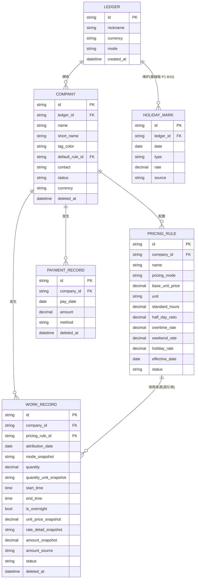

# 03 · 数据模型与信息架构（概念级 · 基础版 v2）

> 本文遵守 PRD 三条设计底线：① 日历/统计**不另存汇总数据**，全部派生；② 金额**快照**；③ 剩余工资**唯一口径**（基础版：`剩余 = 应收 − 已收`，无借支项——借支随二期，见 §5 过渡期风险标注）。
>
> 字段标注约定：
> - `(派生)` = 不落库，由其他数据实时算出；
> - `(快照)` = 落库即固化、此后不改；
> - `PRD 未定义·本次新增` = PRD §2 未列出、本设计为可落地性补齐，逐条给出理由。
>
> **本文件不落技术选型**：全文对存储载体保持中立（§6.6 给手机本地存储的概念级说明）。

---

## 0. 一句话架构（v2 · 基础版）

> **事件（工作记录 / 收款）只增不改其快照；派生量（剩余、日历小计、统计）在读取时实时计算。基础版没有"会随时间漂移的落库骨架"（周期实例整体随二期，见 §9），数据只有两层。**

数据分两层：

| 层 | 内容 | 性质 |
|----|------|------|
| **事务层（只增）** | 账本/公司/计价规则/工作记录/收款记录/节假日标记（基础版 P1·B10） | 用户产生的事实，快照固化 |
| **派生层（不落库）** | 剩余工资、日历小计、月收入、统计 | 读取时计算，可丢弃可重建 |
| ~~骨架层（冻结）~~ | ~~周期实例、账期配置版本~~ | **整体移二期（§9.4–9.7）** |

### 范围裁剪对照表（v1 → v2）

| v1 实体 / 机制 | 基础版处置 |
|---------------|-----------|
| Ledger / Company / PricingRule / WorkRecord / PaymentRecord / HolidayMark | **保留**（Company 删结算三字段、PaymentRecord 删「冲抵周期」、PricingRule 删提成/固定扣款） |
| 借支记录 AdvanceRecord + FIFO 核销全套 | → **§9.1–9.3**（二期） |
| 周期实例 PeriodInstance / 账期配置版本 SettlementConfigVersion | → **§9.4**（二期） |
| 周期闭合口径 / 懒生成 / 配置变更切换点算法 | → **§9.5–9.7**（二期，含 Reviewer 复核后的修复规则） |
| 恒等条件 G1–G4 / assertTelescope 断言 | → **§9.8–9.9**（二期，含 N1/N2 修复） |
| 期级调整项（提成/固定扣款按结算期计提） | → **§9.10**（二期，用户已拍板"按结算期算"） |
| AC-57 运行时防双计口径 | → **§9.11**（二期，随借支后移） |
| 数据导出备份 | **新增**（基础版功能，§6） |

---

## 1. 实体关系图（基础版）



> **读图要点**：`WORK_RECORD -- PRICING_RULE` 是**弱引用（仅溯源/分组）**，非计算依赖（见 §3.3）。基础版**没有** PeriodInstance 及其关联——收款/借支挂周期的全部关系随二期（§9）。

---

## 2. 实体字段清单（基础版）

> 类型命名中立：`标识 / 文本 / 金额 / 数值 / 日期 / 时间 / 时间戳 / 布尔 / 枚举 / 结构(JSON快照)`。金额统一 `decimal`（见 §4.6）。

### 2.1 账本 Ledger `PRD 未定义·本次新增`

> 理由：PRD §2.1 画了「用户(账本)」但未给字段。MVP 单用户单账本，但需一个根实体承载币种（Q7 预留）。

| 字段 | 类型 | 约束 | 必填 | 备注 |
|------|------|------|------|------|
| id | 标识 | 主键 | 是 | 全局唯一（UUID） |
| 昵称 | 文本 | — | 否 | 默认"我的账本" |
| 币种 | 枚举 | 单账本单币种 | 是 | 默认 CNY（Q7 预留，MVP 不透出） |
| 模式 | 枚举 | 本地 / 云端 | 是 | 基础版**恒为"本地"**（用户决策：基础版完全不做云/账号/同步） |
| 创建时间 | 时间戳 | — | 是 | 自动 |

### 2.2 公司 Company（v2：删结算三字段）

> **删除项（→二期）**：结算方式 / 结算日 / 宽限期——账期概念整体随二期（§9.4–9.7），届时以 `SettlementConfigVersion` 版本化落地，**不回填到 Company 主表**（版本表为唯一主源，Company 只冗余显示快照）。

| 字段 | 类型 | 约束 | 必填 | 备注 |
|------|------|------|------|------|
| id | 标识 | 主键 | 是 | — |
| 账本 | 引用 | 外键 → Ledger | 是 | — |
| 名称 | 文本 | 非空 | 是 | — |
| 简称 | 文本 | — | 否 | 默认取名称前 2 字（派生，可覆盖） |
| 标记色 | 颜色 | — | 否 | 系统分配，多公司并行区分 |
| 默认计价规则 | 引用 | 外键 → PricingRule | 否 | 快记默认项 |
| 联系方式 | 文本 | — | 否 | — |
| 状态 | 枚举 | 启用/停用 | 是 | 默认启用；**停用 ≠ 删除**——停用只表示"不再新记"，历史记录与派生**照常计入**；与「归档（`删除时间`）」**并存、互不替代**（**R-G04**） |
| 币种 | 枚举 | 继承账本 | 否 | **PRD 未定义·本次新增**（对齐 Q7，恒等于账本币种） |
| 备注 | 文本 | — | 否 | — |
| 创建/更新时间 | 时间戳 | — | 是 | 审计 |
| 删除时间 | 时间戳 | 可空 | 否 | **PRD 未定义·本次新增**——**删除 = 归档（软删除）唯一语义**；**不物理删除、不级联删除**（**R-G04** / Q13，见 §8 约束 3） |

### 2.3 计价规则 PricingRule（v2：删提成/固定扣款）

> **删除项（→二期 §9.10）**：提成规则 / 固定扣款项——用户已拍板二者**按结算期计提**（期级），基础版无周期，故整体随二期。

| 字段 | 类型 | 约束 | 必填 | 备注 |
|------|------|------|------|------|
| id | 标识 | 主键 | 是 | — |
| 所属公司 | 引用 | 外键 → Company | 是 | — |
| 规则名 | 文本 | 非空 | 是 | =工序/岗位 |
| 计价方式 | 枚举 | 时价/日价/计件 | 是 | — |
| 基础单价 | 金额 | >0 | 是 | — |
| 计价单位 | 文本 | — | 条件必填 | 小时/天/件/㎡/趟（计件必填） |
| 标准工时 | 数值 | >0 | 否 | 判定加班的阈值（如日价按 8 小时） |
| 半天折算比 | 数值 | 0<x<1 | 否 | 默认 0.5。**PRD 未定义·本次新增**：原 PRD 把"标准工时/半天定义"合为一个字段，语义混杂，拆开以免歧义 |
| 加班倍率 | 倍率 | ≥1 | 否 | 默认 1.5 |
| 周末倍率 | 倍率 | ≥1 | 否 | 默认 1.0 |
| 节假日倍率 | 倍率 | ≥1 | 否 | 默认 1.0（基础版 P1·B10 生效，见 §4.1） |
| 生效日期 | 日期 | — | 否 | 仅提示，不改历史 |
| 状态 | 枚举 | 启用/停用 | 是 | — |
| 创建/更新时间 | 时间戳 | — | 是 | 审计 |
| 删除时间 | 时间戳 | 可空 | 否 | 软删除 |

### 2.4 工作记录 WorkRecord（计薪单元）

（与 v1 一致，快照五件套不变）

| 字段 | 类型 | 约束 | 必填 | 备注 |
|------|------|------|------|------|
| id | 标识 | 主键 | 是 | — |
| 归属日 | 日期 | 非空 | 是 | 跨夜默认归开始日（Q6） |
| 公司 | 引用 | 外键 → Company | 是 | — |
| 计价规则 | 引用 | **弱引用** → PricingRule | 是 | 溯源/分组用，**不参与金额重算**（见 §3.3） |
| 计价方式快照 | 枚举 | (快照) | 是 | 落库固化 |
| 数量快照 | 数值 | ≥0 | 是 | 时长/天数/件数 |
| 数量单位快照 | 文本 | (快照) | 是 | **PRD 未定义·本次新增**：计件的"趟/㎡"必须随记录固化，否则规则改动后单位丢失 |
| 起止时间 | 时间 | 可空 | 否 | 支持跨夜 |
| 跨夜标记 | 布尔 | — | 否 | **PRD 未定义·本次新增**：跨夜需显式留痕（AC-08/AC-11 依赖，见 §4.4） |
| 单价快照 | 金额 | (快照) | 是 | 倍率已展开的实际单价 |
| 倍率明细快照 | 结构 | (快照) | 是 | `{命中项:加班\|周末\|节假日, 各倍率, 取用倍率}` |
| 金额快照 | 金额 | (快照) | 是 | 计入应收的最终金额（基础版 = 单价×数量，无提成/扣款） |
| 金额来源 | 枚举 | 自动/手工覆盖 | 是 | 默认自动 |
| 自动计算参考值 | 金额 | (快照) | 否 | **PRD 未定义·本次新增**：Q5 要求"保留自动计算值可对照"。**语义（R-G01 细化）：专属手工覆盖**——仅动作 B 写"覆盖时的自动值"；**动作 A 改单价时置 `null`**（见 §4.5） |
| 币种 | 枚举 | (快照) | 否 | 继承账本（Q7 预留） |
| 备注 | 文本 | — | 否 | **过渡期建议用途**：用户现实中有借款未还时可在此暂记（见 §5 风险标注） |
| 状态 | 枚举 | 草稿/已确认/已结算 | 是 | 默认已确认 |
| 创建/更新时间 | 时间戳 | — | 是 | 审计 |
| 删除时间 | 时间戳 | 可空 | 否 | 软删除 |

### 2.5 收款记录 PaymentRecord（v2：删「冲抵周期」）

> **删除项（→二期）**：「冲抵周期」外键——基础版无周期概念，收款按公司直线累计。二期加回时为**可空新增字段**，对基础版既有数据无破坏（空值 = 按默认策略派生）。

| 字段 | 类型 | 约束 | 必填 | 备注 |
|------|------|------|------|------|
| id | 标识 | 主键 | 是 | — |
| 收款日期 | 日期 | 非空 | 是 | — |
| 公司 | 引用 | 外键 → Company | 是 | — |
| 金额 | 金额 | >0 | 是 | AC-25：≤0 阻止 |
| 收款方式 | 枚举 | 现金/微信/支付宝/银行/其他 | 否 | — |
| 备注 | 文本 | — | 否 | — |
| 创建/更新时间 | 时间戳 | — | 是 | 审计 |
| 删除时间 | 时间戳 | 可空 | 否 | 软删除 |

### 2.6 节假日标记 HolidayMark（基础版 P1·B10）

| 字段 | 类型 | 约束 | 必填 | 备注 |
|------|------|------|------|------|
| id | 标识 | 主键 | 是 | **PRD 未定义·本次新增**（PRD 未给主键，本次补） |
| 账本 | 引用 | 外键 → Ledger | 是 | 节假日是账本级（跨公司共享） |
| 日期 | 日期 | 唯一（账本内） | 是 | 同一天一个标记 |
| 类型 | 枚举 | 法定节假日/调休上班/自定义 | 是 | — |
| 倍率 | 倍率 | ≥1 | 是 | **不参与金额计算**：仅作**预填 / 展示**用（预填自命中规则的 `holidayRate`，`07:621`）；金额计算一律取**规则**的 `holidayRate`（§4.1 第 305 行），本字段**无任何计算消费者**。**★ 阶段⑤ 双回流 R48 回填**（逐字取自 `16-WaveD1-实现设计.md §3.5`）；原字面「默认取命中规则的节假日倍率」**保留可溯** |
| 来源 | 枚举 | 用户手动(MVP)/系统日历(二期) | 是 | — |
| 创建时间 | 时间戳 | — | 是 | 审计 |

> **说明（基础版 P1·B10）**：节假日手动标记**进基础版（P1）**（对齐 PRD §3.1 B10 / §2.6 / AC-51 与 00 台账 Q18）。金额引擎的节假日倍率分支为**正式分支**（§4.1），本实体为正式实体，非可选。

---

## 3. 键与关系

### 3.1 主键 / 外键 / 唯一约束（基础版）

| 实体 | 主键 | 关键外键 | 唯一约束 |
|------|------|---------|---------|
| Ledger | id | — | — |
| Company | id | ledger_id, default_rule_id | —（同名公司允许，仅提示） |
| PricingRule | id | company_id | — |
| WorkRecord | id | company_id, pricing_rule_id(弱) | — |
| PaymentRecord | id | company_id | — |
| HolidayMark | id | ledger_id | (ledger_id, date) 唯一 |

### 3.2 全局唯一 id

所有实体 id 采用**全局唯一标识（UUID）**——导出/导入（§6）与二期同步场景下，不同设备/备份各自生成的 id 不得冲突。

### 3.3 `工作记录 → 计价规则`：**快照引用**（非外键计算引用）

| 维度 | 外键引用（❌ 本设计不采用） | **快照引用（✅ 本设计采用）** |
|------|------------------------|---------------------------|
| 金额计算 | 读取时 join 规则重算 | 读取时**直接读 `金额快照`**，永不 join 规则 |
| 规则改价影响 | 历史金额随之变（违反底线 2） | 历史金额**不变**（快照已固化） |
| 规则被删/停用 | 记录金额无法还原 | 记录**自包含**，仍可完整还原与展示 |
| `pricing_rule_id` 的作用 | 计算依赖 | **溯源 + 分组**（按工序/计价方式统计、详情页展示） |

**如何保证改价不影响历史**：金额所需的一切参数（计价方式、数量、数量单位、实际单价、倍率明细、金额）**在记录落库时全部固化**为 `*_snapshot` 字段；改价只写 `PricingRule` 表，**任何读取路径都不重算历史记录**。`pricing_rule_id` 即使指向一条已停用/已删除的规则，也不影响该记录的金额展示（弱引用允许悬空，但不允许因悬空而算不出金额）。

> **实现红线**：禁止任何"读取时用 pricing_rule 当前值重算 WorkRecord 金额"的代码路径——这是打破设计底线 2 的唯一途径，须作为 Reviewer 专项检查项。

---

## 4. 金额引擎规则（基础版）

### 4.1 计算总流程（伪代码）

```text
function 算金额(规则R, 输入I, 日期上下文D):
    # ── 1. 定数量 ──
    match R.计价方式:
      case 时价:
        qty = I.手填时长 ?? 时长(I.开始, I.结束, I.跨夜)   # 跨夜 +24h
        if qty <= 0: return {状态: 草稿}                    # AC-12
      case 日价:
        qty = I.整天 ? 1 : (R.半天折算比 ?? 0.5)           # AC-04/AC-05
      case 计件:
        qty = I.件数                                        # AC-06

    # ── 2. 定倍率（当日取最高档，不叠乘；Q12）──
    命中 = []
    if I.加班 and R.加班倍率:   命中 += [R.加班倍率]
    if D.是周末  and R.周末倍率: 命中 += [R.周末倍率]
    if D.是节假日 and R.节假日倍率: 命中 += [R.节假日倍率]   # 正式分支（基础版 P1·B10）
    倍率 = 命中为空 ? 1.0 : max(命中)                       # 默认口径

    # ── 3. 实际单价与主金额（基础版：金额 = 单价 × 数量，无提成/扣款）──
    实际单价 = R.基础单价 × 倍率                            # 快照
    主金额   = 实际单价 × qty

    # ── 4. 手工覆盖（外层，Q5）──
    if I.手工金额 != null:
        结果金额 = I.手工金额; 金额来源 = 手工覆盖
        自动参考值 = 主金额                                  # 并存，供"恢复自动"
    else:
        结果金额 = 主金额;    金额来源 = 自动

    return { 计价方式快照: R.计价方式, 数量快照: qty, 数量单位快照: R.单位,
             单价快照: 实际单价, 倍率明细快照: {命中, 取用:倍率},
             金额快照: 结果金额, 金额来源, 自动参考值 }
```

> **v2 删减说明**：v1 引擎第 4 步（提成）、第 5 步（固定扣款）已删除——二者改为**期级调整项**随二期（§9.10，用户已拍板"按结算期算"）。基础版金额快照**只含** `单价 × 数量 × 倍率`。

> **输入 `D` —— 日期上下文（R-G05 终版）**：伪代码第 2 步的 `D.是周末` / `D.是节假日`（第 304-305 行）此前**只被引用、从未定义**，现钉死为：
> - `D` 只含两个布尔量 `D.isWeekend` / `D.isHoliday`（与 `AmountInput` 一致，`amount_engine.dart:42-44`）；引擎**只读**这两个量，**不查日历、不查 `holiday_mark`**（标记由调用方在构造输入时算好）。
> - **`D` 由记录「首次固化」时点的 `workDate` 推出**（`isWeekend` = 该日是否周六/周日；`isHoliday` = 该日是否命中 `holiday_mark`），固化时写入 `rateDetailSnapshot` 并**冻结**（`database_schema.dart:82-88` 的 `rate_weekend_hit` / `rate_holiday_hit` / `rate_applied` 即**冻结的命中结果**）。**⇒ `D` 不是运行期函数，是"首次固化时点"的快照。**
> - **此后任何编辑都不再引用 `D`**：全套重算路径（**AC-68** 改数量·起止时间 / **AC-16 动作 A** 改单价 / **AC-18** 恢复自动计算）都只需 `rateSnapshot × qty`（`rateSnapshot` 已含倍率、**不含日期**）。
> - **改 `workDate` 不是重算事件**（**AC-10 / AC-09**），**不引用 `D`**，**金额快照一律冻结不动**。日期已错填、又想按当日倍率计价的记录，走**显式动作 B（手工覆盖金额）**，不在本轮范围（见 `07 §7` G-15 / G-16）。
> - ⚠️ **存储事实（勿再误设"`D` 取自 `startTime` 日期部分"）**：`start_time` / `end_time` 列**只存 `HH:mm`**（`database_schema.dart:78-79`），读回时**日期部分恒为 `1970-01-01` 占位符**（`database.dart` 的 `_parseHhmm` 把日期部分钉死为 `1970-01-01`）——**它承载不了"班次开始日"**；记录里**唯一的日期字段是 `attribution_date`**（`database_schema.dart:74`）。
> - **调用方指派（★ 阶段⑤ 双回流 R49 回填，逐字取自 `16-WaveD1-实现设计.md §3.5`）**：负责「算好 `D`」的调用方 = **录入 / 重算路径**，具体为：**P02（新建，含 P02b 完整表单与秒级快记弹层）** 在**首次固化时点**按 `workDate` 调 `getHolidayMarkByDate`（存在性）与「周六/周日」判定，构造 `D` 后随 `AmountInput` 传入引擎，引擎将结果写入 `rateDetailSnapshot` 并冻结；**P05（编辑重算）** 一律**读回冻结快照的 `D`**（`isWeekend`/`isHoliday` 取自 `rateDetailSnapshot`），**重算不重新判定**。
> - **`isWeekend` 判定口径**：该 `workDate` 是否**周六或周日**（`03:328` 原文）；**`isHoliday` 判定口径**：该 `workDate` 是否**命中 `holiday_mark`**（同左）。两口径为唯一口径，调用方**不得自创**。

### 4.2 倍率判定表（Q12：取最高档）

| 命中情形 | 命中倍率集合（示例值） | 取用倍率（默认口径） | 备注 |
|---------|--------------------|------------------|------|
| 仅加班 | {加班 1.5} | 1.5 | — |
| 仅周末 | {周末 1.0} | 1.0 | 默认周末倍率 1.0 时无影响 |
| 周末 + 加班 | {1.5, 1.0} | **1.5** | 不叠乘 |
| 仅节假日 | {节假日 3.0} | 3.0 | 基础版 P1·B10 生效 |
| 节假日 + 加班 | {3.0, 1.5} | **3.0** | 法定节假日加班取节假日倍率（B10） |

### 4.3 日价整天 / 半天

| 输入 | 数量 | 金额（日价 300） | 依据 |
|------|------|----------------|------|
| 整天 | 1.0 | 300 | AC-04 |
| 半天 | 0.5（或规则配置的折算比） | 150 | AC-05 |

### 4.4 时价：起止时间 / 手填时长 / 跨夜

| 情形 | 计算 | 依据 |
|------|------|------|
| 填起止时间、未跨夜 | 结束 − 开始 | — |
| 填起止时间、开跨夜开关 | 结束 − 开始 + 24h | AC-08 |
| 结束 < 开始 且未开跨夜 | **不静默算负数**，提示"是否跨夜？"（落草稿或回退） | AC-11 |
| 只填时长 | 直接取值 | — |
| 时长为 0 / 空 | 落**草稿**，不计入应收 | AC-12 |

> **跨夜归属**：默认归**开始日**（AC-08/AC-09），提供"归属日"可改为结束日（AC-10）；`is_overnight` 显式留痕。

### 4.5 手工覆盖与"恢复自动计算"

| 操作 | 结果 | 依据 |
|------|------|------|
| **动作 B · 手工填金额（仅本条）** | `金额快照 = 手工值`，`金额来源 = 手工覆盖`，`自动参考值 = 当时自动值` | Q5 / **AC-16（v3.1）/ R-G01** |
| 手工覆盖后改公司单价 | 手工值**保持**（快照优先），不重算 | AC-17 |
| 点"恢复自动计算" | 按**本条快照单价 × 数量**重算 → `金额来源 = 自动` | AC-18 |
| **动作 A · 改单价（仅本条）** | 二次确认 → 改本条**单价快照** `rateSnapshot` → 按新快照重算 → `金额来源 = 自动`、`自动参考值 = null` | **AC-16（v3.1）/ R-G01** |
| **改归属日（`workDate`，仅本条）** | **纯 Meta**：只改 `attribution_date`；**金额快照一律冻结不动**（不重算、不迁 `startTime`/`endTime`、不需事务双写、不需二次确认） | **R-G05 / AC-10 / AC-09** |

> **已决（R-G01，PRD v3.1 AC-16）**：「**改单价**」与「**手工覆盖金额**」是**两个独立动作**，**都只影响本条、都需二次确认**，二者**正交**：**动作 A 改单价** = 改本条单价快照 `rateSnapshot` → 按新快照重算 → `金额来源 = 自动`、`自动参考值 = null`（auto 态无需参考值）；**动作 B 手工覆盖金额** = `金额来源 = 手工覆盖`、`自动参考值 = 当时自动值`。原「建议 (a)+可切换」的待议措辞作废（§10-4 已闭结）。

> **已决（R-G05 · 终版）· 改「归属日 `workDate`」= 纯 Meta**：`workDate` 是**位置 / 统计归属**字段，**不是金额输入**——`D`（倍率上下文）锚定于**「首次固化」时点**并已冻结入快照（§4.1），**改 `workDate` 不触发任何重算**。故改归属日 = `updateWorkRecordMeta` **一次调用、只写 `attribution_date`**；**金额快照一律冻结不动**、不迁 `startTime`/`endTime`、不需事务双写、不需二次确认（**AC-10**：日历显示在结束日、**金额不变**；**AC-09**：只改统计归属）。日期错填又想按当日倍率计价，走**显式动作 B（手工覆盖）**，不在本轮（`07 §7` G-15/G-16）。

### 4.6 金额精度（`PRD 未定义·本次新增`）

- 存储用**定点小数**（两位小数，货币最小单位"分"），**禁用浮点**（浮点累加产生"1 分钱对不上账"，直接冲击 AC-33 与导出导入断言 §6.5）。
- 倍率可带一位小数（如 1.5）；金额中间计算保留到分，**四舍五入到分**后再累加。
- 全局统一舍入规则（唯一），否则剩余显示与导出合计可能因舍入路径不同而不等。
- **不计入本节的字段（★ 阶段⑤ 双回流 R48 回填，逐字取自 `16-WaveD1-实现设计.md §3.5`）**：`HolidayMark.rate` 虽为整数「×10」倍率，但**不参与金额计算**（§4.1 的倍率命中取 `R.节假日倍率`，非本字段）；本节纪律不适用于它，亦不得据本节推导它对金额的影响。

---

## 5. 剩余工资口径（基础版唯一口径）

### 5.1 算法

```text
剩余(公司c) =
    Σ 工作记录(c, 状态 ∈ {已确认, 已结算}).金额快照
  − Σ 收款(c).金额
```

- **基础版无借支项**（借支随二期）。
- 全局剩余 = Σ 各公司剩余。
- 显示一致性（AC-33 基础版口径）：首页看板 / 公司详情 / 统计 / 日历下钻 / **导出文件** 五处显示**共用同一查询函数**（同过滤器、同金额字段），派生不落库。

### 5.2 ⚠️ 过渡期风险（诚实标注，不沉默执行）

**用户范围裁剪在数据模型上有一个已知隐患**：现实中已有"公司借支未还"的用户，在基础版里 `剩余 = 应收 − 已收` 会**把已借未还的钱当作仍会拿到 → 剩余虚高**（例：应收 5000、已收 0、期间已借支 1000，真实剩余应约 4000，基础版显示 5000）。

| 项 | 说明 |
|----|------|
| 严重度 | 中——**不破数据**（只是显示语义少了借支项），二期迁移即可修正 |
| 对策 1（产品层） | 首启引导/关于页明示「基础版不记借支，剩余 = 应收 − 已收」 |
| 对策 2（暂记层） | **不建正式借支字段**（防与二期 schema 冲突）。若过渡期必须暂记借支，两种方式**后果不同，须区分**：① 记成**收款记录**——会进「已收」、**扣减剩余**（金额口径更贴近真实剩余，但语义上把借来的钱记成了"老板付的工资"，污染收款流水），**须在备注注明"借支"**以便二期识别迁移；② 记成**备注**（工作记录备注字段）——**不扣剩余**（剩余仍虚高，但不污染收款流水）。**推荐**：过渡期暂记用**收款记录**（更贴近真实剩余），备注标注"借支"；对语义洁癖用户可用备注但接受剩余虚高 |
| 对策 3（二期迁移） | 二期 AdvanceRecord 为**新增表**（§9.1），基础版 schema 未占用借支字段，迁移无结构冲突 |
| 状态 | `[待用户确认]`：目标用户过渡期借支普遍度——若普遍，建议产品文案强化甚至二期提前 |

---

## 6. 数据导出与备份（基础版新增功能 · 重点设计）

### 6.1 总原则

1. **导出原始记录（含快照），不导出派生值**——剩余/月收入/小计不进备份文件，导入后由记录重算（遵守底线 1）。
2. **导入恢复后数据无损**——含单价/倍率/金额快照**不被重算**（遵守底线 2）。
3. 备份文件**含软删记录**（`deleted_at` 原样保留）——少一条即不是全量，导入侧据此校验（§6.4）。

### 6.2 JSON 全量备份格式

```json
{
  "format": "worklog-app-backup",
  "schema_version": 1,
  "exported_at": "2026-10-01T20:30:00+08:00",
  "app_version": "1.0.0",
  "ledger":            { "id": "…", "nickname": "我的账本", "currency": "CNY", "mode": "本地", "created_at": "…" },
  "companies":         [ { "id": "…", "ledger_id": "…", "name": "A装修队", "short_name": "A队",
                          "tag_color": "#E53935", "default_rule_id": "…", "contact": "…",
                          "status": "启用", "currency": "CNY", "deleted_at": null,
                          "created_at": "…", "updated_at": "…" } ],
  "pricing_rules":     [ { "id": "…", "company_id": "…", "name": "木工", "pricing_mode": "时价",
                          "base_unit_price": 4000, "unit": "小时", "standard_hours": null,
                          "half_day_ratio": null, "overtime_rate": 15, "weekend_rate": 10,
                          "holiday_rate": 10, "effective_date": null, "status": "启用" } ],
  "work_records":      [ { "id": "…", "company_id": "…", "pricing_rule_id": "…",
                          "attribution_date": "2026-09-30", "mode_snapshot": "时价",
                          "quantity": 4, "quantity_unit_snapshot": "小时",
                          "start_time": "08:00", "end_time": "12:00", "is_overnight": false,
                          "unit_price_snapshot": 6000, "rate_detail_snapshot":
                            { "命中项": ["加班"], "各倍率": { "加班": 15 }, "取用倍率": 15 },
                          "amount_snapshot": 24000, "amount_source": "自动",
                          "auto_reference": null, "status": "已确认", "deleted_at": null } ],
  "payment_records":   [ { "id": "…", "company_id": "…", "pay_date": "2026-09-30",
                          "amount": 50000, "method": "微信", "deleted_at": null } ],
  "holiday_marks":     [ { "id": "…", "ledger_id": "…", "date": "2026-10-01",
                          "type": "法定节假日", "rate": 30, "source": "用户手动" } ]
}
```

**格式规则**：

| # | 规则 | 理由 |
|---|------|------|
| 1 | `schema_version` 必填，未知/更高版本 → 导入拒绝并提示升级 App | 二期迁移钩子（借支/周期表加入时升 version，做转换器） |
| 2 | 金额**以整数"分"序列化**（示例：24000 = 240.00 元） | 彻底规避浮点；倍率同法（15 = 1.5 倍）。`[待验证]`：实现期复核定点存储层 ↔ 整数分换算无精度损失 |
| 3 | id/UUID、快照结构**原样序列化**，不做任何重编码 | 无损恢复的前提 |
| 4 | 六实体**逐表全量**（含软删），缺表视为文件不完整 → 拒绝导入 | §6.4 校验 |
| 5 | CSV 值内逗号/引号按 RFC 4180 转义；JSON 为 UTF-8 无 BOM | 通用性 |

### 6.3 CSV 导出（面向人看的记录视图）

| 文件 | 字段（列） |
|------|-----------|
| `工作记录.csv` | 归属日, 公司, 规则名, 计价方式, 数量, 单位, 实际单价(元), 倍率命中, 取用倍率, 金额(元), 金额来源, 状态, 备注, 创建时间 |
| `收款记录.csv` | 收款日期, 公司, 金额(元), 收款方式, 备注, 创建时间 |

- 编码 **UTF-8 带 BOM**（Excel 直接打开不乱码）。`[待验证]`：主流手机表格 App 对 BOM 的兼容性——实现期实测，若异常则提供"带/不带 BOM"两选项。
- 金额两位小数（人类可读）。
- **CSV 不作为导入格式**：倍率明细等结构化快照在 CSV 扁平化后**不可完整还原**，导入恢复仅接受 JSON 全量备份（§6.2）。

### 6.4 导入恢复流程与校验

```text
function 导入恢复(文件F, 冲突策略P):
    # 1. 格式识别
    if F.format != "worklog-app-backup" 或 F.schema_version 无法识别: 拒绝（提示升级）
    # 2. 结构校验（硬错误 → 整文件拒绝）
    六表齐全；必填字段与类型合法；id 为合法 UUID；金额为整数分格式；
    枚举值合法（状态/计价方式/金额来源/收款方式/节假日类型）
    # 3. 引用与语义校验（软警告 → 列出但允许继续）
    弱引用悬空（pricing_rule_id 指向不存在规则 → 允许，弱引用语义）；
    金额来源=手工覆盖 但缺自动参考值（允许，对照功能降级）；
    日期超界（如未来归属日）、软删记录条数提示
    # 4. 冲突策略执行（见下表）；若 P=覆盖 → 先自动导出当前数据一份带时间戳 JSON
    #    ★ 该自动备份是「覆盖」策略下**唯一 undo 通道**：**备份失败必须在此中止导入**，
    #      不得继续执行破坏性写入（阶段⑤ 双回流 R56，对治 MAJ-2）
    #      —— 旧实现吞掉备份失败仍继续写入、且确认文案谎称"已备份"；两处均已修复：
    #      自动备份返回**是否成功**，调用方据其决定**是否中止**（`import_service.dart` / `export_backup_page.dart`）。
    # 5. 单事务批量写入（全成或全回滚，不留半成品）
    # 6. 导入后断言（§6.5），通过才提示成功；失败给出差异清单
```

**id 冲突策略（三选，给建议）**：

| 策略 | 行为 | 适用场景 | 评价 |
|------|------|---------|------|
| **覆盖（推荐默认）** | 同 id 整条以备份文件版本覆盖本地；执行前**自动**把当前数据导出一份带时间戳的 JSON | 换机/恢复/回滚 | restore 语义最直觉；记录不可变快照下"整条覆盖"无字段级歧义 ✅ |
| 合并 | 已存在 id 跳过，仅导入本地没有的 | 两台设备各记一半、想拼起来 | 记录不可变语义下安全（无字段合并歧义），但可能拼出语义重复账（同一天两台各记）需用户自查 |
| 拒绝 | 发现任一 id 冲突即中止，输出冲突清单 | 审慎用户/防误导入 | 最安全，但换机场景几乎必然中止 |

> **建议**：默认「覆盖 + 导入前自动备份」，UI 提供三选。

### 6.5 导出/导入与口径的关系（可验证断言）

- **断言 1（导出）**：`Σ 导出文件中有效工作记录金额（分） == App 内该集合应收合计（分）`——定点精确相等，非容差。
- **断言 2（导入）**：**对 `incomingIds` 范围内**，`Σ有效工作记录金额` / `Σ收款金额` / 条数 **与被件逐条一致**（**★ 阶段⑤ 双回流 R50 改写**，依据 `15 §11` 缺口 2）：原字面「`Σ App 内有效工作记录金额 == 导出文件同集合合计`；`Σ 收款` 同理；记录条数（含软删）一致」在**「覆盖」策略**下**非恒真**——「覆盖」= **按 id 覆盖**（本机独有记录**保留**）⇒ 本机非空时 `Σ本机 ≠ Σ备份`；本改式在 **AC-62「导出→清空→导入」** 流程下**等价于**字面式，为其**正确泛化**。**原字面保留可溯**。
  > **★ 阶段⑤ 双回流 R57 扩充校验覆盖面**（依据 `15 §15.2`，对治 MIN-2）：本断言的**校验面须覆盖全部五表** —— **公司 / 计价规则 / 工作记录 / 收款 / 节假日**；其中**节假日以 `(ledger_id, date)` 为键**、比对 `type` 与 `rate` **关键值**（**宽容 id 漂移**，G-13）。实现形态 = `ImportVerification`（`import_service.dart`）**恒须项 F3（节假日键集合 + 关键值）/ F4（来件逐条内容相等）**，`app/tool/verify_waveC2.dart` 有对应断言。原文只列工作记录与收款两类，属**覆盖面不足**；本条为其补全口径。
- **断言 3（往返）**：导出 → 清空 → 导入 → 再导出，两份 JSON **逐字节等价**（时间戳类字段除外）。
- **断言 4（导入 · 「合并」策略不变量）**：**仅当冲突策略 = 合并（merge）** 时须满足以下三条，**缺一不可** ——
  **(A) 本机原有 id 逐条不变**（四张 id 主键表）；**(B) 新插入 id 与来件 1:1 相等**；**(C) 四表 id 集合 = 导入前本机集合 ∪ 来件集合**。
  （阶段⑤ 双回流 **R55**，依据 `15 §15.2`；实现形态 = `ImportSnapshot` + `verifyImportInvariants`，`export_backup_page.dart` 在导入前取快照、导入后**按策略分派** —— 「覆盖」走全量比对、「合并」走本条 (A)(B)(C)。）
- 实现形态：提供 `assertExportConsistency()` 校验函数（§5.1 同一查询函数复用），测试期全量跑、导入完成时必跑。**这是把"数据无损"从口头承诺变成可执行断言的手段。**

### 6.6 手机本地存储形态（概念级，不选型）

- **嵌入式单机存储**（关系型表或文档集合，**不定选型**）：六实体各一张表/集合，记录级粒度 CRUD。
- 统一审计列：`id(UUID)` / `created_at` / `updated_at` / `deleted_at`(软删)。
- 金额定点存储（§4.6）。
- **基础版无** `rev / device_id / dirty` 等同步字段（用户决策：完全不做云/账号/同步）——二期若开同步，加列向前兼容（新增列有默认值，不破坏基础版数据）。
- 导出 = 逐表全量读（含软删）→ 序列化；导入 = 单事务批量 upsert（按 §6.4 策略）。
- **依赖边界（实施决策指针）**：数据访问层实现只依赖 `package:sqflite_common`（纯 Dart），
  平台默认 factory 由插件注册注入；依赖决策与理由、各平台注入链、使用约束见
  `06-技术选型对比.md §7.4`（本文档按开头约定不落技术选型，仅留指针）。

---

## 7. 日历派生的查询口径（基础版，无周期）

### 7.1 按日聚合 / 多公司色点 / 当日小计

```text
function 月历(账本L, 年y, 月m):
    记录 = 工作记录 where 公司 ∈ L 的公司
                        and 状态 ∈ {已确认, 已结算}          # 草稿排除（AC-32）
                        and 归属日 ∈ [y-m-01 .. y-m-末]
                        and deleted_at IS NULL
    按 归属日 分组:
        perDay.色点集 = distinct(公司.标记色)                  # 一天多公司 = 多色点（AC-02/35）
        perDay.小计   = Σ 金额快照                              # (派生)
    返回 perDay 映射
```

> v2 删去 v1 的 `确保周期()` 行——基础版无周期，无需懒生成兜底。

### 7.2 为何无需落汇总表

| 理由 | 说明 |
|------|------|
| 设计底线 1 | 日历/统计不另存汇总，杜绝"日历 8 小时、统计 7.5 小时"对不上账 |
| 数据量小 | 个人账本，年记录量级 10³；月历派生查询 O(当月记录数)，可接受 |
| 一致性 > 性能 | 派生天然与看板/统计**同源**，AC-33 相等性无需额外对账 |
| 可缓存但不落主源 | 若性能瓶颈，可加**可丢弃、可重建**的派生缓存；缓存不得作为口径来源 |

> **红线**：任何人不得为了性能把"工时/金额汇总"持久化为**唯一真相**——缓存必须可重建。

---

## 8. 数据完整性约束清单（基础版）

| # | 约束 | 落地 | 依据 |
|---|------|------|------|
| 1 | **草稿不计入应收** | 所有派生口径共用过滤器 `状态 ∈ {已确认, 已结算}`；日历不显示草稿金额 | AC-32 |
| 2 | **停用公司历史保留** | 停用 = `status=停用`，仅从"快记下拉"移除，历史记录/派生不受影响 | AC-19 / M1 |
| 3 | **删除 = 归档（软删除）唯一语义** | 删除写 `deleted_at`（归档）；派生查询默认过滤 `deleted_at IS NULL`；**不物理删除、不级联删除**（**R-G04**）；「停用 `status=停用`」与「归档 `deleted_at`」**并存、互不替代**；已归档公司的历史记录与派生**照常计入** | Q13 / **AC-20（v3.1）** / R-G04 |
| 4 | **金额快照不可变** | 记录一经落库，`*_snapshot` 字段仅在编辑本条时按其规则更新；改价/改规则永不回改 | 底线 2 / AC-13~17 |
| 5 | **收款金额 > 0** | 校验；≤0 阻止保存 | AC-25 |
| 6 | **归属日必填** | 工作记录非空 | AC-09 |
| 7 | **币种一致** | 单账本单币种；记录币种 = 账本币种 | Q7 |
| 8 | **金额定点、统一舍入** | 定点两位小数，全局唯一舍入规则；备份文件整数分 | §4.6 / §6.2 / AC-33 |
| 9 | **唯一约束** | 见 §3.1 | 本设计 |
| 10 | **状态机约束** | 工作记录：草稿/已确认/已结算；基础版"已结算"仅手动打标（Q14），不改变剩余算法 | PRD §5.1 |
| 11 | **引用完整性（软）** | 软删除的父实体不出现在新建选择器，但历史引用仍可解析（弱引用允许悬空不崩） | 底线 2 |
| 12 | **备份完整性** | 备份必须含六表全部记录（含软删），缺表即文件不完整 → 拒绝导入 | §6.4 |
| 13 | **导入事务性** | 全成或全回滚（含 id 覆盖），不留半成品 | §6.4 |
| 14 | **导入后断言** | 口径一致才提示成功；不一致给出差异清单 | §6.5 |
| 15 | **金额宁可硬失败，不可静默算错** | 「**少算已收 → 剩余虚增**」是**本项目唯一不可容忍的方向**：一切读取路径（**行映射 `_workRecordFromRow` / `_paymentFromRow`** 与**聚合 `_sumInt` / `aggregateByCompanyOn` → `_asAggregateInt`**）遇脏金额一律**抛 `FormatException`**，**禁止**静默按 0 计或截断；UI 层负责 **`catch` + 降级呈现（不白屏）**。**本约束 = 该口径的正式出处**（此后引「少算已收 → 剩余虚增」以此条为准） | 底线 1 / **AC-33**；**M-01 / G-03 / I-9** |

---

## 9. 二期预留设计（完整保留 · 设计资产，二期直接用）

> 本章 = v1 数据模型中被基础版裁剪的全部机制 + **Reviewer 独立审查（05-审查报告）复核确认后的修复规则**（主理人裁定 R-A~R-H）。基础版不实现；二期启动时本章为设计起点，**不推翻、按此落地**。
>
> **修复规则总览（依据 05 §5 C-1/C-2 + 主理人裁定）**：
> - 周期闭合口径 = `[结算日D, 次月(D−1)]`（R-A）
> - 配置变更切换点**强制** = 最后旧周期结束日 + 1，新配置从该日作**非自然起点**滚动；**禁用**"用旧配置跨切换点补齐"（R-B；v1 的 `max` 钳制方案被 Reviewer 独立复现出"晚段留空洞/补齐造重叠"，已废弃）
> - 不设生成下界——任意日期可回溯生成周期（R-C / N3 修复）
> - 「最早未结清周期」良定义（R-D / N1 修复）：求值时点排除本笔归还、仅取期结余>0、兜底归发生日周期
> - 冲抵周期必须同公司（R-E / N2 修复）
> - 提成/固定扣款按**结算期**计提（用户拍板，期级调整项）
> - Q16 **随二期再议**：PM 建议「不定账期」公司按自然月切周期，仅供归集挂靠、不做逾期判定——**待二期时由用户确认，非已决**（用户只拍板"账期随二期"，未拍板自然月方案）
> - AC-57 口径：不承诺运行时自动判错；仅测试可对照；运行时仅带条件的启发式提示（R-H）

### 9.1 借支记录 AdvanceRecord（二期）

| 字段 | 类型 | 约束 | 必填 | 备注 |
|------|------|------|------|------|
| id | 标识 | 主键 | 是 | — |
| 发生日期 | 日期 | 非空 | 是 | — |
| 公司 | 引用 | 外键 → Company | 是 | 借支必绑公司（Q3） |
| 方向 | 枚举 | 借出/归还 | 是 | — |
| 金额 | 金额 | >0 | 是 | 用方向表示正负，金额恒正 |
| 冲抵周期 | 引用 | 外键 → PeriodInstance，**可空** | 归还时条件落库 | 借出侧不落库（派生）；归还侧：用户填则落库，不填走默认策略（§9.2） |
| 备注 | 文本 | — | 否 | — |
| 创建/更新时间 | 时间戳 | — | 是 | 审计 |
| 删除时间 | 时间戳 | 可空 | 否 | 软删除 |

> **设计取舍**：借出的"归期"**派生**（= 发生日所在周期），不落库冗余字段——周期实例一经生成即冻结，派生结果稳定；落库会产生双主源风险。归还的"冲抵周期"是**用户意图**，落库（可空）。核销状态（未核销/部分核销/已核销）**纯派生**（§9.3 FIFO 重算），不落库。

### 9.2 归还默认归期函数（N1 修复版 · 良定义）

```text
function 归期(归还r):
    # ── 良定义三保证（修复 N1 循环依赖）──
    #   ① 求值时点显式：计算本函数时，期结余的记录集**排除 r 自身**
    #   ② 候选域良定义：仅取 期结余 > 0 的期（净预支期不作为归还目标），按周期起始日升序
    #   ③ 兜底确定：无候选 → 发生日所在周期
    if r.冲抵周期 != null:
        断言 周期表[r.冲抵周期].company_id == r.company_id     # 修复 N2：跨公司引用
        return r.冲抵周期
    p = 最早的 { p ∈ 周期(公司(r)) : 期结余(p, 排除归还r) > 0 }
    return p ?? 发生日所在周期(r)
```

**良定义性说明**：无自引用（排除本笔）、求值时点显式（任意时点对同一数据集返回唯一结果）、返回恰一期且属本公司域。G1 已把"函数良定义"补为条件（§9.8）。

### 9.3 FIFO 分配（纯函数，跨周期按时间先后）

两个正交轴：**归期轴**（该笔归还金额算到哪一期，决定期结余与恒等）与**核销轴**（标记哪几笔借出已还，仅决定展示）——两轴解耦，互不干扰；`Σ借出 − Σ归还` 与核销状态无关。

```text
function FIFO分配(公司c):
    借出s = 借支(c, 借出) 按 (发生日, 创建时间) 升序       # 先借先还
    归还s = 借支(c, 归还)  按 (发生日, 创建时间) 升序
    各借出.已核销 = 0
    for r in 归还s:
        余 = r.金额
        for b in 借出s (升序遍历):
            if b.余额(依据已核销) <= 0: continue
            分配 = min(余, b.余额)
            b.已核销 += 分配; 余 -= 分配
            if 余 == 0: break
        if 余 > 0: r.未分配余量 = 余                        # → 公司级"多还/待核对"（AC-59）
    # 借出.核销状态: 已核销额==0→未核销; <金额→部分核销; ==金额→已核销
```

边界：FIFO **跨周期**（公司全域先借先还）；超还提示确认、余量挂"多还/待核对"；撤销/修改归还 → 重跑纯函数自动回滚，无持久化分配残渣。

### 9.4 周期实例 PeriodInstance + 账期配置版本 SettlementConfigVersion（二期）

**PeriodInstance**：周期id（主键，生成后永不改变）/ 公司 / 配置版本(FK) / 周期起止(生成时算出，此后冻结) / 到期日 / 是否冻结(恒 true，结构冻结语义：起止与到期日不可变；"封账"如需另设字段，不混用) / **仅用于归集**（Q16 **随二期再议**：PM 建议「不定账期」公司按自然月生成周期，置 true → 不做逾期判定、仅供借支/收款归集挂靠；到期日取月末占位；**待二期时由用户确认，非已决**）/ 已归档（仅 UI 折叠，**不得**从派生遍历排除）。

**SettlementConfigVersion**：id / 公司 / 生效起点 / 结算方式 / 结算日 / 宽限期（版本快照）。不变式：某公司版本按"生效起点"严格递增、区间不重叠；Company 上的结算字段 = 最新版本的冗余显示快照。
> **理由**：历史补记需为"过去日期"生成周期，必须知道**当时生效的是哪版配置**；无版本留痕则"新配置从下一个未开始周期起生效"在时间线上不可判定。

### 9.5 周期闭合边界口径（R-A · 全局唯一定义）

> **周期 = `[结算日D, 次月(D−1)]`，结算日当天算本期起点。**

- 例：月结 15 日 → 周期 `[15日, 次月14日]`；月结 20 日 → `[20日, 次月19日]`（与 PRD v2 自述一致）。
- 结算日 = 31 且当月无 31 → 取该月最后一天（AC-50），次月周期起点正常从次月结算日算起。
- **全文（含 PRD、AC、UI 文案）统一按此口径表述**，禁止 `[16→15]` 之类的漂移写法（v1 曾出现，已废弃）。

### 9.6 周期生成：懒生成 + 不设下界（N3 修复）

- **懒生成**：任何 write 引用某周期时（记工作记录/收款/借支/查看对账）确保该周期已生成，不存在则按"日期当时所属的配置版本"切分生成。归期函数**遇空即生成，禁止返回空**。
- **不设生成下界（R-C 裁定）**：任意日期可回溯生成周期，包括早于"账本建立日"的补记。v1 曾建议"设账本建立日为生成下界"——**该建议撤回**（04 v2 §3-6 同步标注）：设下界会使"早于建账日的补记"必然产生空洞，C1 对策（强制懒生成）失效，直接破恒等；不设下界的代价仅是可能多生成少量周期实例（个人级数据量，可忽略）。

```text
function 确保周期(公司c, 日期d) -> 周期id:
    v = 配置版本(c, d)                      # 按 d 落在哪个版本的生效区间（含锚定起点规则，§9.7）
    (start, end, due) = 切分周期(v, d)
    p = 查周期实例(c, start, end)            # 唯一约束 (company, start, end)
    if p == null:
        p = 新建周期实例(c, v, start, end, due, 冻结=true,
                        仅用于归集 = (v.结算方式 == 不定))   # Q16 随二期再议：PM 建议自然月
    return p.id
```

### 9.7 配置变更切换点算法（R-B 修复版 · 替换 v1 §6.2）

```text
function 变更账期配置(公司c, 新配置N, 变更时刻t):
    # 1. 定切换点 —— 无条件取"最后旧周期结束日 + 1"，不做 max（修复 v1 缺口）
    最后旧周期 = 该公司已生成周期中 结束日最晚者
    切换点 = (最后旧周期 == null) ? t : 最后旧周期.结束日 + 1天

    # 2. 落新配置版本（生效起点 = 切换点）
    新版本 = SettlementConfigVersion(c, N, effective_from = 切换点)

    # 3. 新配置周期序列 = 从切换点起"非自然起点"滚动
    #    首个新周期 = [切换点, 新规律下 ≥ 切换点的首个自然周期终点]（可短于常规长度，允许）
    #    后续周期按新配置规律自然推进（月结D：[每月D, 次月(D−1)]）
    #    禁止：用旧配置在切换点之后补齐任何周期（v1 方案"二次重叠"的根因，已删）

    # 4. 旧周期实例全部保留（结构冻结、只增不删）；UI 提示"已保留 N 个旧周期"

    # 5. 写入前一致性断言（失败即中止变更）
    断言: 所有新周期.start ≥ 切换点
    断言: 新周期区间 ∩ 已有旧周期区间 = ∅
    # 6. 数据库兜底: 唯一约束 (company, period_start, period_end)

function 切分周期(版本v, 日期d):
    if d < v.effective_from: 用更早版本切分      # 版本时间线回溯
    # 在 v 的周期序列中找包含 d 的周期：
    #   序列首期 = [v.effective_from, 新规律首个自然终点]（非自然起点）
    #   其后每期按新规律自然推进
```

**自证 · 两分支日期演算**（旧配置月结 D=15，按 §9.5 口径旧周期 `[8/15, 9/14]` 已生成；改为月结 D=5）：

**分支一 · t 落旧周期早段（t = 9/1）**：
- 切换点 = 9/14 + 1 = **9/15**（强制，不看 t）
- 新周期序列：`[9/15, 10/4]`（首期非自然起点）→ `[10/5, 11/4]` → …
- 核对：旧 `[8/15, 9/14]` 与新 `[9/15, 10/4]` 相邻**不相交、无空洞** → MECE ✔
- （对照：v1 max 方案 `max(9/5, 9/15) = 9/15`，本分支两方案同果——这正是 v1 缺陷未在此分支暴露的原因）

**分支二 · t 落旧周期晚段（t = 9/14）**：
- 新配置自然起点 ≥ t 的首个 = 10/5。v1 max(10/5, 9/15) = 10/5 → **空洞 [9/15, 10/4]**；其"旧配置补齐"步生成 `[9/15, 10/14]` 又与 `[10/5, 11/4]` **重叠**（Reviewer 独立复现，05 §5 C-1）
- 修复后：切换点 = **9/15**（强制，不取 max）；首期 = `[9/15, 10/4]`，后续 `[10/5, 11/4]` → **无重叠、无空洞** → MECE ✔

**结论**：t 落旧周期任意段，切换点恒 = 最后旧周期结束日 + 1，新旧序列首尾相接，MECE 成立；"用旧配置补齐跨切换点"一步彻底删除。

### 9.8 恒等条件 G1–G4（二期 · N1/N2 修复后完备表述）

`Σ_p 期结余(p) = 剩余(c)`（口径B 分解 = 口径A 总额）。本质是"先分区再求和 = 直接求和"：

| # | 条件 | 内容（v2 修复后） |
|---|------|-----------------|
| **G1** | 归期函数**良定义且本公司域** | 4 个唯一归期函数（工作记录=归属日所在周期 / 收款=冲抵周期??默认规则 / 借出=发生日所在周期 / 归还=§9.2 良定义版），满足：**无自引用、求值时点显式、返回恰一期、且返回周期属本公司域**（N1/N2 修复） |
| **G2** | 周期实例区间 MECE | 两两不相交且无缝覆盖公司全时间轴；**含配置变更边界**（切换点强制，§9.7） |
| **G3** | 两口径同源 | 同一"有效记录过滤器"（`{已确认,已结算}`）、同一"金额字段"（`金额快照`）、**同源纳入期级调整项**（§9.10 扩展） |
| **G4** | 周期实例只增不删 | 软归档仅影响 UI，不影响派生遍历；引用的周期 id 永不失效 |

**表述纪律（修复 v1 过强表述）**：当 G1–G4 成立时，恒等**必然成立**——这是**充分条件，非必要**（不排除其他实现路径也能保证恒等；不声称"当且仅当"）。

**未覆盖情形说明（诚实）**：G1–G4 吸收 N1/N2/N3 修复后，已知失败面（C1 空洞 / C2 重叠 / C3 引用失效 / C4 口径分叉 / C5 跨公司串味 / C6 核销当金额 + N1–N3）均有对应条件覆盖；**不声称穷尽一切未发现情形**——靠 §9.9 断言做运行期兜底。

### 9.9 assertTelescope 断言（二期）

```text
function assertTelescope(公司c):
    断言 Σ_p 期结余(p) == 口径A(c)      # 定点精确相等，非浮点容差
```
测试期对跨期借支、FIFO 默认归期、期级调整项、配置变更边界（§9.7 两分支）等组合全量跑；运行期低频抽样自检，不等即告警。

### 9.10 期级调整项（提成 / 固定扣款按结算期计提 · 用户拍板）

> **决策依据**：用户明确选择提成与固定扣款**按结算期算**（否决 Dev 原"按单条记录计提"建议）。期不存在时依赖懒生成先行（§9.6）。

**实体 PeriodAdjustment（挂周期实例）**：

| 字段 | 类型 | 约束 | 必填 | 备注 |
|------|------|------|------|------|
| id | 标识 | 主键 | 是 | — |
| 公司 | 引用 | 外键 → Company | 是 | — |
| 周期 | 引用 | 外键 → PeriodInstance | 是 | **同公司断言**（同 N2 约束） |
| 类型 | 枚举 | 期级提成 / 期级扣款 | 是 | — |
| 计算方式 | 枚举 | 比例（%该期应收）/ 固定额 | 是 | — |
| 值 | 数值 | >0 | 是 | **登记时固化**（快照语义）：比例或金额 |
| 说明 | 文本 | — | 否 | 如"三季度奖金" |
| 创建时间 | 时间戳 | — | 是 | 审计 |

**金额引擎口径（二期）**：工作记录金额快照**只含** `单价 × 数量 × 倍率`；期级提成/扣款作为**期级项**进期结余：

```text
应收总额(公司c)   = Σ记录金额 + Σ期级提成(c) − Σ期级扣款(c)          # 口径A 扩展
期结余(周期p)     = 该期应收 + 该期期级提成 − 该期期级扣款
                  − 该期已收 − 该期借支净额                        # 口径B 扩展
```

**G3 扩展**：口径A 的"应收总额"与口径B 的"该期应收"必须**同源纳入期级调整项**（同一查询函数）——否则恒等必破。

**恒等演算（含"扣款超过该期应收"边界，1 例 + 正常例）**：

- 例 1（边界）：某期记录应收 3000；期级提成 5%（=150）；期级扣款 3500（> 3000+150）；已收 0；借支净额 0。
  - 口径A：应收总额 = 3000+150−3500 = **−350**；剩余 = −350 − 0 = **−350**
  - 口径B：期结余 = 3000+150−3500−0−0 = **−350** → **Σ = −350 = 口径A ✔**（负值 UI 提示"扣超/待核对"，不隐藏）
- 例 2（正常）：应收 5000；提成 5%（=250）；扣款 100；已收 5000。
  - A：(5000+250−100) − 5000 = **150**；B：5000+250−100−5000 = **150** ✔

**与懒生成的关系**：登记期级调整项必先 `确保周期(公司, 目标日期)`——周期不存在则先生成，**同事务**落调整项；周期骨架只增不删，外键引用稳定。

**语义注记**：比例型提成的金额 = 值 × 该期应收，**读取时实时算**（派生）——该期应收因补记变化时提成随之变化，属"按期计提"的预期行为，非缺陷。

**对 PRD 的修改建议（二期）**：§2.3「提成规则 / 固定扣款项」字段语义从"规则级（随单条记录）"改为"**期级生效**（登记在周期上）"（见 §10-5）。

### 9.11 AC-57 运行时口径（R-H · 第三方案，随二期）

- **不承诺运行时自动判错**（错误记法③ 在"自掏腰包归还 + 部分收款"场景下合法，系统无法区分真实意图——Reviewer 已独立复现并确认，05 §5 C-4）。
- 仅**测试（ground truth）**可对照验证 ①②③ 的数值关系。
- 运行时仅提供**带条件的启发式提示**：`收款额 + 归还额 ≈ 该期应收` → 提示"疑似从工资扣款，请核对收款是否为应发全额"；提示**不阻断保存、明示不确定性**。该口径需同步进 PRD AC-57 与 §4.4（§10-7）。

### 9.12 Reviewer 确认的缺口记录（历史留痕，不删）

| # | 缺口 | Reviewer 结论（05 审查报告） | 修复落点 |
|---|------|------------------------------|---------|
| N1 | "最早未结清周期"循环依赖/不良定义 | 独立构造并确认（C-2） | §9.2 良定义版 |
| N2 | `offset_period_id` 未约束跨公司引用 | 独立构造并确认（C-2） | §9.2 断言 + §9.10 同公司约束 |
| N3 | 强制懒生成 vs 建账日下界互相矛盾 | 独立构造并确认（C-2） | §9.6 不设下界（撤回下界建议） |
| C-1 | v1 §6.2 max 钳制算法不完备（晚段留空洞/补齐造重叠） | 独立复现确认（t=9/10、9/14 两例失败） | §9.7 切换点强制版 |

---

## 10. 对 PRD 的修改建议（**不改 PRD 文件本身，仅登记，由主理人中转给 PM**）

> 格式：**位置 + 问题 + 建议**。基础版口径（10-1~10-3）+ 二期口径（10-5~10-7）。

| # | 位置 | 问题 | 建议 |
|---|------|------|------|
| **10-1** | §3.1 功能清单 / §2 概念模型（**基础版落地**） | 范围裁剪需在 PRD 显性化 | 基础版：M5（借支）/M10（账期）/M12（欠薪感知）/M13（逐期核销）→ 二期；M2 删"提成/固定扣款"配置项；§2.5 收款删「冲抵周期」；§2.2 公司删结算方式/结算日/宽限期；§2.9 口径A 基础版 = `应收 − 已收`；§5.2/5.3/5.4 状态机随二期（基础版仅 §5.1 工作记录状态机） |
| **10-2** | §4.4 / 首启引导（**基础版**） | 借支后移的**过渡期口径失真**（§5.2）：有借款的用户剩余虚高 | 产品明示「基础版不记借支，剩余 = 应收 − 已收」；不建正式借支字段（防与二期 schema 冲突）；`[待用户确认]` 目标用户过渡期借支普遍度 |
| **10-3** | §7 验收标准（**基础版新增**） | 导出备份无 AC | 补 AC（建议）：AC-60 导出 JSON → 清空 → 导入 → 数据无损（快照不被重算、软删保留、条数一致）；AC-61 CSV 金额合计 = App 内合计；AC-62 id 冲突"覆盖"执行前自动备份当前数据；AC-63 导入后剩余与导出前完全一致（定点相等）；AC-64 缺表/坏格式文件被拒绝且不写入半成品 |
| **10-4** | §7 AC-16 | 改价落地方式含混 | **已决（R-G01，见 PRD §12 v3.1）**：拆「**动作 A 改单价**」（改本条快照 → 按新快照重算 → 金额来源 = 自动、自动参考值 = `null`）与「**动作 B 手工覆盖金额**」（金额来源 = 手工覆盖、自动参考值 = 当时自动值）两个独立动作；均仅影响本条、均需二次确认。原「建议 (a)+可切换」已被裁定吸收，**本条闭结** |
| **10-5** | §2.3（**二期**） | 提成/固定扣款计提口径 | 语义改为**期级生效**（登记在周期上，§9.10）；用户已拍板按结算期算 |
| **10-6** | §2.7 冻结规则（**二期**） | 周期闭合口径 + 变更切换未定义 | 写入：周期 = `[结算日D, 次月(D−1)]`；切换点**强制** = 最后旧周期结束日+1，新配置从该日非自然起点滚动，禁用旧配置跨切换点补齐；补 AC"改账期后跑 assertTelescope 断言相等"（§9.5/§9.7） |
| **10-7** | §7 AC-57 + §8 Q16（**二期**） | AC-57 判定口径 / Q16 状态 | AC-57 采纳第三方案（§9.11：启发式提示不阻断、明示不确定性）；Q16 标**随二期再议**（PM 建议自然月、仅用于归集、不做逾期判定，待二期时由用户确认，非已决） |

---

## 11. 本设计的隐含前提（基础版 · 逐条标风险 + 不成立后果）

| # | 隐含前提 | 风险 | 不成立的后果 | 对策 / 状态 |
|---|---------|------|------------|-----------|
| **B1** | 基础版「剩余 = 应收 − 已收」在用户**现实中无未还借支**时语义正确 | **中**（裁剪引入，见 §5.2） | 有借款用户剩余虚高（过渡期失真） | 已诚实标注 §5.2；产品明示 + 二期迁移无结构冲突 |
| **B2** | 单账本记录量级个人级（≤10³~10⁴），派生查询性能可接受 | 中 | 日历/统计卡顿 | 可重建缓存（§7.2）；量级远超预期再议 |
| **B3** | 归属日以**设备本地日期**为唯一口径 | 中 | 记录归错日 | 统一"归属日 = 用户可见本地日"；不做 UTC 换算 |
| **B4** | 导出/导入在本机单用户完成、无并发写 | 低 | 并发导入脏写 | 单用户本地操作；导入加全局写锁 |
| **B5** | 基础版 schema 与二期**前向兼容**（借支/周期/期级调整项均为新增表） | 中 | 二期需数据迁移转换 | 导出 JSON `schema_version` 为迁移留钩子（§6.2）`[待验证]`：二期定稿时复核 |

> **处置**：B1 为本次范围裁剪引入的新风险，已标注且不破数据；B5 需二期定稿时复核；其余中低风险已有对策。

---

## 12. 认知小结（阶段② 交接用，≤10 行）

- **关键发现**：基础版（场景 A+C）数据模型可完全由"事务层 + 派生层"两层承载，**无周期骨架**即无 MECE/切换点/恒等问题域——v1 的致命缺陷 F-01 的**问题面与修复规则已一并封存至 §9**（二期资产，含切换点两分支演算自证）。
- **已建立的联系**：导出备份（§6）与快照纪律（§3.3）、定点金额（§4.6）、唯一口径（§5.1）同源——"数据无损"由 `assertExportConsistency` 断言背书，与 v1 的 `assertTelescope` 同一手法。
- **开放问题**：过渡期借支失真的普遍度（B1/§5.2）；CSV BOM 兼容性；二期 schema 兼容复核（B5）→ 见 §10 与 `00-开放问题.md`。
- **候选方向**：① 导入 id 冲突默认"覆盖+自动备份"；② 二期迁移用 schema_version 转换器；③ 期级调整项比例型实时算（预期行为，非缺陷）。
- **异议/风险（如实）**：范围裁剪本身无数据模型硬伤，**唯一隐患 = 借支后移的过渡期口径失真**（§5.2，已按纪律写出，不沉默执行）。

---

## 变更注记

| 日期 | 变更 | 依据 / 来源 |
|------|------|------------|
| 2026-10-01 | **口径收口（R-G01 / R-G04）**：① §4.5「改单价」按 **R-G01** 拆「动作 A / 动作 B」并转**已决**（动作 A → `金额来源 = 自动` + `自动参考值 = null`；动作 B → `手工覆盖` + 保留当时自动值）；② §2.4「自动计算参考值」补 R-G01 语义（专属手工覆盖）；③ §8 约束 3 删除语义按 **R-G04** 收敛为「删除 = 归档（软删除）唯一语义，**不物理、不级联**」；④ §2.2 明确「停用 ≠ 删除」二者并存；⑤ §10-4 闭结 | PRD v3.1（§12）；`07-UI实现规格.md` 审查 G-01 / G-04；主理人裁定 R-G01 / R-G04 |
| 2026-10-01 | **口径收口（R-G05 · 终版）**：① **新增 §4.1「输入 `D` —— 日期上下文」定义**——`D` 由记录**「首次固化」时点的 `workDate`** 推出并**冻结入快照**（`rate_weekend_hit` / `rate_holiday_hit` / `rate_applied`，`database_schema.dart:82-88`），**非运行期函数**；② §4.5「改归属日 `workDate`」= **纯 Meta**（只改 `attribution_date`，**金额快照一律冻结不动**，`updateWorkRecordMeta` 一次调用）；③ **更正链（如实保留）**：v1「auto 一律重算」与 **AC-10** 冲突；v2「按 `D` 分四情形 + `D` 取自 `startTime` 日期部分」**存储层不可实现**（`start_time` 落库仅 `HH:mm`、日期部分恒为 `1970-01-01` 占位符，`database_schema.dart:78-79` + `database.dart:1342-1348`）；**v3（终版）= 纯 Meta** | `07-UI实现规格.md` 审查 R-G05；主理人终裁；依据 **AC-10 / AC-09 / AC-68（未列举"改归属日"）+ `work_record.dart:3`（固化纪律）+ `database_schema.dart:74,78-79`（唯一日期字段）** |
| 2026-10-13 | **阶段⑤ 双回流 · `R55` / `R56` / `R57` 落点回填**（原本三条**无上游落点**，由主理人本轮裁定落于本节）：① **§6.4 流程第 4 步**补「「覆盖」策略下自动备份 = **唯一 undo 通道**，**备份失败必须在破坏性写入前中止导入**」（**R56**，对治 MAJ-2）；② **§6.5 断言 2** 下补「**校验面须覆盖五表**（公司/计价规则/工作记录/收款/节假日），节假日以 `(ledger_id, date)` 为键 + `type`/`rate` 关键值，**宽容 id 漂移**」（**R57**，对治 MIN-2）；③ **§6.5 新增「断言 4」**：**「合并」策略不变量 (A)(B)(C) 缺一不可**（**R55**）。**依据 = `15-WaveC2-实现设计.md §15.2`（据现盘代码定义）**；同行 `R48`/`R49`/`R50` 已于同日就地回填（见 §2.2 / §4.1 / §4.6 / §6.5 内「★ 阶段⑤ 双回流 R4x」标记）。**未改 `app/**`** | 阶段⑤ 双回流 × `19-回流总台账.md`；主理人裁定（**不选 `02 AC` 侧为载体**，理由：不变量/流程细则属本节「可验证断言」载体，与 `R50` 同例；`AC-P13-07/08/09` 描述的用户可观察行为已足够） |
