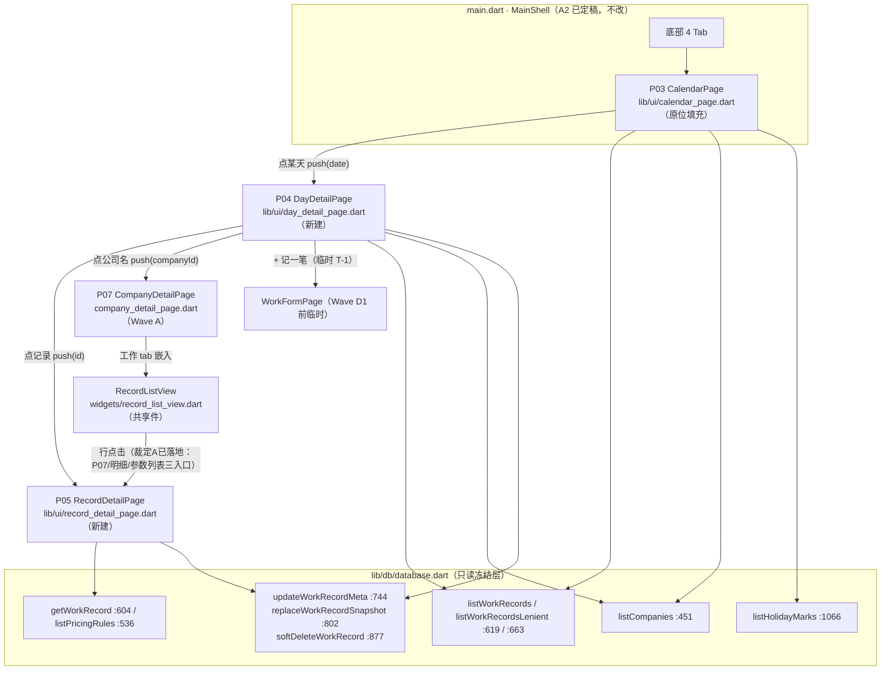
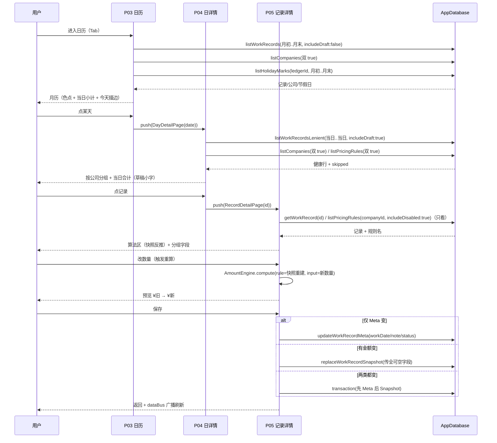

# 13 · Wave B 实现设计（P03 / P04 / P05）

> **性质**：Wave B 施工设计（阶段② 产物）。**只设计，不冻结**（冻结需 PM + Reviewer 三方签字）。
> **证据纪律（D-8）**：本文每处对代码的断言均带 `文件:行号`；引用上游**逐字复制**，禁止转述；所有私有成员结论标注证据层级。
> **口径纪律（D-1/D-2/D-3/D-4，全文不得松动）**：金额**整数「分」**、倍率**整数「×10」**、**禁浮点**；日历/统计/下钻**全派生不落库**；金额**快照**改价不回改历史；剩余工资**唯一口径**取 `aggregate()` / `aggregateByCompany().remaining`，UI **不得**手写 `应收 − 已收`。

---

## §0 施工边界与依据

### 0.1 文件白名单（**越界即打回**）

| 动作 | 文件 | 说明 |
|------|------|------|
| 改（原位填充） | `app/lib/ui/calendar_page.dart` | P03；保留 `Scaffold`/`AppBar` 外壳与 `const CalendarPage({super.key})` 构造签名（`calendar_page.dart:34-35`；`class` `:34` / `const` `:35`） |
| 新建 | `app/lib/ui/day_detail_page.dart` | P04 |
| 新建 | `app/lib/ui/record_detail_page.dart` | P05 |
| 改（裁定 (A) **+ 复审修复轮 M-03**） | `app/lib/ui/widgets/record_list_view.dart` | ① 裁定 (A) 授权改 `_openWork`（`record_list_view.dart:203`）——行点击由**共享件**实现（P07 自身无行点击代码）；详见 §2.4 / §3 缺口 1。**替代**原设计误列的 `company_detail_page.dart`（实为只嵌入 `RecordListView`，`company_detail_page.dart:582-597`，**本波未改**）。② **【复审修复轮补记（见 §10 / §10.4）】** 该文件实际**还有一处改动**：**M-03** 可选槽位 `qtySnapshot`（`:321`/`:334`）/`qtyUnitSnapshot`（`:322`/`:337`）+ `_qtyLabel`（`:381`）——默认 `null` ⇒ 不渲染（P07/明细页行为零变化）。 |
| 改（MIN-02 最小面） | `app/lib/services/enum_codec.dart` | **【复审修复轮补记（见 §10.1 MIN-02 / §10.4）】** 新增**展示专用** `recordStatusDisplay`（`:46`，草稿→「草稿·未完成」；其余委托 `recordStatus`）；序列化 token `recordStatus`（`:28`）**不动**。原 §0.1 白名单曾漏记本文件。 |
| 新建 | `app/tool/verify_waveB.dart` | 自建可执行断言脚本 |
| 新建 | 本文件 `13-WaveB-实现设计.md` | 设计文档 |

**禁止触碰**：`stats_page.dart` / `settings_page.dart` / `export_backup_page.dart`、`main.dart` 的 `MainShell`、`company_page.dart` 的 P08 对话框、`lib/db/database.dart`、`pubspec.yaml`。

### 0.2 Wave A 已定稿的可复用件（本波**只读复用**，不改其 API）

| 件 | 位置 | 本波用途 |
|----|------|---------|
| `RecordsFilter`（值对象，含 `RecordsFilter.day(d)`） | `records_filter.dart:17-128`（`day` 工厂 `:68-73`） | P04 数据过滤（单日、仅工作、含草稿） |
| `WorkRecordRow` / `RecordStatusChip`（公开件） | `record_list_view.dart:312` / `:430` | P04 记录行复用（不重复造行组件）；`WorkRecordRow` 已加**可选** `qtySnapshot`/`qtyUnitSnapshot` 槽位（M-03，默认 `null` ⇒ 不渲染，P07/明细页行为零变化） |
| `fenToYuan` / `fenToYuanPlain` / `yuanToFen` | `widgets/money.dart:9` / `:19` / `:30` | 金额显示与输入解析（**唯一** 元↔分 入口） |
| `EnumCodec.recordStatus` / `.pricingMethod` / `.amountSource` / `.enabled` | `enum_codec.dart:28` / `:14` / `:50` / `:118` | 枚举文案（**禁**页面内硬编码中文，§D.0.2-7）。**UI 展示**另用 `.recordStatusDisplay`（`:46`，草稿→「草稿·未完成」）；`recordStatus`（`:28`）是导出/导入**序列化 token**，与展示**刻意分离**（MIN-02） |
| `AmountEngine().compute(...)` | `amount_engine.dart:98`（`_draft` `:215`） | P05 重算（**rule 由本条快照重建**）；⚠️ `_draft`/`isInvalidInput`/`needsOvernightConfirm` 分支返回**占位** `RateSnapshot(appliedRate:10)` → 不可写回（C-01） |
| `P03/P04/P05` 的 Tab 位 | `main.dart:207-211`（`_pages` 第 2 项 `CalendarPage()` 于 `:209`） | P03 由底部 Tab 进入，P04/P05 由 P03 命令式 `push` |

### 0.3 DB 层接线（**只读冻结层**，方法名 + 行号逐条核实）

| 方法 | 行号 | 签名要点（**默认值必须显式处理**） |
|------|------|-----------------------------------|
| `listWorkRecords({companyId, startDate, endDate, includeDeleted=false, includeDraft=true})` | `database.dart:619-633` | 日期按**归属日闭区间**；`_dateRange` 用 `>= / <=`（`:1163-1179`）；`includeDraft=false` ≡ `status IN ('confirmed','settled')`（`:1263`） |
| `listWorkRecordsLenient({...})` | `database.dart:663-677` | 返回 `LenientRead<WorkRecord>`（健康行 + `skipped` 坏行清单），**不上抛** |
| `listCompanies({ledgerId, includeDeleted=false, includeDisabled=false})` | `database.dart:451-461` | 默认排除停用/软删 → 历史展示**必须显式**传参 |
| `listPricingRules({companyId, includeDeleted=false, includeDisabled=false})` | `database.dart:536-546` | 工序名映射 |
| `listHolidayMarks({ledgerId, startDate, endDate})` | `database.dart:1066-1076` | 按 `date` 闭区间 |
| `getWorkRecord(id)` | `database.dart:604-605` | 不过滤软删（P05 需显示"已删除"只读态） |
| `updateWorkRecordMeta({required id, workDate?, note?, status?, required updatedAt})` | `database.dart:744-758` | **SQL 不含快照列** + 运行期断言（`:782-784`）；可空参数 `null` = **保留现值** |
| `replaceWorkRecordSnapshot({required id, required rateSnapshot, required rateDetailSnapshot, required amountSnapshot, required amountSource, autoReferenceAmount?, qtySnapshot?, qtyUnitSnapshot?, startTime?, endTime?, overnight?, required updatedAt})` | `database.dart:802-830` | **整块覆盖**；可空列传 `null` = **清空写 NULL**（`:854-869`）→ **必须显式传全终态** |
| `softDeleteWorkRecord(id, at)` | `database.dart:877-878` | 软删 |
| `transaction<T>((txn) async {...})` | `database.dart:263-266` | 事务内**必须**用 `...On(txn, ...)` 变体（`:761`/`:833`） |
| `aggregate(companyId)` / `aggregateByCompany()` | `database.dart:273-274` / `:333-334` | 剩余**唯一真源**（本波 P03/P04 不直接显示剩余，但禁止任何手写减法） |

---

## §1 逐页设计

### 1.1 P03 · 日历页（`calendar_page.dart` · 原位填充）

**入口**：底部 4 Tab 第 2 项（`main.dart:209` `CalendarPage()`；A2 已定 `_pages` 顺序 `[OverviewPage, CalendarPage, StatsPage, SettingsPage]`，`main.dart:207-211`）。
**出口**：点某天 → P04（命令式 `Navigator.push`）；← 底部 Tab。

**状态**：`_year` / `_month`（初始 = 系统当月）；`_loading` / `_error` / `_skipped`（坏行数）；`List<WorkRecord> _records`（**仅有效记录**，见下）；`Map<String,Company> _companyById`；`Map<DateTime,HolidayMark> _holidayByDay`（按 `yyyy-MM-dd` 归一化为 key）。

**数据接线（具体到方法名 + 行号）**

1. `listWorkRecordsLenient(startDate: 月初, endDate: 月末, includeDraft: false)` —— `database.dart:663-677`（**容错读**：返回 `LenientRead<WorkRecord>` = 健康行 + `skipped` 坏行清单，**不上抛**）。
   - **M-01 修复**（复审 FAIL）：原设计用 `listWorkRecords`（整表读，脏行整表抛）→ 与 `02:442`「脏行 → 容错读 + 告警条」直写 P03 异常态**冲突** → **改用 `listWorkRecordsLenient`**；`skipped.isNotEmpty` → 顶部 `_SkippedBanner`（文案同 P04：「有 N 条数据异常，未显示也未计入剩余」）。
   - **口径依据（逐字）**：`03 §7.1`（`03:525-534`）「记录 = 工作记录 where ... and 状态 ∈ {已确认, 已结算} ... and deleted_at IS NULL ... perDay.色点集 = distinct(公司.标记色)；perDay.小计 = Σ 金额快照」。
   - **∴ 色点与当日小计同源 = 有效（非草稿、未软删）记录集** → `includeDraft: false`（≡ `status IN ('confirmed','settled')`，`database.dart:1263`），与 **AC-P03-04**（草稿不计入）**逐字一致**。
   - `includeDeleted` 保持默认 `false`（软删不显示，§D.0.2-4）。
2. `listCompanies(includeDisabled: true, includeDeleted: true)` —— `database.dart:451-461`。
   - **⚠️ 设计外偏差（超集，见 §3 缺口 2）**：冻结件 `02 §D.3`（`02:438`）与 `07 §3.3`（`07:309`）字面写 `listCompanies({includeDisabled: true})`。本设计**额外传 `includeDeleted: true`**，理由 = `D-5` 第 1 条「展示历史数据时公司元数据查询**必须显式** `listCompanies(includeDisabled: true, includeDeleted: true)`」+ 日历属历史展示（已归档公司的历史记录其色点仍应显示，否则落 `未知公司`）。**超集只增不减，不隐藏任何数据**。**报主理人裁定**。
3. `listHolidayMarks(ledgerId: AppState.ledgerId, startDate: 月初, endDate: 月末)` —— `database.dart:1066-1076`（`endDate` 传当月最后一天，`07 A7` `07:179`）。

**写**：无（**全派生不落库**，D-2）。

**控件清单映射（`07 §3.3` `07:299-307` 逐条）**

| 控件（07） | 本设计落点 | 说明 |
|-----------|-----------|------|
| 月份切换 `‹ 2026年9月 ›`（`07:301`） | `_MonthHeader` | 左右 `IconButton` 改 `_year/_month` → `_load()`；**跨年**（12→次年1）由 `DateTime(_year, _month + 1, 1)` 自然进位（**AC-P03-05 / AC-36**） |
| 星期表头 | `_WeekdayHeader` | 固定「一二三四五六日」（周一为周首，与该 App 中文习惯一致） |
| 月历格子（`07:302`） | `_DayCell` | 7 列 `GridView.count`（`shrinkWrap`）或 `Table`；首格前补 `firstWeekday` 个空位 |
| 公司色点（`07:303`） | `_ColorDots` | `distinct` 各公司色；`Color(0xFF000000 \| company.color)`（**禁** `Color(color)`，**AC-P03-03 / §1.4** `07:111`）；>4 个显示 `+N` |
| 当日小计（`07:304`） | `_DayCell` 小字 | `Σ` 当日有效记录 `amountSnapshot`；`fenToYuan`；**为 0 不显示**；**草稿不计入**（AC-P03-04） |
| 节假日标记（`07:305`） | `_DayCell` 底色/角标 | `_holidayByDay` 命中 → 底色（法定节假日/调休不同色）；点击可查看/编辑 → **入 P12a（Wave C1，本波不实现）**，本波命中仅**渲染底色** |
| 今天高亮描边（`07:306`） | `_DayCell` | `DateTime(y,m,d) == 今天(日期归一)` → 描边 |
| 格点击 → P04（`07:307`） | `onTap` | **所有格子可点**（有/无记录都进 P04，AC-P03-08「无记录也进空态日详情」） |
| 空月提示（`07:317`） | 网格下 `_monthEmptyHint` | 当月无有效记录 → 「本月还没记工」（AC-P03-09） |

**空态 / 异常态（`07:317-318` + §D.0.3 `02:331-341`）**
- 当月无记录：网格正常、无小计 + 底部「本月还没记工」。
- 公司已停用/已归档但历史有记录：**色点照常显示**（元数据双 `true`，AC-19 / `03 §8` 约束 2）。
- 加载中：居中 `CircularProgressIndicator`（`07 §1.6`）。
- 加载失败：`_ErrorView`（错误文案 + 「重试」，**不白屏**）。
- 脏行（**M-01 修复后**）：`listWorkRecordsLenient` **逐行隔离**坏行（`database.dart:663`）→ 不影响网格；`skipped.isNotEmpty` → 顶部 `_SkippedBanner` 告警条。`catch` 仅兜底**非脏行**类异常（连接失败等）→ `_ErrorView` + 「重试」。（原「整表 `try/catch` 退让档」已被 M-01 修复取代，见 §3 缺口 3 / §10。）

**证据层级**：本页全部结论为【读码级】（源码 + 冻结文档），UI 渲染/手势 = **[真机] 档**，本机不可自动化。

---

### 1.2 P04 · 日详情页（`day_detail_page.dart` · 新建）

**构造**：`DayDetailPage({required DateTime date})`。
**入口**：P03 点某天。
**出口**：`+ 记一笔` → P02（**临时**：`WorkFormPage(initialDate: d)`，AC-P04-05 / T-1）；点记录 → P05；点公司名 → P07（`CompanyDetailPage(companyId)`）。

**状态**：`_records`（`List<WorkRecord>`，含草稿）、`_skipped`（坏行清单）、`Map<String,String> _companyNameById`、`Map<String,String> _ruleNameById`、`_loading` / `_error`；每组折叠态 `Set<String> _collapsedGroups`。

**数据接线（具体到方法名 + 行号）**

1. `listWorkRecordsLenient(startDate: 当日, endDate: 当日, includeDraft: true)` —— `database.dart:663-677`（容错读，§D.4 `02:471` 明列）。
   - 返回 `LenientRead<WorkRecord>`：`healthy` 行 + `skipped`；`skipped.isNotEmpty` → 顶部黄色告警条「有 N 条数据异常，未显示也未计入剩余」（§D.0.3 `02:339`）。
   - **闭区间**依据：`_dateRange` `>= / <=`（`database.dart:1170-1177`）。
   - **写路径不含草稿过滤**：`includeDraft: true`（默认）= 台账语义，草稿行须显示（AC-P04-06）。
2. `listCompanies(includeDisabled: true, includeDeleted: true)` —— `database.dart:451-461`（分组名/色 + 悬空公司兜底；**同 P03 缺口 2** 的超集说明）。
3. `listPricingRules(includeDisabled: true, includeDeleted: true)` —— `database.dart:536-546`（工序名映射 + 悬空规则判定；**只看，不参与任何金额计算**）。
4. 写：`softDeleteWorkRecord(id, DateTime.now())` —— `database.dart:877-878`（二次确认后）。

**分组与合计（`07 §3.4` `07:334-341` / `§D.4` `02:479-484`）**

- **分组**：按 `companyId`；组头「公司名 · 当日小计」。
  - **公司名**：`company.shortName` 非空附「（简称）」，否则 `name`（**D-5**：主标签用全名，**禁** `displayName`）；未命中 → 「未知公司」。
  - **组内排序**：按 `createdAt` **升序**（`07:346`）。DB 返回 `attribution_date DESC, created_at DESC`（`database.dart:1272`）→ UI **必须**重排为升序。
- **组小计 / 当日合计**：`Σ` 该组**有效（非草稿）**记录 `amountSnapshot`（**组小计只算有效记录**，与当日合计同口径）→ 显示 `fenToYuan`。
- **当日合计 == 各组小计之和**（自检，AC-P04-02 `[静态]`）；**草稿不计入**（AC-P04-06）。
- **只有草稿**：合计显示 `¥0.00` + 小字「（不含 N 条草稿）」（`07:353` / AC-P04-09）。

**控件清单映射**

| 控件（07 §3.4） | 本设计落点 | 说明 |
|-----------------|-----------|------|
| 日期标题 + 当日合计（`07:334`） | `AppBar(title: yyyy-MM-dd)` + 顶部合计条 | 合计 = `Σ` 有效记录；草稿小字见上 |
| 公司分组头（`07:335`） | `_GroupHeader` | 可点 → P07；显示「公司名 · 当日小计」 |
| 组内记录行（`07:336`） | **复用 `WorkRecordRow`**（`record_list_view.dart:312`） | 工序/规则名 + 数量→（行内以工序名 + 金额 + 状态角标呈现；数量由 `qtySnapshot` 不可直读于行组件，**见 §3 缺口 4**） |
| 折叠开关（`07:337`） | `_GroupHeader` 尾部 | **仅当组内存在「同规则 ≥2 段」时出现**（`07:337` Q2/Q15）；**不合并存储，仅视觉折叠**（AC-P04-03） |
| 记录行点击 → P05（`07:338`） | `WorkRecordRow.onTap` | `Navigator.push(RecordDetailPage(id))`，返回后 `_load()` |
| `+ 记一笔`（`07:339`） | 右下 `FloatingActionButton` | `WorkFormPage(initialDate: date)`（**临时** T-1，标"临时"） |
| 草稿行（`07:340`） | `WorkRecordRow` + **虚线边框包裹** | 复用件已渲染「草稿」角标 + 金额 `—`；本页对草稿行**外加虚线边框**（`_DashedBorder`，无依赖自绘） |
| 软删记录**不显示**（`07:341`） | `includeDeleted` 默认 `false` | DB 层过滤（`database.dart:1262`） |
| 左滑删除（`07:348`） | `Dismissible`（endToStart） | 确认文案**逐字**：「删除后不计入应收，且不可在 App 内恢复，是否删除？」（AC-P04-08） |
| 悬空规则（`07:354`） | 行 `ruleName` = 快照兜底 + 「（规则已删除）」 | 兜底构成 = `EnumCodec.pricingMethod(methodSnapshot)` + `qtyUnitSnapshot`（+ 备注），弱引用允许悬空（`03 §3.3`） |

**空态 / 异常态（`07:352-354`）**
- 当天无记录：空态「这天还没记工」+ `+ 记一笔`（**禁**"暂无数据"，§1.6）。
- 当天只有草稿：合计 `¥0.00` + 「（不含 N 条草稿）」。
- 规则已软删：记录仍显示，规则名用快照兜底并标「规则已删除」。
- 加载失败：`_ErrorView` + 「重试」。
- 脏行：`skipped` 非空 → 顶部黄色告警条。

**证据层级**：分组/排序/合计口径【读码级】；折叠交互、虚线框、滑动删除 = **[真机]**。

---

### 1.3 P05 · 记录详情 / 编辑页（`record_detail_page.dart` · 新建，**改造量最大**）

**定位（`07:362`）**：**I-8 快照护栏唯一触发点** → **必须走拆签名接口**（护栏已于批次 0-A 落地，`database.dart:699-732`）。
**构造**：`RecordDetailPage({required String id})`。
**入口**：P04 点记录 / P07 点记录（工作 tab）/ 参数化列表点记录。
**出口**：← 返回。

**数据接线（具体到方法名 + 行号）**

1. `getWorkRecord(id)` —— `database.dart:604-605`。
   - `null` → 空态「该记录不存在」；`isDeleted`（`deletedAt != null`） → **只读 + 「该记录已删除」**（`07:399`）。
2. `listPricingRules(companyId: rec.companyId, includeDisabled: true)` —— `database.dart:536-546`。**只看（取规则名/是否存在），绝不用于重算**（AC-P05-10 / `07 §4.2 U3` `07:762`）。
3. **重算**：`AmountEngine().compute({rule: 由本条快照重建, input: 新输入})` —— `amount_engine.dart:98-201`。
   - **rule 重建（`07 §4.2 U3` `07:762` 逐字）**：`PricingRule(baseRate: 由 rateSnapshot 与实际倍率反推, method: methodSnapshot, unit: qtyUnitSnapshot, overtimeRate/weekendRate/holidayRate: 取自 rateDetailSnapshot, halfDayRatio: 由 qtySnapshot 与 methodSnapshot 的情形决定)`。
     - 反推公式（整数，无浮点）：`baseRate = roundDiv(rateSnapshot × 10, appliedRate)`，其中 `appliedRate = rateDetailSnapshot.appliedRate`；`roundDiv` 与引擎同规（`amount_engine.dart:248-253`）。**校验**：`actualRate = roundDiv(baseRate × appliedRate, 10)`（`amount_engine.dart:176`）应与 `rateSnapshot` 相等（本设计在 `verify_waveB.dart` 断言）。
     - 冲突兜底：`appliedRate == 0`（脏快照）→ 禁止重算，走「字段红字 + 保存置灰」（`isInvalidInput` 等价处理）。
   - **禁用路径**：**绝不** `listPricingRules()` 取当前规则重算（底线 2 / §8#4）。
4. **写（按分组调用，不整对象提交，`07 §4.2 U2` `07:761`）**：
   - 仅 Meta 变 → `updateWorkRecordMeta(...)` `database.dart:744-758`；
   - 有金额相关变 → `replaceWorkRecordSnapshot(...)` `database.dart:802-830`；
   - 两类都变 → `transaction((txn) async { updateWorkRecordMetaOn(...); replaceWorkRecordSnapshotOn(...); })`（`database.dart:761` / `:833`；**原子**）。
   - **`null` 语义硬契约（`07:766`）**：Meta 传 `null` = **保留现值**；Snapshot 可空列传 `null` = **清空** → **调用 `replaceWorkRecordSnapshot` 时显式传全每个可空字段的期望终态**（`autoReferenceAmount` / `qtyUnitSnapshot` / `startTime` / `endTime`；`qtySnapshot`/`overnight` 非空列传 `null` = 保留现值，`database.dart:854-858`）。
5. `softDeleteWorkRecord(id, DateTime.now())` —— `database.dart:877-878`（删除，二次确认）。

**字段分组表（`07 §4.2 U4` `07:770-775`，照抄执行）**

| 组 | 字段 | 编辑后 | 调用 | 二次确认 |
|----|------|-------|------|---------|
| **Meta** | `note` / `status`（打标已结算）/ `workDate`（归属日） | 直接落库 | `updateWorkRecordMeta` | ❌ |
| **Snapshot** | 数量 / 起止时间 / `overnight` | **重算**（本条快照单价 × 数量）→ 预览"旧 → 新" | `replaceWorkRecordSnapshot` | ❌（但展示金额变化） |
| **Snapshot·高危（动作 A）** | `rateSnapshot`（实际单价） | 按新单价重算 → `amountSource = auto`、`autoReferenceAmount = null` | `replaceWorkRecordSnapshot` | ✅ **必须** |
| **Snapshot·手工（动作 B）** | `amountSnapshot` + `amountSource = manual` | 直接改 | `replaceWorkRecordSnapshot` | ✅ **必须** |

- **动作 A 确认文案（`07:764`）**：含三点（只改这一条 / 不影响其他历史 / 不影响公司规则），确认按钮 = **"只改这一条"**。
- **动作 B 确认文案**：「这会**手工覆盖**这条的金额（原自动值 ¥X 会保留，可恢复自动计算）」。
- **恢复自动计算（AC-18 / AC-P05-07）**：`amountSource → auto`，金额按**本条快照单价 × 数量重算**（**不**取回 `autoReferenceAmount`，`07:788`）；无 `autoReferenceAmount` 时**按钮置灰**。

**控件清单映射（`07 §3.5` `07:374-388`）**

| 控件（07） | 本设计落点 | 校验 / 交互 |
|-----------|-----------|-----------|
| 金额算法展开区（`07:367-368`） | `_AlgorithmSection`（可折叠，默认展开） | ① `基础单价 ¥X × 倍率 R = 实际单价 ¥Y`；② `实际单价 ¥Y × 数量 Q = 金额 ¥Z`（AC-P05-01） |
| 五件套只读区（`07:386`） | `_SnapshotSection`（可折叠） | `methodSnapshot`/`qtyUnitSnapshot`/`rateSnapshot`/`rateDetailSnapshot`/`amountSnapshot`（AC-P05-02） |
| 归属日（`07:376`） | `showDatePicker` | **纯 Meta**：只写 `attribution_date`，**不重算、不迁起止、不需二次确认**（AC-P05-03 / R-G05） |
| 备注（`07:377`） | `TextField` | 可空（**清空传空串 `''`**，因 Meta `null` = 保留，`database.dart:721`） |
| 状态打标"已结算"（`07:378`） | `Switch`/`Chip` | `confirmed ⇄ settled`，**不改金额、不改剩余**（AC-P05-08） |
| 数量（`07:379`） | 按 `methodSnapshot` 切换：时价=手填小时/起止；日价=整天/半天；计件=件数 | 改后**重算** + 预览"¥旧 → ¥新"（AC-P05-04） |
| 起止时间（`07:380`） | 两个 `showTimePicker`（时:分） | 挂到**同一 `workDate`** 再落库（`07 §1.3` `07:102`）；结束<开始 → AC-11 提示 |
| 跨夜（`07:381`） | `Switch` | 显式标记，不由"结束<开始"推断 |
| 实际单价（本条）（`07:382`） | `TextField`（元） | **动作 A** → 二次确认 → `auto` |
| 手工覆盖金额（`07:383`） | `TextField`（元） | **动作 B** → 二次确认 → `manual` |
| `恢复自动计算`（`07:384`） | `TextButton` | 无 `autoReferenceAmount` → 置灰 |
| 金额来源（`07:385`） | 只读 `Chip` | `EnumCodec.amountSource`（禁硬编码中文） |
| `保存`（`07:387`） | `FilledButton` | 有变更才可点；分组调用 |
| `删除`（`07:388`） | `TextButton`（警示色） | 二次确认 → 软删 → 返回 + 广播（AC-P05-12） |

**交互序列（`07:392-396`）**
1. 进入 → `getWorkRecord` → 展开算法区（`基础单价` 由快照反推，见上）。
2. 改数量/起止 → `compute(rule: 快照重建的 Rule, input: 新数量 + 本条 `rateDetailSnapshot` 命中项)` → `isDraft` → 黄色提示。
3. 预览：`¥旧 → ¥新`（旧 = `amountSnapshot`，新 = 重算）。
4. `保存` → 按分组调用。

**空态 / 异常态（`07:398-401`）**
- 记录已软删（从外部进入）→ **只读** + 「该记录已删除」；禁用保存/删除。
- 重算遇非法输入（`isInvalidInput`）→ 字段红字，保存置灰。
- 重算得草稿（`isDraft`）→ 黄色提示「数量为 0，保存后将变为草稿且不计入应收」；**允许保存**（AC-12 / E-06：不阻止保存）；保存时 `status → draft`（Meta）。
- 保存失败 → SnackBar + **保留用户输入**（不清空表单）。

**硬约束自检（本设计对 `07 §4.2` 的实现承诺）**
- U1：**不复用 `WorkRecord` 作表单模型** → 本设计用 `_EditModel`（仅可编辑 + 只读展示字段），**禁止**把 `WorkRecord` 直接双向绑定。
- U2：保存**按变更分组调用**，不整对象提交。
- U3：重算 **rule 由快照重建**，代码不出现 `listPricingRules` 现价参与计算（AC-P05-10 `[静态]` 检查项）。
- U5：动作 A/B **必须二次确认**。

---

## §2 AC 映射表（逐条 → 落点 → 可验证方式）

### 2.1 P03（`§D.3` `02:446-458`）

| AC | 场景 | 落点 | 可验证方式 |
|----|------|------|-----------|
| AC-P03-01 | 有记录格子显色点 + 小计；无记录空白 | `_DayCell`（色点 + `Σ`） | `[真机]` |
| AC-P03-02 | 一天多公司 = 多色点；>4 显 `+N` | `_ColorDots`（distinct 色，>4 → `+N`） | `[真机]` |
| AC-P03-03 | 色值 `Color(0xFF000000 \| company.color)` | `_ColorDots`（**禁** `Color(color)`） | `[静态]` + `[真机]` |
| AC-P03-04 | 当日小计 = `Σ status∈{confirmed,settled}` 且未软删；草稿不计；为 0 不显 | `includeDraft: false` + `Σ amountSnapshot` | `[静态]` + `[真机]` |
| AC-P03-05 | 翻月（含跨年）重新查询不用跨月缓存 | `_MonthHeader` → `_load()` 重查 | `[真机]` |
| AC-P03-06 | 节假日标记命中底色/角标；点击入 P12a | `_DayCell` 底色（**入口 P12a 属 Wave C1，本波不做**） | `[真机]`（本波仅渲染） |
| AC-P03-07 | 今天高亮描边 | `_DayCell` | `[真机]` |
| AC-P03-08 | 点某天 → P04（无记录也进空态日详情） | 所有格 `onTap` | `[真机]` |
| AC-P03-09 | 空月：网格正常 + 「本月还没记工」 | `_monthEmptyHint` | `[真机]` |

### 2.2 P04（`§D.4` `02:477-489`）

| AC | 场景 | 落点 | 可验证方式 |
|----|------|------|-----------|
| AC-P04-01 | 按公司分组；组头「公司名 · 当日小计」；行含工序/规则名 + 数量 + 金额 + 状态角标 | `_GroupHeader` + `WorkRecordRow` | `[真机]` |
| AC-P04-02 | 当日合计 == 各组小计之和；== `Σ` 有效记录 | 合计计算（自检） | `[静态]` + `[真机]` |
| AC-P04-03 | 同公司同规则多段不合并存储、仅视觉折叠；折叠开关仅在多段时出现 | `_collapsedGroups` + 「折叠/展开」 | `[真机]` + `[静态]` |
| AC-P04-04 | 记录行点击 → P05 | `WorkRecordRow.onTap` → `RecordDetailPage` | `[真机]` |
| AC-P04-05 | `+ 记一笔` → P02 预置 `workDate`（Wave D1 前临时进 `WorkFormPage(initialDate:)`） | FAB | `[真机]` |
| AC-P04-06 | 草稿行：虚线边框 + 「草稿·未完成」+ 金额 `—` | `_DashedBorder` + 复用件 | `[真机]` |
| AC-P04-07 | 软删记录不显示 | `includeDeleted: false`（DB 层） | `[静态]` |
| AC-P04-08 | 左滑/长按删除 + 二次确认（文案逐字） | `Dismissible` + 确认弹窗 | `[真机]` |
| AC-P04-09 | 空态/仅草稿/悬空规则三态文案 | 空态文案 / 草稿小字 / 快照兜底 | `[真机]` |

### 2.3 P05（`§D.5` `02:526-540`）

| AC | 场景 | 落点 | 可验证方式 |
|----|------|------|-----------|
| AC-P05-01 | 首屏金额算法展开 | `_AlgorithmSection` | `[真机]` |
| AC-P05-02 | 五件套只读区可见 | `_SnapshotSection` | `[真机]` |
| AC-P05-03 | 改归属日 = 纯 Meta；只写 `attribution_date`；金额不变；不迁起止/不重算/不二次确认 | 只出现 `updateWorkRecordMeta` 调用 | `[静态]` + `[真机]` |
| AC-P05-04 | 改数量/起止 → 按本条快照单价重算 + 预览；保存走 `replaceWorkRecordSnapshot` | `compute` + `_preview` | `[静态]` + `[真机]` |
| AC-P05-05 | 动作 A 改单价 → 二次确认（文案三点 / 按钮"只改这一条"）；`auto` + `autoReferenceAmount=null` | 确认弹窗 + `replaceWorkRecordSnapshot` | `[静态]` + `[真机]` |
| AC-P05-06 | 动作 B 手工覆盖 → 二次确认；`manual` + `autoReferenceAmount=覆盖时自动值` | 确认弹窗 + `replaceWorkRecordSnapshot` | `[静态]` + `[真机]` |
| AC-P05-07 | 恢复自动计算 → `auto` + 按快照单价×数量重算；无 `autoReferenceAmount` 置灰 | 按钮 enabled 逻辑 | `[真机]` |
| AC-P05-08 | 已结算打标 `confirmed ⇄ settled`，不改金额 | `updateWorkRecordMeta(status:)` | `[静态]` + `[真机]` |
| AC-P05-09 | 改公司规则单价（P09）本条不受影响 | 重算只读快照（不读现价） | `[真机]` |
| AC-P05-10 | 重算不读当前规则（源码不出现 `listPricingRules` 现价参与计算） | `[静态]` 走查 + `verify_waveB.dart` 反证 | `[静态]` |
| AC-P05-11 | `replaceWorkRecordSnapshot` 可空字段显式传全；漏传会清空 → 单测覆盖"传全 vs 漏传"两例 | `verify_waveB.dart` | `[静态]` + `[单测]` |
| AC-P05-12 | 删除 → 二次确认 → 软删 → 返回 + 广播 | `softDeleteWorkRecord` + `dataBus` | `[真机]` |
| AC-P05-13 | `updateWorkRecordMeta` 内部断言四快照不变，不得被绕过 | DB 层既有（`database.dart:782-784`）→ `verify_waveB.dart` 复验 | `[单测]` |

### 2.4 P07 记录行点击（`AC-P07-04`）

| AC | 场景 | 落点 | 可验证方式 |
|----|------|------|-----------|
| AC-P07-04 | P07 工作 tab 点记录 → P05 | **已裁定 (A) 并落地**（见 §3 缺口 1）：`record_list_view.dart:203` `_openWork` 内 `RecordDetailPage(id: id)`（`:205`）；三处调用点（`company_detail_page.dart:584`/`:600`、`records_page.dart:288`）统一切 P05 | `[静态]`（改后 gen_kernel rc=0；`WorkFormPage` 仍 4 处可达）+ `[真机]`（末次点检） |

---

## §3 需求缺口 / 设计外偏差（**如实上报，不得自行扩大改动范围**）

### 缺口 1（**已裁定 (A) 并落地**）· P07 记录行点击落点不在白名单文件内
- **事实**：P07 的行点击由共享件 `lib/ui/widgets/record_list_view.dart:203-209` 的 `_openWork` 实现（原硬编码 `WorkFormPage(id: id)`）；`company_detail_page.dart:582-597` 只把 `RecordListView` 嵌入，**自身无行点击代码**。
- **冲突**：原白名单仅许改 `company_detail_page.dart` → **在白名单内无法改到行点击目标**。
- **主理人裁定 (A)**（依据 `02 §D.5:511` 三入口同源 + `record_list_view.dart:201` 自标「Wave B 前临时」+ `:7` 声明 API 由下钻需求决定）：**授权把 `record_list_view.dart` 加入白名单，仅改 `_openWork`**。
- **落地**：`record_list_view.dart:205` `WorkFormPage(id: id)` → `RecordDetailPage(id: id)`；import 由 `../work_form_page.dart` 换为 `../record_detail_page.dart`（原 import 因本改动成为未用 → 一并移除，属授权的直接衍生）。**未加回调参数、未动 `RecordListView` 公开签名**；`_openPayment`（`:211`）未动。`_openWork` 上方陈旧注释（`:201`「Wave B 前临时」）已按**主理人追认②** 改为可同时描述两条分行——工作行 → P05、收款行 → P10 收款登记。
- **影响面核实**：`RecordListView` 工作行点击共 3 处调用点 —— `company_detail_page.dart:584`、`:600`、`records_page.dart:288` → 三处**同源需求**（`02 §D.5:511`），统一切 P05 是唯一不制造不一致的做法。
- **可达性硬检查**：改后 `WorkFormPage` 仍有 4 处可达入口（`main.dart:51` 深链、`company_detail_page.dart:199` 新建态、`day_detail_page.dart:184` P04 新建态、`records_page.dart:310` 新建态）。

### 缺口 2（**超集，不缩小**）· 日历/日详情公司元数据传参
- 冻结件字面 `listCompanies({includeDisabled: true})`（`02:438` / `07:309`）；本设计传 `includeDisabled: true, includeDeleted: true`。理由 = `D-5` 第 1 条（历史展示双 `true`，防归档公司落「未知公司」/色点缺失）。**只增不减**。**报主理人**。
- **裁定：接受**（只增不减、无泄漏）→ **登记回流 R37**（`02:438` / `07:309` 字面须补注 `includeDeleted`）。

### 缺口 3（**已修复 · M-01**）· 日历脏行处理未用 `Lenient` 容错读
- **原设计（已推翻）**：曾采**整表 `try/catch` → `_ErrorView` + 重试**退让档，立论「日历是网格聚合视图、逐行『跳过』无行可显，整月降级更诚实」。
- **复审推翻（FAIL · M-01）**：`02:442` 直写 P03 异常态为「脏行 → 容错读 + 告警条」；主理人认「未亲自读 `02:442` 即接受整表降级」为**为缺口编理由**。**立论订正**：日历虽为网格视图，但坏行**可逐行隔离且须告警**（「有 N 条数据异常，未显示也未计入剩余」），**不得整月静默降级**——「小计不可信」的正确处置是**隔离坏行 + 明示告警**，而非放弃整个月。
- **修复**：`calendar_page.dart` 改用 `listWorkRecordsLenient`（`database.dart:663`）+ `_SkippedBanner`；`catch` 仅兜底非脏行异常。**不登记回流**（上游 `02:442` 本就要求，属实现纠偏）。

### 缺口 4（**已修复 · M-03**）· P04 记录行「数量」字段
- `07:336` 要求行内显示「工序/规则名 + **数量** + 金额 + 状态角标」；公开件 `WorkRecordRow`（`record_list_view.dart:312`）原**无数量槽位**。
- **原裁定（已撤回）**：曾裁定「接受 (a) 复用优先（数量由 P05 承担）」并**登记回流 R38**。
- **★ 撤回 R38**（主理人自我更正）：复核 `02:479` 与 `07:336` **本就要求行内含数量、无分叉** —— 原裁定属**为缺口编理由**。**裁定：改代码，撤回 R38**。
- **修复（M-03）**：`WorkRecordRow` 加**可选**槽位 `qtySnapshot`（`double?`）/ `qtyUnitSnapshot`（`String?`）——默认 `null` ⇒ 不渲染（P07/明细页行为**零变化**）；`day_detail_page.dart:339` 传入 `w.qtySnapshot`/`w.qtyUnitSnapshot`。**R38 作废，不再登记**。

### 缺口 5（**M-04 · 本波不改，归 Wave D2**）· P03 节假日标记点击 → P12a
- `07:353` 要求 P03 节假日标记「点击可查看/编辑（入 P12a）」；P12a `HolidayMarkPage` **Wave C1 已交付**，但 P03 侧入口**本波未接**（本波 P03 命中仅**渲染底色/角标**）。
- **M-04 留痕**：**AC-P03-06 = 部分未闭环**（渲染 ✅ / 点击查看编辑 ❌）→ 归 **Wave D2「入口闭合」** 接上，**本波不做**（保持 `calendar_page.dart` 冻结；主理人裁定 M-04 不在本波修）。**不登记本波回流**。

### 缺口 6（**上游漏列，已按需补齐并报备**）· §D.4 数据接线漏列「规则名读」
- **事实**：`02 §D.4 数据接线`（`02:467-471`）只列了 `listWorkRecords` / `listCompanies` / `softDeleteWorkRecord` / `listWorkRecordsLenient`，**未列** `listPricingRules`；但同节 **AC-P04-09**（`02:487`）与 `07:354` 都要求「规则名显示 + 悬空规则用快照兜底并标『规则已删除』」「行含工序/规则名」（`07:336`）——**没有规则读就取不到工序名**。
- **处置**：P04 补一次 `listPricingRules(includeDisabled: true, includeDeleted: true)`（`database.dart:536-546`）→ 同时得**工序名映射**与**已删判定**（`includeDeleted: true` 才拿得到已归档规则并识别 `isDeleted`）。与 P07 同款（`company_detail_page.dart:99-103`）。**报主理人**（不改冻结件，仅实现补齐）。
- **注**：`07 §3.4 数据接线` 亦未列此读 → 属规格侧共同遗漏，非本波新增需求。
- **裁定：接受，且必须补**（否则「规则已删除」判定不成立）→ **登记回流 R39**（`02 §D.4` 与 `07 §3.4` 接线表漏列 `listPricingRules`）。

### 缺口 7（**已由他波解决，仅记录**）· A2 占位断言与新波填充的时序冲突
- Wave B 原位填充 P03、Wave C1 填充 P11/P12 后，`tool/verify_waveA2.dart` 原「占位页 `_load()` 为空 / 含『建设中』」静态断言**必然失效**。该脚本已由并行波次改为**条件式**（仍是占位页才校验），当前 **35/0 通过**，与本波无冲突。**本波未触碰该脚本**（不在白名单）。
- **裁定：由主理人自行维护，本波不动该文件**。

---

## §4 风险清单

| # | 风险 | 等级 | 缓解 |
|---|------|------|------|
| R1 | `replaceWorkRecordSnapshot` 可空列传 `null` = **清空** → 漏传即静默数据丢失（`database.dart:854-869`） | **致命** | 保存路径**显式传全**终态；`verify_waveB.dart` 覆盖"传全 vs 漏传"两例（AC-P05-11） |
| R2 | 重算误读当前 `pricing_rule` 现价 → 改价回改历史（底线 2） | **致命** | rule 由快照重建；`verify_waveB.dart` 反证：不传 `listPricingRules` 结果入引擎；源码走查无现价计算（AC-P05-10） |
| R3 | 基础单价反推 `roundDiv(rateSnapshot×10, appliedRate)` 与 `rateSnapshot` 不自洽（脏/手工快照） | 严重 | `verify_waveB.dart` 断言 `roundDiv(baseRate×appliedRate,10) == rateSnapshot`；不自洽 → 禁止重算（字段红字 + 保存置灰） |
| R4 | 日历公司色点漏归档公司（单 `true` 缺口 2） | 严重 | 传双 `true`（超集）；已登记缺口 2 |
| R5 | P03/P04 启动期 DB 读数增加（`IndexedStack` 首帧 build 全 Tab） | 一般 | A2 已接受：P03 现为**实页**，`_load()` 在 `initState`；P04/P05 为下钻页按需 `push`（不常驻）。启动期读数由 1→2（P01+P03），可接受；**末次全量回归**须复测 |
| R6 | 草稿唯一性/转草稿：P05 保存「数量=0」需 `status→draft`（Meta）+ 快照，跨组 → 需事务 | 严重 | 两类都变 → `transaction` + `...On(txn)`（`database.dart:761`/`:833`） |
| R7 | 时/分选择器 `DateTime` 日期部分（`07 §1.3` `07:102`：磁盘只存 `HH:mm`，读回恒 `1970-01-01`） | 一般 | UI 把所选时分挂到同一 `workDate` 再落库；重算只用 `hour/minute`（引擎 `amount_engine.dart:206-213`） |

---

## §5 施工顺序

```
① calendar_page.dart 原位填充（P03）        → gen_kernel 类型编译
② day_detail_page.dart 新建（P04）          → gen_kernel
③ record_detail_page.dart 新建（P05）       → gen_kernel（最复杂，单独跑）
④ widgets/record_list_view.dart `_openWork`  → 依赖缺口 1 裁定 (A)（非 company_detail_page.dart，见 §0.1/§3 缺口 1）
⑤ tool/verify_waveB.dart 自建断言           → 跑通（贴原始输出）
⑥ 全量类型编译 + 既有套件回归（verify_db / verify_waveA / verify_waveA2）→ 不得变红
⑦ 交独立 Reviewer 配对审查（dev-chain §五）
```

**每步即写即验**（`dev-chain` 分模块增量循环）；任一 gen_kernel `rc=254` → 立即定位，不攒批。

---

## §6 架构与调用链（Mermaid）





---

## §7 自检（本设计对照纪律）

- [x] 每处代码断言带 `文件:行号`（D-8-2）。
- [x] 引用上游逐字复制（`03 §7.1` / `07 §4.2 U3/U4/U5` / `02 §D.0.2`）。
- [x] 金额整数分、倍率 ×10、禁浮点（D-1）：全文无 `fen/100` / `double.parse` / `.round()` / `toDouble()`。
  - **数量 `qty` 例外说明**：`qty` 是**物理量**（`types.dart:7` 明示「保留 double」），P05/P02 的**数量输入**用 `double.tryParse`（与既存 `work_form_page.dart:246,264` **完全同款**）——**不属金额浮点路径**；**金额** 元↔分一律 `yuanToFen`/`fenToYuan`（`money.dart:30`/`:9`）。此点在 `tool/verify_waveB.dart §5 ⑪` 以**剥离注释后**的正则扫描证伪。
- [x] 剩余唯一口径（D-4）：本波页面**不手写** `应收 − 已收`；P03/P04 不显示剩余。
- [x] 全派生不落库（D-2）：日历现算，无新增汇总表。
- [x] 金额快照（D-3）：改价不回改历史；重算 rule 由快照重建。
- [x] 不新增依赖；不改 DB 公开签名。
- [x] 需求缺口 7 项如实上报，未自行扩大改动范围。
- [x] AC-P07-04 授权改动（`record_list_view.dart`）严格限于 `_openWork` 目标替换 + 必需 import；未动注释/公开签名/`_openPayment`；`WorkFormPage` 改后仍 4 处可达。

---

## §8 回流项（本波 **R37 / R39 / R64 / R65** 有效；**R38 已撤回**）

> 编号纪律：R31~R34 已被 `18` 件占用；R35/R36 由主理人登记。本波**仅**用 R37/R38/R39，不得另编号。
> **R38 状态：已撤回**（主理人自我更正 —— 复核 `02:479`/`07:336` **本就要求行内含数量、无分叉**；原裁定「复用优先、数量由 P05 承担」属**为缺口编理由**）。已改为**代码修复**（`WorkRecordRow` 加可选数量槽位，见 §3 缺口 4 / §10）。**撤回后不新增替代编号**。

| 编号 | 类型 | 上游落点 | 缺口 | 建议补注 |
|------|------|---------|------|---------|
| **R37** | 上游规格遗漏 | `02:438` / `07:309` | 字面只写 `listCompanies({includeDisabled: true})`，未含 `includeDeleted` | 须补注 `includeDeleted: true`（历史展示口径，D-5 第 1 条） |
| ~~**R38**~~ | ~~上游规格与共享件不一致~~ | ~~`07:336`~~ | ~~要求 P04 行内显「数量」，但公开件 `WorkRecordRow` 无数量槽位~~ | **已撤回**：`02:479`/`07:336` 本就要求行内含数量，无分叉（主理人自我更正）→ 改为**代码修复**（见 §3 缺口 4） |
| **R39** | 上游接线表漏列 | `02 §D.4` / `07 §3.4` | 接线表漏列 `listPricingRules`，但 AC-P04-09 要求工序名 + 「规则已删除」判定 | 须补列 `listPricingRules(includeDisabled:true, includeDeleted:true)` |
| **R64** | 上游规格补漏（**议题属 Wave B**） | `07 §3.5` / `02 §D.5`（AC-P05-05 / 对治 C-01） | 「数量归零转草稿」时 **`rateDetailSnapshot`（倍率命中上下文）必须保留** —— 上游未规定，致 **C-01**（引擎占位 `rateDetail` 若被写回会静默清空冻结倍率，`appliedRate` 15→10） | 上游须补「**转草稿时必须保留 `rateDetailSnapshot`**」 |
| **R65** | 上游规格补漏（**议题属 Wave B**） | `07 §3.5` / `02 §D.5` | 「转草稿」时 **`autoReferenceAmount` 的保留/清空语义**未规定 —— **具体实例 = 复审官观察 LL-1**：草稿保存会把 `autoReferenceAmount` 写为 `null`（引擎 `_draft` 未设该值），**会使草稿日后「恢复自动计算」不可用** | 上游须补「**转草稿时 `autoReferenceAmount` 保留/清空语义**」（LL-1 实例） |

> **★ R64 / R65 跨段说明（沿用 R63 先例）**：二者**议题属 Wave B**，但 **Wave B 段位（R37~R39）已耗尽** → **编号落 Wave D1 段预留区（R64 / R65）**。按主理人「**跨段议题一律『如实标注、不重编号』**」口径（`19` §2.3 / **R63 先例**）：**保留现编号、在备注如实标注「段位」与「议题波次」不一致，不挪段**（挪段会触发连环重编号，破坏 `16`/`13`/`14` 既有 R 号引用）。**R64/R65 的编号由主理人已分配，非本波自拟。**

> 台账由 `ledger-r` 统一维护于 `19-回流总台账.md`；**本文件不直接改台账**。复审报告建议的 R40~R44 由主理人核定后交 `ledger-r` 采纳（见 §10）。

---

## §9 未核实 / 未验证清单（如实标注，不得造弱证据）

- **[真机] 档（本机不可自动化，须末次出包人工验收）**：P03 网格渲染/翻月/节假日底色/今天描边/色点 `+N`；P04 虚线边框/折叠/滑动删除手势/降级告警条；P05 算法区三段式/二次确认弹窗/保存脏态高亮/只读五件套；`record_list_view.dart` 行点击实际跳转（AC-P07-04）。
- **P05 事务双写路径（Meta + Snapshot）页面级运行用例** —— **裁定：不做，降级 `[真机]`**。理由：本机 `flutter test` 不可用（拦截 Dart 子进程），强行做只能产**逐字复刻的复制体**（弱证据）；本项目已有 `verify_p01_degrade.dart` 第 3 节「同构模拟被写得像实测」的教训 → **宁可如实缺，不造弱证据**。数据层前提已由 `verify_waveB.dart §3` + `verify_db.dart §10`（`...On(txn)` 变体）覆盖；**页面级双写分支列入末次出包人工点检项**。
- 页面内私有方法（`_target()` / `_snapshotChanged()`）结论为 **[读码级/逐字一致性自证]**（`verify_waveB.dart §5` 对真实源码逐字正则断言背书），**非实测**。

---

## §10 复审修复轮记录（**独立审查 FAIL 后修订**）

> 依据：`_scratch/review-b/审查报告.md`（判 **FAIL**：1 Critical + 5 MAJ + 5 MIN）。**修复前由实施者亲读**该报告与本文件（**不采信转述**，D-8）。修复**仅动白名单内文件**，未越界（见 §10.4）。

### 10.1 逐条修复对照

| 编号 | 级别 | 缺陷（复审原文要点） | 修复落点 | 证据层级 |
|------|------|---------------------|---------|---------|
| **C-01** | **Critical · 数据丢失** | 草稿/待确认跨夜/非法输入三分支下引擎返回**占位** `RateSnapshot(appliedRate: 10)`（`amount_engine.dart:215`）；原 `record_detail_page.dart:227` 原样写回 `replaceWorkRecordSnapshot` → **静默清空**本条冻结倍率上下文（`appliedRate 15→10`） | `record_detail_page.dart:233`：`rateDetail: (r.isDraft \|\| r.isInvalidInput \|\| r.needsOvernightConfirm) ? rd : r.rateDetail`（**页面层保留冻结 `rd`，不改引擎**，遵主理人裁定） | **【危害存在性复现 · DB 层静态】**`verify_waveB.dart §3.7` C-01①~⑤ —— **不构成「页面已规避」的证据**（定位订正见下表后「C-01 证据定位订正 · 证据边界」） |
| **M-01** | MAJ | P03 用整表 `listWorkRecords`（脏行整表抛）→ 违 `02:442`「脏行 → 容错读 + 告警条」 | `calendar_page.dart:89` 改 `listWorkRecordsLenient`；新增字段 `_skipped`（`:57`）+ `_SkippedBanner`（`:408` 触发于 `:191`） | 【实测级】`verify_waveB §5 ⑬`；【读码级】行号 |
| **M-02** | MAJ | `恢复自动计算` 按钮未按 `autoReferenceAmount == null` 置灰（`07:384`/`02:534`） | `record_detail_page.dart:657`：`onPressed: (readonly \|\| _rec?.autoReferenceAmount == null) ? null : _restoreAuto` | 【读码级】`verify_waveB §5 ㉔` 整行匹配 |
| **M-03** | MAJ | P04 行未显「数量」（`02:479`/`07:336` 要求行内含数量）—— **R38 撤回，改代码** | `record_list_view.dart`：`WorkRecordRow` 加可选 `qtySnapshot`(`:321`/`:334`)/`qtyUnitSnapshot`(`:322`/`:337`) + `_qtyLabel`(`:381`)；`day_detail_page.dart:339` 传入 | 【读码级】源码断言；【真机】渲染 |
| **M-04** | MAJ | P03 节假日标记点击 → P12a（`07:353`） | **本波不改**（主理人裁定归 **Wave D2**）→ 见图 §3 缺口 5 留痕：**AC-P03-06 = 部分未闭环** | — |
| **M-05** | MAJ | `verify_waveB.dart` 头注「逐字一致」声明过头 + `§5①` 恒真 + 缺 §2.7 第 1/4/6 断言 | `verify_waveB.dart`：头注改**证据三层分档**（a 整行精确 / b 关键片段 / c 存在性）；`§5①` 改 `contains('class _RecordDetailPageState')`；新增 C-01 五条 + ㉓㉔㉕ | 【实测级】脚本 `76 通过 / 0 失败` |
| **MIN-01** | MIN | P04 `ListView(children:)` 全量构建（≥200 行卡顿） | `day_detail_page.dart:262` 改 `ListView.builder` + 行构造闭包 `List<Widget Function()>`（`:300`） | 【读码级】 |
| **MIN-02** | MIN | 草稿角标文案须「草稿·未完成」（`02:484`/`07:340`）；但 `EnumCodec.recordStatus` 是**序列化 token**（`export_service.dart` 写 / `import_service.dart` 读回 / `verify_waveC2.dart:409`），**不可改** | `enum_codec.dart:46` **新增展示专用** `recordStatusDisplay`（草稿→「草稿·未完成」；其余委托 `recordStatus`）；`record_list_view.dart:439/441/442` 展示改用它。**`recordStatus`（`:28`）token 不动** | 【实测级】`verify_waveB §5`；【读码级】调用点 |
| **MIN-03** | MIN | 保存判定 `noteChanged` 未 `trim()` → 仅首尾空白备注误判「已改」（保存键误亮 + 静默 trim） | `record_detail_page.dart:267`：`_noteCtrl.text.trim() != (rec.note ?? '').trim()` | 【读码级】 |
| **MIN-04** | MIN | 软删记录 Meta 未只读门控 | `record_detail_page.dart:570` `final deleted = _rec?.isDeleted ?? false;` → `onTap`/`onChanged`/备注 `enabled` 均加 `deleted` 门控 | 【读码级】`verify_waveB §5 ㉕` |
| **MIN-05** | MIN | 本文件行号漂移（`:27`/`:45`/`:299`） | 已回填：§0.1 `calendar_page.dart:34-35`；§0.2 `main.dart:207-211`（`CalendarPage()` `:209`）；§3 缺口 1 `_openWork` 描述更新（`:203`/`:205`）。**另**：`enum_codec.dart` 因 MIN-02 +8 行 → `amountSource :42→:50`、`enabled :110→:118` 一并回填 | 【读码级】 |

### C-01 证据定位订正 · 证据边界（**主理人裁定；降级，不删断言**）

> 依据：复审官在**副本** `_scratch/review-b/swaptest/` 上把产线 C-01 守卫（`record_detail_page.dart:232-233`）**回退**为 `rateDetail: r.rateDetail,` 后重跑 `verify_waveB.dart`，实测 **75 通过 / 1 失败，RC=1**，**唯一变红 = ㉓**，而 **C-01①~⑤ 全部仍 ✓**（详见 §10.7 回退实验原始记录）。

- **`§3.7` 的 C-01①~⑤ 定性 = 危害存在性复现（DB 层自测）**：脚本**自造** `frozenRd` / 直接取 `draftRes.rateDetail`，调 `db.replaceWorkRecordSnapshot` 写库，证明「占位 `rateDetail` 若被写回，会清空本条冻结的倍率命中上下文（`appliedRate` 15→10）」这一**危害真实存在**（`verify_waveB.dart:430-518`）。
- **明文声明**：C-01①~⑤ **不与页面耦合、不构成「页面已规避」的证据**（它们读的是 DB 层「给什么存什么」，非页面写回路径）。
- **C-01 的页面级证据 = `㉓`**（`verify_waveB.dart:703-716`：结构式断言「三 flag 全在场 + 命中取 `rd` + `rateDetail:` 唯一」）；**档位 = 静态档**（读真实源码字符串，非行为型）。
- **证据边界**：**本波 C-01 无行为型页面断言**。「占位值未被写回」已由页面守卫 + `㉓` 静态证成；三条分支（draft / invalid / overnight）的**运行期页面行为**本机不可自动化，**仍属 `[真机]` 档**（§9）。

### 10.2 复审报告 §2.7 要求补的断言（已在 `verify_waveB.dart` 落实，逐条对齐现盘）

审查报告 §2.7 列 7 条应补断言。**本波实补 4 条（第 1/4/6/7 条）**；**第 2/3/5 条本波未覆盖**（理由见下）：
- **第 1 条（草稿分支快照保全 · 对治 C-01）** → 新增 **`§3.7` C-01①~⑤**（`verify_waveB.dart:430-518`；C-01⑤ 为**反证**：写回占位值 → `appliedRate` 退化 10 且 `overtime=false`）。**注**：本节断言属 **DB 层危害存在性复现**，**页面级证据另见 `㉓`**（见上「证据边界」）。
- **第 4 条（P03 是否用容错读 · 对治 M-01）** → `§5⑬` 由 `listWorkRecords(` 改 `listWorkRecordsLenient(`。
- **第 6 条（`恢复自动计算` 置灰条件 · 对治 M-02）** → 新增 **`㉔`**（`verify_waveB.dart:717`：`_rec?.autoReferenceAmount == null`）。
- **第 7 条（P05 `isDeleted` 只读性 · 对治 MIN-04）** → 新增 **`㉕`**（`verify_waveB.dart:719`：归属日 `onTap` 门控 `deleted`）。
- **第 2 条（`_target()` 的 daily / piece / hourly-range 行为断言）** → **本波未覆盖**：`§4` 仍**限 hourly-manual 复刻**（`verify_waveB.dart:17-20` 头注已如实标注）。
- **第 3 条（"打开即假变更"反例）** → **本波未覆盖**（评审侧由 `_scratch/review-b/probe_roundtrip.dart` 自建探针旁证，**非本波脚本**）。
- **第 5 条（`_save()` 三分支可达性 + 原子性）** → **本波未覆盖行为**：现仅由 `§5④⑤` 断言 `...On(txn` 的**存在性** + `verify_db §10` 兜底；**页面级分支行为未驱动**（理由同 §9）。
- **另（非 §2.7 编号项）**：`§5①` 由恒真 `p05.isNotEmpty` 改 `p05.contains('class _RecordDetailPageState')` —— 属 **M-05 断言纪律订正（删恒真）**。

### 10.3 五关验证（本轮实测原始输出）

| 关 | 命令 | 结果 |
|----|------|------|
| ① 全量类型编译 | `check_flutter.sh lib/main.dart`（`dartaotruntime gen_kernel --target flutter`） | **rc=0**（stderr 0 行） |
| ② `verify_db` | `WORKLOG_USE_SYSTEM_SQLITE=1 dart --packages=... tool/verify_db.dart` | **93 通过 / 0 失败**，rc=0 |
| ③ `verify_waveA` | 同上 | **54 通过 / 0 失败**，rc=0 |
| ④ `verify_waveA2` | 同上 | **35 通过 / 0 失败**，rc=0 |
| ⑤ `verify_core` | 同上 | **81 通过 / 0 失败**，rc=0（基线未变红） |
| 自建 | `tool/verify_waveB.dart` | **76 通过 / 0 失败**，rc=0；C-01①~⑤ 全绿 |

### 10.4 越界核查

本轮改动**仅**：`record_detail_page.dart` / `calendar_page.dart` / `day_detail_page.dart` / `widgets/record_list_view.dart` / `services/enum_codec.dart` / `tool/verify_waveB.dart` / 本文件。
`enum_codec.dart` 属 MIN-02 修复的**必需最小面**（新增静态方法，未改任何既有签名/token）；`record_list_view.dart` 属**裁定 (A) 授权**（`_openWork`）+ M-03 授权扩展（可选槽位）。**未触碰**：`stats_page.dart` / `settings_page.dart` / `export_backup_page.dart` / `company_page.dart` / `work_form_page.dart` / `holiday_mark_page.dart` / `import_service.dart` / `main.dart` / `lib/db/database.dart` / `pubspec.yaml` / `company_detail_page.dart`。

### 10.5 复审报告建议的回流项（**本波不新增编号**，供 `ledger-r` 采纳）

主理人明示「本波不再新增回流项」。审查报告 §6.2 建议编号 **R40~R44**（由主理人核定后交 `ledger-r` 采纳）：

| 建议编号 | 类型 | 上游落点 | 缺口 |
|---------|------|---------|------|
| **R40** | 上游规格冲突 + 设计立论订正 | `02:340` / `02:442` / 本文件 §3 缺口 3 | `02:339` 脏行条无「适用列表页」限定、`02:442` 已要求 P03 容错读；设计缺口 3 原立论不准（已订正） |
| **R41** | 上游规格补漏（**对治 C-01**） | `07 §3.5` / `02 §D.5` | 未规定「数量归零转草稿」时 `rateDetailSnapshot`（倍率命中上下文）**必须保留** |
| **R42** | 上游规格与共享件不一致（**合并 R38**） | `07:336` / `07:340` | P04 行「数量」缺位（已改代码）+ 草稿文案「草稿·未完成」vs 复用件「草稿」（已改展示） |
| **R43** | 上游 AC 与实现歧义 | `07:384` / `02:534` | 「恢复自动计算」置灰条件（`autoReferenceAmount == null`）实现与 AC 未对齐 |
| **R44** | 设计文档回填 | 本文件 `:27`/`:45`/`:299` | §0.1/§0.2 行号漂移 + §3 缺口 1 描述过时（**本轮已回填**） |

> **★ 与本文件 §8 的关系（补注）**：本表 **R40~R44 为复审报告「建议编号」、尚未由主理人正式分配**。主理人**已另行正式分配**两个编号并登记于 **§8**：**R64**（议题 = 本表 **R41** 的 `rateDetailSnapshot` 必须保留）与 **R65**（转草稿时 `autoReferenceAmount` 语义，实例 = LL-1）。**R64/R41 为两套编号体系下的同一议题，不得混用。**

### 10.6 本轮新增未核实项

- MIN-02 的 `recordStatusDisplay`：**是否应改 `recordStatus` 本身**由上游裁定（本波采**最小面/双用分离**，见 MIN-02）。若上游确认无导入兼容约束，可合并——**报主理人**。
- C-01 修复为**页面层守卫**；引擎 `_draft` 占位语义（`amount_engine.dart:215`）**未改**（主理人裁定「修在页面层，不改引擎」），故引擎侧仍会在其他调用点返回占位值——**调用方须各自守卫**（R41 建议上游补规范）。

### 10.7 第 10 类教训：**断言须能被回退修复置红，否则为假断言**（主理人新立；可复用判据）

> 触发源：本波 C-01 的 `§3.7` C-01①~⑤ 曾被声明为「【实测级】可证伪」，但**回退页面守卫后它们仍全绿** → 经复审官回退实验证否（见下），遂立此第 10 类教训。

**判据（可复用，适用于任何「守卫 / 约束型修复」的验收）**：

1. **置红律**：一条针对某修复的断言，其**真值必须随该修复的存在/缺失而翻转**。把该修复**回退**后重跑，**该断言必须变红**；若仍全绿，则该断言**不测该修复**（属假断言 / 恒真 / 测错对象）。
2. **单点归因**：回退实验须做到「**只有对应该修复的那条（那组）断言**变红，其余不变」。若变红的是别的断言、或不止该组，说明断言**挂错对象**。
3. **层级分离（本次的核心坑）**：断言须标明它所证的是
   - **A = 危害存在性复现**（**底层自测**：证明"若把危险值写回，底层会存成危险终态"）——**只能证危害真实存在**；**不能**被当成「上层已规避」的证据；
   - **B = 规避证据**（**上层 / 采集侧**：证明危险值在到达底层**之前**已被挡下）。
   **A ≠ B**。把 A 说成 B（如把 DB 层自测的 C-01①~⑤ 说成"页面已规避"）= **over-claim**。
4. **归档要求**：每条守卫型「B 类」断言须在脚本头注 / 设计文档**指明它测哪个文件、哪一处**；对「页面级」修复，若无**行为型**断言，须**明文写「本波无行为型页面断言」**，不得以静态/底层证据冒充行为证据。

**本次回退实验（实测记录，可复现）**

- **副本**：`_scratch/review-b/swaptest/`（产线 `app/` 的整拷）。
- **改了什么**：把 `record_detail_page.dart:232-233` 的守卫
  ```dart
  rateDetail:
      (r.isDraft || r.isInvalidInput || r.needsOvernightConfirm) ? rd : r.rateDetail,
  ```
  **回退**为 `rateDetail: r.rateDetail,`（脚本 `_scratch/review-b/patch_swap.py`）。
- **红绿对照（原始输出摘录）**：

  | 运行对象 | 脚本 | 结果 | RC | ㉓ | C-01①~⑤ |
  |---------|------|------|----|----|---------|
  | **产线（守卫在）** | `tool/verify_waveB.dart`（现盘） | **76 通过 / 0 失败** | 0 | ✓ | 全 ✓ |
  | **副本（守卫已回退）** | `tool/verify_waveB.dart`（现盘） | **75 通过 / 1 失败** | 1 | **✗**（「…`rateDetail:` 出现 1 次，flags=false，取rd=false」） | 全 ✓ |

- **C-01①~⑤ 在两次运行中逐字均为 ✓**（证明它们**不读页面**）：
  ```
  ✓ C-01① 引擎 draft 分支返回占位 rateDetail.appliedRate==10（危害真实存在）
  ✓ C-01② 引擎占位 rateDetail 丢失加班命中（overtime=false）
  ✓ C-01③ 草稿写回 rd → appliedRate 保全为 15（非占位 10）
  ✓ C-01④ 草稿写回 rd → 加班命中上下文保全（overtime=true, rate=15）
  ✓ C-01⑤ 反证：若写回引擎占位值 → appliedRate 退化 10 且 overtime=false
  ```
- **结论**：`㉓` 满足**置红律**（回退必红）→ **真断言**；C-01①~⑤ 回退后仍全绿 → 属 **A 类**（仅证危害存在），**不是**页面证据。为使其可被回退置红，`㉓` 已经 **M-06 强化为结构式断言**（`verify_waveB.dart:703-716`：三 flag 全在场 + 命中取 `rd` + `rateDetail:` 唯一，任一被改即红）。

**教训落地**：本文 §10.1 已将 C-01 证据定位订正为 **A 类（危害存在性复现）+ 页面级证据 = `㉓`（静态档）**，并明文声明「**本波 C-01 无行为型页面断言**」（见 §10.1 后「证据边界」）。
