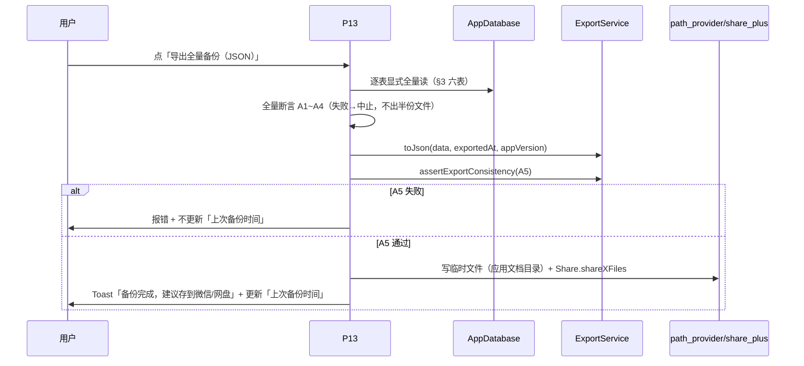
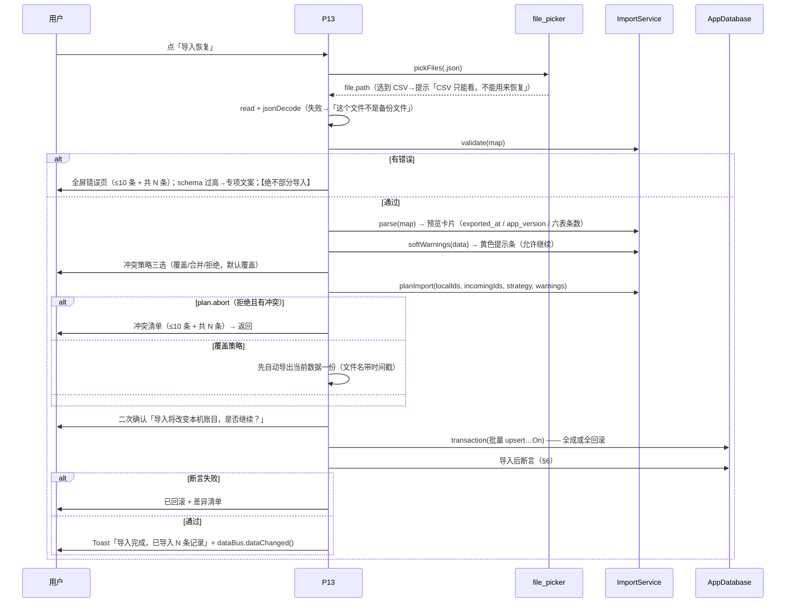

# Wave C2 · P13 导出备份页 实现设计

> **纪律（DECISIONS §D-8）**：本文件所有对代码的断言均带 `文件:行号`；引用上游**逐字复制原文**，不转述。证据分三层：**【实测级】/【仅类型编译】/【读码级】**（见 §12）。

## 0. 依据（唯一冻结源）

| 来源 | 位置 | 用途 |
|------|------|------|
| `02-需求与验收.md` | **§D.0**（`:306-344`）、**§D.11**（`:734-779`）、**§C.3.1 Q23/U-2**（`:245-283`） | 验收口径 + 逐字谓词 |
| `07-UI实现规格.md` | **§3.13 P13**（`:637-706`）、**§4.3 I-4 全量读**（`:803-843`）、**§1**（`:54-166`）、**§2**（`:167-195`）、**§6**（`:911-935`） | 交互序列 + 全量读唯一写法 + 全局约定 |
| `02-PRD.md` | **B8 数据导出备份（P0）**（`:212`）、`AC-60`~`AC-64` | 需求 |
| 现盘代码 | `lib/services/export_service.dart`、`lib/services/import_service.dart`、`lib/db/database.dart`、`lib/ui/export_backup_page.dart` | 接线事实 |

## 1. 范围与文件白名单（越界即打回）

| # | 文件 | 动作 | 说明 |
|---|------|------|------|
| 1 | `app/lib/ui/export_backup_page.dart` | **原位填充**（不删重建） | 构造签名 `const ExportBackupPage({super.key})` **不动**（`export_backup_page.dart:41`；Wave C1 的 P12 依赖接线） |
| 2 | `app/lib/services/import_service.dart` | **仅** U-2 放宽 id 校验谓词 | 见 §10 逐字前后对照；**不改其它字段校验** |
| 3 | `app/tool/verify_waveC2.dart` | 新建 | 内存库实测 AC-62 六表往返逐字节等价 |
| 4 | 本文件 `15-WaveC2-实现设计.md` | 新建 | — |

**禁触**：`stats_page.dart` / `settings_page.dart`（Wave C1）、`calendar_page.dart` / `day_detail_page.dart` / `record_detail_page.dart`（Wave B）、`main.dart`、`lib/db/database.dart`、`company_page.dart`、`pubspec.yaml`。
**依赖**：仅用已就绪 `path_provider 2.1.6` / `share_plus 10.1.4` / `file_picker 8.3.7`（`pubspec.lock` 实测版本），**不新增任何依赖**。

## 2. 组件结构与调用链（Mermaid 架构图）

```mermaid
graph TD
    P12["P12 设置页<br/>(Wave C1, 拥有)"]
    P13["ExportBackupPage (P13)<br/>lib/ui/export_backup_page.dart"]
    subgraph SVC["服务层（只读复用，不改）"]
      EX["ExportService<br/>toJson / workRecordsCsv / paymentRecordsCsv / assertExportConsistency"]
      IM["ImportService<br/>validate / parse / planImport / softWarnings"]
      RS["ReceivableService<br/>(口径纯函数)"]
    end
    subgraph DB["数据层（只读冻结，不改签名）"]
      AD["AppDatabase.instance"]
    end
    subgraph PLUG["U-1 批准的 3 库（用途限本页）"]
      PP["path_provider<br/>getApplicationDocumentsDirectory"]
      SP["share_plus<br/>Share.shareXFiles"]
      FP["file_picker<br/>FilePicker.platform.pickFiles"]
    end
    AS["AppState.ledgerId"]
    P12 -->|push| P13
    P13 --> EX
    P13 --> IM
    EX --> RS
    P13 -->|逐表显式全量读| AD
    P13 -->|事务内 ...On(txn,...) 批量写| AD
    P13 --> PP
    P13 --> SP
    P13 --> FP
    P13 --> AS
    P13 -->|dataBus.dataChanged| BUS["DataBus"]
```

## 3. 数据接线（逐表显式传参清单 · §4.3 唯一写法）

**导出组装 `BackupData`（逐字照做 `07:809-821`，任一漏参 → 备份非全量）**：

| # | 表 | 调用（**逐字**） | DB 落点 | 易漏点（`07:840`） |
|---|----|------------------|---------|-------------------|
| 1 | ledger | `db.getLedger(ledgerId)` | `database.dart:394` | G-12 已落地（`main.dart:120-132`），返回 null → 走错误态 |
| 2 | company | `db.listCompanies(ledgerId: ledgerId, includeDeleted: true, includeDisabled: true)` | `database.dart:451-461` | 两个 `true` 都必写，否则停用/已删公司丢失 |
| 3 | pricing_rule | `db.listPricingRules(includeDeleted: true, includeDisabled: true)` | `database.dart:536-546` | **不传 `companyId`** = 全部公司 |
| 4 | work_record | `db.listWorkRecords(includeDeleted: true, includeDraft: true)` | `database.dart:619-633` | `includeDraft: true`，否则草稿丢失 |
| 5 | payment_record | `db.listPaymentRecords(includeDeleted: true)` | `database.dart:910-922` | — |
| 6 | holiday_mark | `db.listHolidayMarks(ledgerId: ledgerId)` | `database.dart:1066-1076` | 无软删概念 |

**导出前全量断言（`07:824-832`，任一失败即中止，不产出半份文件）**：

| # | 断言 |
|---|------|
| A1 | `data.companies.length == (await db.listCompanies(ledgerId: ledgerId, includeDeleted: true, includeDisabled: true)).length` |
| A2 | `data.pricingRules.length == (await db.listPricingRules(includeDeleted: true, includeDisabled: true)).length` |
| A3 | `data.workRecords.length == (await db.listWorkRecords(includeDeleted: true, includeDraft: true)).length` |
| A4 | `data.paymentRecords.length == (await db.listPaymentRecords(includeDeleted: true)).length` |
| A5 | `ExportService().assertExportConsistency(workRecords:…, paymentRecords:…, exportedJson: ExportService().toMap(data,…))` → 定点精确相等（AC-61） |

**导入侧接线**（**行号已按现盘实测订正**，见 §15 变更记录）：

| 用途 | 调用 | 落点（**现盘实测行号**） |
|------|------|------|
| 选文件 | `FilePicker.platform.pickFiles(type: FileType.custom, allowedExtensions: ['json'])` | `export_backup_page.dart:271`（在 `_startImport` `:265` 内） |
| 结构校验 | `ImportService().validate(map)` → `List<String>`（永不抛） | `import_service.dart:125` |
| 反序列化 | `ImportService().parse(map)` → `BackupData` | `import_service.dart:331` |
| 软警告 | `ImportService().softWarnings(data, now: …)` | `import_service.dart:483` |
| 冲突规划 | `ImportService().planImport(localIds:, incomingIds:, strategy:, warnings:)` | `import_service.dart:465` |
| 落库 | `db.transaction((txn) async { … db.upsertXxxOn(txn, x) … })` | `database.dart:263`（`transaction`）+ 各 `...On`；落点 `export_backup_page.dart:500-594`（`_doImportTransaction`；事务体 `:512`） |
| 导入后不变量校验 | `ImportService().verifyImportInvariants({strategy, pre, post, data, newIds})` → `ImportVerification`（**不抛异常**；UI 据 `!verdict.ok` 抛 `StateError`） | `import_service.dart:543`；调用 `export_backup_page.dart:585-594` |

**`localIds` 来源（`07:678` 硬约束）＝本机六表全量 id 并集，取 id **必须** `includeDeleted: true`**：
`listCompanies(includeDeleted: true)` / `listPricingRules(includeDeleted: true)` / `listWorkRecords(includeDeleted: true, includeDraft: true)` / `listPaymentRecords(includeDeleted: true)` / `listHolidayMarks(ledgerId:)` 的 `id` 全集 + 当前 `ledgerId`。
`incomingIds` = `data.ledger.id` + 五张列表元素的 `id`。

## 4. 导出交互序列（JSON）



**CSV**：`workRecordsCsv(records, companyNames, ruleNames)` + `paymentRecordsCsv(payments, companyNames)` → 2 个 `.csv` 文件 → 分别 `Share.shareXFiles`（`07 §7 G-08`：「两个文件分别分享」）。UTF-8 带 BOM、金额两位小数由 `export_service.dart:293/:218` 既有实现保证（**不新增浮点**；该 `_yuan` 属导出层格式化，`07 §1.1` 规则 2 例外条款）。

## 5. 导入交互序列（破坏性，逐步确认）



## 6. 控件清单映射（`07 §3.13` → 落点）

| 控件（`07:645-652`） | 类型 | 落点方法（`export_backup_page.dart`，**现盘实测**） | 接线 |
|----------------------|------|--------------------------------------|------|
| 上次备份时间 | 文本 | **字段** `_lastBackupAt`（`:58`）；渲染在 `_buildBody` 内联（`:706-715`）。~~`_lastBackupLabel()` 不存在（幻觉名）~~ | 会话内存态；无 → 「从未备份」（红）。**G-07 未落地，见 §11 缺口 1** |
| `导出全量备份（JSON）` | 主按钮 | `_exportJson()`（`:173`） | §3 六表全量 + A1~A5 + 落盘/分享 |
| `导出明细（CSV）` | 次按钮 | `_exportCsv()`（`:214`） | `workRecordsCsv` + `paymentRecordsCsv` 双文件 |
| `导入恢复` | 次按钮（警示） | `_startImport()`（`:265`） | §5 全流程 |
| 格式说明（只读） | 说明文字 | **`_buildBody` 内联**（`:746-749`）。~~`_buildFormatNote()` 不存在（幻觉名）~~ | 逐字「JSON = 完整备份，可用来恢复；CSV = 表格明细，只能看、不能用来恢复」（Q19） |
| 风险说明（只读） | 警告条 | **`_buildBody` 内联**（`:751-758`）。~~`_buildRiskNote()` 不存在（幻觉名）~~ | 「恢复会**覆盖**本机数据，操作前会自动备份一份当前数据」 |

## 7. 空态 / 异常态（`07 §6` E-14~E-18 + `07:690-699`）

| 场景 | 呈现 | 落点（**现盘实测**） |
|------|------|------|
| 从未备份 | 「上次备份」+「从未备份」+ 红色 | 字段 `_lastBackupAt`（`:58`）+ `_buildBody` 内联（`:706-715`）。~~`_lastBackupLabel()` 不存在（幻觉名）~~ |
| 非本产品格式 / 解析失败 | 「这个文件不是本产品的备份文件」（不继续） | `_startImport`（`:265`）分支 |
| `schema_version` 过高 | 「备份文件来自更新版本，请先升级 App」 | `validate`（`import_service.dart:125`）错误含 `schema_version` 关键字时专项文案 |
| 缺表 / 类型不符 | 全屏错误页 + 错误清单（≤10 条 + 共 N 条）+ 返回；**不部分导入** | `_ImportErrorPage`（`:809`，调用点 `:310`）。~~`_ImportErrorView` 不存在（幻觉名）~~ |
| 导入 id 冲突 | 策略三选 + 冲突清单（≤10 条 + 共 N 条） | `_showStrategyDialog`（`:612`）/ `_showConflictDialog`（`:630`）。~~`_pickStrategy` 不存在（幻觉名）~~ |
| 导入中断 / 断言失败 | 事务回滚 → 数据仍为导入前状态（AC-43） | `transaction`（`database.dart:263`）+ `verifyImportInvariants`（`import_service.dart:543`） |
| 导出磁盘/权限失败 | SnackBar「保存失败，请检查存储权限」+ 可重试 | `try/catch` in `_exportJson`（`:173`） |
| 导出含坏行 | 黄色提示（**MAJ-3 后现盘文案：「备份包含 N 条异常数据，导出将被中止，请先处理异常行」**；`07:865` 的「仍会原样导出」**本波不可达**，见 §11 缺口 5） | `_load`（`:69`）用 `listWorkRecordsLenient` 预检计数 + `_warnBar`（`:772`） |
| 加载失败（DB 异常） | 错误态 + 「重试」，不白屏 | `_ErrorView`（`:965`） |

## 8. AC 映射表（`02 §D.11` 逐条 + Q23）

> **注（行号已按现盘实测重订）**：本表「落点行号」列 = **现盘实测值**（以落盘代码为准，见 §15 变更记录）。原表多处行号为**落盘前估值 / 后来漂移 / 引用已删除方法**，均已订正。

| AC | 场景 | 落点（`文件:行号`，**现盘实测**） | 可验证方式 |
|----|------|----|-----------|
| **AC-P13-01** | JSON 导出全量：六表条数 == `listXxx(includeDeleted:true[,includeDisabled:true])` 条数（含草稿）；任一不等→中止 | `export_backup_page.dart:173`（`_exportJson`）+ `:103`（`_buildBackupData`）+ `:137`（`_assertFullExportCounts`） | `[单测]`=**verify_waveC2 §2**（>0 通过） |
| **AC-P13-02** | 导出金额与 App 一致：`assertExportConsistency` 通过；失败→报错+不更新「上次备份时间」 | `export_backup_page.dart:173`（A5 `:186-191`，失败 `:192-195`） | `[单测]`=**verify_waveC2 §2 A5** |
| **AC-P13-03 / AC-62** | **往返无损**：导出→清空→导入→再导出，两份 JSON **逐字节等价**（时间戳除外） | `:173`（导出）+ `:500`（`_doImportTransaction`） | `[单测]`=**verify_waveC2 §3**（核心：两份 JSON 逐字节等价 ✓） |
| **AC-P13-04** | CSV 导出：2 文件；金额两位小数、无 ¥、无千分位；UTF-8 带 BOM | `export_backup_page.dart:214`（`_exportCsv`）+ `export_service.dart:185/218/293`（既有） | `[单测]`=**verify_waveC2 §5**（BOM/两位小数/无 ¥ ✓，纯 Dart 层）+`[真机]`（双文件落盘/分享） |
| **AC-P13-05** | 导入结构校验：非 JSON/缺表/类型不符 → 全屏错误页 + 清单（≤10+N）+ 绝不部分导入 | `:265`（`_startImport`）+ `:301`（`_runImport`）+ `:809`（`_ImportErrorPage`，调用点 `:310`） | `[静态]`+`[真机]` |
| **AC-P13-06** | `schema_version` 过高 → 专项文案 | `export_backup_page.dart:809-841`（`_ImportErrorPage`；`tooNew` 关键字分派 `:817`，专项文案 `:840`） | `[真机]` |
| **AC-P13-07** | id 冲突：三选策略；`localIds` 取六表全量并集且 `includeDeleted: true` | `:429`（`_collectLocalIds`）+ `:612`（`_showStrategyDialog`）+ `:470`（`_collectIncomingIds`） | `[静态]`（grep 六表 + `includeDeleted: true`）+`[真机]` |
| **AC-P13-08** | 覆盖策略：先自动导出当前数据一份（文件名带时间戳）→ 二次确认 → 执行 | `:482`（`_autoBackupBeforeOverwrite`）+ `:659`（`_confirmImport`） | `[真机]` |
| **AC-P13-09** | 导入后断言：合计/条数一致；失败→已回滚 + 差异清单 | **改落点**：`ImportService().verifyImportInvariants`（`import_service.dart:543`，**返回 `ImportVerification` 不抛**；UI 据 `!verdict.ok` 抛 `StateError`），事务内调用 `export_backup_page.dart:585-594`。~~原引 `:498` 私有方法 `_assertImportResult` **已删除**~~（其职责迁至 `verifyImportInvariants`，见 `export_backup_page.dart:606-608` 注释） | `[单测]`=**verify_waveC2 §3 / §6**（真调 `verifyImportInvariants`） |
| **AC-P13-10** | 导入中进程被杀 → 事务回滚 | `:500`（`_doImportTransaction` → `db.transaction` `:512`；`database.dart:263`）；回滚能力 `verify_db` §3 已证 | `[真机]`（需人工构造） |
| **AC-P13-11** | 导出含坏行 → 黄色提示（**现盘文案**：导出将被中止）；`07:865`「仍会原样导出」本波不可达 | `:69`（`_load` 容错读计数）+ `:772`（`_warnBar`）；**注：见 §11 缺口 5** | `[真机]`；检测路径 `[单测]`=**verify_waveC2 §4** |
| **AC-P13-12** | 依赖影响（U-1）：体积/权限/用途限 P13 | `pubspec.yaml:54-64`（3 库 `path_provider`/`share_plus`/`file_picker` 在 `:60/:62/:64`）+ 本页 import 面 | `[真机]` |
| **AC-Q23-01** | 新建 5 类实体 id 跑回填谓词 → 5/5 命中分支① | `import_service.dart:114-119`（`_id` 谓词）+ 调用点 `:189/:199/:211/:246/:287/:304`（`_requireUuid` 方法定义 `:774`） | `[单测]`=**verify_waveC2 §1**（本地 5 类 validate 通过 ✓） |
| **AC-Q23-02** | 导出→清空→导入→再导出，六表 id 集合逐条一致；`validate()` 空错误 | `import_service.dart:114-119` + `export_backup_page.dart:500` | `[单测]`=**verify_waveC2 §3 ✓** |
| **AC-Q23-03** | 既有 UUID 样本仍通过（分支②）；`verify_db` 93/0 不下降 | `import_service.dart:114-119`（分支②） | `[单测]`=**verify_waveC2 §1 ✓** + `verify_db` **93/0 ✓** |
| **AC-Q23-04** | 同一微秒连续 1000 个本地 id 无重复 | `id_gen.dart`（**不改**，仅引用说明） | `[单测]`=**verify_waveC2 §1**（1000 个无重复 ✓） |

## 9. 逐表显式传参"漏参即失败"的自证（对 AC-P13-01）

A1~A4 的对照右值**就是**组装左值的同一调用（显式传参版）。其 load-bearing 点：若未来有人把组装改成默认参数（漏 `includeDisabled`/`includeDeleted`/`includeDraft`），左值会小于右值 → 断言失败 → 中止导出。**故断言不是空转**。

## 10. U-2 谓词改动 前后对照（逐字）

### 改前（**改动前**原文行号 `import_service.dart:61-63`，实测原文）

```dart
  static final RegExp _uuid = RegExp(
    r'^[0-9a-fA-F]{8}-[0-9a-fA-F]{4}-[0-9a-fA-F]{4}-[0-9a-fA-F]{4}-[0-9a-fA-F]{12}$',
  );
```

方法 `_requireUuid`（**改动前**原文行号 `import_service.dart:466-470`；**改动后落盘 `:774-778`**）：

```dart
  void _requireUuid(String field, dynamic v, List<String> errors) {
    if (v is! String || !_uuid.hasMatch(v)) {
      errors.add('$field 非法 UUID：$v');
    }
  }
```

### 改后（逐字照抄 `02 §C.3.1`「回填后的谓词」，`:263-270`；**落盘实测行号 `import_service.dart:114-119`**）

```dart
  static final RegExp _id = RegExp(
    r'^('
    r'[A-Za-z]+-[0-9a-z]+-[0-9a-z]+'   // ① 本地格式：<prefix>-<base36>-<base36>
    r'|[0-9a-fA-F]{8}-[0-9a-fA-F]{4}-[0-9a-fA-F]{4}-[0-9a-fA-F]{4}-[0-9a-fA-F]{12}' // ② 既有 UUID（兼容，勿删）
    r')$',
  );
```

方法体（**仅换正则引用 + 文案**；方法名 `_requireUuid` 按 `02 §C.3.1`：「Dev 可保留 `_requireUuid` 名、仅换正则」**保留**，6 处调用点不动）：

```dart
  void _requireUuid(String field, dynamic v, List<String> errors) {
    if (v is! String || !_id.hasMatch(v)) {
      errors.add('$field 非法 id：$v');
    }
  }
```

**改动点清单（4 处，均在 `import_service.dart`，**行号为现盘实测**）**：① 字段名 `_uuid`→`_id` + 正则体换为回填谓词（`:114-119`）；② 方法体 `_uuid`→`_id` 引用（`:775`）；③ 错误文案 `非法 UUID`→`非法 id`（`:776`）；④ 文件头 doc 第 11 行「id 为合法 UUID」→「id 为合法 id（本地格式 … 或 UUID，U-2 放宽）」。
**明确不做（`02 §C.3.1`）**：不改 `id_gen.dart`；不做存量数据迁移；除 id 谓词外不放宽任何字段校验。

## 11. 发现的需求缺口 / 设计外偏差（报主理人裁定，**不自行扩大范围**）

| # | 缺口 / 偏差 | 事实依据 | 本设计的临时处理 | 建议归属 |
|---|-------------|---------|-----------------|---------|
| **缺口 1** | **「上次备份时间」无持久化落点**（G-07 未落地）：`07 §7 G-07` 要求「本地记录…需引入轻量 key-value 存储（如 `shared_preferences`）或建 UI 偏好表；不得塞进六表」。但 **U-1 只批准 3 库、明确不含 `shared_preferences`**（`DECISIONS §D-7` U-1；`pubspec.yaml:54`），且不得新增表 / 不得改 DB 签名 | `DECISIONS.md:95` U-1 原文；`07:946` G-07 | **降级**：该行显示「上次备份：从未备份」；本次会话内导出成功后**内存态**更新为「刚刚备份」（重启即回到「从未备份」）。`02 §D.10` 亦认可「本轮若未落地，则该行降级显示『从未备份』」 | **主理人裁定**（是否授权极小偏好存储 / 接受降级） |
| **缺口 2** | **导入后断言「本机全部 == 备份全部」在"覆盖"策略下非恒真**：「覆盖」= 按 id 覆盖（`07:673`：只覆盖同一条，本机独有记录保留），故本机非空时 `Σ本机 ≠ Σ备份`。`02 §D.11` AC-P13-09 的「记录条数（含软删）一致」隐含"本机已清空"的恢复场景 | `07:673` 覆盖语义原文；`03 §6.5` 断言 2 | **按「来件 id 集合」断言**：对 `incomingIds` 范围内，`Σ有效工作记录金额`/`Σ收款金额`/条数 与被件逐条一致。该式在 **AC-62「导出→清空→导入」** 流程下**等价于**字面式（清空后本机全部 = 来件集合） | **主理人裁定**（字面式仅在清空场景成立；本式为其正确泛化） |
| **偏差 3** | **CSV 是否含软删/草稿 未规定**：`07:649` / AC-P13-04 未给过滤口径 | `07:649` | **与 JSON 同源**取全量（含软删/草稿），守「导出即全量」一致口径；若主理人要求"人类明细只看有效"，改为 `includeDeleted:false, includeDraft:false` 一行即可 | **主理人**（低风险，默认从简） |
| **偏差 4** | **`_requireUuid` 方法名保留但语义已扩大**（校验"id"非仅 UUID） | `02 §C.3.1`「可保留 `_requireUuid` 名」 | 按 `02 §C.3.1` 授权保留方法名，避免触碰 6 处调用点；错误文案已同步为「非法 id」 | 已授权，仅登记 |
| **缺口 5** | **AC-P13-11「仍会原样导出」在冻结 DB 层下不可达**：`07:865` 要求"备份包含 N 条异常数据，**仍会原样导出**"；但坏行 = 行映射抛错（`database.dart` `_asAmountColumn` / `_asId`，实测 `verify_waveC2 §4`：含坏行时 `listWorkRecords` **抛错**），而唯一导出入口 `ExportService.toJson` 只吃**模型**（`BackupData`）→ 无法产出"坏行原样 JSON"；且 **UI 禁写 SQL**（`02 §D.0.2` 禁令 1）、**DB 层冻结**（不改签名）→ 无"原始行导出"通路 | `07:865`；`database.dart:1726-1746/:1772-1778`（坏行抛错，实测）；`02 §D.0.2` 禁令 1 | **诚实降级**：① 页面**照常显示**黄色「备份包含 N 条异常数据」告警（检测经 `listWorkRecordsLenient`，**实测**）；② 导出走 `§4.3` 强制的**严格**全量读 → 若真存在坏行则**Fail-loud 中止**（不出半份文件、不静默丢行）。「原样导出坏行」**本波无法满足**（需 DB 层新增 raw-row 导出方法或放宽映射，均越界） | **主理人裁定**（接受 fail-loud 降级，或另开 DB 层缺口件） |
| **缺口 6**（**本轮新增 · 见 §15**） | **节假日标记「同日不同 id」被 `INSERT OR REPLACE` 静默替换**：`holiday_mark` 以 `id` 为主键、另有 `UNIQUE (ledger_id, date)`；`upsertHolidayMarkOn` 走 `_write`（恒 `INSERT OR REPLACE`）→ 当来件的标记与本机 `(ledger_id, date)` **相同但 `id` 不同**时，**静默「删旧行 + 插新行」**——本机原有标记被来件覆盖，**且不留痕**（旧 id 消失、无审计痕迹） | **实现（现盘实测）**：`database_schema.dart:116-124`（`id TEXT PRIMARY KEY`；`UNIQUE (ledger_id, date)` 在 `:124`）；`database.dart:1028-1029`（`upsertHolidayMarkOn` → `_write`）+ 其上方 `:1024-1027` 注释（「恒用 `INSERT OR REPLACE`，**任意** UNIQUE 冲突均静默『删旧行 + 插新行』、不抛异常」——R2-01 修正）；实测复现在 `verify_waveC2.dart:658-666`（「R57 佐证：节假日 id 已由 `_hmA` 漂移为来件 id（G-13 `INSERT OR REPLACE` 实况）」） | **本波不改 DB（只读冻结）**：不变量校验侧改以 `(ledger_id, date)` 键 + 关键值断言（**id 可漂移、键不可漂移**，`import_service.dart:536-539` / `:603-625`）；且 `merge` 策略下「本机原有 id 逐条不变」的 id 集合恒等式**只作用于四张 id 主键表**（公司/规则/工作记录/收款），**节假日除外**（`import_service.dart:536-539`） | **主理人裁定**（是否要求上游补「同日不同 id 的冲突处置语义 / 导入留痕」，或接受当前静默替换） |

## 12. 风险清单

| # | 风险 | 缓解 |
|---|------|------|
| R1 | 逐表显式传参漏一个 → 备份非全量（**最危险**） | A1~A4 断言 + verify_waveC2 软删/停用/草稿样本子集断言 |
| R2 | 事务内误调公开方法 → 死锁 | 一律用 `...On(txn, …)`；`verify_db` §10 反证 |
| R3 | `AppState.ledgerId == null`（G-12 未就绪）→ `getLedger` 崩溃 | 调用前判空 → 走错误态 + 重试（不白屏） |
| R4 | 平台库（path_provider/share_plus/file_picker）本机不可编译（`dart:ui`）→ **无法纯 Dart 实测** | 类型编译只走 gen_kernel（入口 `lib/main.dart` 已含本页 import 闭包）；平台调用**标【仅类型编译】/【读码级】**，真机验收 |
| R5 | `upsertHolidayMarkOn` 为 `INSERT OR REPLACE`（G-13）→ 导入时同 `(ledger,date)` 换 id | 导入按 id 覆盖属可接受；已在设计登记，不改 DB |
| R6 | 数值浮点回归 | 本页**零新增** `fen/100`/`double.parse`/`.round()`/`toDouble()`；金额仅供 CSV 走既有 `_yuan`（例外条款） |

## 13. 施工顺序

1. 落本设计 → 2. 改 `import_service.dart` 谓词（§10）→ 3. 实现 `export_backup_page.dart`（导出 + CSV + 导入 + 空态）→ 4. 写 `tool/verify_waveC2.dart` → 5. 跑①类型编译 ②既有套件回归（`verify_db` **93/0**、`verify_waveA` **54/0**、`verify_waveA2` **35/0**；见 §15 变更记录）③本波脚本（**现盘 48/0**）→ 6. **回填 §8 行号** → 7. 报告主理人。

## 14. 验证计划（证据层级标注）

| 手段 | 命令 | 证据层级 |
|------|------|---------|
| ① 全量类型编译 | gen_kernel（入口 `lib/main.dart`）rc 0/254/255 | 【仅类型编译】 |
| ② 既有回归 | `verify_db`（基线 **93/0**）、`verify_waveA`（**54/0**）、`verify_waveA2`（**35/0**；现盘实测，原记 32/0 已订正） | 【实测级】（纯 Dart DB/静态） |
| ③ 本波专项 | `tool/verify_waveC2.dart`（**现盘 48 通过 / 0 失败，rc=0**；节 [1]~[7]）：内存库 + `ImportService`/`ExportService` **真源码** + 真调 `verifyImportInvariants`（[6] R55/R57）+ 静态核对（[7] MAJ-2/MAJ-3/MIN-3/R55 落点） | 【实测级】（服务层纯逻辑 + DB 侧）；**UI/平台库调用【读码级】** |

> **AC-62 闭环**：内存库写入六表样本（含停用/软删/草稿）→ `_buildBackupData` 等价组装 → `toJson` → 清空六表 → `validate`+`parse` → 事务 `...On` 落库 → 再 `toJson` → **两份 JSON 逐字节比对**（剔除 `exported_at`）。**同构推理 ≠ 实测**：脚本**直接 import 真源码**（`ExportService`/`ImportService`/`AppDatabase`），非复刻内部逻辑；若必须复刻（如 UI 私有方法），降级标注【读码级】。

---

## 15. 回填登记：R55 / R56 / R57 **重新定义** + 本轮变更记录

### 15.1 为什么要「重新定义」

> **事实**：**上一轮的编号分配记录已丢失**（本文件此前从未记录 R55/R56/R57 的语义），而 `app/lib/**` 的代码注释已引用这三个编号。故本轮**按现盘代码注释与实现如实定义**（**不照抄任何转述**）。
> **段位**：`R50~R59` = **Wave C2**（`19` §2.2）。R55/R56/R57 落于此段，**议题亦属 Wave C2** —— **段位与议题一致，无跨段**。

### 15.2 R55 / R56 / R57 定义（**依据 = 现盘代码，非转述**）

| 编号 | 定义（据现盘代码） | 判定依据（文件 + 逐字摘录） | 段位 |
|------|------------------|--------------------------|------|
| **R55** | **导入后「合并（merge）」策略的不变量校验语义** —— merge 须满足 **(A) 本机原有 id 逐条不变（四张 id 主键表）；(B) 新插入 id 与来件 1:1 相等；(C) 四表 id 集合 = 导入前本机集合 ∪ 来件集合**，**缺一不可** | `import_service.dart:91-94`：`/// **仅 `merge`** 须满足的语义失败项（R55：**(A)(B)(C)** 三条，缺一不可）`；`:532-534`：`/// - [ImportVerification.mergeFailures]（**仅 `merge`**，R55）：(A)…(B)…(C)…`；`:635`：`// ── merge (A)(B)(C)（R55） ──`；`:64`：`ImportSnapshot` doc「…供 `verifyImportInvariants` 做不变量校验（R55）」；`export_backup_page.dart:554`：`// R55：断言口径**按策略分派**（overwrite 全量比对；merge 走 (A)(B)(C)）`；`:359`：`// ④.5 导入前快照（供导入后不变量校验；R55）` | Wave C2 |
| **R56** | **「覆盖」策略下自动备份 = 唯一 undo 通道；备份失败必须在中止破坏性写入**（旧实现吞掉失败仍继续 + 确认文案谎称已备份）—— 对治 **MAJ-2** | `export_backup_page.dart:347-349`：`// ④ 覆盖策略 … **MAJ-2 / R56**：自动备份是「覆盖」唯一 undo 通道；失败**必须在破坏性写入前中止**…`；`:481`：`/// **返回是否成功**——**MAJ-2 / R56**：失败必须由调用方**中止导入**（不再吞掉失败继续写入）。`；`:657`：`/// 二次确认。\`backedUp\` = 「覆盖」策略下自动备份**是否已成功**（MAJ-2 / R56）` | Wave C2 |
| **R57** | **导入后校验须覆盖「五表」（公司/规则/工作记录/收款/节假日）**（旧断言仅 work+payment），其中**节假日以 `(ledger_id, date)` 为键 + `type`/`rate` 关键值**断言（**宽容 id 漂移**，G-13）—— 对治 **MIN-2** | `import_service.dart:85`：`ImportVerification` doc「（R55 / R57）」；`:88`：`//（R57）节假日键/关键值 + 覆盖内容逐条相等`；`:530`：`（R57/MIN-2）节假日 (ledger_id,date) 键集合 + type/rate 一致`；`:603`：`// ── 恒须 F3：节假日 (ledger_id,date) 键集合 + 关键值（R57/MIN-2；G-13 宽容 id 漂移） ──`；`:627`：F4 四表来件逐条内容相等`（R57/MIN-2 的"条数 + 关键值"最强形式）`；`export_backup_page.dart:556`：`// R57：校验覆盖 公司/规则/工作记录/收款/节假日**五表**（旧断言仅 work+payment）`；`verify_waveC2.dart:443/:446/:658-666/:687` | Wave C2 |

> **与 `19` 台账的关系**：`19` §2.2 现记 **R55~R59 为「Wave C2 段预留空号」**；本波**据现盘代码正式占用 R55 / R56 / R57**（三者均为 **Wave C2** 议题，**段位与议题一致、无跨段**）。**`19` 的空号登记须由 `ledger-r` 同步更新**（**本文件不改台账**）。**R58 / R59 仍为预留空号。**

### 15.3 与既有 R50 / R51 / R52 / R53 的关系（**不改其含义**）

- **R50**（= `15 §11` 缺口 2：「覆盖」下「本机全部 == 备份全部」非恒真 → 须按来件 id 断言）→ 现盘**已由 `verifyImportInvariants` 的按策略分派实现**（overwrite 走全量 F4 / merge 走 (A)(B)(C)）；**R50 既有含义不动**（仍是「上游 `03 §6.5` 需补口径」的回流项）。
- **R51**（`15 §11` 偏差 3，CSV 过滤口径）、**R52**（`15 §11` 缺口 5，AC-P13-11「原样导出」不可达）、**R53**（条件下启用）—— **含义均不动**。

### 15.4 本轮变更记录（**订正动作本身如实留痕**）

> 背景：本文件此前**从未同步** Wave C2 修复轮（MAJ-1/2/3、MIN-3、R55/R56/R57）。本轮**只做订正、不改结论**，变更如下：
> 1. **方法名 / 行号订正**（原多为**落盘前估值 / 幻觉名 / 已删除方法**）：
>    - **幻觉名（不存在）**：`_lastBackupLabel()` → 实为字段 `_lastBackupAt`（`export_backup_page.dart:58`）+ `_buildBody` 内联（`:706-715`）；`_buildFormatNote()` / `_buildRiskNote()` → 实为 `_buildBody` 内联（`:746-749` / `:751-758`）；`_ImportErrorView` → `_ImportErrorPage`（`:809`）；`_pickStrategy` → `_showStrategyDialog`（`:612`）。
>    - **已删除方法**：`_assertImportResult`（现仅存于注释 `export_backup_page.dart:606-608`）→ §8 AC-P13-09 落点改 `ImportService.verifyImportInvariants`（`import_service.dart:543`；UI 调用 `:585-594`）。
>    - **行号按现盘实测重订**（§1/§3/§6/§7/§8/§10）：`import_service.dart` 行号因本轮新增 `ImportSnapshot`/`ImportVerification`/`verifyImportInvariants` 而整体下移 —— `_id` 谓词 `:64-76→:114-119`、`_requireUuid` `:472-476→:774-778`、`validate` `:75→:125`、`parse` `:281→:331`、`softWarnings` `:433→:483`、`planImport` `:415-420→:465`；`export_backup_page.dart` 亦同步（`_exportJson` `:172→:173`、`_exportCsv` `:213→:214`、`_startImport` `:264→:265`、`_runImport` `:295→:301`、`_collectLocalIds` `:354→:429`、`_collectIncomingIds` `:395→:470`、`_autoBackupBeforeOverwrite` `:404→:482`、`_doImportTransaction` `:420→:500`、`_showStrategyDialog` `:534→:612`、`_confirmImport` `:579→:659`、`_warnBar` `:688→:772`、`_ImportErrorPage` `:725→:809`、`_ErrorView` `:965`）。
> 2. **新增缺口 6**（§11）：节假日「同日不同 id」被 `INSERT OR REPLACE` 静默替换（依据 `database_schema.dart:116-124`、`database.dart:1024-1029`）。
> 3. **登记 R55 / R56 / R57**（本节；依据 = 现盘代码注释；**原编号分配记录丢失，此即"重新定义"动作本身**）。
> 4. **断言清单更新**（§13/§14）：`verify_waveC2.dart` 现盘 **48 通过 / 0 失败 rc=0**（原记 **27 条**）；新增节 **[6]**（真调 `verifyImportInvariants`，R55/R57）与 **[7]**（静态核对 MAJ-2/MAJ-3/MIN-3/R55 落点）。既有回归 `verify_waveA2` **35/0**（现盘实测，原记 32/0 已订正）。
> 5. **§7「导出含坏行」呈现文案**：由「仍会原样导出」订正为现盘文案「…导出将被中止…」（MAJ-3；结论/降级口径不变，见 §11 缺口 5）。
> 6. **未改动**：§2 / §4 / §5 交互序列、§12 风险结论、`R50`/`R51`/`R52`/`R53` 含义、§0 依据。

## 16. 本轮**未核实项**（如实标注，不猜）

- `pubspec.yaml:54-64` 的 U-1 三库**行号范围**为近似（`path_provider`/`share_plus`/`file_picker` 实测在 `:60/:62/:64`；`shared_preferences` 声明禁令在 `:54`）；未逐行核 `:50-53` 内容。
- `_collectLocalIds`（`:429`）内的**六表调用逐条**未逐行摘录（仅核到其存在于 `:429` 起）。
- §8「可验证方式」列中 `verify_waveC2 §N` 的**节号映射**已按现盘节标题 [1]~[7] 核过；**每条 AC 与脚本内 `check(...)` 的一一对应**未逐条穷举（脚本 48 条）。
- `DECISIONS.md:95` U-1 原文行号（§11 缺口 1 引用）**未核对**（本轮未开该文件）。
