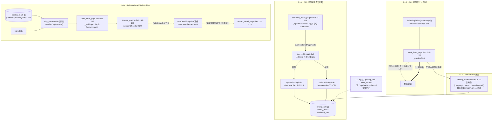

# 16 · Wave D1（录入与规则）实现设计

> **本文性质**：阶段② **实现设计**（可施工级）。**唯一需求依据** = 同目录 `02-需求与验收.md`（`status: 已冻结`）+ `docs/07-UI实现规格.md` + `docs/03-数据模型与信息架构.md`。**本文不改任何代码**（改动属阶段③）。
> **证据纪律（D-8）**：本文每处对代码的断言均带 `文件:行号`；引用上游**逐字复制原文**、禁止凭记忆转述。所有结论标证据层级：**【实测】**（本设计方或 `review-c1` 亲自跑出的输出）/ **【读码】**（只读源码推断）/ **【仅类型编译】**（gen_kernel rc=0）。
> **口径纪律（继承冻结件，全文不松动）**：金额**整数「分」**、倍率**整数「×10」**；**禁浮点**（`fen/100`、`double.parse`、`.round()`、`toDouble()`、`x/10`）；显示一律 `fenToYuan`（`app/lib/ui/widgets/money.dart:9`）/ `fenToYuanPlain`（`:20`），解析一律 `yuanToFen`（`:30`）。日历/统计**全派生不落库**（D-2）；金额**必须快照、改价不回改历史**（D-3）。

---

## §0 冻结声明

| 项 | 值 |
|----|----|
| **本设计文档落盘时间** | **2026-10-08 09:14:16 +0800**（本机实测 `date` 输出） |
| **本设计冻结时间（推荐）** | **2026-10-08 09:14:16 +0800** —— 以本次落盘时间为冻结基线；若主理人在独立审查后签发修订版，则以**修订版落盘时间**为新冻结时间（同规则：**`lib/` 改动不得早于该时刻**） |
| **冻结语义（写死）** | **本冻结时间之前/之时，`app/**` 未被本设计方改动一个字**；**阶段③ 实现开工不得早于冻结时间**；开工后由主理人核对 `app/**` 各文件 mtime 是否全部 **≥ 冻结时间** |
| **冻结成因** | `review-c1` 的 INFO-2（`_scratch/review-c1/审查报告.md:116`）：Wave C1 设计件 mtime（`2026-10-07 23:22:03`）**晚于**其四个实现文件（`23:10:32~23:11:39`）→ 设计未冻结即已施工、审查基线不清。**本波起新规：先落盘设计 + 声明冻结时间，再动 `lib/`。** |

**本设计方在本轮仅做「读码 / grep / 读上游原文」，未写入、未修改、未重命名、未删除 `app/**` 下任何文件（含 `pubspec.yaml`），亦未改其他波次设计文档。** 本轮唯一写入 = 本文件。

**冻结前不动 `lib/`** —— 主理人独立审查本节并签发前，不得以本设计为据启动阶段③。

---

## §1 施工边界与 DB 接线表

### 1.1 文件白名单（越界即打回）

| 动作 | 文件 | 说明 |
|------|------|------|
| **改** | `app/lib/ui/work_form_page.dart` | 现存文件（P02b 完整表单）。D1-b（规则下拉 + 预览接线）+ 跨波硬性项 D1-c 的新建路径接线 |
| **改** | `app/lib/ui/company_page.dart` | 现存文件（P06 内嵌 `_CompanyEditDialog` = P08）。D1 的 P08 收口（§2.4） |
| **改** | `app/lib/ui/company_detail_page.dart` | 现存文件（P07）。**仅替换 `_openRuleEditor`（`:574-578`）函数体**为跳转 P09（§2.1.4）；`company_detail_page.dart:466-573` 的规则区块**页面结构、行组件、字段绑定、入口位置一字不改**（AC-P07-07c） |
| **改** | `app/lib/ui/holiday_mark_page.dart` | 现存文件（P12a）。**仅改 §2.1.5 列出的 1 行注释**（`:14` 的 `x / 10` 示例注释，避免新增静态断言假阳性）——**不改任何文案**（R53 条件触发，见 §3.5） |
| **新建** | `app/lib/ui/rule_edit_page.dart` | P09 计价规则编辑页（§2.1） |
| **新建** | `app/lib/ui/quick_add_sheet.dart` | P02 秒级快记弹层（§2.3；依 `02 §A.3` 波次表） |
| **新建** | `app/lib/services/day_context.dart` | `D`（日期上下文）唯一构造点（§3.3）；上游 `03:327` 要求「标记由**调用方**在构造输入时算好」，此处把「算」收敛为一处，供 P02b/P02弹层/P05 复用 |
| **新建** | `app/tool/verify_waveD1.dart` | 本波专项可证伪断言脚本（§3.6） |
| **禁改** | `app/lib/db/database.dart`、`app/lib/db/database_schema.dart` | DB 层**已冻结**（`02 §E-6`：不改既有公开签名）。§1.2 已核实 D1 所需能力**全部现成**，**无需 DB 改动** |
| **禁改** | `app/lib/services/pricing_bootstrap.dart` | D1-d（§3.4）定案 = **保持现状不动**（守 `02 §D.8`「共存规则」表「数据源」行「不改 `pricing_bootstrap.dart`」） |
| **禁改** | `app/lib/services/amount_engine.dart` | 引擎**只读** `D.isWeekend` / `D.isHoliday`（`03:327`），D1 不碰引擎 |
| **不纳入 D1** | `calendar_page.dart` / `day_detail_page.dart` / `record_detail_page.dart` | P03/P04/P05 —— **Wave B 区域**，D1 不得改（team-lead 硬边界）。P05 的 `D` 读取（`record_detail_page.dart:218-219`）**已合规**（§3.3.3），D1 只**断言**不**修改** |
| **不纳入 D1** | `app/lib/main.dart` / `app/lib/app/routes.dart` | 导航改动属 **Wave D2**（`02 §A.3`）；D1 不动导航 |

### 1.2 DB 接线表（真实方法名 + 行号，**已开 `database.dart` 逐行核对**）

| 用途 | 方法签名（逐字） | 行号 | 证据 |
|------|----------------|------|------|
| P09 列表读（**含停用、不含已归档**） | `listPricingRules({String? companyId, bool includeDeleted = false, bool includeDisabled = false})` | `database.dart:536-546`（`:538` `includeDeleted` 默认 false；`:539` `includeDisabled` 默认 false） | 【读码】 |
| P09 单条读 | `getPricingRule(String id)` | `database.dart:519-520` | 【读码】 |
| P09 新建写 | `upsertPricingRule(PricingRule x)` | `database.dart:510-515` | 【读码】 |
| P09 编辑写 | `updatePricingRule(PricingRule x)` | `database.dart:573-579` | 【读码】 |
| P09 停用 / 归档 | `updatePricingRule`（改 `enabled`）/ `softDeletePricingRule(String id, DateTime at)` | `database.dart:573-579` / `:583-588` | 【读码】 |
| P02 规则下拉读（**默认参数 = 仅启用**） | `listPricingRules({companyId: ...})`（`includeDisabled` 留默认 false） | `database.dart:536-546`（`:558` `if (!includeDisabled) 'enabled = 1'`） | 【读码】 |
| P02 公司下拉读（**默认参数 = 仅启用公司**） | `listCompanies()`（`includeDisabled`/`includeDeleted` 留默认 false） | `database.dart:451-461`（`:458-459`，默认过滤 `enabled=1` 且 `deleted_at IS NULL`） | 【读码】 |
| P02 新建写 | `upsertWorkRecord(WorkRecord x)` | `database.dart:596-600` | 【读码】 |
| P02 "上次记录"读（上家公司/规则/数量默认值） | `listWorkRecords()`（`ORDER BY attribution_date DESC, created_at DESC`） | `database.dart:619-633`（排序见 `:1272`） | 【读码】 |
| 账本币种 / `ledgerId` | `getLedger(String id)` / `AppState.ledgerId` | `database.dart:394` / `app/lib/app/app_state.dart:11` | 【读码】 |
| **D1-c 节假日存在性判定（关键）** | `getHolidayMarkByDate(String ledgerId, DateTime date)`（命中唯一索引 `(ledger_id, date)`，未标记返回 `null`） | `database.dart:1046-1047`（实现 `:1050-1062`） | 【读码】+ `database.dart:1043-1045` 注释逐字「日历着色前查『当日是否节假日』走本方法」 |
| P08 编辑写 / 新建写 / 软删 | `updateCompany(Company x)` / `upsertCompany(Company x)` / `softDeleteCompany(String id, DateTime at)` | `database.dart:488` / `:428-429` / `:496-497` | 【读码】（`02 §D.7:597-599` 同） |
| P08 默认规则下拉读（含停用） | `listPricingRules({companyId: ..., includeDisabled: true})` | `database.dart:536-546`（`:633` 明确「`includeDeleted` **保持默认 `false`**」） | 【读码】 |
| P08 删除影响条数读 | `listWorkRecords({companyId})` / `listPaymentRecords({companyId})` | `database.dart:619-633` / `:910-922` | 【读码】（**已在 Wave A 提前落地**，见 §2.4.3） |

> **结论（无 DB 缺口）**：D1 全部读写**均已存在于冻结 DB 层**，**无需新增 / 修改任何 DB 方法或签名**。这是 D1 不触碰「冻结 DB 层」的硬证据。

### 1.3 硬约束自检（写死，实现方交回前必跑）

| # | 约束 | 自检命令（`cd app`） | 期望 |
|---|------|--------------------|------|
| 1 | 不新增依赖（U-1） | `grep -n "^  [a-z_]*:" pubspec.yaml` | 依赖集**不变**（不出现 `shared_preferences` 等） |
| 2 | 不复活死路由 | `grep -rn "Routes\.records\|Routes\.overview" lib/` | **0 命中** |
| 3 | 保留 `Routes.companies` 为活路由 | `grep -rn "pushNamed(Routes.companies)" lib/` | **≥2 命中**（`overview_page.dart` / `settings_page.dart`）不改 |
| 4 | 禁浮点（金额/倍率） | `grep -rnE "fen\s*/\s*100|double\.parse|\.round\(\)|toDouble\(\)|/\s*10\b" lib/` | 仅既有豁免（`export_service.dart`/`amount_engine.dart`/`import_service.dart`）+ 呈现层比例豁免（`stats_page.dart:519-520`，见 §5）；**D1 新增文件 0 命中** |
| 5 | 不硬编码枚举中文 | `grep -rn "现金\|微信\|时价 / 日价\|法定节假日" lib/ui/rule_edit_page.dart lib/ui/quick_add_sheet.dart` | 枚举文案一律走 `EnumCodec.*`；**0 硬编码** |
| 6 | 写入后广播 | `grep -n "dataBus.dataChanged()" lib/ui/rule_edit_page.dart lib/ui/quick_add_sheet.dart lib/ui/work_form_page.dart lib/ui/company_page.dart` | 每个写操作路径**≥1** |

---

## §2 逐页设计

### 2.1 P09 · 计价规则编辑页 `[新建] app/lib/ui/rule_edit_page.dart`

> **依据**：`07 §3.9:501-528`（控件清单逐字）+ `docs/00-项目总览/DECISIONS.md` D-7 U-3（「P09 按 `07 §3.9` **做用户可见的价目表管理页**；`ensureRule` 保留为兜底，与手工规则**共存**」）+ `02-需求与验收.md:104`（Wave D1 ② = P09）+ `02:624`（P09「**未实现**」）+ `02:899`（「**本文不存在"不做规则管理页"的口径**」）+ `07:988`（AC-51 覆盖页 = P03 + P12a + **P09**）。

#### 2.1.1 现状（三断点，全部【实测】）

| 断点 | 事实 | 证据 |
|------|------|------|
| **B1-a** | `lib/ui/` **无 P09 页面**；用户**无任何入口**把节假日倍率配成 3.0 | `review-c1` 补充核实-holidayRate.md §A.2「`lib/ui/` 无规则编辑页文件」【实测】；本设计方复跑 `grep -rn "RuleEditPage" lib/` → 仅 `company_detail_page.dart:563`（**注释里的示例**）【实测】 |
| **B1-b** | `updatePricingRule` **全工程零调用**（死方法）；`upsertPricingRule` 在 `lib/` 仅 2 处真实调用，**均非用户配置**（`pricing_bootstrap.dart:49`/`:68`、`export_backup_page.dart:446`） | `review-c1` 补充核实-holidayRate.md §A.2【实测】；本设计方 `grep -rn "updatePricingRule" lib/` → 仅 `database.dart:573`（定义）`:578`（`...On`）【实测】 |
| **B1-c** | 现入口是**占位 SnackBar**（点了不白跳，但无页面） | `company_detail_page.dart:574-578`：`void _openRuleEditor({String? ruleId}) { ScaffoldMessenger.of(context).showSnackBar(const SnackBar(content: Text('计价规则编辑将在下个版本上线'))); }`【读码】 |

#### 2.1.2 页面形态

`RuleEditPage`（`StatefulWidget`），**整页**（`07 §1.7:143`：整页用于**结构化录入**（…公司、规则））。构造：

```dart
const RuleEditPage({super.key, required this.companyId, this.ruleId});
final String companyId;   // P07 固定公司（§2.1.4 注入）
final String? ruleId;     // null = 新建态；非空 = 编辑态
```

命名路由**不新增**（守 §1.3-2/3）；入口一律**命令式** `Navigator.push(MaterialPageRoute(...))`（`company_detail_page.dart:560-570` 的 `14 §5.6` 示例即命令式）。

#### 2.1.3 控件清单（**逐条映射 `07:505-520`**）

| 控件 | 类型 | 绑定字段 | 校验 | 落点 / 备注 |
|------|------|---------|------|------------|
| 规则名 / 工序 | 文本（必填） | `PricingRule.name` | `Validators.validName`（`validators.dart:45`） | 占位：「木工 / 司机趟次 / 拆墙」（`07:507`） |
| 计价方式 | `SegmentedButton<PricingMethod>`（3 项） | `method` | 必选 | **切换时联动**下方字段可见性（`07:508`）；文案走 `EnumCodec.pricingMethod`（`enum_codec.dart:15-19`） |
| 基础单价 | 金额输入（`yuanToFen` 解析） | `baseRate`（**分**） | `Validators.validBaseRate`（`>0`，`validators.dart:29`） | 单位随方式变：元/小时、元/天、元/件（`07:509`） |
| 计价单位 | 文本 | `unit` | **计件必填**（`07:510`） | 小时/天/件/㎡/趟 |
| 标准工时 | 数字（小时，物理量） | `standardHours`（`double?`） | — | 仅加班判定提示，可空（`07:511`） |
| 半天折算比 | 数字（×10） | `halfDayRatio` | `Validators.validHalfDayRatio`（1~9，`validators.dart:35`） | **仅日价可见**；默认 5 = 0.5（`07:512`） |
| 加班倍率 | 数字（×10） | `overtimeRate` | `Validators.validRate`（≥10，`validators.dart:32`） | 默认 15 = 1.5（`07:513`） |
| **周末倍率** | 数字（×10） | `weekendRate` | `validRate` | 默认 10 = 1.0（`07:514`） |
| **节假日倍率** | 数字（×10） | `holidayRate` | `validRate` | 默认 10 = 1.0（`07:515`）—— **本行即 U-3 用户诉求的落点** |
| 倍率口径说明（**只读**） | 说明文字 | — | — | **固定文案**逐字：「同时命中多个倍率时**取最高档，不叠加**」（`07:516`） |
| 生效日期 | 日期 | `effectiveDate` | — | 页面注明「**仅作提示，不影响历史记录**」（`07:517`） |
| 启用状态 | 开关 | `enabled` | — | （`07:518`） |
| `保存` | 主按钮 | 见 §2.1.5 双分支 | — | 编辑态**必须**显示横幅（AC-13，`07:519`） |
| `删除规则` | 危险按钮 | `softDeletePricingRule(id, DateTime.now())` | — | 二次确认，文案见 §2.1.6（AC-P09-10） |

**倍率解析（全整数，禁浮点）**：倍率输入框复用 `holiday_mark_page.dart:579-593` 的 `_parseRateX10` 同构实现（`'3.0' → 30`，整数×10，**禁** `double.parse`）【读码】；显示复用 `holiday_mark_page.dart:575` `_rateText(int x10) => '${x10 ~/ 10}.${x10 % 10}'`【读码】。

#### 2.1.4 入口接线（**Wave A ↔ Wave D1 接口契约**，`02 §A.3:107`）

`company_detail_page.dart:554-578` 的 `_openRuleEditor` **只替换函数体**（页面结构一字不改）：

```dart
Future<void> _openRuleEditor({String? ruleId}) async {
  await Navigator.of(context).push(MaterialPageRoute<void>(
    builder: (_) => RuleEditPage(
      companyId: widget.companyId,   // P07 固定公司
      ruleId: ruleId,                // null = 新建态
    ),
  ));
  if (!mounted) return;
  await _load();                     // 规则列表 / ruleNameById 同步刷新（M-11②）
}
```

- 上行 `companyId` 来源：`company_detail_page.dart:44-45` `const CompanyDetailPage({super.key, required this.companyId}); final String companyId;`【读码】。
- 「新建规则」按钮入口 `company_detail_page.dart:488-491`（`_openRuleEditor()`，`ruleId` 缺省 null）；行点击入口 `:521-523`（`_openRuleEditor(ruleId: r.id)`）—— **两者共用同一注入点**，D1 **只换函数体**，两入口自动同时生效。

#### 2.1.5 保存双分支（`02 §D.8:635` 逐字要求）

| 分支 | 调用 | 判据 |
|------|------|------|
| **新建**（`ruleId == null`） | `upsertPricingRule(x)`（`database.dart:510-515`） | `id: newId('rule')` |
| **编辑**（`ruleId != null`） | `updatePricingRule(x)`（`database.dart:573-579`） | `id: ruleId`（**复用原 id**）；`createdAt` 保留 |
| 停用 / 启用 | `updatePricingRule(逐字段整对象, enabled: !enabled)` | `PricingRule` **无 `copyWith`** → 必须逐字段构造整个对象（同 `company_page.dart:376-390` 既存范式） |
| 归档 | `softDeletePricingRule(id, DateTime.now())`（`database.dart:583-588`） | 二次确认后再调 |

- 写库路径**只写 `pricing_rule` 表**（`database.dart:571` 注释逐字「**注意：绝不可在此重算历史 work_record**（§3.3 实现红线）」）→ AC-P09-13 满足（**代码路径不出现** `updateWorkRecord*` / `replaceWorkRecordSnapshot`）。
- 校验：`Validators.pricingRule(r)`（`validators.dart:50-58`，逐字校验 `baseRate>0`、三档 `rate≥10`、`halfDayRatio∈[1,9]`）【读码】。
- 保存后 `dataBus.dataChanged()`（`app/lib/app/data_bus.dart:11`）→ P07 / P02 下拉随之刷新。
- 写入失败：SnackBar + **保留用户输入**（`02 §D.0.3:338`「写入失败 → SnackBar 显示可读原因 + **保留用户输入（不得清空表单）**」）→ 采用 `holiday_mark_page.dart` 的「**成功才 pop**」范式（`holiday_mark_page.dart:465-486`）【读码】。

#### 2.1.6 空态 / 异常态（`07:524` + `02 §D.0.3`）

- **公司无启用规则**：编辑页本身是**单条**编辑页，列表空态由 P07 规则区块兜（`company_detail_page.dart:494-501` 已实现「还没有计价规则，点「新建规则」添加」）；**P09 新建态**进来自无规则公司 → 直接呈现空表单（不阻塞）。
- **计件未填单位** → 字段红字 + 保存置灰（`07:524`）。
- **`(method, baseRate, unit)` 撞已有启用规则**（共存规则判据，`02 §D.8:646`）→ 提示「已有同类规则，是否直接编辑」（用 `pricing_bootstrap.dart:28-30` 的同一判据）【读码】。
- **归档后的重建行为（by design，C-4）**：删除确认弹窗**必须逐字告知**（见下）；**不改 `pricing_bootstrap.dart`**。

#### 2.1.7 删除确认文案（**逐字**，`02 §D.8:667` AC-P09-10）

> 「删除后该规则不再出现。**若以后用相同的计价方式和单价记账，会重新创建一条**（避免金额无据可溯）。」

---

### 2.2 P02 · 录入路径（改 `app/lib/ui/work_form_page.dart`）

> **范围**：D1-b（规则下拉 + 预览接线，§3.2）+ D1-c 新建路径（§3.3）。**不建 P02 弹层**（弹层见 §2.3）；**不动导航**（属 Wave D2）。

#### 2.2.1 现状（B2 / B3，全部【实测】）

| 断点 | 事实 | 证据 |
|------|------|------|
| **B2** | `_previewRule`（`:213-225`）**未传** `holidayRate`/`weekendRate`/`overtimeRate` → 取模型默认（`pricing_rule.dart:38-41`：半天 5、加班 15、周末 10、**节假日 10**）→ **预览恒按 1.0×** | `review-c1` 补充核实-holidayRate.md §A.2 B2【实测】；本设计方读 `work_form_page.dart:213-225`【读码】 |
| **B3** | 保存路径 `ensureRule`（`:436-441`）**未传倍率** → `pricing_bootstrap.dart:57-67` 新建规则时全取模型默认；复用键 `(companyId, method, baseRate, unit)`（`pricing_bootstrap.dart:30`）**不含任何倍率** | 【实测】+【读码】 |
| **B5** | `_buildInput`（`:241-268`）4 处 `AmountInput(...)`（`:245`/`:251`/`:258`/`:263`）**每处只喂 `isOvertime`**，**全文零 `isHoliday` / `isWeekend`** → 周末/节假日分支**恒不命中** | `review-c1` 补充核实-holidayRate.md §2.2【实测】 |
| **陈旧注释（R61）** | `work_form_page.dart:211`：「故预览金额与保存金额一致。**基础版没有「规则管理」页**，同 (公司,方式,单价,单位) 必然复用同一条规则…」—— 与 `02:899`（U-3 已裁定「本文**不存在**"不做规则管理页"的口径」）**直接冲突** | 本设计方 `grep -rn "规则管理" lib/` → `work_form_page.dart:211`、`:803`、`pricing_bootstrap.dart:4`/`:72`【实测】 |

#### 2.2.2 D1-b 设计：规则下拉 + 预览/保存接线

- **新增状态**：`String? _ruleId;`（当前选中规则）+ `List<PricingRule> _rules;`（该公司启用规则）。
- **数据源**：`listPricingRules(companyId: _companyId)`（**默认参数 = 仅启用**，`database.dart:536-546`；符合 `07:261`「数据源 `A4(companyId)` 默认参数（只含启用规则）」）。公司切换时重拉。
- **默认值**：`07:261`「**上次规则优先**」——启动时读 `listWorkRecords()`（`database.dart:619-633`）首条的 `pricingRuleId` 作默认；命中且在当前启用集内 → 选中；否则取第一条启用规则。
- **联动**：选中规则 → 回填 `_method`（`rule.method`）、单价输入框（`fenToYuanPlain(rule.baseRate)`）、计件单位（`rule.unit`）；这三个字段由「用户可编辑」变为「**随规则联动、可微调**」。
- **预览规则（改 `_previewRule`）**：从**选中的规则**取三档倍率与半天折算比；无选中规则时退回现状（模型默认）。**逐字段**：

```dart
// _previewRule 增补（D1-b）：倍率/折算比随选中规则，杜绝"预览一套、落库一套"
final r = _selectedRule;                 // List<PricingRule> 里按 _ruleId 取；null 时用模型默认
halfDayRatio: r?.halfDayRatio ?? 5,
overtimeRate: r?.overtimeRate ?? 15,
weekendRate:  r?.weekendRate  ?? 10,
holidayRate:  r?.holidayRate  ?? 10,
```

- **保存规则（改 `_saveNew`）**：`ruleId` 已选中 → **直接以该落库规则重算**（`const AmountEngine().compute(rule: 选中规则, input: ...)`），**不再调 `ensureRule`**；未选中（或公司下无启用规则）→ 退回 `ensureRule`（`pricing_bootstrap.dart:20-70`，**兜底路径，U-3 明确保留**）。
- **R61 注释订正**：`work_form_page.dart:211` 的「基础版没有「规则管理」页」→ 改为与 U-3 一致的措辞（拟定条文见 §3.5）。

#### 2.2.3 D1-c 设计：`isWeekend` / `isHoliday` 接线（**详 §3.3**）

`_buildInput`（`:241-268`）的 4 处 `AmountInput(...)` **各增两行** `isWeekend: _isWeekendForDate, isHoliday: _isHolidayForDate`；两个状态由 §3.3 的 `day_context.dart` 在 `_workDate` 变化时异步刷新。**这一处改完，预览（`:295-298`）与保存（`:442-445`）同时生效**（二者共用 `_buildInput`）。

#### 2.2.4 附带文案订正（**B5 的可见面**）

`work_form_page.dart:643-646` 的提示条逐字：「本版只支持「加班」一个倍率开关（×1.5）；**周末/节假日自动倍率**、云同步、导入导出**为二期功能**。」【读码】—— D1-c 接线后**"周末/节假日自动倍率…为二期功能"这半句变假**，必须订正为「周末/节假日倍率按所选计价规则自动套用（可在公司详情 → 计价规则里配置）」。**这是 D1-c 落地的必做附带项**，否则用户看到的提示与功能相反。

---

### 2.3 P02 · 秒级快记弹层 `[新建] app/lib/ui/quick_add_sheet.dart`

> **依据**：`02 §A.3:104`（Wave D1 ① = P02 秒级快记弹层 ≤3 步）+ `07 §3.2:250-287`（首屏结构 + 控件清单 + 交互序列逐字）+ `02 §D.2:388-427`（AC-P02-01~10）。
> **波次提示（必须回报主理人，见 §9 待确认项 Q-1）**：`review-c1` 附录 A 把 D1 重划为 D1-a~d（P09 / P02 规则下拉 / D 接线 / ensureRule 倍率），**未列 P02 弹层**；但 `02 §A.3`（已冻结）Wave D1 行**明列**「① P02 秒级快记弹层（≤3 步）」、Wave D2 行只负责「把 A/B 内"临时进 `WorkFormPage(...)`"的入口统一替换为 P02 弹层」。**本设计按 `02 §A.3` 保留弹层于 D1**；若主理人已改判，请以最新裁定为准（本项不阻塞 D1-a~d）。

#### 2.3.1 形态与结构

- **形态**：底部弹层 `showModalBottomSheet`（`07:254`「底部弹层」；`07:394`「形态：底部弹层（`showModalBottomSheet`）…高频轻量录入用弹层」）【读码】。
- **自下而上**（`07:254`）：公司选择（默认上次）→ 规则选择（默认上次）→ **大字数量输入**（自动聚焦数字键盘，≥32sp）→ 实时金额预览 → `保存`。
- **归属日**：**默认今天**（**可由入口预置，P04**）；需改日期 → 走「展开（补时间/备注）」（`07:263`）。—— **R66 订正**：原文把归属日写死为单一时点，属**过强措辞**（`02 AC-P02-02` / `AC-P02-10` 允许入口预置）。

#### 2.3.2 关键接线（逐条锚定 `07:258-270`）

| 控件 | 数据源 / 行为 | 行号依据 |
|------|--------------|---------|
| 公司选择 | `listCompanies()` **默认参数**（只含启用公司；停用不进快记 → AC-19） | `07:260`；`database.dart:451-461` |
| 规则选择 | `listPricingRules({companyId})` **默认参数**（只含启用规则） | `07:261`；`database.dart:536-546` |
| 数量输入 | `manualHours` / `fullDay` / `pieceCount`（按 `rule.method` 切换） | `07:262` |
| 金额预览 | `AmountEngine.compute(...).amount`（**实时算，不落库**） | `07:264` |
| 倍率提示 | `AmountResult.rateDetail`（命中项 + 取用倍率） | `07:265` |
| 草稿提示 | `AmountResult.isDraft` → 提示「已存为草稿，补上时长再算金额」（AC-12） | `07:266` |
| 跨夜确认 | `AlertDialog`（`needsOvernightConfirm`，AC-11） | `07:267`；复用 `work_form_page.dart:366-396` |
| 非法输入 | 字段红字（**不用** Toast） | `07:268` |
| `保存` | `upsertWorkRecord`；`status=confirmed`、`amountSource=auto`、五件套取自 `AmountResult` | `07:269`/`:277`；`database.dart:596-600` |
| `展开` | → 切 P02b 完整表单（本设计 = `WorkFormPage`） | `07:270` |

#### 2.3.3 空态 / 异常态（`07:280-283`）

- **无公司** → 弹层顶部提示「还没有公司，先建一个」→ 直达 P08；**不允许无公司保存**。
- **公司下无启用规则** → 规则下拉空 → 提示「该公司还没配计价规则」→ **直达 P09**（`RuleEditPage(companyId: ...)`，§2.1）。
- **上次记录的公司已停用/已删** → 回退到「第一个启用公司」，**不报错**。
- **跨夜**（AC-11）→ `AlertDialog`（复用 `work_form_page.dart:366-396`）。
- **`isInvalidInput`** → 字段红字 + 阻止保存（**不弹全局 Toast**）。

#### 2.3.4 草稿分支（**已裁定：Q-2 = A**）

**主理人裁定（Q-2 = A）**：**弹层允许落草稿**（`status: RecordStatus.draft`、`amountSnapshot: 0`、`isDraft` 提示「已存为草稿，补上时长再算金额」）。

依据（逐字）：
- `07:266`（P02 弹层规格行）：「数量为 0/空 → 保存后为**草稿**（AC-12），提示"已存为草稿，补上时长再算金额"」
- `02 §D.2:419`（AC-P02-04）：「数量为 0/空 | 落为**草稿** + 提示"已存为草稿，补上时长再算金额"（AC-12）」
- AC-12 为全局草稿口径，草稿是基础版一等概念（`enum_codec.dart:28-33` 有 `recordStatus` 的草稿映射、引擎有 `isDraft` 三元组 `amount_engine.dart:70-71`、P05 有草稿分支）。

**同批裁定的边界**：**P02b（`work_form_page.dart:454-456`「数量为 0，请填写数量后再保存」）本波不改** —— 主理人已核实 `02 §D.2` 的 P02 范围 = **弹层**（`AC-P02-01`「弹层形态 | 底部弹层（非整页）」为证），故 P02b 拒绝草稿**不违 AC-P02-04 字面**。**两者行为分叉已登记为新回流项 R62**（§8）。

---

### 2.4 P08 · 公司编辑页收口（改 `app/lib/ui/company_page.dart`）

> **依据**：`07 §3.8:474-497` + `02 §D.7:592-620`（AC-P08-01~10）。**§A.3 波次表 P08 属 Wave D1。**

#### 2.4.1 现状（**已逐行核对**；行号为**现盘实测**）

| 项 | 现盘事实 | 行号 | 证据 |
|----|---------|------|------|
| P08 形态 | **内嵌对话框** `_CompanyEditDialog`，**不是独立页** | `company_page.dart:632-651`（widget）、`:653-741`（state） | 【读码】 |
| 新建 / 编辑共用 | 新建 `showEnabled:false`（`:146-149`）；编辑 `showEnabled:true`（`:181-190`） | `:142-150` / `:180-191` | 【读码】 |
| **缺** `shortName` 输入 | 新建写死 `shortName: null`（`:161`）；编辑仅透传 `c.shortName`（`:201`） | `:161` / `:201` | 【读码】 |
| **缺** 调色板 | 调色板常量仅 **8 色**（`:40-49`），且取色按**公司数**轮转 `_kPalette[_companies.length % _kPalette.length]`（`:156`） | `:40-49` / `:156` | 【读码】；`07:112` 要求 **12 预设色 + 按"已用色"轮转** |
| **缺** `defaultRuleId` 下拉 | 新建写死 `null`（`:163`）；编辑仅透传（`:203`） | `:163` / `:203` | 【读码】 |
| **缺** `contact` 新建态 | `contact` 字段仅在 `showEnabled` 时渲染（`:718-731`）→ **新建态不显示联系方式** | `:718-731` | 【读码】；AC-P08-05 要求「已填值回填」+ 新建可填 |
| 名称校验方式 | `_submit` 用 **SnackBar**（`:679-683`） | `:676-694` | 【读码】；AC-P08-01 要求**内联红字**（`07 §0.3`） |
| `ledgerId` 兜底 | `ledgerId: AppState.ledgerId ?? ''`（`:159`） | `:159` | 【读码】；AC-P08-09 要求**显式失败而非写空串** |
| **删除影响条数** | **已实现**（`_confirmDelete` 计算 `workCount`/`payCount`） | `:225-265`（计数 `:229-242`；文案 `:237-239`/`:245-248`） | 【读码】—— **`02 §D.7:616` 称「现状 `company_page.dart:168-184` 无条数」= 行号过期**（§5-①） |

#### 2.4.2 D1 收口项（逐条 → 落点）

> **必做项标记**：下表 **1 / 2 / 3 / 5 / 6** 为 **必做**（其中 **5 / 6** 由主理人 **Q-3 = A** 裁定为**必做、非可选**——两者均为**硬性 AC**）；**4 / 8** 为 **已落地·只核不动**；**7** 为 **AC-P08-09 必做**。

| # | 收口项 | 落点 | 依据 |
|---|--------|------|------|
| 1 | **必做** · **补 `shortName` 输入框**（可空；空则展示取名称前 2 字） | `_CompanyEditDialog` 增 `initialShortName` 参数 + 文本框；`_CompanyEditResult`（`:616-628`）增 `shortName` 字段；`_onAdd`（`:157-170`）/`_onEdit`（`:197-211`）写入 `shortName` | `07:481`；AC-P08-02 |
| 2 | **必做** · **调色板补至 12 色 + 按"已用色"轮转** | `_kPalette`（`:40-49`）扩到 12 色；取色改「从 `_companies` 已用 `color` 集合里取**第一个未用**，全用满再按序轮转」 | `07:112`；AC-P08-03 |
| 3 | **必做** · **补 `defaultRuleId` 下拉** | `_CompanyEditDialog` 增下拉；数据源 `listPricingRules({companyId, includeDisabled: true})`（`database.dart:536-546`，**`includeDeleted` 保持默认 false**）；可空 | `07:484`；AC-P08-04 |
| 4 | **已落地·只核不动** · **删除影响条数** | `:225-265`；**D1 只核不动**；精确口径 = ①计数抛异常→退回不带条数原文案；②计数成功且 `workCount==0 && payCount==0`→也退回；③其余按 `AC-P08-08` 字面原样显示两个数（`11 §9.9:407-408`） | AC-P08-08 / AC-20 |
| 5 | **必做（Q-3=A 裁定，非可选）** · **`contact` 新建态显示** | 把 `contact` 字段移出 `if (widget.showEnabled)` 块（`:718-731`），改为**始终渲染**（新建态也显示「联系方式」输入框）；编辑态仍回填 `c.contact` | **AC-P08-05（`02:613` 硬性 AC）**：「可填；**已填值回填**（现状新建态**不显示** contact 字段，`company_page.dart:519` 仅编辑态显示 → 需收口）」 |
| 6 | **必做（Q-3=A 裁定，非可选）** · **名称校验改内联红字** | `_submit`（`:676-694`）的 SnackBar → 字段 `errorText` + 保存置灰（**不弹全局 Toast**） | **AC-P08-01（`02:609` 硬性 AC）**：「空 → 字段红字 + 保存置灰（**不弹全局 Toast**；现状 `company_page.dart:479-485` 用的是 SnackBar → **需改内联**，`07 §0.3`）」 |
| 7 | **必做** · **`ledgerId` 显式失败** | `:159` 的 `?? ''` → 若 `AppState.ledgerId == null` 则**中止并提示**，不写空串 | AC-P08-09 |
| 8 | **已落地·只核不动** · **停用 / 删除二次确认文案** | 停用（`:351-364`）已含「历史账目不受影响，只是不再出现在快记里」；删除（`:225-265`）已含影响条数 | `07:486-489`；AC-P08-06/07/08 |

> **注 1**：`PricingRule` **无 `copyWith`**、`Company` 亦无 → 改 `_onEdit` 时**必须逐字段构造整个 `Company`**（现盘 `:197-211` 已是该范式）【读码】。
> **注 2（Q-5 = A）**：P08 **维持内嵌对话框形态**，不新建独立页 —— `02 §D.7:592` 逐字「P08 · 公司编辑页（P0 · **已实现（内嵌对话框）· 需复核收口**）」、`:594` 逐字「**复核结论**：**已存在**，形态 = `company_page.dart` 内嵌 `_CompanyEditDialog`」→ 形态**已被冻结件认可**。

---

## §3 跨波硬性项（D1-a ~ D1-d 四项）

> **本节 = 本波最关键部分。** 起因：主理人设问「用户把节假日倍率配成 3.0 → `updatePricingRule` → 引擎 `amount_engine.dart:161` 是否拿到 30？」；`review-c1` **独立实测**（`_scratch/review-c1/补充核实-holidayRate.md` 附录 A）证实：**链路有 3 处断点（B1/B2/B3），其中 B1 = 整条链路起点根本不存在** ⇒ **Wave D1 不止"接一根线"，是四项工程**。

> **★ 两视角并集口径（主理人 Q-1 裁定补充，写死）**：本波的"范围"由**两个互补视角**共同定义，**二者互补非互斥**：
> - **视角 1 · 交付物视角**（`02 §A.3:104`，**冻结件**）：Wave D1 = ① P02 秒级快记弹层（≤3 步）② **P09 计价规则编辑页** ③ **P08 公司编辑页收口**。
> - **视角 2 · 断点闭合视角**（`review-c1` 附录 A）：D1-a~d = ① P09 页 ⇄ 引擎链路 ② P02 规则下拉接线 ③ `D.isWeekend`/`D.isHoliday` 构造并冻结 ④ `ensureRule` 默认倍率口径定案。
> **⇒ D1 完整范围 = 二者的并集。** 具体地：**D1-a / D1-b / D1-c / D1-d 四项（视角 2）为必做**；**P02 弹层（`quick_add_sheet.dart`，视角 1 ①）亦为必做**（裁定理由：弹层是**新建路径的两个入口之一**，而 `03:327` 要求「标记由**调用方**在构造输入时算好」——若弹层移出 D1，则 D1-c 只覆盖 `work_form_page.dart` 一半入口，**弹层记的工仍拿不到节假日倍率 ⇒ D1-c 目标未达成**）；**P08 收口（视角 1 ③）亦为必做**（其"D1-a~d 未列"只是断点视角未涉及，非"不属于 D1"）。

### 3.0 四项总览 + 断点定位

| 项 | 内容 | 闭合的断点 | 落点 |
|----|------|-----------|------|
| **D1-a** | 新建 P09 规则编辑页（含三档倍率 + 双分支写库） | **B1**（无页面 / `updatePricingRule` 死方法 / 占位 SnackBar） | `[新建] rule_edit_page.dart` + `company_detail_page.dart:574-578` |
| **D1-b** | P02 规则下拉 + 预览/保存接线 | **B2**（`_previewRule` 未传倍率）+ **B3 的入口侧** | `work_form_page.dart:213-225` / `:436-441` |
| **D1-c** | 新建路径构造并冻结 `D.isWeekend` / `D.isHoliday` | **B5**（`isWeekend`/`isHoliday` 恒 false → 分支死代码） | `[新建] day_context.dart` + `work_form_page.dart:241-268` |
| **D1-d** | `ensureRule` 默认倍率口径定案 | **B3 的语义错配**（复用键不含倍率） | `pricing_bootstrap.dart`（**定案 = 不改**，§3.4） |

**链路（`review-c1` 附录 A.1，逐字复制）**：
```text
[P09 规则表单 填 节假日倍率 = 30]
        │  ← ★ 断点 B1：无 P09 页面；入口是 SnackBar 占位
        ▼
  upsertPricingRule / updatePricingRule
        │  ← ★ 断点 B1：updatePricingRule 全工程零调用（死方法）
        ▼
  DB: pricing_rule.holiday_rate           ── 无断点（B4）
        ▼
  _ruleFromRow → PricingRule.holidayRate  ── 无断点（B4）
        ├─→ work_form_page._previewRule   ← ★ 断点 B2：未传 holidayRate → 默认 10
        └─→ work_form_page → ensureRule   ← ★ 断点 B3：新建未传 → 落库 10；复用键不含倍率
                 ▼
        amount_engine.dart:161 rule.holidayRate ── 正确（B5），但被 input.isHoliday 恒 false 挡住
```

**B4（无断点）逐字**：`database.dart:1455`（写 `'holiday_rate': x.holidayRate, // ×10`）↔ `:1556`（读 `holidayRate: _asIntOr(r['holiday_rate'], 10)`）—— **写 30 读 30**（【读码】核 `database.dart:1444-1455` / `:1545-1560` 区段）。

### 3.1 D1-a · P09 ⇄ 引擎链路（闭合 B1）

**见 §2.1 全节。** 关键断言：

- 用户可写 `holidayRate`：`rule_edit_page.dart` 是 `lib/ui/` **唯一**写 `holidayRate` 的文件（现状【实测】：`grep -rn "holidayRate" lib/ui/` → 仅 `holiday_mark_page.dart:47`/`:84`（**读**）、`record_detail_page.dart:199`/`:815`（**读**冻结快照）；**无一处写**）。
- `updatePricingRule` 由「死方法」变为**活跃**（编辑分支）。
- 入口由占位 SnackBar 变为真页（§2.1.4）。

### 3.2 D1-b · P02 规则下拉 + 预览接线（闭合 B2）

**见 §2.2.2。** 关键：预览规则从**选中规则**取三档倍率与 `halfDayRatio`，使 `07:264`「金额预览（实时）」与实际落库一致。

### 3.3 D1-c · 构造并冻结 `D.isWeekend` / `D.isHoliday`（闭合 B5）

#### 3.3.1 上游口径（**逐字复制，不得自创**）

> `docs/03-数据模型与信息架构.md:327`（§4.1 R-G05 注）：**「`D` 只含两个布尔量 `D.isWeekend` / `D.isHoliday`（与 `AmountInput` 一致，`amount_engine.dart:42-44`）；引擎**只读**这两个量，**不查日历、不查 `holiday_mark`**（标记由调用方在构造输入时算好）。」**
>
> `docs/03-数据模型与信息架构.md:328`：**「**`D` 由记录「首次固化」时点的 `workDate` 推出**（`isWeekend` = 该日是否周六/周日；`isHoliday` = 该日是否**命中** `holiday_mark`），固化时写入 `rateDetailSnapshot` 并**冻结**（`database_schema.dart:82-88` 的 `rate_weekend_hit` / `rate_holiday_hit` / `rate_applied` 即**冻结的命中结果**）。**⇒ `D` 不是运行期函数，是"首次固化时点"的快照。**」**

**周末判定口径（**上游已定义，**不需回流**）**：`03:328` 逐字给了 `isWeekend` = 「该日是否**周六/周日**」→ Dart：`d.weekday == DateTime.saturday || d.weekday == DateTime.sunday`（`DateTime.weekday`：1=周一…7=周日）。**本设计未自创口径，逐字依 `03:328`。**

**节假日判定口径**：`isHoliday` = 「该日是否**命中** `holiday_mark`」→ `getHolidayMarkByDate(ledgerId, workDate) != null`（`database.dart:1046-1047`）【读码】。**非** `HolidayMark.rate`（该字段不参与计算，见 §3.5 R48）。

#### 3.3.2 落点：`[新建] app/lib/services/day_context.dart`（唯一构造点）

```dart
/// 日期上下文 D 的唯一构造点（03 §4.1 R-G05）。
/// 引擎只读 D.isWeekend / D.isHoliday（03:327），"算"由调用方负责 —— 本文件即那个调用方。
/// 纪律：D 是"首次固化时点的快照"，不是运行期函数；固化后编辑不重算（03:328 / §4.5）。
library;

import '../db/database.dart';

class DayContext {
  final bool isWeekend;
  final bool isHoliday;
  const DayContext({required this.isWeekend, required this.isHoliday});
  static const DayContext none = DayContext(isWeekend: false, isHoliday: false);
}

/// isWeekend = 该日是否周六/周日（03:328 逐字口径）。
bool isWeekendDate(DateTime d) =>
    d.weekday == DateTime.saturday || d.weekday == DateTime.sunday;

/// isHoliday = 该日是否命中 holiday_mark（03:328 逐字口径）。
/// 记录「首次固化」时由调用方算好（03:327）。
Future<DayContext> resolveDayContext({
  required String ledgerId,
  required DateTime workDate,
}) async {
  final mark = await AppDatabase.instance.getHolidayMarkByDate(ledgerId, workDate);
  return DayContext(isWeekend: isWeekendDate(workDate), isHoliday: mark != null);
}
```

| # | 落地位置 | 时点 | 查什么 | 怎么冻结 |
|---|---------|------|--------|---------|
| 1 | **新建路径（P02b）**：`work_form_page.dart` `_buildInput`（`:241-268`）4 处 `AmountInput(...)` 各加 `isWeekend`/`isHoliday` | **`workDate` 变化时**刷新（`_pickDate` `:326-339` / `initState` `:107-110` / T-1 预置 `:163-167`）→ 异步 `resolveDayContext` 存 `_dayCtx` 状态 | `getHolidayMarkByDate(AppState.ledgerId, _workDate)` + `isWeekendDate(_workDate)` | 引擎 `compute` 把 `input.isWeekend`/`isHoliday` 写入 `RateSnapshot`（`amount_engine.dart:164-172`）→ `upsertWorkRecord`（`database.dart:596-600`）落列 `rate_weekend_hit`/`rate_holiday_hit`（`database.dart:862-865` / `:1478-1481`）→ **冻结** |
| 2 | **新建路径（P02 弹层）** | 打开弹层即 `resolveDayContext(ledgerId, workDate: _workDate)`（弹层归属日**默认今天**，可由入口预置 P04。—— **R66 订正**：①原文把归属日写死为单一时点，属**过强措辞**；②原文误写入参 `DateTime.now()`，**实现实为 `_workDate`** = `initialDate ?? _today()`，见 `quick_add_sheet.dart:125`/`:172`） | 同上 | 同上 |
| 3 | **编辑重算路径（P05）** | **不调用本服务** —— 依 R-G05「固化时算好并冻结，此后编辑不重算」 | — | 现盘 `record_detail_page.dart:218-219` **已合规**：`isWeekend: rd.weekend, isHoliday: rd.holiday`（取自**冻结快照**）【读码】；`record_detail_page.dart:232-233` 已带 C-01 护栏（退化分支保留原 `rd`）【读码】。**⇒ D1 只断言、不修改 P05** |

#### 3.3.3 对 `app/lib/ui/work_form_page.dart:210-212`（预览规则）的影响

**答（主理人 D3 指定问题）**：**有影响，且必须一并改**。`_previewResult`（`:291-299`）与 `_saveNew`（`:442-445`）**共用 `_buildInput`**，故 D1-c 只需改 `_buildInput` 一处，预览与落库**同时**拿到真 `D`。若不改，预览会显示 1.0× 而保存按 3.0×（或反之）—— 即 B2 的同类漂移。**故 D1-b 与 D1-c 在 `work_form_page.dart` 内必须同批完成。**

#### 3.3.4 与 Wave B 的耦合（`review-c1` 附录 B，**必须回报主理人**）

`review-c1` 附录 B.3 指出：**D1-c 依赖 Wave B 的 Critical 修复先落地**——否则「一次退化重算」会把 `rateDetailSnapshot` 的 `D` 整体抹成默认值（`amount_engine.dart:219`/`:229`/`:239` 三个 `const RateSnapshot(appliedRate: 10)`）。

**本设计方【读码】核实**：该问题**当前已被修复** —— `record_detail_page.dart:227-233` 已有护栏：

```dart
// C-01：草稿 / 待确认跨夜 / 非法输入三种分支下，引擎返回的 r.rateDetail 是**占位值** …
// 故这三种分支一律**保留**本条完整冻结快照 rd（含 appliedRate）。
rateDetail: (r.isDraft || r.isInvalidInput || r.needsOvernightConfirm) ? rd : r.rateDetail,
```

⇒ **D1-c 的隐含前提（"冻结的 D 不会被退化重算摧毁"）在现盘成立**。但**该护栏属 Wave B 产物、不由 D1 引入**；D1 的实现方**不得改动** `record_detail_page.dart`（D1 白名单外）。**建议在 `tool/verify_waveD1.dart` 加一条静态断言**（§3.6 A7）锁住该护栏，防回归。

### 3.4 D1-d · `ensureRule` 默认倍率口径定案

**问题（B3 的语义错配，`review-c1` 附录 A.2 逐字）**：`pricing_bootstrap.dart:30` 复用判据 = `(companyId, method, baseRate, unit)` **四元组**——**不含任何倍率字段**（注释 `:3` 亦如此声明）⇒ 即使某条规则已被改成 `holidayRate=30`：命中 → 复用返回（**带 30**）；**不完全命中 → 新建一条 10 的规则** → 引擎拿到 10。

**四个候选方案（代价对照）**：

| 方案 | 内容 | 代价 | 建议 |
|------|------|------|------|
| A | 沿用模型默认（加班 15 / 周末 10 / 节假日 10 / 半天 5） | 自动建规则倍率恒 1.0，与用户配置脱节；用户以为"改了倍率已全局生效" | **采（作兜底）** |
| B | 新建时复制"该公司/该账本最近一条启用规则"的倍率 | 语义不唯一（哪条？账本级 vs 公司级，同 `G-C1-C` 的错配）；需额外 DB 读 | ✗ |
| C | 复用键**加入倍率** → `(companyId, method, baseRate, unit, 三档倍率)` | 同单价不同倍率会**新建多条近似重复规则**，P09 列表膨胀、用户困惑 | ✗ |
| D | **不改 `ensureRule`**；靠 D1-b 的**显式规则下拉**让用户配的倍率生效；`ensureRule` 退化为"仅当用户不选规则"的兜底 | 无 | **★ 定案** |

**定案（写死）**：
1. **`pricing_bootstrap.dart` 一字不改**（守 `02 §D.8:643`「数据源」行「**不改 `ensureRule` 签名、不改 `pricing_bootstrap.dart`**」）。
2. 自动建规则的默认倍率 = **模型默认**（`pricing_rule.dart:38-41`：半天 5、加班 15、周末 10、节假日 10）。
3. **正本清源靠 D1-b**：P02 提供显式规则下拉（`07:261`），用户选中某规则 → 该规则的倍率即生效；`ensureRule` 仅在「用户未选规则」或「公司下无启用规则」时兜底。
4. **必须在 UI 明示**（AC-P09-14 / `02 §D.8:648`）：P09 编辑横幅 + 删除确认文案告知「倍率**只作用于被选中的那一条规则**；用相同(方式,单价,单位)记账时若未命中该规则，会自动新建一条（默认倍率 1.0）」。

### 3.5 ★ 待上游回填口径（本设计先行钉死）

> **口径载体约定（主理人已定）**：**D1 冻结前不改 `02` / `03` / `07`**（多波仍引用）；R48 / R49 / R60 / R61 的**拟定条文措辞由本节先行钉死**，阶段⑤ 把**同一份措辞**回填上游。**R48 / R49 已在 `19-回流总台账.md:97-98` 占号（Wave C1 段，状态 `待办`）**；**R60 / R61 为本波新占号（Wave D1 段，见 §8）**。

#### R48 · `HolidayMark.rate` 的定位（「不参与金额计算」）

**逐字依据**：
- `03:245`（§2.6 字段表）：「`| 倍率 | 倍率 | ≥1 | 是 | 默认取命中规则的节假日倍率 |`」
- `03:304-305`（§4.1 伪代码）：「`if D.是节假日 and R.节假日倍率: 命中 += [R.节假日倍率]   # 正式分支（基础版 P1·B10）`」—— 命中值取 **`R.节假日倍率`（规则的）**。
- `03:327`（R-G05）：「引擎**只读**这两个量，**不查日历、不查 `holiday_mark`**」。
- `07:621`（P12a 倍率行）：「`| 倍率 | 数字（×10） | rate | 默认取计价规则的节假日倍率；显示 3.0 形式 |`」。
- **【实测】`HolidayMark.rate` 无计算消费者**（`review-c1` 补充核实-holidayRate.md §2 证据链 1~5：`amount_engine.dart` 剥注释后零 `HolidayMark` 引用；14 条断言全通过 / RC=0）。

**拟定条文（可直接粘贴）**：

> **→ `03-数据模型与信息架构.md §2.6` 字段表「倍率」行 备注列，改为**：
> 「**不参与金额计算**：仅作**预填 / 展示**用（预填自命中规则的 `holidayRate`，`07:621`）；金额计算一律取**规则**的 `holidayRate`（§4.1 第 305 行），本字段**无任何计算消费者**。」
>
> **→ `03-数据模型与信息架构.md §4.6`（金额精度）末尾追加一段**：
> 「**不计入本节的字段**：`HolidayMark.rate` 虽为整数「×10」倍率，但**不参与金额计算**（§4.1 的倍率命中取 `R.节假日倍率`，非本字段）；本节纪律不适用于它，亦不得据本节推导它对金额的影响。」
>
> **→ `07-UI实现规格.md:621`（P12a 倍率行）备注列，改为**：
> 「**仅预填展示，实际计算取规则 `holidayRate`**（预填自账本最早启用规则的 `holidayRate`，见 `02 §D.10` AC-P12-08 口径）；**本值不影响金额**。」

**待主理人拍板点**：无分叉（`review-c1` 已实测定论「不存在任何路径让 `HolidayMark.rate` 影响金额」）。**唯一可选**：是否顺带把 P12a 的倍率控件改为**只读展示**（`review-c1` 备选修法 C-最小）—— 若改，属 Wave C1 段追加、**不在 D1 白名单**，本设计**不动**（登记于 §5-④）。

#### R49 · `D.isWeekend` / `D.isHoliday` 的**调用方指派**（新建 / 重算路径）

**逐字依据**：
- `03:327`：「…（标记由**调用方**在构造输入时算好）」—— **上游要求"调用方"算，但从未指派"哪个页面"**。
- `03:328`：「`D` 由记录「首次固化」时点的 `workDate` 推出…固化时写入 `rateDetailSnapshot` 并**冻结**」。
- `07:988`（AC 覆盖自检）：「`| AC-51 | P03（渲染）+ P12a（标记）+ P09（倍率配置） | ✅ |`」—— **覆盖页不含 P02**。
- **【实测】**：`grep -rn "isHoliday:" lib/` → **仅** `record_detail_page.dart:219`（且取自冻结快照 `rd.holiday`，是**读回**非**构造**）；`grep -rn "isWeekend" lib/` → 定义/使用在 `amount_engine.dart`，赋值点同样仅 `record_detail_page.dart:218`。
- **【实测】**`isWeekend` 同为死路径：`amount_engine.dart:55` 默认 `false`、**全工程无人构造**。

**拟定条文（可直接粘贴）**：

> **→ `03-数据模型与信息架构.md §4.1`（R-G05 注）追加两条**：
> 「- **调用方指派（R49 回填）**：负责「算好 `D`」的调用方 = **录入 / 重算路径**，具体为：**P02（新建，含 P02b 完整表单与秒级快记弹层）** 在**首次固化时点**按 `workDate` 调 `getHolidayMarkByDate`（存在性）与「周六/周日」判定，构造 `D` 后随 `AmountInput` 传入引擎，引擎将结果写入 `rateDetailSnapshot` 并冻结；**P05（编辑重算）** 一律**读回冻结快照的 `D`**（`isWeekend`/`isHoliday` 取自 `rateDetailSnapshot`），**重算不重新判定**。
> - **`isWeekend` 判定口径**：该 `workDate` 是否**周六或周日**（`03:328` 原文）；**`isHoliday` 判定口径**：该 `workDate` 是否**命中 `holiday_mark`**（同左）。两口径为唯一口径，调用方**不得自创**。」
>
> **→ `docs/07-UI实现规格.md` §3.2（P02 段 `:250-287`）追加一行控件**：
> 「`| 倍率上下文（只读，不展示） | — | `D.isWeekend` / `D.isHoliday`（由 `workDate` + `holiday_mark` 判定后随快照冻结） | — | 首次固化时算好并冻结；编辑不重算（R-G05）；命中时下方显示倍率提示（`:265`） |`」
>
> **→ `docs/07-UI实现规格.md:988`（AC-51 覆盖页）改为**：
> 「`| AC-51 | P03（渲染）+ P12a（标记）+ P09（倍率配置）+ **P02（新建构造 D）** | ✅ |`」
>
> **→ `02-需求与验收.md §D.2`（P02 段）新增 1 条 AC**：
> 「`| AC-P02-11 | 节假日/周末倍率生效 | 在某日标记节假日（P12a）后，该日新增工作记录 → 金额按所选规则的 `holidayRate` 计算（`rateDetailSnapshot.holiday == true`）；改标记不影响已记历史（AC-51） | `[单测]`+`[真机]` |`」

**待主理人拍板点**：无分叉（口径由 `03:328` 逐字给定）。**唯一需裁定**：P05 是否要**在 UI 显露**「本条记录的倍率上下文」（现盘 `record_detail_page.dart:814-815` 已显示「周末 命中/无 ×N · 节假日 命中/无 ×N」）—— 属 Wave B 既有，D1 不改。

#### R60 · `ensureRule` 默认倍率口径 + 复用键不含倍率

**逐字依据**：
- `pricing_bootstrap.dart:3`（文件头）：「[`ensureRule`] 在 `(companyId, method, baseRate, unit)` 四元组上复用**已启用**规则；找不到则新建一条。」
- `pricing_bootstrap.dart:30`：`if (r.method == method && r.baseRate == baseRate && r.unit == unit) {` —— **判据不含倍率**。
- `pricing_bootstrap.dart:57-67`：新建 `PricingRule` **未传** `holidayRate`/`weekendRate`/`overtimeRate`/`halfDayRatio` → 取模型默认（`pricing_rule.dart:38-41`）。
- `02 §D.8:643`（共存规则表「数据源」行）：「`pricing_rule` 表是**唯一**来源；**不新增表、不改 `ensureRule` 签名、不改 `pricing_bootstrap.dart`**」。

**拟定条文（可直接粘贴）**：

> **→ `docs/07-UI实现规格.md` §3.9（P09 段）「页脚说明」新增一段**：
> 「**自动规则的倍率口径（R60 回填）**：`ensureRule` 自动创建的规则（`pricing_bootstrap.dart:57-67`）**沿用模型默认倍率**（加班 1.5、周末 1.0、节假日 1.0、半天折算比 0.5），**不复用**任何手工规则的倍率；其复用判据为 `(companyId, method, baseRate, unit)` **四元组（不含倍率）**（`pricing_bootstrap.dart:30`）。故**用户在 P09 配置的倍率只作用于被选中的那一条规则**；P02 录入时**应优先让用户显式选择规则**（`07:261`），`ensureRule` 仅作兜底。」
>
> **→ `02-需求与验收.md §D.8`（P09 段「共存规则」表）追加一行**：
> 「`| 自动规则倍率 | `ensureRule` 新建 / 复用的规则**沿用模型默认倍率**（15/10/10/5）；复用键 `(companyId, method, baseRate, unit)` **不含倍率**；**不改 `pricing_bootstrap.dart`** | `pricing_bootstrap.dart:30`/`:57-67`；`02 §D.8:643` |`」
>
> **→ `02-需求与验收.md §D.2`（P02 段）数据接线补一句**：
> 「- 规则：**优先显式选择**（`listPricingRules({companyId})` 默认参数）；无选中时退回 `ensureRule(companyId, method, baseRate, unit)` 兜底（兜底规则的倍率 = 模型默认，见 §D.8「自动规则倍率」）。」

**待主理人拍板点**：**A**（定案 = 保持 `ensureRule` 现状 + 显式规则下拉为正本）vs **B**（改 `ensureRule` 使其继承倍率）。**A 的代价**：兜底路径倍率恒 1.0（已由 UI 明示 + P09 可事后修改）；**B 的代价**：违反 `02 §D.8:643`「不改 `pricing_bootstrap.dart`」、且"继承哪条"语义不唯一（同 `G-C1-C`）。**建议 A。**

#### R61 · `07` P09 节与 U-3 的一致性（陈旧注释）

**逐字依据**：
- `work_form_page.dart:211`（**现盘实测原文**）：「`/// 故预览金额与保存金额一致。基础版没有「规则管理」页，同 (公司,方式,单价,单位)`」
- `02:899`（U-3 已撤销的口径）：「**已撤销的"不做"口径（U-3）**…**本文不存在"不做规则管理页"的口径**」
- `docs/00-项目总览/DECISIONS.md:97`（D-7 U-3）：「**U-3（P09）**：P09 按 `07 §3.9` **做用户可见的价目表管理页**；`ensureRule` 保留为兜底，与手工规则**共存**。」
- 另有 3 处同类旧口径残留（【实测】`grep -rn "规则管理" lib/`）：`work_form_page.dart:803`（「可在二期规则管理中调整」）、`pricing_bootstrap.dart:4`（「UI 端…无需暴露「规则管理」概念」）、`pricing_bootstrap.dart:72`（「用户不感知规则管理」）。

**拟定条文（可直接粘贴）**：

> **→ `work_form_page.dart:211` 注释改为**：
> 「`/// 故预览金额与保存金额一致。**基础版本波（Wave D1）已交付 P09 规则管理页**（`07 §3.9` / U-3）；同 (公司,方式,单价,单位) 仍复用同一条规则，但**规则倍率随所选规则生效**（D1-b）。`」
>
> **→ `work_form_page.dart:803` 文案改为**：
> 「`'半天按规则的折算比计（可在公司详情 → 计价规则里调整）。'`」（去「二期」字样）
>
> **→ `pricing_bootstrap.dart:4` / `:72` 注释**：**不改**（属"为什么这么设计"的历史说明，且 §1.1 禁改该文件）；**改由 `07 §3.9` 侧说明兜底**（上 R60 条文已含）。
>
> **→ `07-UI实现规格.md §3.9`（P09 段）页首追加**：
> 「**与 U-3 的一致性**：本节即 U-3 裁定的"用户可见价目表管理页"落点（`DECISIONS.md` D-7）；`ensureRule` 自动建规则**保留为兜底**，与手工规则**共存**（共存规则见 `02 §D.8`）。**本规格不存在"不做规则管理页"的口径**（`02:899`）。」

**待主理人拍板点**：无分叉。**附注**：`pricing_bootstrap.dart` 两处注释**不改**（守 §1.1 禁改），仅在 `07` 侧澄清 —— 如主理人要求连注释一并改，须先解除 `02 §D.8:643` 的「不改 `pricing_bootstrap.dart`」限制。

### 3.6 可证伪断言清单（将放进 `app/tool/verify_waveD1.dart`）

> 参照 `tool/verify_db.dart` 风格（纯 Dart + 系统 SQLite：`WORKLOG_USE_SYSTEM_SQLITE=1` + `dart --disable-dart-dev tool\verify_waveD1.dart`）。**每条必须可被文件证伪**（`review-c1` MAJ-1 的教训：**断言必须读真实源码 / 真实 DB，不得只做同构复刻**）。

**A. 静态断言（读真实源码 + 剥离注释后正则；剥离正则：`RegExp(r'(^|\s)//.*$', multiLine: true)`）**

| # | 断言 | 覆盖 |
|---|------|------|
| A1 | `lib/ui/rule_edit_page.dart` 存在，且同时含 `upsertPricingRule(`、`updatePricingRule(`、`softDeletePricingRule(` | D1-a / AC-P09-04/10/13 |
| A2 | `lib/ui/rule_edit_page.dart` 含 `holidayRate:`、`weekendRate:`、`overtimeRate:` 赋值（**写**，非读） | D1-a / AC-P09-02 |
| A3 | `lib/ui/rule_edit_page.dart` 剥注释后含「取最高档，不叠加」固定文案（或引用常量） | AC-P09-05 |
| A4 | `lib/ui/rule_edit_page.dart` 剥注释后**不含** `updateWorkRecord` / `replaceWorkRecordSnapshot` | AC-P09-13（评审红线） |
| A5 | `lib/ui/company_detail_page.dart` 剥注释后**不含** `计价规则编辑将在下个版本上线`；且含 `RuleEditPage(` | D1-a 入口闭合 |
| A6 | `lib/ui/work_form_page.dart` 剥注释后**含** `isWeekend:` 与 `isHoliday:`（≥4 处 AmountInput 各一）；且**含** `holidayRate:`（预览规则 D1-b） | D1-b / D1-c |
| A7 | `lib/ui/record_detail_page.dart` 剥注释后含 `(r.isDraft \|\| r.isInvalidInput \|\| r.needsOvernightConfirm) ? rd : r.rateDetail`（C-01 护栏，防 D 被退化重算清零） | §3.3.4 耦合 |
| A8 | `lib/services/day_context.dart` 存在，且含 `weekday == DateTime.saturday`、`getHolidayMarkByDate(` | D1-c 口径唯一性 |
| A9 | 新增两文件（`rule_edit_page.dart` / `quick_add_sheet.dart`）剥注释后**禁用模式零命中**：`fen / 100`、`double.parse`、`.round()`、`toDouble()`、`x / 10`、`/ 100.0` | D-1 禁浮点 |
| A10 | `pricing_bootstrap.dart` **与本设计基线逐字节相同**（未改） | D1-d 定案 / `02 §D.8:643` |
| A11 | `lib/` 内 `pushNamed(Routes.records)` / `pushNamed(Routes.overview)` **0 命中** | §1.3-2 |
| A12 | `lib/ui/work_form_page.dart` 剥注释后**不含** `基础版没有「规则管理」页` | R61 |

**B. 行为断言（真实 DB，纯 Dart 可跑）**

| # | 断言（含反证方向） | 覆盖 |
|---|-------------------|------|
| B1 | 建规则 A（`holidayRate=30`）→ `getPricingRule(A).holidayRate == 30`（写 30 读 30，证 B4 无断点） | AC-P09-02 |
| B2 | 记 1 条工作（快照价 P1）→ `updatePricingRule` 改 `baseRate=P2` → `getWorkRecord(id).amountSnapshot` **不变**；新建记录按 P2 | AC-P09-07（评审红线） |
| B3 | 改 `holidayRate` 30 → 用 `AmountEngine` 以 `isHoliday:true` 算 → `appliedRate == 30`；以 `isHoliday:false` → `10`（**反证**：两值不同 ⇒ 断言非恒真） | D1-c 闭环 |
| B4 | `resolveDayContext(ledgerId, 周六)` → `isWeekend == true`；周一 → `false` | D1-c 周末口径 |
| B5 | 写入 `holiday_mark`（某日）→ `resolveDayContext(ledgerId, 该日).isHoliday == true`；删除标记 → `false`（**反证**：可被变更证伪） | D1-c 节假日口径 |
| B6 | 端到端：仿 `work_form_page` 新路径构造 `AmountInput`（喂 `resolveDayContext` 结果）→ 该日为标记节假日 → `amount == baseRate × 数量 × 3.0`（**对照现状 = 1.0×**，`review-c1` P1/P2 表：32000 vs 96000） | D1-c 端到端 |
| B7 | `listPricingRules({companyId})` 默认**不含**停用；`includeDisabled: true` **含**停用、**不含**已归档（`includeDeleted` 默认 false） | AC-P09-04 / `02 §D.8:633` |

**C. 不得混用证据层级**：A 组 = 【静态】（读源码）；B 组 = 【实测】（真跑）。**`[类型]`（gen_kernel rc=0）不得单独构成本波"通过"依据**（`02 §D.0.1:313` 三条边界）。

---

## §4 AC 映射表（AC 编号 → `文件:行号` → 可验证方式）

> 行号：**已落盘的填现盘实测行号**；**待新建的标 `[新建]`**。可验证方式沿用 `02 §D.0.1` 的 `[静态]`/`[类型]`/`[单测]`/`[真机]` 四标签。

### 4.1 P09（`02 §D.8:658-671` / `07:501-528`）

| AC | 场景 | 落点（文件:行号） | 可验证方式 |
|----|------|-----------------|-----------|
| AC-P09-01 | 三处入口可达 | `company_detail_page.dart:488-491`（新建按钮）`:521-523`（行点击）→ `_openRuleEditor:574-578`；P08→P09（`07:495`）→ §2.4 **待接线**；P02 空态直达 → §2.3.3 | `[真机]` |
| AC-P09-02 | 字段完整性 | `[新建] rule_edit_page.dart`（§2.1.3 全 13 字段） | `[真机]`+A1/A2 |
| AC-P09-03 | 切换计价方式联动 | `[新建] rule_edit_page.dart`（`SegmentedButton<PricingMethod>`） | `[真机]` |
| AC-P09-04 | 列表内容（含自动建 + 手工建 + 停用） | `company_detail_page.dart:468-515`（P07 区块，**已实现**）+ `database.dart:536-546` | `[真机]`+B7 |
| AC-P09-05 | 倍率口径说明（取最高档不叠加） | `[新建] rule_edit_page.dart`（固定文案） | `[真机]`+A3 |
| AC-P09-06 | 编辑已有规则的横幅 | `[新建] rule_edit_page.dart`（AC-13 横幅） | `[真机]` |
| AC-P09-07 | 改基础单价后历史不变 | `database.dart:571` 注释 + `:573-579`（只写 `pricing_rule`） | `[单测]`B2 + `[真机]` |
| AC-P09-08 | 改倍率/改计价方式历史不变 | 同上 | `[真机]` |
| AC-P09-09 | 计件未填单位 → 红字置灰 | `[新建] rule_edit_page.dart` + `validators.dart:50-58` | `[真机]` |
| AC-P09-10 | 停用 / 归档（文案逐字） | `[新建] rule_edit_page.dart`（删除确认文案，§2.1.7）+ `database.dart:583-588` | `[真机]`+A1 |
| AC-P09-11 | 共存规则（撞同类提示） | `[新建] rule_edit_page.dart`（判据同 `pricing_bootstrap.dart:28-30`） | `[真机]`+`[静态]` |
| AC-P09-12 | 空态 | `company_detail_page.dart:494-501`（P07 空态）+ `[新建] rule_edit_page.dart` | `[真机]` |
| AC-P09-13 | **不触碰历史**（评审红线） | `database.dart:571`/`:577-579`；`[新建] rule_edit_page.dart` | `[静态]`A4 |
| AC-P09-14 | 归档后重建行为（by design） | `pricing_bootstrap.dart:28-69`（**不改**）+ 删除文案告知 | `[真机]`+A10 |

### 4.2 P02 / 录入路径（`02 §D.2:414-425` / `07:250-287`）

| AC | 场景 | 落点 | 可验证方式 |
|----|------|------|-----------|
| AC-P02-01 | 弹层形态（底部弹层 + 自动聚焦） | `[新建] quick_add_sheet.dart`（§2.3.1） | `[真机]` |
| AC-P02-02 | ≤3 步落库（上次公司/规则/数量默认） | `[新建] quick_add_sheet.dart` + `database.dart:619-633`（上次记录）+ `:1272`（排序） | `[真机]` |
| AC-P02-03 | 实时金额预览（不落库） | `[新建] quick_add_sheet.dart`；P02b：`work_form_page.dart:291-299` | `[静态]`+`[真机]` |
| AC-P02-04 | 数量 0/空 → 草稿（**待拍板 §9 Q-2**） | `[新建] quick_add_sheet.dart`；`[新建] rule_edit_page.dart`? 否 —— 仅弹层 | `[真机]` |
| AC-P02-05 | 结束<开始 → 跨夜确认 | `work_form_page.dart:366-396`（复用） | `[真机]` |
| AC-P02-06 | 保存成功 → 关弹层 + Toast + 广播 | `[新建] quick_add_sheet.dart` + `data_bus.dart:11` | `[真机]` |
| AC-P02-07 | 停用公司不进快记下拉 | `database.dart:451-461`（默认参数） | `[静态]`+`[真机]` |
| AC-P02-08 | 无公司保存被阻止 | `[新建] quick_add_sheet.dart`（§2.3.3） | `[真机]` |
| AC-P02-09 | 保存失败 → SnackBar + 保留输入 | `[新建] quick_add_sheet.dart`（成功才 pop 范式） | `[真机]` |
| AC-P02-10 | 入口预置（T-1） | `work_form_page.dart:46-54`（`companyId`/`initialDate` 已实现） | `[真机]` |
| **AC-P02-11**（§3.5 R49 新拟） | 节假日/周末倍率生效 | `[新建] day_context.dart` + `work_form_page.dart:241-268` | `[单测]`B3/B6 + `[真机]` |

### 4.3 P08（`02 §D.7:609-618`）

| AC | 场景 | 落点 | 可验证方式 |
|----|------|------|-----------|
| AC-P08-01 | 名称必填（**内联红字**） | `company_page.dart:676-694`（`_submit` 改内联） | `[真机]` |
| AC-P08-02 | `shortName` 可空 | `company_page.dart:632-651`/`:653-741` 增输入 + `:616-628` 增字段 | `[真机]` |
| AC-P08-03 | 12 色调色板 + 已用色轮转 | `company_page.dart:40-49`（扩 12）+ `:156`（改轮转） | `[静态]`+`[真机]` |
| AC-P08-04 | 默认计价规则下拉 | `company_page.dart`（对话框增下拉）+ `database.dart:536-546` | `[真机]` |
| AC-P08-05 | 联系方式 / 备注（新建态可见） | `company_page.dart:718-731`（移出 `showEnabled` 块） | `[真机]` |
| AC-P08-06 | 启用状态开关 | `company_page.dart:724-730` | `[真机]` |
| AC-P08-07 | 停用次按钮（二次确认说明） | `company_page.dart:351-364`（**已实现**） | `[真机]` |
| AC-P08-08 | 删除含影响条数 | `company_page.dart:225-265`（**已实现**，口径见 `11 §9.9:407-408`） | `[真机]` |
| AC-P08-09 | 新建 `ledgerId` 显式失败 | `company_page.dart:159`（改 `?? ''`） | `[静态]` |
| AC-P08-10 | 保存后广播 | `company_page.dart:174`/`:215`/`:393`（**已实现**） | `[静态]` |

---

## §5 缺口 / 风险

| # | 类型 | 内容 | 依据 / 处置 |
|---|------|------|-----------|
| ① | **上游行号过期（已核实）** | `02 §D.7:594/616` 称 P08 对话框在 `company_page.dart:433-542`、删除确认「现状 `:168-184` 无条数」——**现盘实测**：对话框在 `:632-741`（Wave A 收口后漂移），且删除条数**已实现**于 `:225-265` | 【读码】现盘；**不阻塞**（施工以符号名为准，行号仅锚点；见 `11 §2 N-D5`） |
| ② | **上游文案行号过期（待回报）** | 主理人转述 R53 落点为 `holiday_mark_page.dart:348`/`:239-242`、`settings_page.dart:199`；**现盘实测**：[「当天记工自动按节假日倍率算」在 `holiday_mark_page.dart:352` + `settings_page.dart:181`]；[「标记只影响以后新建的记录」在 `holiday_mark_page.dart:244`] | 【实测】`grep -rn "当天记工自动按节假日倍率算" lib/`；**R53 三处落点须改用实测行号** |
| ③ | **上游转述误差（待回报）** | 主理人称 R61 在 `work_form_page.dart:7`/`:210-212`；**现盘实测**：「基础版没有「规则管理」页」在 `:211` —— `:7` **不含**该短语（`:7` 是「保存时才 `ensureRule`」） | 【实测】`grep -rn "规则管理" lib/` |
| ④ | **R48 备选未落 D1** | `review-c1` 备选修法 C-最小建议把 P12a 的倍率控件改「只读展示 / 隐藏」；**不改** 则用户仍可能误以为填的 3.0 生效 | 处置：**不在 D1 白名单**（属 Wave C1 段追加）；请在 R48 回填时一并裁定 |
| ⑤ | **R53 触发条件依赖** | R53（订正三处误导文案）**条件触发** = 「Wave D1 最终**未**落地 R49」；D1-c 落地后文案由假变真、**不触发** | 见 `19-回流总台账.md:102` / `:220`；**D1 不主动改文案** |
| ⑥ | **草稿分叉（待拍板）** | P02 弹层是否允许落草稿（`07:266` 要求 vs `work_form_page.dart:454-456` 拒绝） | §2.3.4 / §9 Q-2 |
| ⑦ | **波次冲突（待拍板）** | `02 §A.3` Wave D1 列 P02 弹层 + P08 收口；`review-c1` 附录 A 重划 D1-a~d **未列**这两项 | §9 Q-1 |
| ⑧ | **禁浮点豁免** | 现盘 `stats_page.dart:519-520` 的 `row.amountFen / totalFen`（占比条**布局比例**）是唯一浮点——**已由 `11 §9.6` 裁定豁免**（`R47`）；本设计**不新增**浮点，新增文件的静态断言（A9）**豁免仅限于呈现层无量纲比例**，且 D1 新增文件中**不存在**该比例 | 【读码】+ `11 §9.6`；**显式声明豁免并给理由**（`02 §D.0.2-6` 机械可检要求） |
| ⑨ | **D1-c 与 Wave B 耦合** | D1-c 依赖「冻结的 `D` 不被退化重算清零」——现盘 `record_detail_page.dart:227-233` 已有 C-01 护栏（**Wave B 产物**） | §3.3.4；加断言 A7 锁回归；D1 **不改**该文件 |
| ⑩ | **最大风险 1** | **P02 录入路径改造面大**（`work_form_page.dart` 同时要接规则下拉、预览倍率、`D` 上下文三件事），任一处漏接线即回退到"预览一套、落库一套"或"分支死代码" | 处置：D1-b/D1-c **同批完工**，以 A6/B3/B6 断言锁死；**不拆批** |
| ⑪ | **最大风险 2** | **`D` 的时点语义易被误实现**：`03:328` 要求「首次固化时点的 `workDate`」，若实现方在**编辑态**（P05/P02b 编辑）重算 `D`，即违 R-G05 并回改历史 | 处置：A8 断言 `day_context.dart` 只被**新建路径**引用；`record_detail_page.dart` 必须保持读回 `rd.*`（A7） |

---

## §6 施工顺序

> 原则：**批内互斥文件**、**先地基后页面**、**类型编译只在批末统一跑**（`11 §6`）。D1 内部：`day_context.dart`（地基）→ P09 页 → P02 改造 → P08 收口 → 弹层 → 断言脚本。

| 步 | 线 | 文件（批内互斥） | 内容 | 依赖 |
|----|----|----------------|------|------|
| **S0** | `impl-d1-core` | `[新建] services/day_context.dart` + `[新建] tool/verify_waveD1.dart`（A/B 骨架） | D1-c 地基（`DayContext` + `resolveDayContext`）+ 断言脚本骨架 | 无 |
| **S1** | `impl-d1-p09` | `[新建] ui/rule_edit_page.dart` + 改 `ui/company_detail_page.dart:574-578` | D1-a：P09 页 + 入口替换 | S0（无强依赖，可并行） |
| **S2** | `impl-d1-p02` | 改 `ui/work_form_page.dart` | D1-b（规则下拉 + 预览倍率）+ D1-c（`_buildInput` 接 `D`）+ R61 注释 | **必须引用 S0** → 晚于 S0 |
| **S3** | `impl-d1-p08` | 改 `ui/company_page.dart` | §2.4 收口 8 项 | 无（可并行 S1/S2） |
| **S4** | `impl-d1-quick` | `[新建] ui/quick_add_sheet.dart` | P02 弹层（§2.3） | 引用 S0、参考 S2 |
| **S5** | 主理人 | — | 批末统一：全量类型编译（gen_kernel）+ `tool/verify_waveD1.dart` + 静态走查 + 独立 Reviewer 配对审查 | S1~S4 全绿 |

**批内纪律（写死）**：① 同批各线**只改自己名下文件**；② 任何"设计外偏差"（行号错、签名不符、需求冲突）→ **报主理人**，不得自行扩大改动范围；③ **先落盘设计 + 冻结时间，再动 `lib/`**（§0）。

---

## §7 Mermaid



---

## §8 回流项（Wave D1 段位 **R60 ~ R69**）

> **段位制依据**：`19-回流总台账.md:104` 与 §2.3「**R60~R69 = Wave D1**；R70~R79 = Wave D2；R80+ = 阶段⑤ 全局」。**本波占 R60 / R61（D1 自身）+ R62 / R63（主理人本轮裁定分配）**；**R64~R69 为预留空号**（非缺失）。**不得占用 R37~R53**。
> **R48 / R49 已在 `19-回流总台账.md:97-98` 占号（Wave C1 段）**——本节**不重复分配**，其**拟定条文**已在 §3.5 钉死（阶段⑤ 按同一措辞回填）。

| 编号 | 回流目标 | 内容 | 拟定条文出处 | 来源 |
|------|---------|------|-------------|------|
| **R60** | `docs/07-UI实现规格.md §3.9`（P09 段）+ `02-需求与验收.md §D.8`（共存规则表）+ `02 §D.2`（P02 数据接线） | **`ensureRule` 默认倍率口径（模型默认 15/10/10/5）+ 复用键不含倍率**，及"P02 优先显式选规则、`ensureRule` 兜底"（**Q-4 = A 定稿**） | **§3.5 R60（可直接粘贴）** | 本设计（`review-c1` 附录 A 建议 R52 的合并项）；主理人 Q-4 裁定 |
| **R61** | `docs/07-UI实现规格.md §3.9`（P09 段页首）+ `app/lib/ui/work_form_page.dart:211`/`:803`（代码注释/文案） | **`07` P09 节与 U-3 的一致性**：订正「基础版没有「规则管理」页」陈旧口径（`work_form_page.dart:211`）+ 澄清 `pricing_bootstrap.dart:4`/`:72` 注释不改 | **§3.5 R61（可直接粘贴）** | 本设计（`review-c1` 附录 A 建议 R51 的合并项） |
| **R62** | `02-需求与验收.md §D.2`（P02 段） | **P02（弹层）可落草稿 vs P02b（`work_form_page.dart:454-456`）拒绝草稿 —— 两者行为分叉，交阶段⑤ 裁定是否统一**（弹层侧 `07:266`/`AC-P02-04` 要求落草稿；整页侧本波不改，见 §2.3.4） | §2.3.4（撰写口径） | **主理人 Q-2 裁定新分配** |
| **R63** | `docs/07-UI实现规格.md §3.12`（P12a 倍率行）+ `app/lib/ui/holiday_mark_page.dart`（倍率控件） | **P12a 倍率控件只读化**（消除"用户填 3.0 不生效"的误导；前提 = R48 条文回填）。**归属 Wave C1 段追加，不在 D1 白名单** | `review-c1` 备选修法 C-最小（`_scratch/review-c1/补充核实-holidayRate.md §4.5`） | **主理人 §5-④ 裁定（采纳只读展示）新分配** |
| R64~R69 | — | **预留空号**（本波未用，非缺失） | — | `19-回流总台账.md:104` |

> **登记范围小结**：本波**占 R60 / R61（D1 自身）+ R62 / R63（主理人本轮 Q-2 / §5-④ 裁定分配）**；**R64~R69 仍为预留空号**。**未占用 R37~R53**。

**另需登记（已占号，仅提示本波依赖关系，不重复分配）**：

| 已占编号 | 与 D1 的关系 |
|---------|-------------|
| **R48**（`19:97`，Wave C1 段） | `HolidayMark.rate` 定位订正；**D1 落地后 `rate` 仍不参与计算**（D1 只让**存在性**生效，`holidayRate` 仍取规则）→ **R48 不受 D1 影响** |
| **R49**（`19:98`，Wave C1 段） | `D.isWeekend`/`D.isHoliday` 的**调用方指派**；**本设计 D1-c 即其落点**；§3.5 已给拟定条文 |
| **R53**（`19:102`，**条件下启用**） | 触发条件 = 「Wave D1 **未**落地 R49」→ **D1-c 落地后不触发**；**若 D1-a~d 任一未闭合，文案仍为假 → 须启用 R53**（同时订正 `holiday_mark_page.dart:352`/`:244`、`settings_page.dart:181` —— **实测行号**，非 `19` 所载 `:348`/`:239-242`/`:199`，见 §5-②） |

---

## §9 未核实清单

> 纪律（D-8 / `review-c1` 教训）：**同构推理 ≠ 实测**；**不得把"未验证"写成"已验证"**。以下逐条标证据层级。

### 9.1 已【实测】的结论（本设计方或 `review-c1` 亲自跑出）

| # | 结论 | 出处 |
|---|------|------|
| E1 | `lib/ui/` 无 P09 页面；`RuleEditPage` 类不存在（仅 `company_detail_page.dart:563` 注释出现） | 本设计方 `grep -rn "RuleEditPage" lib/`【实测】 |
| E2 | `updatePricingRule` 全工程零调用（仅 `database.dart:573`/`:578` 定义） | 本设计方 `grep -rn "updatePricingRule" lib/`【实测】 |
| E3 | `lib/ui/` 无任何文件**写** `holidayRate`（仅读） | 本设计方 + `review-c1` 附录 A.2【实测】 |
| E4 | `work_form_page.dart` 剥注释后零 `isHoliday`/`isWeekend`；4 处 `AmountInput` 各只喂 `isOvertime` | `review-c1` P3【实测】 |
| E5 | `resolveDayContext` 端到端：仿 work_form_page 构造 → 1.0× / ¥320.00；显式 `isHoliday:true` → 3.0× / ¥960.00 | `review-c1` P1/P2【实测】 |
| E6 | `HolidayMark.rate` 无计算消费者（`proof_holiday_inert.dart` 14/0, RC=0） | `review-c1`【实测】 |
| E7 | 三处误导文案**实测行号**：`holiday_mark_page.dart:352`、`:244`、`settings_page.dart:181` | 本设计方 `grep`【实测】 |
| E8 | 「基础版没有「规则管理」页」在 `work_form_page.dart:211`（**非** `:7`） | 本设计方 `grep`【实测】 |
| E9 | `work_form_page.dart` 提交时间/前言 `:643-646` 含「周末/节假日自动倍率…为二期功能」 | 本设计方【实测】 |

### 9.2 【读码级】结论（只读源码推断，**未运行**）

| # | 结论 |
|---|------|
| C1 | `_buildInput`（`work_form_page.dart:241-268`）为预览与保存**共用**，改一处两处生效 |
| C2 | `amount_engine.dart:164-172` 把 `input.isWeekend`/`isHoliday` 写入 `RateSnapshot`，经 `database.dart:862-865`/`:1478-1481` 落列冻结 |
| C3 | `record_detail_page.dart:218-219` 读回 `rd.weekend`/`rd.holiday`（合规）；`:227-233` 有 C-01 护栏保留 `rd`（§3.3.4） |
| C4 | `company_page.dart` P08 对话框在 `:632-741`；删除条数已实现于 `:225-265` |
| C5 | `database.dart:1046-1047` `getHolidayMarkByDate(ledgerId, date)` 命中唯一索引、未标记返回 null |
| C6 | `PricingRule` / `Company` 均**无 `copyWith`** → 编辑须逐字段构造整对象 |
| C7 | `_previewRule`（`work_form_page.dart:213-225`）未传倍率 → 取模型默认 |
| C8 | `pricing_bootstrap.dart:30` 复用键为四元组、`:57-67` 新建不带倍率 |

### 9.3 【仅类型编译】级别

| # | 说明 |
|---|------|
| T1 | 本设计方**本轮未新跑** gen_kernel（改动属阶段③）。任何"编译通过"的表述，**本设计不作断言**；阶段③ 须以 `_scratch` gen_kernel 通道跑 `lib/main.dart` 入口（rc=0=过 / 254=错 / 255=异常，`02 §D.0.1:313`）。 |
| T2 | 【仅类型编译】**不得单独构成任何页面"通过"依据**（`02 §D.0.1` 三条边界）。 |

### 9.4 明确未核实（**不得当作已成立**）

| # | 未核实项 | 说明 |
|---|---------|------|
| U1 | **P02 弹层的真机交互**（自动聚焦、键盘遮挡、≤3 步） | 本机无 Flutter 运行面 → `[真机]` 最终证据，本设计**未验** |
| U2 | **P02 弹层是否确属 Wave D1** | 波次冲突（§5-⑦）→ 需主理人裁定（§9.5 Q-1） |
| U3 | **草稿分支的取舍** | §5-⑥ → 需主理人裁定（§9.5 Q-2） |
| U4 | **P09 页 `onGenerateRoute` 是否需要注册** | 本设计采**命令式 push**（不新增命名路由），故**不需要**注册；若主理人要求命名路由，须改 `main.dart`（属导航改动、`02 §A.3` 归 D2）→ **本设计不加** |
| U5 | **`19-回流总台账.md` 的 R53 落点行号** | `19:102`/`:220` 载 `holiday_mark_page.dart:348`/`:239-242`、`settings_page.dart:199`；**实测已漂移**（§5-②）→ 阶段⑤ 回填时须用实测行号 |
| U6 | **Wave B 的 C-01 护栏是否被 `review-b` 最终验收** | Task #74（`review-b`）仍 `in_progress`（本设计方读 `TaskList` 时点）→ 本设计**只断言代码存在**（A7），不替 `review-b` 下结论 |

### 9.5 待主理人拍板点（分叉）—— **已全部裁定（2026-10-08）**

> **裁定结论（写死）**：**Q-1 ~ Q-5 全部采纳 A 选项**；**§5-④（R48 备选）另行裁定 = 采纳「只读展示」**（列为 **R63**）。下述表格的"主理人裁定"列为最终结论，**设计方已按裁定回改本文档（v1.2）**。

| Q | 分叉 | A 选项（本设计默认） | B 选项 | **主理人裁定** | A 的代价 / B 的代价 |
|---|------|-------------------|-------|--------------|-------------------|
| **Q-1** | P02 弹层（`quick_add_sheet.dart`）是否纳入 D1 | **按 `02 §A.3:104`（已冻结）纳入**（§2.3） | 移出 D1（`review-c1` 附录 A 之 D1-a~d 未列） | **✅ A（纳入 D1）**。理由：弹层是**新建路径的两个入口之一**，`03:327` 要求「标记由**调用方**在构造输入时算好」；弹层移出 ⇒ D1-c 只覆盖一半入口、目标未达成。**并补「两视角并集」口径（§3.0）** | A：D1 工作量 +1 页；B：`02 §A.3` 冻结件与实施不符，须回填 R 项 |
| **Q-2** | P02 弹层数量为 0/空 | **允许落草稿**（`07:266`/`02 AC-P02-04` 一致要求） | 与 `work_form_page.dart:454-456` 一致、禁止草稿 | **✅ A（弹层允许落草稿）；但 P02b 不改**。理由：`07:266`/`AC-P02-04` 逐字要求落草稿；AC-12 为全局口径。**`02 §D.2` 的 P02 范围 = 弹层**（`AC-P02-01`「底部弹层（非整页）」）⇒ P02b 拒绝草稿不违字面、本波不改 → **新回流项 R62** | A：P02 与 P02b 行为分叉（已登记 R62）；B：违 `07:266`/AC-P02-04 字面 |
| **Q-3** | P08 是否也补 `contact`/内联校验（§2.4.2 第 5、6 项） | **补**（AC-P08-01/05 逐字要求） | 不补（维持现状，只补 4 项：`shortName`/调色板/`defaultRuleId`/条数） | **✅ A（补 `contact` + 内联校验）**。理由：均为**硬性 AC**（`AC-P08-01:609`、`AC-P08-05:613`，主理人逐字核实）；同文件同批，不追加额外风险。**已改为"必做项"（§2.4.2）** | A：改 `_CompanyEditDialog` 更多（同一文件、同一批）；B：AC-P08-01/05 不满足 |
| **Q-4** | R60 定案 | **A：不改 `ensureRule`**（守 `02 §D.8:643`） | B：改 `ensureRule` 继承倍率 | **✅ A（不改 `ensureRule`）**。理由：`02 §D.8:643`（冻结件）逐字「不新增表、**不改 `ensureRule` 签名、不改 `pricing_bootstrap.dart`**」；B 违冻结件且"继承哪条"语义不唯一（同 `G-C1-C`）。**§3.5 R60 三处条文按 A 定稿** | A：兜底规则倍率恒 1.0（已 UI 明示、P09 可事后改）；B：违 `02 §D.8:643` + 语义不唯一 |
| **Q-5** | P08 形态 | **维持内嵌对话框**（现盘形态，`02 §D.7:594`「已实现（内嵌对话框）」） | 新建独立页 | **✅ A（维持内嵌对话框）**。理由：`02 §D.7:592`/`:594` 逐字已认可该形态；D1 只做「缺 4 项 + AC-P08-01/05」收口，**不新建独立页** | A：与 `07:474`「公司编辑页」措辞略有出入，但 `02 §D.7` 已认可见状；B：超出 D1 必要范围、且 `临时(D1)` 标记的替换归 R6/Wave D2 |
| **§5-④** | R48 备选：P12a 倍率控件是否只读化 | —（本设计原列为"不在 D1 白名单，待裁定"） | — | **✅ 采纳「只读展示」**。理由：`review-c1` 已实测定论「`HolidayMark.rate` 不存在任何路径影响金额」，用户填 3.0 不生效 = 主动误导；只读化是最小改动。**归属 Wave C1 段追加，不在 D1 白名单 ⇒ R63** | — |

---

## §10 实施后订正（Wave D1 下批 · 断言修复轮 · 2026-10-10）

> **本节为「实施后追加」，只追加、不改既有结论。** 依据：独立审查 `_scratch/review-d1b/审查报告.md`（判定 CONDITIONAL PASS）+ 修复实施 `impl-d1c`。含 4 部分。

### 10.1 `§2.3.2` 接线表漏抄 `D` 接线（订正）

- **事实**：`§2.3.2`「关键接线」表（`16:240-253`）10 行**确无** `D` / `resolveDayContext` / `isWeekend` / `isHoliday` 任何一行（`grep` 佐证）。
- **实际落地依据**（三处已亲自核对）：
  1. **同文件 `§3.3.2` 落地表第 2 行**（`16:410`）逐字：「新建路径（P02 弹层）| 打开弹层即 `resolveDayContext(ledgerId, workDate: _workDate)`（弹层归属日**默认今天**，可由入口预置 P04）」——**本引文系 `R66` 订正后同步**（原引文把归属日写死、且入参写 `DateTime.now()`，二者均已订正，见 `:410` 注）；
  2. `docs/03-数据模型与信息架构.md:327`（冻结件）逐字：「引擎**只读**这两个量，**不查日历、不查 `holiday_mark`**（标记由**调用方**在构造输入时算好）」。
- **结论**：弹层即"调用方"，**必须**调 `resolveDayContext` 并把结果喂 `AmountInput.isWeekend`/`isHoliday`。实现落地（`quick_add_sheet.dart:160`、`:235-248`）与 `§3.3.2` / `03:327` **一致**；`§2.3.2` 表属**漏抄**（设计文档自相矛盾），**非实现越界**。建议后续把 `§3.3.2` 第 2 行回填进 `§2.3.2` 表，二者对齐。

### 10.2 A9 原文与 A9b 改判订正（审查 MIN-2）

- **A9 原文**（`§3.6`，`16:562`）逐字：「新增两文件（`rule_edit_page.dart` / **`quick_add_sheet.dart`**）剥注释后**禁用模式零命中**：`fen / 100`、`double.parse`、`.round()`、`toDouble()`、`x / 10`、`/ 100.0`」——**本就把 `quick_add_sheet.dart` 列入**，从未写"留待下批"。
- **失实订正**：`verify_waveD1.dart` 头注原称"设计 §3.6 原 A9 明示「下批须补跑 A9 全量」"。实测 `16-WaveD1-实现设计.md` 全文 **「补跑」0 命中** ⇒ 该理由**失实**。
- **正确理由**：A9 原文本就把两文件列入；本期因 `quick_add_sheet.dart` **新交付**，故并入 A9a 禁浮点全量扫描（脚本 `newBatch`，已核实 `inA9aScope=true`）。已在脚本头注与 A9b 处订正。
- **A9b 处置**：`A9b`（`quick_add_sheet.dart` 文件存在性）**恒真**、不构成任何产品行为证据 ⇒ **从产品断言中剔除**，改为**不计入通过数**的"范围声明"。

### 10.3 三条已确认边界登记（审查 MIN-3 / MIN-5 / MIN-6 / MIN-4，**不改代码**）

1. **AC-P02-05（跨夜）在弹层恒不可达**：弹层数量输入为**单数字段**，`_buildInput`（`quick_add_sheet.dart:227-251`）三分支**从不设** `start`/`end` ⇒ 引擎 `needsOvernightConfirm`（`amount_engine.dart:118-122`，仅"start/end 均非空且 end<start"）**恒不触发**；`_overnight` 恒 false。`_promptOvernight`（`:364-390`）作为"忠实设计"的守卫**保留**（零副作用）。**AC-P02-05 由 P02b（`work_form_page.dart`）承担**（`16 §4.2:614`）。
2. **AC-P08-02「空则取前 2 字」未采用**：实现用「全名 +（简称）」（`company_page.dart:534-536`）；`Company.displayName`（前 2 字口径）全仓**零调用**（仅注释引用）⇒ 属**既有 D-5 口径**（`day_detail_page.dart:98` 注释"禁 displayName"，**非本批引入**）→ 登记，**不改**。
3. **P08 `defaultRuleId` 新建态无候选 = 设计留白**：设计 `§2.4.2` 第 3 项（`16:302`）只规定**编辑态**数据源（`listPricingRules({companyId, includeDisabled:true})`），**未规定新建态语义**；新建公司外键上不存在规则 ⇒ 无候选是逻辑必然 → **设计留白，非实现缺口**。
4. **AC-P02-01 的"大字聚焦"仅对时价/计件成立**（审查 MIN-4）：日价路径渲染 `SegmentedButton<bool>`（整天/半天，`quick_add_sheet.dart:604-620`），**无**大字数量输入、**无** autofocus；`07:262` 明确"日价 → 整天/半天开关"，属规格内在分工。判为**已知边界**（忠实优先，不为凑 AC 硬塞控件）：AC-P02-01 的「打开即聚焦大字数量输入」**仅对 `hourly` / `piece` 成立**，对 `daily` 不成立。

### 10.4 审查官两条 MAJ（审查 MAJ-1 / MAJ-2）

- **MAJ-1（可达性）· `QuickAddSheet` 全仓零生产调用者**：`grep -rn "QuickAddSheet" lib/` 除其自身外**零命中**（仅 `verify_waveD1.dart` 断言脚本注释出现）；P01/P04/P07 的「+ 记一笔」仍走 `WorkFormPage(...)`。⇒ 弹层 `[真机]` 路径在本批**不存在**；AC-P02-01~09 的 `[真机]` 证据**本批一律无**；**入口统一替换属 Wave D2**（`16 §2.3:232`）。**本批不得签"弹层 `[真机]` 通过"，也不得声称用户价值已在用户侧闭环。**
- **MAJ-2（断言可证伪性）· 原断言存在"单点逃逸"**：① 弹层 `:331` 的 `status` 三元式两分支**对调** ⇒ 原断言 66/0 全绿；② 仅**一个** method 分支把 `isHoliday` 取成 `ctx.isWeekend` ⇒ 原断言 66/0 全绿（根因：`B8b/B9` 为**脚本内自构造**记录、不读弹层代码；`D1B-2b` 只数键出现次数、`D1B-2c` 用整文件 `contains`）。**本轮修复**：`D1B-2b/2c` 改**逐处精确取值**断言（并校验"恰 3 处"）、新增 `D1B-4b`（`status` 三元式**顺序精确**）、新增 `A6d/A6e`（`work_form_page` **逐处**取值，**闭合 `review-d1` 的 D1-MIN-1**）。两/三个定向注入实验已证明可证伪（见 `_scratch/impl-d1c/`）。

---

## 变更记录

| 日期 | 版本 | 说明 |
|------|------|------|
| 2026-10-08 | v1 | 首次落盘。§0 冻结声明（落盘时间 2026-10-08 09:14:16 +0800）；§1 施工边界与 DB 接线表（白名单 8 改/新建 + 13 项 DB 方法核实）；§2 逐页设计（P09 新建页 / P02 录入路径 / P02 弹层 / P08 收口）；§3 跨波硬性项 **D1-a~d**（含 §3.5 待上游回填口径 R48/R49/R60/R61 拟定条文 + §3.6 可证伪断言 A1~A12 / B1~B7）；§4 AC 映射表（P09 14 条 / P02 11 条 / P08 10 条）；§5 缺口风险 11 条；§6 施工顺序 S0~S5；§7 Mermaid；§8 回流项 **R60/R61**（R62~R69 预留）；§9 未核实清单（E1~E9 实测 / C1~C8 读码 / T1~T2 类型 / U1~U6 未核实 / Q-1~Q-5 待拍板）。**只新建本文件，未改任何 `app/**` 文件。** |
| 2026-10-08 | v1.1 | 更正两处上游转述误差（**回报主理人**）：① R53 三处文案的**实测行号**为 `holiday_mark_page.dart:352`/`:244`、`settings_page.dart:181`（`19-回流总台账.md:102` 所载 `:348`/`:239-242`/`:199` 已漂移）；② R61 的陈旧注释在 `work_form_page.dart:211`（本波派发说明所写 `:7` 不含该短语）。已写入 §5-②/③、§9.1 E7/E8、§9.4 U5。 |
| 2026-10-08 | v1.2 | 按主理人 **Q-1~Q-5 裁定回改**（**仍只改本文件，未动 `app/**`**，主理人裁定 **Q-1~Q-5 全部采纳 A 选项**）：① §9.5 表格新增"**主理人裁定**"列（Q-1~Q-5 均标 ✅ A），并加 §5-④ 行（= 采纳「只读展示」→ **R63**）；② §3.0 补"**两视角并集**"口径块（**D1 完整范围 = `02 §A.3` 交付物视角 ∪ `review-c1` 断点视角（D1-a~d）**）；③ §2.3.4 去"待确认"标记（**Q-2 = A**：二级速记弹层**允许落草稿**；P02b 不改 → 登记 **R62**）；④ §8 补 **R62 / R63**（R64~R69 仍预留）；⑤ §2.4.2 按 **Q-3 = A** 把「`contact` 新建态显示 + 内联校验替换 SnackBar」列为**必做项**（逐字引 AC-P08-01/AC-P08-05）。 |
