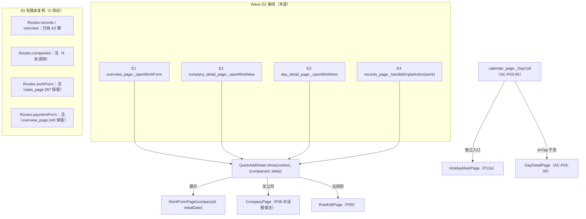

# 20 · Wave D2（导航收尾）实现设计

## §0 冻结声明

- **落盘时间**：`2026-10-10 10:01（现盘实测 `date`）`。
- **本件性质**：**设计文档**。**本文不修改、不新建、不删除 `app/**` 下任何文件**（含 `pubspec.yaml`）；亦不改任何其它波次的既有设计文档。**实现方在本文冻结并经独立审查通过后**，方可按 §1 白名单动 `app/lib/**`（施工纪律 = `DECISIONS.md` D-10 第 4 条「先落盘设计文档 + 声明冻结时间，再动 `lib/`」）。
- **证据层级标注**（`DECISIONS.md` D-8 第 5 条）：本文一律使用 `【实测】`（本设计方现盘 `grep`/`Read`/`stat` 亲手跑出）/ `【类型】仅编译` / `【读码】`（只读源码推断，未运行）。**未核实项单列 §9，不猜**。
- **行号口径**：本文所引行号**均为现盘实测**（本目录非 git 仓库，行号会漂移）。**引用一律「内容摘录 + 行号」，行号仅作参考**（`DECISIONS.md` D-10 第 2 条「行号即证据，转述即失据」）。

---

## §1 范围、文件白名单与硬约束自检

### 1.1 权威范围（`02 §A.3:105`，**逐字**，不得自行扩大或收窄）

> | **Wave D2**<br>导航收尾 | ① **P02 入口闭合**：D1 交付后，把 A/B 内"临时进 `WorkFormPage(companyId:)` / `(initialDate:)`"的入口统一替换为 P02 弹层<br>② **导航细节**：死路由处置（见 §C.2.3） | **必须在 D1 之后**（导航是全局壳，改动影响面最大，最后做以降低返工）；4 Tab 已由 **A2** 完成，D2 不再改 Tab 数 | **无临时入口残留、无孤立路由；`07:907` 入口可达性自检全绿** |

**附加项（本设计的第 ③ 项，证据在 §4）**：**`AC-P03-06` 部分未闭环** —— 由 `19-回流总台账.md §4 在途小项 3`（`19:224-225`）与 `13-WaveB-实现设计.md §3 缺口 5`（`13:324-326`）**双处**指派归 **Wave D2「入口闭合」**。**该指派非本设计方自创**（见 §4 原文）。

### 1.2 明确不做（out of scope）

| # | 不做项 | 依据 |
|---|-------|------|
| N1 | **不改 Tab 数**（4 Tab 已由 A2 落地） | `02 §A.3:105` 括注「4 Tab 已由 A2 完成，D2 不再改 Tab 数」；`main.dart:207-212`【实测】已为 4 项 |
| N2 | **不在本波重写已交付页面**（不重构 QuickAddSheet/CalendarPage 结构） | 主理人派单硬边界「D2 是接线 + 导航收尾，不得重写已交付页面」；**★ 主理人 §9.2 裁定澄清（`2026-10-10`）**：本禁令**限于"重写/重构结构"**；以下三类**属允许的定点改动、不违 N2** —— ① 给已交付件加**具名可选参数**（W5 `QuickAddSheet.initialDate`）；② 已交付页的**主按钮形态**由 §9.1-Q3 + §9.2-P3 裁定变更（`overview_page.dart` FAB）；③ 已交付页的**既有元素接线**（§9.2-P4 `_DayCell` 角标 `onTap`） |
| N3 | **不新增依赖、不新增表、不改 DB 签名**（`shared_preferences` 未获批准） | `02 §E-6:892`；`02 §G T-3:953` |
| N4 | **不改 `Routes.companies`（活路由，A2/D2 均不得删）** | `18 §1.1`（`18:34`）逐字：Q-D1 (b)「`Routes.companies` 保留为"活路由"，**A2/D2 均不得删**」 |
| N5 | **不删除/改动 `Routes.workForm` / `Routes.paymentForm` 常量与 `main.dart` case**（二者均须保留活路由身份，见 §3.3） | 同 N4 口径（Q-D1）之推论；`§C.2.3` 判据「无"定义了但永不调用"的路由」 |
| N6 | **不动 A2 已清理的死路由结论**（`records` / `overview` 已删） | `18 §1.3`（`18:54-60`）；`verify_waveA2.dart` 第 6 节【实测】 |
| N7 | **不动 `payment_record` 侧任何 P10 入口**（P10 非 P02） | `02 §A.3:114` 逐字「**N-4 更正**：该入口指向 **P10**（收款登记）而非 P02，**不应**计入"指向 P02 的入口"」 |

### 1.3 文件白名单（**疑改文件 = 拟改**；越界即打回）

| # | 文件 | 动作 | 依据 |
|---|------|------|------|
| W1 | `app/lib/ui/overview_page.dart` | 改（**仅 E1 接线 + E1/E2 陈旧注释**；FAB 形态见 §9-Q3） | §2 表 E1 |
| W2 | `app/lib/ui/company_detail_page.dart` | 改（**仅 E2 接线**） | §2 表 E2 |
| W3 | `app/lib/ui/day_detail_page.dart` | 改（**仅 E3 接线**） | §2 表 E3 |
| W4 | `app/lib/ui/records_page.dart` | 改（**仅 E4 接线分支**） | §2 表 E4 |
| W5 | `app/lib/ui/quick_add_sheet.dart` | 改（**仅新增可选构造参数 `initialDate` + 逐处消费**，见 §2.3） | §2 表 E3 的前置；`02 AC-P02-10:425` |
| W6 | `app/lib/ui/calendar_page.dart` | 改（**仅新增 P12a 入口**，见 §4） | §4 |
| W7 | `app/lib/ui/holiday_mark_page.dart` | 改（**条件**：仅当 §9-Q5 裁定 P12a 需预置日期时，加可选 `initialDate`） | §4/§9-Q5 |
| W8 | `app/tool/verify_waveD2.dart` | **新建**（D2 专项断言脚本，见 §5） | §5 |

> **不在白名单（明确列出以防误改）**：`app/lib/app/routes.dart`、`app/lib/main.dart`、`app/lib/ui/stats_page.dart`、`app/lib/ui/work_form_page.dart`、`app/lib/ui/payment_form_page.dart`、`app/lib/ui/widgets/record_list_view.dart`、`app/lib/db/**`、`app/pubspec.yaml`。若 §9 任一项裁定要求触碰其中文件，**须先由主理人把该文件加入白名单**（D-8 第 3 条）。

### 1.4 硬约束自检（实现方交回前必跑）

- [ ] `grep -rn "WorkFormPage(" app/lib/ui/` **剔除 `work_form_page.dart`（类定义行）后命中恰 1 处**，且该处 = `quick_add_sheet.dart:400`（展开出口，by design）（即 E1~E4 四处已不再含 `WorkFormPage(`）。〔**v3 按 §9.2-P1 收紧**：原「按 §9.2-P1 收紧」表述误列 `main.dart`（不在 `lib/ui/**`）；`work_form_page.dart:49` 类定义行按文件级剔除〕**现盘基线**见 §2.2。
- [ ] `grep -rn "pushNamed(Routes.workForm)" app/lib/` **仍 ≥1 处**（`stats_page.dart:267`，见 §3.3）；`grep -rn "pushNamed(Routes.paymentForm)" app/lib/` **仍 =1 处**（`overview_page.dart:240`，见 N7）。
- [ ] `routes.dart` 常量集 = `{workForm, paymentForm, companies}`（**未增未减**）。
- [ ] `main.dart` `onGenerateRoute` 的 `case` 集 = `{workForm, paymentForm, companies}`（**未增未减**）。
- [ ] 全部改动文件 **剥注释后**禁浮点扫描零命中（`_floatViolations` 同款，见 §5 A11）。
- [ ] `app/pubspec.yaml` 的 `dependencies` **未新增任何项**。
- [ ] **无未使用 import**：W2/W3/W4 中 `import 'work_form_page.dart';` 已删（改后未用）；四处均新增 `import 'quick_add_sheet.dart';`。
- [ ] 已交付页面的**用户可见字符串**（除 §4 新增的 P12a 入口文案外）**零改动**。
- [ ] **〔v3 新增 · 见 §9.2-P3〕** `overview_page.dart` 含 `floatingActionButton:` 恰 1 处；「`记一笔工作`」与「`记一笔收款`」两条文案**各恰 1 处**（收款按钮**未删**）；`:737`/`:747` 两条 `// 临时(D1)` 注释**已清除**；`_ActionButtons.onWorkTap` 死形参**已移除**。
- [ ] **〔v3 新增 · 见 §9.2-P4〕** `calendar_page.dart` 含**独立的 P12a 入口**（角标 `onHolidayTap` → `const HolidayMarkPage()`），且原 `onTap: () => _openDay(date)`（AC-P03-08 路径）**未动**。

---

## §2 P02 入口闭合（①）

### 2.1 ★ 本波为什么必须做（背景，自足）

**核心事实（本设计方独立复现）**：`QuickAddSheet`（P02 弹层，D1 批 2 新建）**全仓零生产调用者**。现盘实测：

```
grep -rn "quick_add_sheet|QuickAddSheet" app/lib/  →  仅 5 处，全部在 quick_add_sheet.dart 自身
grep -rln "QuickAddSheet" app/tool/                →  tool 零命中
```
→ 弹层**当前不可达**；其 `[真机]` 路径不存在；本批核心价值「在弹层里记工也能拿节假日倍率」**在用户侧尚未闭环**。此即 `review-d1b` 审查官 **MAJ-1**（`_scratch/review-d1b/审查报告.md:62-68`，逐字「`quick_add_sheet.dart` 全仓零生产引用 ⇒ 弹层不可达」）。设计本身把「入口统一替换**属 Wave D2**」（`16 §2.3` 波次提示栏 `16:232`；`09 §6.6:615`）⇒ **非越界，但必须由 D2 收口**。

### 2.2 逐入口现状表（**现盘实测**；行号为 2026-10-10 10:01 实测）

> **筛选口径**：在 `app/lib/ui/**` 搜 `WorkFormPage(` / `PaymentFormPage(` / `pushNamed(Routes.workForm|paymentForm)` 的**命令式/命名**调用点，逐点判定其**入口语义**与**是否 P02**。

| # | 文件:行号（现盘） | 现盘事实（内容摘录） | 入口语义 / 触发控件 | 是否 P02 入口 | D2 处置 |
|---|------------------|--------------------|--------------------|--------------|--------|
| **E1** | `app/lib/ui/overview_page.dart:232-236` | `Future<void> _openWorkForm() async {` / `// 临时(D1)：Wave D1 交付 P02 后由 Wave D2 统一替换为弹层。`(`:233`) / `await Navigator.of(context).pushNamed(Routes.workForm);`(`:234`) | **P01「记一笔工作」**（`overview_page.dart:738-742` `FilledButton.icon`） | **是**（`09 §6.6:613-615`【实测】明列；`19 R8`） | **改为弹层**（§2.3-E1） |
| **E2** | `app/lib/ui/company_detail_page.dart:196-205` | `Future<void> _openWorkNew() async {` / `// 临时(T-1)：Wave D1 前 P02 未交付，先用 WorkFormPage 新建态并预置公司。`(`:197`) / `builder: (_) => WorkFormPage(companyId: widget.companyId),`(`:200`) | **P07「+ 记一笔」**（预置公司） | **是**（`02 §A.3:113`；`09 §8:702`） | **改为弹层**（§2.3-E2） |
| **E3** | `app/lib/ui/day_detail_page.dart:180-189` | `/// 临时入口（T-1，Wave D1 前 P02 未交付）：预置 workDate = 本日。`(`:180`) / `Future<void> _openWorkNew() async {`(`:181`) / `builder: (_) => WorkFormPage(initialDate: widget.date),`(`:184`) | **P04「+ 记一笔」**（预置归属日） | **是**（`02 §A.3:115`；`09 §8:702`） | **改为弹层**（§2.3-E3，**需 W5 前置**） |
| **E4** | `app/lib/ui/records_page.dart:304-312` | `Future<void> _handleEmptyAction(bool isWork, RecordsFilter f) async {`(`:304`) / `// 传 f.companyId（T-1 预置）…`(`:306-307`) / `builder: (_) => WorkFormPage(companyId: f.companyId),`(`:310`) | **RecordsPage 空态「记一笔工作」**（`records_page.dart:285-286` 注入） | **是**（`09 §8:712`「临时」；`02 §C.1.3:189`「Wave D1 前临时：进 `WorkFormPage(companyId:)`，标"临时"」） | **改为弹层**（§2.3-E4） |
| **X1** | `app/lib/ui/overview_page.dart:238-242` | `Future<void> _openPaymentForm() async {` / `// 临时(D1)：Wave D1 交付 P02 后由 Wave D2 统一替换为弹层。`(`:239`) / `pushNamed(Routes.paymentForm);`(`:240`) | **P01「记一笔收款」** → **P10** | **否**（N7：指向 P10） | **不改行为**；`:239` 注释为**陈旧误标**（见 §7-R2） |
| **X2** | `app/lib/ui/company_detail_page.dart:207-216` | `Future<void> _openPaymentNew()` / `// 不标临时（N-5）：P10 本体即 PaymentFormPage，已在 Wave A 交付。`(`:208`) / `PaymentFormPage(companyId: widget.companyId)`(`:211`) | **P07「记一笔收款」** → **P10** | **否**（`02 §A.3:114` N-4/N-5） | **不改** |
| **X3** | `app/lib/ui/records_page.dart:313-318` | `else { … PaymentFormPage(companyId: f.companyId) … }`(`:316`) | **RecordsPage 空态「记一笔收款」** → **P10** | **否** | **不改** |
| **X4** | `app/lib/ui/widgets/record_list_view.dart:213` | `MaterialPageRoute<void>(builder: (_) => PaymentFormPage(id: id))` | 收款行点击 → **P10 编辑** | **否**（编辑态，非新建） | **不改** |
| **X5** | `app/lib/main.dart:51` | `builder: (_) => WorkFormPage(id: _extractId(settings)),` | 命名路由 `/work/new` **深链编辑态** | **否**（编辑态） | **不改**（且 `Routes.workForm` 须保留，§3.3） |
| **X6** | `app/lib/main.dart:55` | `builder: (_) => PaymentFormPage(id: _extractId(settings)),` | 命名路由 `/payment/new` **深链编辑态** | **否** | **不改** |
| **X7** | `app/lib/ui/quick_add_sheet.dart:400` | `builder: (_) => WorkFormPage(companyId: _companyId, initialDate: _today()),` | 弹层「**展开**」→ P02b 完整表单 | **否**（`16 §2.3.2` 设计内「展开」出口；`07:270`） | **不改**（§7-R3 记 07:893 口径差异） |
| **B1** | `app/lib/ui/stats_page.dart:266-269` | `Future<void> _openWorkForm() async { … pushNamed(Routes.workForm); }`(`:267`) | **P11 空态「记一笔工作」**（`stats_page.dart:360` `_EmptyView(onAddWork: _openWorkForm)`） | **否**（Wave C1，不属 "A/B 内"） | **不改**（**待裁定** §9-Q2；亦是 §3.3 的活路由关键） |
| **B2** | `app/lib/ui/overview_page.dart:735-753` | 两个 `FilledButton`（`:738` 记一笔工作 / `:748` 记一笔收款），含 `// 临时(D1)：07:226 要求 P01 + 记一笔 为 FAB…FAB 推 Wave D2。`(`:737`/`:747`) | P01 主按钮**形态**（`07:226` 要求 FAB） | 部分（E1 的宿主控件） | **待裁定**（§9-Q3，FAB 形态是否属 D2） |

**结论**：**P02 临时入口 = E1 / E2 / E3 / E4 共 4 处**。其余（X1~X7、B1）**均非 P02 或非 A/B 内**，本波不改（B1 待裁定）。

### 2.3 改后形态与调用签名（逐入口）

**统一接线写法**（对齐 `09 §8:715-720` 与 `07 §0.2-7` 无条件重载）：

```dart
await QuickAddSheet.show(context, /* 预置参数 */);
if (!mounted) return;
await _load();          // 07 §0.2-7：无条件重载
```

> **★ 写法钉死（v4 按复审 R-02 明确）**：四处调用的 **`show(...)` 实参写法一律按上表逐字写** —— ① **不得改为间接变量**（如 `final d = widget.date; … show(context, date: d)`），否则 `A19`/`A20`/`A21` 的正则会 MISS（**属实现偏离设计，不是断言缺陷**）；② 允许 `dart format` 的**换行**与**尾逗号**（`A19`~`A21` 的正则已含 `\s*,?\s*\)` 容忍）。

> **注意**：E1/E3/E4 的宿主是「页 `_load()`」；E2 宿主 P07 亦为 `_load()`。弹层保存成功后自身已 `dataBus.dataChanged()`（`quick_add_sheet.dart:345`），叠加宿主 `_load()` 为**幂等冗余**（安全，不违任何 AC）。

| # | 落点（现盘行号） | 改后形态（**写死**） | 说明 |
|---|----------------|--------------------|------|
| **E1** | `overview_page.dart:232-236` | ```Future<void> _openWorkForm() async { await QuickAddSheet.show(context); if (mounted) await _load(); }``` | 删除 `// 临时(D1)` 注释（`:233`）；`Routes` 仍被 `:221`/`:228` 使用 → `import '../app/routes.dart';`（`:22`）**不删**；**新增 `import 'quick_add_sheet.dart';`**（`overview_page.dart` 现盘**未** import `work_form_page.dart`，无删项） |
| **E2** | `company_detail_page.dart:196-205` | ```Future<void> _openWorkNew() async { await QuickAddSheet.show(context, companyId: widget.companyId); if (!mounted) return; await _load(); }``` | 删除 `// 临时(T-1)`（`:197`）；**公司预置语义不变**（`QuickAddSheet.initialCompanyId`）；**删 `import 'work_form_page.dart';`（`:39`，改后未用）**；**新增 `import 'quick_add_sheet.dart';`**；`import '../app/routes.dart';`（`:28`）仍被 `:221` 使用 → 保留 |
| **E3** | `day_detail_page.dart:180-189` | ```Future<void> _openWorkNew() async { await QuickAddSheet.show(context, date: widget.date); if (!mounted) return; await _load(); }``` | 删除 `/// 临时入口…`（`:180`）；**归属日预置语义** ⇒ **需 W5 前置**（§2.3.1）；**删 `import 'work_form_page.dart';`（`:34`，改后未用）**；**新增 `import 'quick_add_sheet.dart';`** |
| **E4** | `records_page.dart:304-312` | 工作分支：`await QuickAddSheet.show(context, companyId: f.companyId);`（`else` 分支**不动**） | 删除 `:306-307` 的「T-1 预置」注释；`f.companyId` 为 `null` 时 = 无预置（弹层走默认）；**删 `import 'work_form_page.dart';`（`:38`，改后未用）**；`import 'payment_form_page.dart';`（`:34`）**保留**（`:316` 仍用）；**新增 `import 'quick_add_sheet.dart';`** |

#### 2.3.1 W5 前置：`QuickAddSheet` 新增可选 `initialDate`（★ 本波唯一「改已交付件」项）

**为什么必须**：E3 的入口语义 = 「预置归属日 = `widget.date`」（`07:339` 逐字「`+ 记一笔` → P02（预置 `workDate` = 本日）」；`02 AC-P02-10:425` 逐字「P04「`+ 记一笔`」进入 → 归属日预置为当日」）。而现盘 `QuickAddSheet` **归属日硬编码今天**，`initialDate` 能力**不存在**：

```
quick_add_sheet.dart:52   const QuickAddSheet({super.key, this.initialCompanyId});   // 无 initialDate/date
quick_add_sheet.dart:160  ctx = await resolveDayContext(ledgerId: ledgerId, workDate: _today());
quick_add_sheet.dart:318  workDate: _today(),                                        // 落库归属日
quick_add_sheet.dart:400  WorkFormPage(companyId: _companyId, initialDate: _today())  // 展开
quick_add_sheet.dart:479  Text('今天 ${_fmtDate(_today())}')                          // 归属日显示
```
⇒ 若 D2 只把 E3 换成 `QuickAddSheet.show(context)`，则**非今天的 P04 日**点「记一笔」会**静默记到今天** = 数据错误（比"临时入口"更坏）。故 **W5 是 E3 的必要前置，非可选**。

**最小改动面（8 处，均为「新增可选参数 + 替换 `_today()` 取值为 `_workDate`」，不改结构）**：

| 落点（现盘行号） | 改后（写死） |
|----------------|-------------|
| `:52` 构造 | `const QuickAddSheet({super.key, this.initialCompanyId, this.initialDate});` + 新增字段 `/// 入口预置归属日（T-1，可空）：P04「+ 记一笔」传入；为空 = 今天。` `final DateTime? initialDate;` |
| `:58-64` 静态 `show` | 签名加可选具名 `DateTime? date`，builder 传 `QuickAddSheet(initialCompanyId: companyId, initialDate: date)` |
| 新增 getter（紧随 `:112-115` `_today()`） | `DateTime get _workDate { final d = widget.initialDate ?? _today(); return DateTime(d.year, d.month, d.day); }`（**归一到日**，与 `_today()` 同口径） |
| `:160` | `workDate: _workDate` |
| `:318` | `workDate: _workDate,` |
| `:400` | `WorkFormPage(companyId: _companyId, initialDate: _workDate)` |
| `:478-479` | 归一日 = 今天 → 保留 `'今天 …'`；否则显示 `_fmtDate(_workDate)`（**只读不变**） |
| `:5` / `:92` 文档注释 | 「归属日固定今天」→「归属日**默认今天**，可由入口预置（P04）」 |

> **向后兼容**：`initialDate` 为**具名可选参数**，W1/W2/W4 的调用（不传 date）**零破坏**；`:400` 展开路径行为在无预置时与现状**逐字相同**。
> **不涉浮点/DB 签名/依赖**：纯 UI 参数透传，符合 §1.2 N3。
> **冲突登记**：`16 §2.3.1`（D1 设计）冻结口径为「归属日**固定今天**（只读文本）」。W5 与之**表面措辞冲突**（详见 §9-Q1 与 §7-R4），**故 W5 须经主理人裁定后方可实施**。

---

## §3 导航细节：死路由逐条处置（②）

### 3.1 `02 §C.2.3` 需求（逐字）

> - `Routes.records`（`/records`）在 4 Tab 落地后**不再对应底部 Tab**；……**验收判据 = 全工程无"定义了但永不调用"的路由，且无"被调用但未注册"的路由**（`routes.dart:11-15` 5 个常量 × `main.dart:46-60` 4 个 case → 目前 `Routes.overview` 也未注册，需一并核对）。

### 3.2 逐条处置表（**现盘实测**）

| 路由常量 | 现盘 `routes.dart` | 现盘 `main.dart` `onGenerateRoute` | 现盘调用点（`grep`） | 判定 | D2 动作 |
|---------|-------------------|-----------------------------------|--------------------|------|--------|
| `Routes.records` | **不存在**（A2 已删） | **无 case**（A2 已删） | **0** | **已收口** | **不动**（复跑 `verify_waveA2.dart` 第 6 节） |
| `Routes.overview` | **不存在**（A2 已删） | **无 case**（从未注册） | **0** | **已收口** | **不动** |
| `Routes.companies` | `routes.dart:29`【实测】 | `main.dart:61-62` `case Routes.companies:` → `const CompanyPage()` | `overview_page.dart:221` / `:228`、`company_detail_page.dart:221`、`settings_page.dart:97`（**4 处**） | **活路由** | **不得删**（N4） |
| `Routes.workForm` | `routes.dart:27`【实测】 | `main.dart:49-52` | `overview_page.dart:234`（E1）+ **`stats_page.dart:267`**（B1） | **活路由（2 处）** | **不动**；E1 接线后 **仍余 1 处（B1）**（§3.3） |
| `Routes.paymentForm` | `routes.dart:28`【实测】 | `main.dart:53-56` | `overview_page.dart:240`（**1 处**） | **活路由** | **不动**（N5/N7） |

**结论**：**D2 的「死路由处置」= 0 处代码改动**。A2 已按 `11 §1 Q-D1`(a) / `09 §13.1 N-D7` / `12 §7` **同批**删除 `records`/`overview` 常量与 case（`18 §1.3`，`18:54-60`【实测】）。D2 的职责 = **复核「无孤立路由」判据在 E1 接线后仍成立**（§3.3）+ **登记上游文书订正 R32**（§7-R1）。

### 3.3 ★ E1 接线的「新增死路由」风险（本设计特有的关键交互）

E1 把 `overview_page.dart:234` 的 `pushNamed(Routes.workForm)` 换成弹层 ⇒ `Routes.workForm` 调用点由 **2 处降为 1 处**（`stats_page.dart:267`）。**只要 B1 不动，`Routes.workForm` 仍是活路由，判据不破**。

**但若 §9-Q2 裁定「B1 也换弹层」** ⇒ `Routes.workForm` 调用点归 **0** ⇒ **变成新增死路由** ⇒ 按 `N-D7`「**常量 + `main.dart` case 同批，不得只删其一**」必须 **同时**删 `routes.dart:27` 常量 + `main.dart:49-52` case（**本轮不在白名单**，须主理人补授权）。**本设计不自行拍板**（见 §9-Q2）。

> **同理**：`Routes.paymentForm` 唯一调用点是 `overview_page.dart:240`（X1）。**只要不动 X1**（N7），它保持活路由。

---

## §4 `AC-P03-06` 收口（③ · 是否确属 D2）

### 4.1 证据链（**双处指派，非本设计自创**）

| 来源（现盘） | 逐字摘录 |
|------------|---------|
| `02 §D.3:453` | `AC-P03-06 \| 节假日标记 \| 命中当日有不同底色/角标；点击可查看/编辑（入 P12a） \| [真机]` |
| `13-WaveB-实现设计.md §3 缺口 5`（`13:324-326`） | 「**M-04 · 本波不改，归 Wave D2**」/「`07:353` 要求 P03 节假日标记「点击可查看/编辑（入 P12a）」；P12a `HolidayMarkPage` **Wave C1 已交付**，但 P03 侧入口**本波未接**」/「**AC-P03-06 = 部分未闭环**（渲染 ✅ / 点击查看编辑 ❌）→ 归 **Wave D2「入口闭合」** 接上」 |
| `19-回流总台账.md §4 在途小项 3`（`19:224-225`） | 「**`P03` 接 `P12a` 入口（Wave D2 待办）**……**经主理人裁定：此项非回流项，移入本 §4**，标注「**Wave D2 待办**：P03 接 P12a 入口」」/「**★ 留痕（主理人本轮要求）：`AC-P03-06` …… = 部分未闭环**，归 **Wave D2「入口闭合」**」 |
| **`07:305`** | （P03 控件清单行，**现盘实测**）「└ 节假日标记 \| 角标 / 底色 \| `A7` 命中当日 \| 节假日/调休不同底色；**点击可查看/编辑（P12 入口）**」 |
| `07:307` | （P03 格点击行，**现盘实测**）「格点击 \| 行点击 \| → P04 日详情 \| 有记录才可点（无记录给轻提示或直接进空态日详情）」⇒ **单元格点击语义已被 P04 占用**（AC-P03-08），P12a 入口**必须另开**（§4.3） |

> **★ 行号漂移更正（本设计现盘实测，D-10 第 2 条）**：`13 §3 缺口 5`（`13:325`）与 `19:224` 均引 **`07:353`** 作为 P03 节假日标记条文；**现盘 `07:353` 实为 P04「当天只有草稿」段**（`07` 全文 1019 行）。**正确落点为 `07:305`**（全文唯一「点击可查看」命中）。此为**上游引用行号漂移**，**不属回流项**（内容无误、仅行号过时）→ 仅在 §7-R9 留痕。

**判定 ③ 成立**：`AC-P03-06` 的「点击查看/编辑（入 P12a）」确属 D2。

### 4.2 现盘事实（**实测**）

- **已成立的半条**：`calendar_page.dart:362-366` `_holidayFill(HolidayType)` 按法定/调休/自定义给不同底色；`:320` `color: marked ? _holidayFill(holiday!.type) : null` ⇒ 「命中当日有不同底色」（AC-P03-06 前半）**已实现**。
- **未成立的半条**：唯一格点击路径为 `calendar_page.dart:219` `onTap: () => _openDay(date)`，`:151-157` `_openDay` **只** `push(DayDetailPage(date: day))`；**全 `calendar_page.dart` 无 `HolidayMarkPage` 引用**（`grep` 0 命中）⇒ 「点击入 P12a」**未实现**。
- **P12a 现盘签名**：`holiday_mark_page.dart:32-33` `const HolidayMarkPage({super.key});` —— **无日期参数**。

### 4.3 D2 处置（**待 §9-Q5 定形态后落笔**）

`AC-P03-06` 只要求「**点击可查看/编辑（入 P12a）**」，**未要求**必须带日期直达/滚动定位。故最小改动面为：

- **方案 α（最小）**：`calendar_page.dart` 的 `_DayCell` 增加一个**显式的「节假日标记」次要入口**（仅当 `holiday != null` 时显示，如格子右下角小图标 `onTap`）→ `Navigator.push(MaterialPageRoute(builder: (_) => const HolidayMarkPage()))`，返回后 `_load()`。**不改 `HolidayMarkPage` 签名**（W7 不启用）。
  - 优点：改动面最小、零签名变更、W7 不进白名单。
  - 风险：不直达该日，用户仍需在 P12a 列表里找该日（**是否满足 AC 字面「查看/编辑」——需裁定**）。
- **方案 β（带日期预置）**：`HolidayMarkPage` 加可选 `initialDate`（滚动/高亮该日）→ `HolidayMarkPage(initialDate: date)`。**需启用 W7**。
  - 优点：体验更贴「点击该日 → 编辑该日」。
  - 风险：改 Wave C1 已交付件；超出「入口闭合」的最小面。

> **本设计不拍板**：α/β 的选择写入 **§9-Q5**，由主理人裁定。**注意 §4.2 的「底色」半条已由 `_DayCell` 承担点击（进日详情，AC-P03-08）**，故 P12a 入口**不得覆盖**原 `onTap`（否则破 AC-P03-08）——**必须**是**独立**入口（如长按或角标）。

---

## §5 可证伪断言清单（A 组静态 / B 组行为）

> **纪律（本项目第 10 类教训 · 断言须能"回退修复置红"）**：**每条断言必须能被"把改动还原"置红，否则为假断言**。来历：`_scratch/review-b/复审报告.md`（`verify_waveB` 曾出现"改坏仍全绿"的假覆盖）+ `13-WaveB-实现设计.md` 订正节。下表**每条单列「如何被证伪」列**。
> **载体**：`app/tool/verify_waveD2.dart`（**新建**，W8；静态层仿 `verify_waveA2.dart`，行为层仿 `verify_waveD1.dart` §B，**读真实源码 + 真实内存库 + 真实实体**）。跑法：`set WORKLOG_USE_SYSTEM_SQLITE=1` + `dart.exe --disable-dart-dev --packages=.dart_tool/package_config.json tool\verify_waveD2.dart`。

### 5.1 A 组（静态 · 读真实源码；剥注释 `(^|\s)//.*$` multiLine）

| 编号 | 断言 | 落点（现盘行号） | **如何被证伪（回退置红）** | 证据档 |
|------|------|----------------|------------------------|--------|
| **A1** | `QuickAddSheet.show(` 在 `lib/ui/**`（**排除 `quick_add_sheet.dart` 自身**）命中 **恰 4 处** | E1~E4 | 删任一 `QuickAddSheet.show(`（还原为 `WorkFormPage(`/`pushNamed`）→ 计数 ≠4 → 红 | 【实测】 |
| **A2** | `overview_page.dart` 剥注释后**不含** `pushNamed(Routes.workForm)` | `:234` | 把 E1 还原为 `pushNamed(Routes.workForm)` → 红 | 【实测】 |
| **A3** | `company_detail_page.dart` 剥注释后**不含** `WorkFormPage(companyId:` 且 `_openWorkNew` 体含 `QuickAddSheet.show(` | `:200` | 还原 `:200` → 红 | 【实测】 |
| **A4** | `day_detail_page.dart` 剥注释后**不含** `WorkFormPage(initialDate:` 且含 `QuickAddSheet.show(` | `:184` | 还原 `:184` → 红 | 【实测】 |
| **A5** | `records_page.dart` 工作分支（`isWork`）**不含** `WorkFormPage(companyId:` 且含 `QuickAddSheet.show(` | `:310` | 还原 `:310` → 红 | 【实测】 |
| **A6** | **`lib/ui/**` 剥注释后 `WorkFormPage(` 命中 —— 剔除 `work_form_page.dart`（类定义行）后 **恰 1 处**，且该处位于 `quick_add_sheet.dart`（展开出口）** 〔**主理人 §9.2-P1 收紧**：原「≤2」的理由列误列 `main.dart`（不在 `lib/ui/**`）且**漏列 `work_form_page.dart:49` 类定义行**〕 | E1~E4 已清 | 任一入口残留 `WorkFormPage(` → 剔除定义行后计数 >1 → 红 | 【实测】 |
| **A7** | `quick_add_sheet.dart` 含 `this.initialDate` **恰 1 处** + `initialDate:` **恰 2 处** + `workDate: _workDate` **恰 2 处**（`:160`/`:318`）+ `_workDate` 定义 1 处 〔**v3 补注（`review-d2` B.3）**：两处 `initialDate:` **异质** —— 1 处是 `show` 的 builder `QuickAddSheet(… initialDate: date)`（`:63` 一带）、1 处是 `:400` 的 `WorkFormPage(… initialDate: _workDate)`（**展开出口**）⇒ **不得"合并成 1 处"**〕 | W5 | 删 `initialDate` 或任一 `_workDate` → 红 | 【实测】 |
| **A8** | `quick_add_sheet.dart` 剥注释后**不含** `_today()` 直传（即 `workDate: _today()` / `initialDate: _today()` 均 0 命中） | W5 | 任一处还原 `_today()` → 红 | 【实测】 |
| **A9** | **死路由判据**：`routes.dart` 无 `records`/`overview` 常量；`main.dart` 无对应 case；`routes.dart` 保留 `companies`；`main.dart` 有 `case Routes.companies:` | §3.2 | 复跑 `verify_waveA2.dart` 第 6 节（**既有脚本**，非本波新写）；删 `companies` → 红 | 【实测】 |
| **A10** | **`Routes.workForm` 仍 ≥1 活调用**（`grep pushNamed(Routes.workForm)` ≥1）；**`Routes.paymentForm` 仍 =1**（`overview_page.dart:240`） | §3.3 | 若误删 stats 入口/误改 overview:240 而不删常量 → 红 | 【实测】 |
| **A11** | 全部改动文件剥注释后 `_floatViolations` 零命中（复用 `verify_waveD1.dart:132-153` 正负例） | W1~W7 | 引入 `fen/100` / `/10`（非 `~/`）/`double.parse` → 红 | 【实测】 |
| **A12** | `app/pubspec.yaml` `dependencies` **未新增**（尤其无 `shared_preferences`） | §1.4 | 加依赖 → 红 | 【实测】 |
| **A13** | `calendar_page.dart` 剥注释后含 **≥1** 处 `HolidayMarkPage(` 命令式 push，且**原 cell 点击路径**（**按内容定位**：`contains('onTap: () => _openDay(date)')`，**不用行号**）仍在（保 AC-P03-08） 〔**v3 按 `review-d2` C-13 改内容定位**（原用行号 `:219`，会随编辑漂移）〕 | §4.3 | 删 P12a 入口 → 红；**把该 `onTap` 改掉 → 亦红** | 【实测】 |
| **A14** | **（辅助项，不单独作行为证据）** `calendar_page.dart` 新入口**独立于 cell 点击**：`onHolidayTap` 不在 `onTap: () => _openDay(date)` 同一行 〔**v3 按 C-13 降级**：文案/注释型断言可被"写个注释"满足 ⇒ 真正的接线证据 = **A22**〕 | §4.3 | 与 `_openDay` 合并 → 红 | 【读码→实测】 |

> **★ A15~A18 = 主理人 §9.2 裁定追加（P-2 / P-3 / P-4）**，**与 A1~A14 同等必备**。

| 编号 | 断言 | 落点（现盘行号） | **如何被证伪（回退置红）** | 证据档 |
|------|------|----------------|------------------------|--------|
| **A15** | `overview_page.dart` 剥注释后含 `floatingActionButton:` **恰 1 处** 且含 `FloatingActionButton` **≥1 处** | §9.2-P3（`Scaffold` 现盘 `:256`） | 删 `floatingActionButton:`（还原为仅 `body:`）→ 红 | 【实测】 |
| **A16** | `overview_page.dart` 剥注释后保留**两条**用户可见文案：「`记一笔工作`」**恰 1 处**、「`记一笔收款`」**恰 1 处** | §9.2-P3 / `_ActionButtons` 现盘 `:726-753` | 删/改任一文案 → 红（**「记一笔收款」被误删必红** ⇒ 防"为做 FAB 而砍掉收款按钮"） | 【实测】 |
| **A17** | `quick_add_sheet.dart` 剥注释后含 `DateTime get _workDate` **恰 1 处**，且其体内含 `widget.initialDate ?? _today()` **恰 1 处** | §2.3.1（getter，紧随 `:112-115` `_today()`） | 删 getter / 把 `?? _today()` 改回 `_today()` → 红（此时 `A8` 亦应红） | 【实测】 |
| **A18** | `calendar_page.dart` 剥注释后 `const HolidayMarkPage()` **恰 1 处**，且 `HolidayMarkPage(` **总命中恰 1 处**（⇒ **无 `initialDate:` 传参 = 证 α 而非 β**） | §9.2-P4（`_openHolidayMark()`） | 删该处 → 红；改为 `HolidayMarkPage(initialDate: …)`（β）→ 总命中仍 1 但 `const` 消失 → `const HolidayMarkPage()` 计数 0 → 红 | 【实测】 |

> **★ A19~A24 = `review-d2` 首轮审查（C-02 / C-03 / C-07）追加的"实参级 / 接线级"断言 —— 与 A1~A18 同等必备。**
> **为什么要它们（实测逃逸场景）**：`A1`/`A3`/`A4`/`A5` **只数「`QuickAddSheet.show(` 出现处数」+「含 `QuickAddSheet.show(`」**，**不校验预置实参**。审查官在副本实测：把 E3 接成 `QuickAddSheet.show(context)`（**丢掉 `date: widget.date`**）→ `A1`=4、`A4` 绿、`A6`=1、`A7`=2、`A8`=0、`A17`=1 **全绿** —— 而这**正是 §2.3.1 自称「静默记到今天 = 数据错误（比'临时入口'更坏）」的场景** ⇒ 旧断言集**放过真 bug**。同理 E2/E4 的预置实参与 `records_page.dart` 的 else 分支（P10 入口）**均无保护**。

| 编号 | 断言 | 落点（现盘行号） | **如何被证伪（回退置红）** | 证据档 |
|------|------|----------------|------------------------|--------|
| **A19** | `day_detail_page.dart` 剥注释后**正则** `QuickAddSheet\.show\(\s*context\s*,\s*date\s*:\s*widget\.date\s*,?\s*\)` 命中 **恰 1 处**（★ **E3 预置归属日实参**）〔**v4 按复审 R-02 放宽尾逗号**：原 `\s*\)` 在 `dart format` 自动补尾逗号（`,\n)`）或跨行写法下会 **MISS 误红**；现容忍 `,?\s*`〕 | §2.3-E3（现盘 `:181-189`） | **接成 `QuickAddSheet.show(context)`（丢 `date:`）→ 红**（= `review-d2` C-02 实测逃逸场景）；改成 `date: DateTime.now()` → 红 | 【实测】 |
| **A20** | `company_detail_page.dart` 剥注释后**正则** `QuickAddSheet\.show\(\s*context\s*,\s*companyId\s*:\s*widget\.companyId\s*,?\s*\)` 命中 **恰 1 处**（★ **E2 预置公司实参**）〔**v4 同 R-02 放宽**〕 | §2.3-E2（现盘 `:196-205`） | 丢/改 `companyId:` 实参 → 红 | 【实测】 |
| **A21** | `records_page.dart` **工作分支内**（`isWork` 分支）**正则** `QuickAddSheet\.show\(\s*context\s*,\s*companyId\s*:\s*f\.companyId\s*,?\s*\)` 命中 **恰 1 处**（★ **E4 预置公司实参**）〔**v4 同 R-02 放宽**〕 | §2.3-E4（现盘 `:304-312`） | 丢/改 `companyId:` 实参 → 红 | 【实测】 |
| **A22** | `calendar_page.dart` 剥注释后**同时**满足：① **精确正则**`onHolidayTap:\s*_holidayByDate\[key\]\s*==\s*null\s*\?\s*null\s*:\s*\(\)\s*=>\s*_openHolidayMark\(\),?` 命中 **恰 1 处**（= **调用处传参**，§9.2-P4 已钉死该写法）；② `onHolidayTap` **总命中 ≥4 处**（字段定义 1 + 构造 1 + `build` 内 `onTap: onHolidayTap` 1 + 调用处传参 1）；③ `_openHolidayMark(` **≥2 处**（定义 + 调用）—— **三者缺一即红**（★ **证明角标真的接上了 `_openHolidayMark()`，而非"定义了却没接"**）〔**v4 按 `review-d2` 复审 R-01 收紧**：v3 只写「`onHolidayTap` ≥2」—— 复审实测「**删掉调用处传参后计数仍 = 3 ≥ 2 ⇒ 断言仍绿、bug 逃逸**」；`A22` 是本波 `C-03` 的**唯一证据**（`A14` 已降级）〕 | §9.2-P4（调用处 `:214-220` / `_DayCell` `:293-367`） | **删调用处 `onHolidayTap:` 传参** → ① 计数 **0** → 红、② 降至 **3** → 红、③ `_openHolidayMark(` 降至 **1** → 红（**三条同时红**）；**只定义 `_openHolidayMark()` 而不接线 → 全红**（= C-03 场景）；写成 `onHolidayTap: holiday == null ? null : _openHolidayMark,`（偏离钉死形态）→ ① 红 | 【实测】 |
| **A23** | `records_page.dart` 剥注释后含 `PaymentFormPage(companyId: f.companyId)` 命中 **恰 1 处**（★ **保护 P10 收款 `else` 分支不被误删**） | `:313-318` | 删 `else` 分支 → 红（= C-07 场景） | 【实测】 |
| **A24** | `overview_page.dart` 的 `_openWorkForm` **方法体内**（**仅方法体内**，不含文件其它处）的 `QuickAddSheet.show(` 调用**不含** `companyId:` / `date:` 实参（★ **E1 = P01 新建态、无预置**，依据 `02:116`「临时进 `WorkFormPage()`（**新建态、无预置参数**）」）〔**v4 按复审补「仅方法体内」限定**〕 | §2.3-E1（现盘 `:232-236`） | 给 E1 误加预置实参 → 红 | 【实测】 |

> **★ `A25`~`A27` = `review-d2` 实现产物审查（第三轮）发现的 5 条逃逸面的补强 —— **与 `A1`~`A24` 同等必备**，规格见 **§9.7**。**
> **为什么要它们（`review-d2` 副本实测的逃逸场景）**：把 `calendar_page.dart` 的 `_DayCell` 角标 `Icon(Icons.local_offer…)` **整条删除**（或换成 `Icon.star`）后，脚本**仍 38/0 全绿** —— 而该角标是 `AC-P03-06` 的**唯一可视入口**（用户据此找到 P12a），`A22` 只证「回调已接线」、**不证「角标存在」**。**根因 = 主理人 v4 修 `R-01` 把 `A22` 收紧为三条件时，丢掉了 v3 曾有的 `Icon(Icons.local_offer` 检查** ⇒ **覆盖退步（主理人自造，须补回）**。同类还有：E3 触发按钮 / 收款按钮的 `onPressed` 被改 `null`（用户点不动）亦 38/0。

| 编号 | 断言 | 落点（现盘行号） | **如何被证伪（回退置红）** | 证据档 |
|------|------|----------------|------------------------|--------|
| **A25** | `calendar_page.dart` 剥注释后**同时**满足：① `Icon(Icons.local_offer` **恰 1 处**（★ **角标图标存在**，堵 **E-1**）；② `GestureDetector(` **≥1 处**；③ `behavior: HitTestBehavior.opaque` **恰 1 处**（堵 **E-2**） | §9.2-P4（角标 `:354-360`） | 删/替换该 `Icon`（如换 `Icons.star`）→ ① 计数 **0** → 红；删 `behavior: …opaque,` → ③ 计数 0 → 红 | 【实测】 |
| **A26** | `overview_page.dart` 剥注释后**同时**满足：① `floatingActionButton:` 块内 `onPressed: _openWorkForm` **恰 1 处**（★ **FAB 真的接上了方法**，堵 **E-5 同源**）；② `_openWorkForm` **方法体内**含 `await _load()` **≥1 处**（堵 **E-3**） | §9.2-P3（FAB `:269-273`）/ §2.3-E1（`:233-236`） | FAB 的 `onPressed` 改 `null` → ① 红；删方法体内的 `await _load();` → ② 红 | 【实测】 |
| **A27** | **两处接线**：① `day_detail_page.dart` 剥注释后含 `onPressed: _openWorkNew` **≥1 处**（★ **E3 的触发按钮还在**，堵 **E-4**）；② `overview_page.dart` 的 `_ActionButtons` **类体内**含 `onPressed: onPaymentTap` **恰 1 处**（★ **收款按钮未断线**，堵 **E-5**；`A16` 只数字案） | §2.2-E3（`day_detail_page.dart:235`）/ §9.2-P3（`_ActionButtons`） | 分别改 `null` → 对应条红 | 【实测】 |

### 5.2 B 组（行为 · 真实内存库 `AppDatabase` + 真实实体 `resolveDayContext`/`AmountEngine`）

> 弹层是 Flutter 组件、本机无 UI 运行时（`02 §D.0.1:308-315`），**脚本不能驱动弹层 widget**。故 B 组断言 **DB/引擎/日期上下文链**（弹层保存路径所依赖的真实实体），并**显式标注「不读弹层源码 ⇒ 不构成弹层 widget 行为证据」**（对齐 `verify_waveD1.dart:16-19` 的诚实口径）。

| 编号 | 断言 | 方法（真实实体） | **如何被证伪（回退置红）** | 证据档 |
|------|------|----------------|------------------------|--------|
| **B1** | **日期 → 引擎分流链**（**不含 E3 入口接线** —— 入口实参由 **`A19`** 覆盖）〔**v3 按 `review-d2` C-12 改标题**：原题「E3 的 preset 日期被真实消费」**过强** —— 本脚本不驱动弹层、不读 P04 入口〕：对同一弹层输入，`resolveDayContext(workDate: 命中节假日日)` → `isHoliday==true` 且金额 = 3.0×；`workDate: 未标记日` → `isHoliday==false` 且 1.0× | `resolveDayContext`（`day_context.dart`）+ `const AmountEngine()` | 两日结果相同（未按日期分流）→ 红 | 【实测】 |
| **B2** | **preset 日期落库口径**：`upsertWorkRecord(rec.workDate = presetDate)` → `listWorkRecords({startDate: presetDate, endDate: presetDate})` **命中该条**（闭区间，`database.dart:1258`） | `AppDatabase`（内存） | 落库写 `today` 而非 preset → 区间查**不命中** → 红 | 【实测】 |
| **B3** | **E4 的 companyId preset 可查到启用规则**：对 `f.companyId` 调 `listPricingRules(companyId:)` 非空（默认参数 = 仅启用） | `AppDatabase` | 该公司规则被停用 → 返回空 → 红 | 【实测】 |
| **B4** | **弹层默认值派生链**（复用 `verify_waveD1.dart` B8/B9/B10，本波**不重写**，仅**复跑**作回归） | 真实库 | 任一回归失败 → 红 | 【实测】 |
| **B5** | **周末口径**：`resolveDayContext` 周六/周日 `isWeekend==true`、周一 `false`（复用 `verify_waveD1.dart` B4） | 真实库驱动 | 固定值 → 红 | 【实测】 |

> **B 组「不覆盖」明示**：弹层**实际弹出**、`setState` 时序、`DropdownButtonFormField.initialValue` 同步、`:478-479` 归属日**显示文本**、P12a 入口**实际可达** —— 均属 **[真机]** 档，**本脚本不能替代**，须末次出包人工验收（`DECISIONS.md` D-9 第 3 条：`[真机]` AC 一条不删）。

### 5.3 断言的自证（本项目「自证无效」纪律）

- A 组每条**均可在脚本内做「反向自检」**：把对应落点以 `patch`/`sed` 临时还原 → 断言**必须变红**，随后还原 → 恢复绿。**每波交回前至少对 `A1` / `A6` / `A7` / `A10` / `A15` / `A16` / `A17` / `A18` / `A19` / `A20` / `A21` / `A22` / `A23` / `A24` / `A25` / `A26` / `A27`（共 17 条）做一次「人为置红」实测并记录输出**（防假覆盖）。〔**v3 按 `review-d2` B.8 扩列**：`A15`~`A18` = 主理人 §9.2 追加；**`A19`~`A24` = `review-d2` C-02/C-03/C-07 追加**，其中 **`A19` 就是"能不能抓住『静默记到今天』的开关"**〕
- **★ `A22` 的置红留痕是强制项（v4 按复审 R-01 加）**：`A22` 是本波 `AC-P03-06` 逃逸面的**唯一证据**（`A14` 已降级为辅助项）。**必须实测"删掉 `_DayCell` 调用处的 `onHolidayTap:` 传参 → `A22` 变红"** 并记录输出；**若该注入后 `A22` 仍绿，视为断言失效，须先修断言再交付**（v3 的旧阈值 ≥2 正是栽在这里：实测删传参后计数仍 = 3）。
- **★ 置红实验的施工纪律（本项目既有教训）**：全部注入实验**必须在副本内进行**（`cp -rp lib tool _scratch/<dir>/copy/`，**`-p` 保 mtime**），**产线 `lib/**` 全程只读**；实验完毕后**不删除副本**（只标注，由主理人决定何时清）—— 本项目**严禁 `rm`/`rm -rf`/送回收站**。
- B 组须**同批给出对照值**（命中 vs 未命中），**两值必须不同**（否则断言恒真、非证伪）。

---

## §6 AC 映射表（本波涉及的 AC → 落点 → 证据档）

| AC | 内容（`文件:行`） | 落点 | 证据档 |
|----|------------------|------|--------|
| **AC-P02-10** | 入口预置（`02:425`）：P07→预置公司；P04→预置归属日；**编辑态忽略预置** | E2（公司）/ **E3 + W5**（日期）；编辑态由 `main.dart:51` 深链承担，与本波无关 | `[静态]`（A3/A4/A7）+ `[真机]` |
| **AC-P02-01** | 弹层形态（`02:416`） | E1~E4 改为 `QuickAddSheet.show` ⇒ **弹层首次可达** | `[真机]`（弹层实际弹出） |
| **AC-P02-06** | 保存成功 → 不跳页，P01/P03/P11 随 `dataBus` 刷新（`02:421`） | `quick_add_sheet.dart:345` + 各宿主 `_load()` | `[静态]`（既有，复跑 verify_waveD1） |
| **AC-P02-02~05/07~09** | 弹层行为（`02:417-424`） | 弹层既有实现；D2 使其**首次可验** | `[真机]` |
| **AC-A2-04** | 首页不变、下钻入口保持可用（`02:876`） | E1 只换 `+ 记一笔` 出口，**不动**下钻（`overview_page.dart:164-216`） | `[静态]`（A9）+ `[真机]` |
| **AC-P03-06** | 节假日标记：**点击入 P12a**（`02:453`） | **W6**（α 或 β，§4.3/§9-Q5） | `[静态]`（A13/A14）+ `[真机]` |
| **AC-P03-08** | 点某天 → P04 日详情（`02:455`） | `calendar_page.dart:219` **不得破** | `[静态]`（A13 反向）+ `[真机]` |
| `§C.2.3` 判据 | 无死路由 / 无未注册路由（`02:242`） | §3（A9/A10） | `[静态]` |
| **`07:226` / `02:392`（FAB）** | **P01 `+ 记一笔` = 右下悬浮按钮 → P02 弹层** | **§9.2-P3**（`overview_page.dart` `floatingActionButton`） | `[静态]`（A15/A16）+ **[真机]**（§9.5-1） |
| `07:907` | 入口可达性自检（`07:907`） | §3 + §4 后全图复核 | `[静态]` + `[真机]` |

---

## §7 缺口与风险清单

| # | 缺口 / 风险 | 事实（现盘） | 处置 |
|---|------------|------------|------|
| **R1** | **上游文书过时**：`02 §A.3:105` D2 行仍列「死路由处置」，而 A2 已实际完成 | `18 §1.3`（`18:54-60`） | **不本轮改冻结件** → 登记 **R32**（`19:85` 已存在：「要求 `02 §A.3` 的 Wave D2 行去掉「死路由处置」或标注"已由 A2 完成"」）。**★ v3 扩写（`review-d2` C-05b）**：因 Q3=(A) 把 FAB 纳入 D2、且本波落地 `AC-P03-06`，**R32 的订正范围须扩为**：「`02 §A.3` D2 行**同步实际范围** —— ① 去「死路由处置」（或标已由 A2 完成）② **补 P01 FAB 形态 + P03→P12a 入口**」；否则 `02` 与实现**永久不一致**（D2 是最后一波）。D2 **不改 `02`**（§E-5），仅**报主理人** |
| **R2** | **陈旧注释**：`overview_page.dart:239`「…由 Wave D2 统一替换为弹层」，但 X1 指向 **P10**（非 P02，非弹层） | `overview_page.dart:238-242`【实测】 | D2 **清注释**（改述为「P10 收款登记，本就不属弹层替换范围」）；**不改行为**（N7）。**★ v3 补（`review-d2` C-14）**：**同源失实**亦存在于冻结设计件 `09-WaveA-实现设计.md §6.6`（现盘 `:615`）逐字「两处**均标"临时"**（Wave D1 交付 P02 后由 Wave D2 统一替换为弹层）」→ **登记回流 R72**（D2 不改 `09`） |
| **R3** | **07 与实现分叉（本波不解决）**：`07:893` mermaid 写 `Fast --展开--> Rec(P05)`，而 `quick_add_sheet.dart:400` 展开 → `WorkFormPage`（P02b） | `07:893` vs `quick_add_sheet.dart:400` | **不在 D2 范围**（展开出口属弹层内因，非入口闭合）→ **登记新回流项（建议 R70~R79 段）**，报主理人 |
| **R4** | **16 §2.3.1 冻结措辞 vs AC-P02-10/T-1**：D1 设计写「归属日固定今天」，而 E3 要求「预置归属日」 | `16:238` vs `02:425`/`07:339` | 见 **§9-Q1**（须裁定）；不自行拍板 |
| **R5** | **`routes.dart` 头注释已声明「Wave 2 冻结为不得增删」**，但 A2 已按 Q-D1 破例 | `routes.dart:3-14`【实测】 | **D2 不动 `routes.dart`** ⇒ 无新风险；仅在 §3 记录该既有破例已获授权 |
| **R6** | **P11 空态「记一笔工作」仍进整页表单**（B1） | `stats_page.dart:260-269`【实测】 | 见 **§9-Q2** |
| **R7** | **P01 `+ 记一笔` 仍为 `FilledButton`**（非 `07:226` 要求的 FAB） | `overview_page.dart:735-753`【实测】；`19 R8` | 见 **§9-Q3** |
| **R8** | **`quick_add_sheet.dart` mtime = 2026-10-10 09:28**（晚于 D1 批 2 审查），提示 D1 审查后又被动过 | `stat`【实测】 | **提示 D2 实现方**：W5 改动前**先复读全文**（D-8 第 4 条「先读后改」），防与审查后的改动冲突 |
| **R9** | **上游行号漂移**：`13:325` / `19:224` 引 `07:353` 作 P03 节假日标记条文，**现盘 `07:353` 实为 P04 草稿段**；正确落点 = **`07:305`** | `grep "点击可查看" 07-UI实现规格.md` → 唯一命中 `:305`【实测】 | **内容无误、仅行号过时** → **不属回流项**；本件 §4.1 已更正为 `07:305`，留痕即可 |
| **R10** | **`07:305` 措辞 =「P12 入口」，`02 AC-P03-06:453` 措辞 =「入 P12a」** | 两处逐字【实测】 | **以 `02` 为准**：P12a（`HolidayMarkPage`）才是节假日标记编辑页；`07:305`「P12 入口」为粗粒度表述。**登记为文档措辞差异**（报主理人，不自行改冻结件） |
| **R11** | **FAB 文案口径留痕（主理人 §9.2-P3 裁定副产）**：`02:392`/`07:226` 写作「`+ 记一笔`」，而现盘 P01 主按钮文案 = **「记一笔工作」**（`overview_page.dart`） | `02:392` / `07:226` vs 现盘【实测】 | **本波保留「记一笔工作」**（守 `§1.4`「用户可见字符串零改动」），把「`+ 记一笔`」按「**图标 `+` + 控件名**」理解，**不视为逐字文案要求** ⇒ **留痕，非回流项**。**若末次 `[真机]` 验收要求逐字**，改文案为 1 行改动，另开。 |

---

## §8 施工顺序

> **纪律（D-10 第 4 条）**：**先落盘本设计 + 声明冻结时间，再动 `lib/`**。本件落盘 = `2026-10-10 10:01`。

1. **S0（开工闸门）**：① §9 各项**获主理人裁定** —— ✅ **已满足**（§9.1~§9.2 已签发）；② 本件经**独立审查通过** —— **`review-d2` 首轮 = REJECT（C-01~C-17）；本节 v3 即修复该清单，须复审通过后方可开工**。
2. **S1（W5 前置，先做）**：改 `quick_add_sheet.dart` 加 `initialDate`（§2.3.1，9 处）→ **立刻写盘**。**先做**是因为 E3 依赖它。
3. **S2（E1~E4 接线）**：按 §2.3 逐入口替换（W1~W4）。**每改一处立刻写盘**（D-10 第 4 条「先落盘，再完善」）。
4. **S3（AC-P03-06 = α）**：按 §9.2-P4（**v3 修正后的可编译形态**）改 `calendar_page.dart`（**W7 不上，`HolidayMarkPage` 签名不改**）。
5. **S4a（写脚本 · 主路径段）**：新建 `verify_waveD2.dart`（W8），写入 **`A1~A14` / `A17` / `A19~A24` + `B1~B5`**〔**v7 追加**：**`A25`~`A27` 一并写入**，见 §9.7〕；**`A15`/`A16` 一并写入**：**`A15` 本阶段预期「红」**（FAB 尚未做，见 S5a）；**`A16` 是文本计数不变量** —— FAB 仅把「记一笔工作」文案从 `FilledButton` 标签搬到 `FloatingActionButton` 标签，**前后计数均恰 1 ⇒ S5a 恒绿、非缺陷**，其置红能力由 S8（注入文案变更）单独证明。〔**v5 按实现实测订正**：原文写「`A15`/`A16` 一并写入，但本阶段预期为「红」」，对 `A16` 不成立〕
6. **S5a（主路径验证 + 回归）**：① 跑 `verify_waveD2.dart` —— **`A15` 预期红（`floatingActionButton:` 计数 0）、其余须全绿（含 `A16`）** ⇒ `A15` 的红**天然构成其「可被置红」证据**（须记录输出）；**`A16` 在本阶段恒绿**（文本计数不变量，见 S4a），**其置红证据由 S8 单独给出**。〔**v5 订正**：原文写「`A15`/`A16` 预期红」，对 `A16` 不成立；实测 S5a = 37 通过 / 1 失败，唯一红 = `A15`〕② **全量回归 = 9 个 `verify_*.dart` 全跑** + **gen_kernel 全量类型编译**（`02 §D.0.1`）：`verify_db`（**93/0 不得下降**）/ `verify_core` / `verify_p01_degrade` / `verify_waveA` / `verify_waveA2` / **`verify_waveB`（★ 必跑：W3 改 P04、W6 改 P03，其回归脚本即本件）** / `verify_waveC1` / `verify_waveC2` / `verify_waveD1`；逐脚本**记录通过基线数**。
7. **S6（FAB 附加项 · §9.2-P3）**：改 `overview_page.dart`（加 `floatingActionButton` + `_ActionButtons` 只留收款 + 删 `onWorkTap` 死参数 + 清 `:737`/`:747` 陈旧注释）→ **立刻写盘**。
8. **S7（全量重跑 · ★ 非增量）**：`verify_waveD2.dart`（**此时 `A15` 须转绿**；`A16` 自 S4a 起恒绿，见 S4a/S5a 的 v5 订正）+ **上条 9 个既有脚本 + gen_kernel 全部重跑**。**理由**：FAB 落在 `overview_page.dart`（W1 已在 S2 改过）⇒ S5a 的回归基线被 S6 破坏，**必须整体重跑**（`review-d2` D.2）。
9. **S8（人为置红自检）**：对 **`A1` / `A6` / `A7` / `A10` / `A15` / `A16` / `A17` / `A18` / `A19` / `A20` / `A21` / `A22` / `A23` / `A24` / `A25` / `A26` / `A27`（共 17 条）** 逐条做「人为置红」实测并记录输出（§5.3）。**该实验必须在副本内进行，产线零改动**。
10. **S9（交付）**：交独立审查（`dev-chain §三.1`）+ **对已修项复审**。**`[真机]` 项留末次统一出包**（D-9），点检清单含 **§9.5 的 4 项**。

---

## §9 待主理人裁定（**不许自己拍板**）

| # | 事项 | 选项 | 本设计倾向（仅供参考，非结论） | 影响落点 |
|---|------|------|---------------------------|---------|
| **Q1** | **W5 是否批准**：为 E3 给 `QuickAddSheet` 加可选 `initialDate`（§2.3.1），但这**改了 D1 已审查交付件**，且 `16 §2.3.1` 冻结「归属日固定今天」 | (A) 批准 W5（加 `initialDate`，默认今天）；(B) 不批准 → E3 保持 `WorkFormPage(initialDate:)` 不动（则 E3 不算"闭合"）；(C) 只把 E3 换 `QuickAddSheet.show(context)` 无预置（**会静默记到今天 = 数据错误**，不建议） | **倾向 (A)**：`02 AC-P02-10` + `07:339` 均要求预置；`initialDate` 为可选项，向后兼容、不违 N3 | W5、E3 |
| **Q2** | **B1 是否属 D2**：`stats_page.dart:267`（P11 空态「记一笔工作」）仍进整页表单；它**非 "A/B 内"**（Wave C1） | (A) 不属 D2，保持不动（`Routes.workForm` 保留活路由）；(B) 属 D2，一并换弹层 → **则必须同批删 `Routes.workForm` 常量 + case**（N-D7） | **倾向 (A)**：严格按 `02 §A.3:105`「A/B 内」字面；且 (B) 会触发 `routes.dart`/`main.dart` 脱离白名单 | B1、`routes.dart`、`main.dart` |
| **Q3** | **R8/FAB 是否属 D2**：`07:226` 要求 P01 `+ 记一笔` 为 **FAB**，`09 §6.6/O-3`+`19 R8` 标「推 Wave D2」，但 `02 §A.3:105` D2 行**未列** | (A) 属 D2（把 `overview_page.dart:735-753` 两个 `FilledButton` 改为 FAB 形态）；(B) 不属 D2，顺延（登记回流） | **倾向裁定明确**：`19 R8` 明写「推 Wave D2」⇒ 若采 (A) 建议**本波合并做**（同属 P01 主按钮区）；但 `§A.3:105` 字面无此项，**故必须裁定** | `overview_page.dart:735-753` |
| **Q4** | **R2 陈旧注释清理是否授权**：`overview_page.dart:239` 误标 X1 为「替换为弹层」 | (A) 授权清除（仅注释）；(B) 留待阶段⑤ 统一 | **倾向 (A)**：注释与行为矛盾（D-8 反复警示「不实注释」模式）；仅注释、可回退 | `overview_page.dart:239` |
| **Q5** | **AC-P03-06 形态**：P12a 入口 α（`const HolidayMarkPage()`，不改签名）还是 β（加 `initialDate`，启用 W7） | (A) β；(B) α（最小） | **倾向 (B) α**：AC 字面只要求「点击可查看/编辑（入 P12a）」，未要求直达；α 零签名变更、W7 不进白名单 | `calendar_page.dart`（+ 视需 `holiday_mark_page.dart`） |
| **Q6** | **R6/R8 三条 `// 临时(D1)` 陈旧标记**（`overview_page.dart:227`/`:779`、`company_detail_page.dart:219`）标「P08 真页」，但 P08 实为**内嵌对话框**（`16 §2.4.1`），非独立页 | (A) 授权重述注释（「P08 为 `company_page.dart` 内 `_CompanyEditDialog`」）；(B) 留待阶段⑤ | **倾向 (A)**：属 `19 R6` 明确登记的「替换登记」项；仅注释 | 三处注释 |

---

### 9.1 主理人裁定（Q1~Q6 一次性签发）

> **签发时间** = `2026-10-10 10:15`（现盘 `date` 实测）。**依据**均为**主理人现盘 `grep`/`Read` 亲手实测**（凡引用他方结论处均逐条复算，不转述）。**裁定即生效**：`§8 S0` 的「§9 各项获主理人裁定」条件**自本节落盘即满足**；`S0` 的**另一半**（本件经独立审查通过）状态见 **§9.4**。
> **本节只写裁定，不写实现**；实现归 §2/§4 + §9.2 的形态钉死。**§9 上表的「本设计倾向」列仍保留原文，不得据以施工。**

| # | 裁定 | 依据（主理人现盘实测） |
|---|------|----------------------|
| **Q1** | **(A) 批准 W5**：给 `QuickAddSheet` 加**具名可选** `initialDate`（默认今天），E3 按 §2.3-E3 接线 | ① `AC-P02-10`（`02:425`）逐字「P04「`+ 记一笔`」进入 → **归属日预置为当日**」；② `07:339` 逐字「`+ 记一笔` \| 按钮 \| → P02（**预置 `workDate` = 本日**）」；③ `02:403`「**入口预置参数（T-1）**：`WorkFormPage` 新增**具名可选** `companyId` / `initialDate`」——`initialDate` 是**既定 API 面**；④ 具名可选参数**向后兼容**（W1/W2/W4 不传 → 与现状逐字相同），**不违 §1.2 N3**。**对 §7-R4 的处置**：`16:238`/`16:410` 的「归属日**固定今天**」**不是**与之对立的上位条文，而是 `AC-P02-02`「**默认**归属日 = 今天」的**过强措辞** → **订正上游措辞（新登记 R66）**，**不阻却 W5**。 |
| **Q2** | **(A)** `stats_page.dart:267`（B1）**不属 D2、保持不动**；**不碰** `routes.dart` / `main.dart`；**并采纳设计方自己 §1.4 硬约束自检的正确版本**（「`pushNamed(Routes.workForm)` **仍 ≥1 处**」） | ① `02 §A.3:105`（D2 权威范围）**字面**只含「**A/B 内**」→ P11（Wave C1）**不在内**（不得自行扩大范围）；② 主理人现盘实测 `grep -rn "pushNamed\(Routes\.workForm" lib/` = **2 处**（`overview_page.dart:234` = E1；`stats_page.dart:267` = B1）⇒ **E1 接线后仍余 1 处 ⇒ `Routes.workForm` 仍是活路由 ⇒ 不触发 `N-D7`、无需删常量/case**；③ 设计方 **§1.4 硬约束自检写的是「仍 ≥1 处」**（= **(A) 取向**下的改后状态）；§9-Q2 (B) 行的「会触发 `routes.dart`/`main.dart` 脱离白名单」是 **(B) 取向**下的**后果推论** —— **二者互不冲突、属条件推论**（**v3 按 `review-d2` C-09 订正**：原写「自相矛盾」**表述过强**）；**本裁定以 §1.4 的 (A) 取向口径为准**。 |
| **Q3** | **(A) 属 D2 —— FAB 形态本波做**。★ **本裁定比设计方的中立表述更进一步：主理人直接判定属 D2**，并把形态**钉死在 §9.2-P3**；施工排在 **S3.5（附加项）**：**主路径（E1~E4 + AC-P03-06）闭合并回归全绿之后**才做 | ① `02:392`（**权威需求文档** P02「入口」段）逐字「**入口**：P01 **右下悬浮** `+ 记一笔`（`07:226`）」；② **`07:209`**（★ **v3 订正行号** —— `review-d2` C-08 实测：内容在 `07:209`，而 `07:210` 实为「4. 底部 4 Tab：…」）逐字「3. **右下悬浮主按钮** `+ 记一笔`」+ `07:226`「悬浮按钮 \| → P02 快记弹层 \| 拇指区」；③ `09 §6.6 O-3`（`09:616`）逐字「Wave A **保留现有两个 `FilledButton`** 的**临时降级**，**FAB 形态推 Wave D2**」（`09:1137` 表格同款）；④ `19 R8`（`19:61`）「登记「P01 `+ 记一笔` 的 **FAB 形态**（`07:226`）**推 Wave D2**」；⑤ `02:876` **AC-A2-04**「A2 不改 P01 内部」——**约束对象是 A2、非 D2** ⇒ **无冲突**。**范围说明**：本波范围 = `02 §A.3:105` 行 ∪ **R8**（`09 §6.6 O-3`）的并集；FAB **不是主理人自创范围**，而是**上游双处（`02`+`07`）明文 + 主理人裁定档（`09`）+ 回流台账（`19 R8`）三方指向 D2** 的既定义务；D2 是**最后一波**，再顺延即永久失实。**★ 生效条件（`review-d2` C-05b 独立复核意见，主理人采纳）**：本裁定的**范围扩张**必须以 **R32 扩写**（把「P01 FAB 形态 + P03→P12a 入口」补进 `02 §A.3` D2 行）**在阶段⑤ 回填为对价** —— 否则 `02`（权威需求文档）与实现**永久不一致**。**审查官另独立确认**：`02:105` 的字面确实只含「A/B 内」⇒ 本条**有轻微扩范围之嫌，但因三处明文「推 Wave D2」＋D2 为末波，裁定 (A) 可成立**；该"轻微扩范围"**由 R32 扩写闭合**。 |
| **Q4** | **(A) 授权清除** `overview_page.dart:239` 陈旧注释（**仅注释**，零行为改动） | ① 主理人现盘实测 `overview_page.dart:238-242`：`_openPaymentForm()` 体 = `pushNamed(Routes.paymentForm)` → **P10**，与 `:239` 注释「由 Wave D2 统一替换为弹层」**直接矛盾**（P10 本体即 `PaymentFormPage`）；`02 §A.3:114` **N-4 / N-5** 已定「指向 **P10** 而非 P02」「**不标临时**」；② `19 R6`（`19:59`）已登记「`// 临时(D1)` 标记位的**替换登记**」；③ `DECISIONS.md` D-8 反复警示「**不实注释**」模式。 |
| **Q5** | **(B) α（最小）**：给 `_DayCell` 的**既有节假日角标**接一个独立 `onTap` → `const HolidayMarkPage()`；**不改 `HolidayMarkPage` 签名 ⇒ W7 不进白名单**。形态**钉死在 §9.2-P4** | ① `AC-P03-06`（`02:453`）字面只要求「**点击可查看/编辑（入 P12a）**」，**未要求**直达/滚动定位；② 主理人现盘实测 `calendar_page.dart:337-339`：`if (marked) Icon(Icons.local_offer, size: 10, color: Colors.red.shade300)` —— **角标已存在** ⇒ α = **给既有角标接一个 `GestureDetector`**（改动面 ≈4 行）；③ `HolidayMarkPage` 现盘签名 = `const HolidayMarkPage({super.key});`（`holiday_mark_page.dart:32-33`）⇒ α **零签名变更**；④ `07:307` 明定「格点击 → P04」（**AC-P03-08**）⇒ 新入口**必须独立于 cell `onTap`**（α **天然满足**：角标为内层命中，手势竞技场由内层胜出）。 |
| **Q6** | **(A) 授权重述三处 + 清除两处** `// 临时(D1)` 陈旧注释（**仅注释**，零行为改动）〔**v3 按 `review-d2` C-10 扩权**：原只授权 3 处 P08 注释，**漏了两条 FAB 相关注释**〕 | ① `19 R6`（`19:59`）；② `16 §2.4.1` 已定 **P08 = `company_page.dart` 内 `_CompanyEditDialog`（内嵌对话框，非独立页）** ⇒ 现盘三处注释（`overview_page.dart:227`/`:779`、`company_detail_page.dart:219`）中「P08 真页」措辞**失实** → **重述口径（写死）**：「P08 = `company_page.dart` 内 `_CompanyEditDialog`（Wave D1 已交付）」；③ **★ 新增授权（C-10）**：`overview_page.dart:737`「`// 临时(D1)：07:226 要求 P01 + 记一笔 为 FAB…FAB 推 Wave D2。`」与 `:747`「`// 临时(D1)：同上，FAB 形态推 Wave D2。`」 —— FAB **本波已落地** ⇒ 两条注释**必须清除**（**重述后不得含「临时」字样**，以对齐本波验收口径「**无临时入口残留**」）。 |

---

### 9.2 裁定附加（**主理人自行发现** · 本波必办）

> 四项**均为主理人在核验本件时独立发现**（非设计方"错误"）：P-1 = **理由文本失实（必纠）**；P-2 = **断言完备性补强（存在逃逸面）**；P-3/P-4 = **Q3/Q5 的落地形态钉死**。**P-1~P-4 与 §9.1 同为生效裁定**。

- **P-1（`§5.1 A6` 理由列失实，须订正）** —— 原文「**全 `lib/ui/**` 剥注释后 `WorkFormPage(` 总命中 ≤2**：仅允许 `main.dart`（不在 ui）+ `quick_add_sheet.dart:400`（展开）」，**理由列有 2 处事实错误**：
  - (a) `main.dart` **不在** `lib/ui/**` ⇒ 不属该 `grep` 作用域（不应列为"允许项"）；
  - (b) **漏列 `work_form_page.dart:49`**：`const WorkFormPage({super.key, this.id, this.companyId, this.initialDate});` —— **该行属 `lib/ui/**` 且命中 `WorkFormPage(`**。
  - **裁定（口径收紧，写死）**：`A6` 改为 —— **`grep -rn "WorkFormPage(" app/lib/ui/` 剔除 `work_form_page.dart`（类定义行）后，命中恰 1 处，且该处位于 `quick_add_sheet.dart`（展开出口）**。**数值上原「≤2」在改后现盘恰好成立**（`lib/ui/**` 仅剩 `quick_add_sheet.dart:400` + `work_form_page.dart:49` 两处），**但理由不实必须纠**（`DECISIONS.md` D-8：不实陈述即失据）。
- **P-2（W5 断言完备性补强 · 新增 `A17`）** —— `A7` 只断言 `this.initialDate` / `initialDate:` / `workDate: _workDate` 的**出现处数**，**未断言 getter 本身存在**。若实现方**改了 4 个调用点却漏写/删了 getter**，`A7` 仍会因「`workDate: _workDate` 恰 2 处」而**通过** ⇒ **存在逃逸面**（本项目第 10 类教训：断言须能被"回退修复"置红）。
  - **裁定**：新增 **`A17`** —— `quick_add_sheet.dart` 剥注释后含 **`DateTime get _workDate`** 恰 1 处，且其体内含 **`widget.initialDate ?? _today()`** 恰 1 处。
  - **置红法（必须实测记录）**：删 getter（或把 `?? _today()` 改回 `_today()`）→ **`A17` 必须红**（此时 `A8` 亦应红）；两态各跑一次。
- **P-3（Q3 落地形态 · 钉死）**
  - `overview_page.dart` 的 `Scaffold`（现盘 `:256`）新增 **`floatingActionButton: FloatingActionButton.extended(onPressed: _openWorkForm, icon: const Icon(Icons.add_task), label: const Text('记一笔工作'))`**。
  - **`_ActionButtons`（现盘 `:726-753`）只保留「记一笔收款」**（`FilledButton.tonalIcon` + `onPaymentTap`）—— **不删、不改文案、不改行为**：`02`/`07` **均未规定** P01 收款按钮的形态，**不属本波范围**。
  - **★ 死参数清理（`review-d2` C-11）**：工作按钮移出 `_ActionButtons` 后，其 `final VoidCallback onWorkTap`（现盘 `:727`）与调用处 `_ActionButtons(onWorkTap: _openWorkForm, …)`（现盘 `:316`）**成为死代码** ⇒ **须同步移除该形参与传参**（`_ActionButtons` 只留 `onPaymentTap`）。**保留理由 = 0**（编译可通过但属死代码，`review-d2` 指为 MINOR）。
  - **★ 陈旧注释清除（`review-d2` C-10）**：`:737`「`// 临时(D1)：07:226 要求 P01 + 记一笔 为 FAB…FAB 推 Wave D2。`」随工作按钮**一并移出/删除**；`:747`「`// 临时(D1)：同上，FAB 形态推 Wave D2。`」在收款按钮上**残留且失真** ⇒ **必须清除**（或改述为不含「临时」的中性注释）。见 §9.1-Q6 扩权。
  - **文案口径（写死）**：FAB 文案**保留现盘「记一笔工作」**（守 `§1.4` 自检项「已交付页面的用户可见字符串零改动」）；`02:392`/`07:226` 的「`+ 记一笔`」按「**图标 `+` + 控件名**」理解，**不视为逐字文案要求** → **留痕**（见 **§7-R11**）。
  - **新增断言**：**`A15`** = `overview_page.dart` 剥注释后含 `floatingActionButton:` **恰 1 处** 且含 `FloatingActionButton` **≥1 处**（置红法 = 删 `floatingActionButton:` → 必须红）；**`A16`** = 剥注释后「`记一笔工作`」文案**恰 1 处** 且「`记一笔收款`」文案**恰 1 处**（置红法 = 删/改其一 → 必须红；**「记一笔收款」被误删必红** ⇒ 防"为做 FAB 砍掉收款按钮"）。**两条一并纳入 §5.3 的「人为置红」自检**（§5.3 现共 **14 条**）。
  - **回归风险**：FAB 与 `MainShell` 底部导航栏的叠放 —— 属 **[真机]** 档，列入 **§9.5-1** 末次验收点检。
- **P-4（Q5/α 落地形态 · 钉死）**
  - `_DayCell`（现盘 `:293-367`）新增参数 **`final VoidCallback? onHolidayTap;`**；其调用处（现盘 `calendar_page.dart:214-220`）新增 **`onHolidayTap: _holidayByDate[key] == null ? null : () => _openHolidayMark(),`**。
  - 新增方法 `_openHolidayMark()`：体内 `await Navigator.of(context).push(MaterialPageRoute<void>(builder: (_) => const HolidayMarkPage()));` + `if (!mounted) return;` + `await _load();`（对齐现盘 `:151-157` `_openDay` 同款口径）。
  - **`:337-339` 改造（唯一视觉改动点 · ★ v3 按 `review-d2` C-01 修正为「可编译形态」）**：把既有 `Icon(Icons.local_offer, size: 10, color: Colors.red.shade300)` 包进
    `GestureDetector(onTap: onHolidayTap, behavior: HitTestBehavior.opaque, child: Padding(padding: const EdgeInsets.all(4), child: Icon(Icons.local_offer, size: 10, color: Colors.red.shade300)))`
    —— **★ `Padding` 外层不得加 `const`**：`Colors.red.shade300` 是**非 const getter**，`const Padding(...)` 报 **`Error: Not a constant expression`**（`review-d2` 在副本 `_scratch/review-d2/copy/` 按 v2 字面写入后编译 **`gen_kernel rc=254`**；**删 `const` 后 `rc=0`** [实测]）。**可 `const` 的只有 `EdgeInsets.all(4)`**。**替代写法不采用**：「`const Icon(… color: Color(0xFFE57373))`」虽可编译，但**会改变色值**（`shade300` 的实取值须现盘核对）⇒ 违「视觉零改动」。
    —— **图标色值与底色渲染零改动**；**命中区由 10×10 扩至 ≈18×18**，**同时给角标增加 +8×8 布局占位**（**v3 按 `review-d2` C-15 订正措辞**：原写「仅扩大命中区…零改动」**不准确** —— `Padding` 会改变 `Row`（日期号 + `Spacer` + 角标）的占位）。
  - **`cell onTap`（现盘 `:219`）零改动** ⇒ **AC-P03-08 不破**。**机制依据（`review-d2` C.5 把"天然满足"升格为可追溯结论）**：Flutter 手势竞技场 `arena.dart:171`「**First member wins**」+ `binding.dart:506` 按 `hitTestResult.path` 顺序派发（**最内层在前**）⇒ 内层 `GestureDetector`（角标）**先入 arena、胜出** ⇒ 点角标 → P12a；点格子其它区域 → 外层 `InkWell` → P04。〔`behavior: HitTestBehavior.opaque` 非必需但无害〕
  - **新增断言**：`A13`/`A14`（§5.1，v3 已改内容定位并降级 A14）保留；新增 **`A18`**（α 而非 β）+ **`A22`**（角标真的接线，见 §5.1 追加表）。
  - **新增 import**：`calendar_page.dart` 新增 `import 'holiday_mark_page.dart';`（主理人现盘 `grep -n "HolidayMarkPage" calendar_page.dart` = **0 命中**，确系新增）。
  - **已知限制（如实登记；非回流项）**：① 角标命中区 **≈18×18 < 44dp** 无障碍建议值（受 7 列 / `childAspectRatio: 0.72` 网格约束）；② **+8×8 布局占位**在**窄屏或大字号**（`textScaleFactor`）下有 `RenderFlex overflow` 风险（`review-d2` C-15，**常规 360dp 屏下估算可放下但未做窄屏用例**）⇒ 两项一并列入 **§9.5-4** 末次 `[真机]` 点检；若真机出现溢出，允许**回退为"零占位命中区"**（如 `SizedBox(18,18)` + `OverflowBox`）**并登记**。

---

### 9.3 本裁定一并分配的回流编号（5 条 + 1 条扩写）

> 依 `19-回流总台账.md` §2「**任何新增回流项必须先登记本表**」+ 段位制；**本节的编号由主理人分配**，台账由 `ledger-v7` 同步（见 §9.4）。
> **★ v3 新增 R67 / R72 —— 二者均由 `review-d2` 首轮审查（C-06 / C-14）独立发现，主理人采纳。**

| 编号 | 事项 | 目标文档 | 段位 | 说明 |
|------|------|---------|------|------|
| **R66** | **订正 `16-WaveD1-实现设计.md:238` / `:410`** 的「归属日 **固定今天**」→「归属日 **默认今天**，可由入口预置（P04）」 | `16-WaveD1-实现设计.md` | **R60~R69（Wave D1 段）**；**议题亦属 Wave D1**（`16` 是 D1 设计件）⇒ **段位与议题一致，无跨段** | 依据 = `AC-P02-02`「**默认**归属日 = 今天」+ `AC-P02-10`（`02:425`）+ `02:403`（`initialDate` = 既定 API 面）；**不阻却 W5**（§9.1-Q1） |
| **R70** | **订正 `07-UI实现规格.md:893` 的 mermaid 边**：`Fast -->\|"展开（补时间/备注）"\| Rec["P05 记录详情"]` **与同文件 `07:270` 表格「`展开（补时间/备注）` → 切 **P02b 完整表单**」自相矛盾**；**实现取表格口径**（`quick_add_sheet.dart:400` → `WorkFormPage` = P02b） | `07-UI实现规格.md` | **R70~R79（Wave D2 段）**；**议题属 Wave D2**（本波入口闭合时暴露）⇒ 一致，无跨段 | 依据 = 主理人现盘实测 `07:270` vs `07:893`（两处逐字）；`20 §7-R3` 已登记该分叉，**本裁定正式分配编号** |
| **R71** | **措辞差异留痕**：`07:305`「点击可查看/编辑（**P12 入口**）」 vs `02 AC-P03-06:453`「点击可查看/编辑（**入 P12a**）」 | `07-UI实现规格.md` | **R70~R79（Wave D2 段）**；一致 | **以 `02` 为准** —— P12a（`HolidayMarkPage`）才是节假日标记编辑页，`07:305`「P12 入口」为**粗粒度表述**；**本波按 P12a 实现** |
| **R67** | **〔v3 新增 · `review-d2` C-06〕订正 `07-UI实现规格.md:263`** 的 P02 弹层「归属日」行 —— 逐字「\| 归属日 \| **只读文本** \| `workDate` = 今天 \| — \| **快记固定今天**；需改日期 → 展开为补记（P02→P03 流程） \|」⇒ 订正为「归属日**默认今天**，**可由入口预置（P04）**」 | `07-UI实现规格.md` | **R60~R69（Wave D1 段）**；**议题属 Wave D1**（P02 弹层 = D1 交付件；其过强措辞与 **R66** 同源）⇒ 段位与议题一致，无跨段 | **依据 = 主理人现盘实测**：`grep -n "固定今天" 07-UI实现规格.md` → **全文唯一命中 `:263`**（U-6 已核：`07` 内**无**其它同类措辞）⇒ **R67 目标仅此一处，不需扩为"P02 段全部同类措辞"**。**该条是 W5 的上游对价**：不登记则 D2 落地后 `07:263` **永久失实**（违 `02 §E-5` + `DECISIONS.md` D-8）。**裁定结论（批准 W5）不变** |
| **R72** | **〔v3 新增 · `review-d2` C-14〕订正 `09-WaveA-实现设计.md §6.6`（现盘 `:615`）** —— 逐字「两处**均标"临时"**（Wave D1 交付 P02 后由 Wave D2 统一替换为弹层）」⇒ 该句**双重失实**：① 「记一笔收款」**不属"临时"**（`02 §A.3:114` **N-4/N-5**：该入口指向 **P10**、且 P10 已列 Wave A）② 它**永不会被替换为弹层** | `09-WaveA-实现设计.md` | **R70~R79（Wave D2 段）**；**★ 议题属 Wave A**（`09` 是 Wave A 设计件，该陈述自 Wave A 起即失实）⇒ **跨段，按段位制「如实标注、不重编号」** | 与 `20 §7-R2`（清 `overview_page.dart:239` 逾期注释）**同源**：**代码侧清注释 = R2；上游文书订正 = R72**。**两处必须同时处置**，否则 `09` 与代码永久不一致 |

> **★ 1 条"扩写"（非新编号）**：**R32**（`19:85`，既存）的目标**由「去掉『死路由处置』」扩为**「`02 §A.3` D2 行**同步实际范围**：① 去「死路由处置」（或标已由 A2 完成）② **补 P01 FAB 形态 + P03→P12a 入口**」—— 依据 `review-d2` **C-05b**：Q3=(A) 把 FAB 纳入 D2 后，**`02:105` 未同步即"需求文档与实现永久不一致"**（D2 是最后一波）。**这是 Q3 范围扩张的对价**（见 §9.1-Q3「生效条件」）。

---

### 9.4 复核与审查状态（S0 闸门的另一半）

| 事项 | 状态（`2026-10-10 10:45`） | 说明 |
|------|--------------------------|------|
| 本件**独立审查（首轮）** | **已完成 = REJECT** | 审查官 `review-d2`（**P1 独立会话**，`subagent_type: reviewer`）：**Critical 1 / MAJOR 6 / MINOR 10**，报告 `worklog-app/_scratch/review-d2/审查报告.md`（46 KB）。**正向确认 10 项**（E1~E4 穷尽无第 5 处 / import 收口逐文件正确 / **W5 是完整修复非半截**（`WorkFormPage` 展开路径落库确用 `initialDate`）/ **α 不破 AC-P03-08**（Flutter 手势竞技场 `arena.dart:171`+`binding.dart:506` 源码可追溯）/ A6 收紧后 **4→1→2 三态可置红不误红** / B 组诚实边界已声明 / 越界零痕迹）。**首轮 17 项问题已由本件 v3 全部吸收** ⇒ **须复审**。 |
| **台账同步** | **✅ 已落地（v8）** | **`19` 现盘 = v8**（**86641 B** / 368 行；H1/frontmatter = **`R1 ~ R72`**；**§1 主表 68 行**）—— v7（78929 B / `R1 ~ R71` / 66 行）已含 R55/R56/R57、R64/R65、R66/R70/R71；**v8 追加 R67 / R72 + R32 扩写**，计数 **68 已占 / 65 待办**。〔**v4 按复审 R-04 订正**：原文停在与 v7 混写的「（v7）」快照上 —— 复审测得的「83485 B」系 `ledger-v7` **写盘中途**的快照，**现盘以 86641 B 为准**（主理人 `ls -la` 实测 `2026-10-10 10:37`）〕 |
| **复审** | **已派发，结论 pending** | **`review-d2`（同一审查官，保留首轮上下文）**对 v3 修订**逐条复验 C-01~C-17**，并对 **R67 / R72 / R32 扩写 / A19~A24 的可证伪性（含"能否置红"）**独立复核。**复审通过前 `S1` 不得开工**（`§8 S0` 第 ② 半）。 |

> **★ §9.4 的闭环要求（`review-d2` C-16 指出的既有缺口）**：**台账落地后须回登本件状态** —— 本行即在执行；此后凡 `19` 再滚版本，须在此同步，**不得长期停留「pending」**。

---

### 9.5 末次统一出包 `[真机]` 点检增补（本裁定 3 项 + v3 追加 1 项 + 阶段⑤ 并入 1 项 = **5 项**）

> 与既有逐波点检清单**合并**，在末次统一验收时人工执行（`DECISIONS.md` D-9 第 3 条：`[真机]` AC 一条不删）。

1. **FAB 形态（`07:226` / `02:392`）**：P01 右下出现**悬浮**「记一笔工作」按钮，点击弹出 P02 弹层；**与底部 4 Tab 不叠压**（滚动到底部时按钮仍可点）。
2. **P12a 独立入口（`AC-P03-06` + `AC-P03-08` 并存）**：在**标了节假日的格子**上，① 点**角标** → 进入 P12a；② 点**格子其它区域** → 进入 P04 日详情（**两条路径互不干扰**）。
3. **E3 预置归属日（`AC-P02-10`）**：进入非今天的 P04 日详情 → 点「`+ 记一笔`」→ 弹层归属日显示**该日**（非今天），保存后该笔落在**该日**（不是今天）。
4. **〔v3 新增 · `review-d2` C-15〕窄屏 / 大字号下 7 列格子不溢出**：把系统字号调至最大（或窄屏设备），进 P03 日历页 → **日历格子无 `RenderFlex overflow` 黄黑条**（`_DayCell` 角标 `+8×8` 占位风险）。若溢出 → 按 §9.2-P4 的「回退为"零占位命中区"」并登记。
5. **〔阶段⑤ 并入 · `R30` 落地〕`company_detail_page.dart` 头部两态渲染**：`_buildHeader()`（现盘 `:265`）顶层已由 `Container` 改为 `Column`。`review-p07` **MIN-R2** 当时的判断为**读码级**（新 `Column` 无 flex 子级 ⇒ 不触发 unbounded-height 断言），**未做真机验证**，故 `11 §10.5:460` 登记为 `R30`「**真机闸门确认（无文件落点）**」。验收动作：进入任一公司详情页，在**① 正常态**（有工作/收款记录）与 **② 空态**（该公司暂无记录）两种状态下渲染正常 —— **无 `RenderFlex overflow` 黄黑条、无 `Vertical viewport was given unbounded height` 异常、无布局塌陷**。若两态均正常 → `R30` 闭合；若异常 → 改回 `Container` 并登记（**代码自 Wave C1 冻结后未改此行，本项为纯确认项**）。

---

### 9.6 实现交回后的主理人裁定（`2026-10-12`，`impl-d2` 申报 2 项）

> 签发时间 = `2026-10-12 09:40`。**依据均为主理人现盘独立实测**（重跑 `gen_kernel` + 全部 10 个 `verify_*.dart` + `grep`/`sed` 逐条复算，未采信实现方汇报）。

| # | 实现方申报 | 主理人独立核实 | 裁定 |
|---|-----------|--------------|------|
| **I-1** | `A16` 在 S5a 实测为 **PASS**（设计 §8 预期「红」）—— 请求裁定是否需改 `A16` 形态 | 复算成立：`A16` 只数「`记一笔工作`」/「`记一笔收款`」**文案出现处数**；S6 仅把「`记一笔工作`」从 `FilledButton` 标签**搬到** `FloatingActionButton` 标签 ⇒ **计数前后均 = 1**（主理人 `sed 's|//.*||'` 后 `grep -c` 实测两文案各 **1**）。**故 `A16` 在 S6 前后恒绿，与本波改动无关**；其「可置红」能力由 `impl-d2` 在 S8 注入文案变更（`记一笔收款`→`记一笔钱`）实测转红证明（`A16` 红 37/1） | **采纳实现方的如实申报；不改 `A16` 形态**（改形态会引入设计未授权的新写法）。**订正设计 §8 S4a/S5a/S7 三处对 `A16` 的预期**（见 v5 变更记录）。**结论：`A16` 仍是有效断言，只是其红态不由 S6 触发** |
| **I-2** | 除设计明列处外，另补做 **4 处注释重述**（`overview_page.dart:226`/`:777`、`company_detail_page.dart:215` 的 P08 注释 + `overview_page.dart:239` 收款陈旧注释），问是否超范围 | 逐处核对：**全部落在 §9.1-Q4(A)（授权清 `:239`）与 §9.1-Q6(A)、§9.2-P3（授权重述三处 P08 + 清除 FAB 相关注释）之内**；均在白名单 W1/W2 内；**均仅注释、零行为**（`sed 's|//.*||'` 后 `grep` 未见任何代码变化；`临时` 在两文件残留 = 0，唯 `company_detail_page.dart:204` 的「不标临时（N-5）」系 §2.2-**X2 明示「不改」**的正确表述，非残留） | **批准**（授权内、零行为）。**另**：`overview_page.dart` 文件头 doc 第 5 行「两个『记一笔』按钮」**不动** —— ① §1.4 自检第 9 条**逐项枚举**了 overview_page 应核项（FAB 计数 / 两文案 / `:737`/`:747` 注释 / 死参数），**未含文件头 doc**；② 该句在改后**字面仍成立**（确有两个「记一笔」控件）⇒ 按「不自行扩大范围」原则**留痕不动** |

---

### 9.7 实现产物审查（`review-d2` 第三轮）5 条逃逸面的补强裁定（`2026-10-12`）

> **背景**：`review-d2` 对 D2 实现产物出具 **CONDITIONAL PASS（阻断项 0 / 逃逸面 5）**。其最重一条 **E-1** 属**主理人自造的覆盖退步**：v4 修 `R-01` 把 `A22` 从「`onHolidayTap` ≥2」收紧为三条件时，**丢掉了 v3 曾有的 `Icon(Icons.local_offer` 检查** ⇒ 删掉角标后脚本**仍 38/0**。**裁定：5 条全部补断言（`A25`~`A27`），规格见 §5.1 追加表。**

| # | 逃逸面（`review-d2` 实测 38/0） | 影响 | 补强落点 |
|---|------------------------------|------|---------|
| **E-1** | 删/换 `_DayCell` 角标 `Icon(Icons.local_offer…)`（删 或 `Icon.star`） | **AC-P03-06 可视入口消失**，用户找不到 P12a 入口 | **`A25` ①** |
| **E-2** | 删 `behavior: HitTestBehavior.opaque,` | 命中区退回 child（`Padding` 仍占位）⇒ 影响小 | **`A25` ③** |
| **E-3** | E1 `_openWorkForm` 删 `await _load();` | 影响低：`overview_page` 另有 `dataBus` 监听兜底 | **`A26` ②** |
| **E-4** | E3 触发按钮 `onPressed: _openWorkNew` → `null` | **P04「+ 记一笔」不可点**（真功能回归） | **`A27` ①** |
| **E-5** | 收款按钮 `onPressed: onPaymentTap` → `null` | **P01「记一笔收款」不可点**（`A16` 只数字案） | **`A27` ②** |

- **施工纪律**：三条均为**纯新增断言**（不得削弱/删除既有 `A1`~`A24`），载体 = `app/tool/verify_waveD2.dart`（W8，已在白名单内）。
- **置红留痕**：`A25`/`A26`/`A27` **各须做一次副本注入置红并记录输出**（§5.3 清单由 14 条扩至 **17 条**）。
- **不含**：`review-d2` 建议的「把 E-4/E-5 纳入 `§9.5 [真机]` 点检」—— **不采纳**（能静态断言就不用真机兜底；`§9.5` 第 2 项已覆盖「点角标 → P12a」的真机行为）。
- **不做**：其余 9 个 `verify_*.dart` 的同等强度审计（见 v6 的「未做项」）⇒ 阶段⑤ 待核。
- **本条不改变** `AC` 覆盖与实现；**W1~W6 产线代码零改动**（仅 `W8` 脚本增断言）。

---

### 9.7.1 补强 diff 的配对审查（**主理人代跑**，`2026-10-13`）

> **为何由主理人代跑**：原派 `review-d2` 执行本项配对审查，跑 **5m0s 后 `502` 网络失败中断**。**中断时的实际落盘（主理人现盘核对，非推测）**：审查官工作区 = `worklog-app/_scratch/review-d2/`，**并非空目录** —— 内含前两轮报告（`审查报告.md` 46371 B / `复审报告.md` 25340 B / `实现审查报告.md` 18933 B）；本轮**仅完成环境搭建**：新建 `copy-fix/`（`lib/` + `tool/` 全量 `cp -p`）并编译 `_rv2.dill`（`09:29`），**但 `copy-fix/tool/verify_waveD2.dart` 与产线 `39480 B` 版 `diff` = 0 行（逐字节相同）⇒ 尚未做任何注入、无任何审查结论丢失**；今日**未产出任何报告文件**（最新 `.md` 仍为 `10-12 09:54`）。为避免等价重派再次撞 `502` 并重复支付额度，改由**主理人按同一四项要求自跑并留痕**（口径不变）。
>
> **★ 两处 `_scratch` 根的区分（本项目既有约定，勿混）**：`worklog-app/_scratch/` = **审查官 / 实现方工作区**（`review-*` / `impl-*` / `audit-c1` / `harden-c1`，报告落此处）；`worklog-app/app/_scratch/` = **主理人实验区**（`lead-*` / `d2-redcheck2`）。本节证据全部落在**后者**。
>
> **证据环境**：实验副本 `app/_scratch/lead-d2rep/copy/`（`cp -p` 保 mtime，含 `lib/` + `tool/` + **`pubspec.yaml`** —— 漏拷 `pubspec.yaml` 会使 `A12` 假红，前序已踩坑）；注入工具 `worklog-app/app/_scratch/lead-d2rep/inject.py`（**锚点唯一性断言**：`old` 命中数 ≠ 1 即 `abort`，**杜绝假注入**）；无削弱比对基线 = `worklog-app/app/_scratch/impl-d2/copy/tool/verify_waveD2.dart`（补强前 `35990 B`）。全部断言一律**现盘实跑**，未采信任何汇报。

| # | 审查项 | 实验（副本注入 → 跑 `verify_waveD2`） | 实测结果 | 结论 |
|---|--------|--------------------------------------|---------|------|
| **P-1** | `A26①` 是否真**锚定 FAB 块内**（非整文件计数） | **X1** 在 FAB 块**外**（`overview_page.dart:242` 之后）另加一处 `onPressed: _openWorkForm,` | `A26` 仍 **PASS**、总数仍 **41/0**（若为整文件计数应 = 2 ⇒ 红） | ✅ **锚定成立** |
| **P-2** | `A26①` 反证（能否置红） | **X2** FAB 块内 `onPressed: _openWorkForm,` → `_openPaymentForm,` | `A26` **FAIL**（`40/1`） | ✅ 可置红 |
| **P-3** | `A27②` 是否真**锚定 `_ActionButtons` 类体内** | **X5** 在类**外**（EOF）追加 `class _ZzProbe { … onPressed: onPaymentTap; }` | `A27` 仍 **PASS**（`41/0`） | ✅ **锚定成立** |
| **P-4** | `A27①` 反证 | **X6** `day_detail_page.dart:231` `onPressed: _openWorkNew,` → `null,` | `A27` **FAIL**（`40/1`） | ✅ 可置红 |
| **P-5** | 过紧误红风险（`A25③` 位置无关） | **X4** 把 `behavior: HitTestBehavior.opaque,` 上移到 `onTap:` 之前 | `A25` **PASS** | ✅ 位置无关 |
| **P-6** | 过紧误红风险（`A25①`） | **X3** 把 `Icon(Icons.local_offer, size: 10, color: …)` 折成 **tall style 多行**（= `dart format` 对 84 列行的实际折法） | `A25` **FAIL（假红 ×1）** ⇒ **命中过紧缺陷** | ⚠️ **已修（见下）** |
| **P-7** | 无削弱核查（`A1`~`A24` + `B1`~`B5` 逐条比对） | `diff -u` 补强前后脚本（基线 = `worklog-app/app/_scratch/impl-d2/copy/tool/verify_waveD2.dart`，`35990 B`） | **删 4 行 / 增 54 行**；**4 行删项全为标签文本**（`A1~A24` → `A1~A27` 的 doc 1 处 + `print` 2 处 + doc 尾 1 处），**`A1`~`A24`/`B1`~`B5` 断言逻辑零改动** | ✅ **「仅纯新增」成立** |

- **P-6 的处置（主理人加固，`2026-10-13`）**：`A25` 三项判据由**裸子串**改为 **`\s*` 容错正则**（`Icon\(\s*Icons\.local_offer` / `GestureDetector\s*\(` / `behavior:\s*HitTestBehavior\.opaque`）；**计数强度不变**（① 恰 1 / ② ≥1 / ③ 恰 1），仅消除「语义等价重排」的假红。**复打证据**：**X3-复打**（tall style）→ `A25` **PASS（`41/0`，假红消除）**；**X7**（`Icons.local_offer` → `Icons.star`）→ `A25` **仍 FAIL（`40/1`，E-1 真值仍被捕获）**。产线 `app/` 重跑 = **41 通过 / 0 失败、`rc=0`**。
- **残余未审**：其余 9 个 `verify_*.dart` 的同等强度审计仍列**阶段⑤ 待核**（与 §9.7 一致）。
- **本节结论**：D2 补强 **CONDITIONAL PASS → PASS**；**无阻断项**；唯一发现（P-6 过紧）**已当场修复并复打验证**。`W1`~`W6` 产线代码**零改动**，仅 `W8` 脚本 3 行判据 + 注释句变更。

---

## §10 Mermaid（调用 / 依赖图 · D2 后）



---

## §11 变更记录

| 日期 | 版本 | 说明 | 作者 |
|------|------|------|------|
| 2026-10-10 | v1 | 首次落盘（`2026-10-10 10:01` 现盘）：范围/白名单、逐入口现状表（E1~E4 = P02 临时入口；X1~X7 非 P02）、死路由逐条处置（A2 已完成，D2 = 0 改动 + 复核）、`AC-P03-06` 收口（双处指派成立，行号漂移更正 `07:353→07:305`）、A/B 两组可证伪断言（含「如何被证伪」列，A1~A14 / B1~B5）、AC 映射、缺口 R1~R10、施工顺序、待裁定 Q1~Q6。 | design-d2 |
| 2026-10-10 | **v2** | **主理人裁定轮（`2026-10-10 10:15`）—— 只追加、不改既有结论**：① 新增 **§9.1 裁定 Q1~Q6**（**Q1=(A) / Q2=(A) / Q3=(A，★ 与设计方中立表述不同，主理人直接判定属 D2) / Q4=(A) / Q5=(B) α / Q6=(A)**），每条附**主理人现盘实测依据**；② 新增 **§9.2 裁定附加 P-1~P-4**（**P-1 = 订正 §5.1 A6 理由列失实**；**P-2 = 新增 A17 补 W5 逃逸面**；**P-3 = Q3 FAB 形态钉死 + A15/A16**；**P-4 = Q5/α 形态钉死 + A18**）；③ 新增 **§9.3 回流编号 R66 / R70 / R71**；④ 新增 **§9.4 复核与审查状态**（review-d2 / ledger-r 已派发）；⑤ 新增 **§9.5 末次 `[真机]` 点检增补 3 项**；⑥ **§5.1** 追加 A15~A18 两张行（A6 按 P-1 收紧口径）；**§5.3** 置红自检由 4 条扩为 **8 条**；**§6** 新增 FAB 映射行；**§7** 新增 **R11**（FAB 文案留痕）；**§1.2 N2** 按 §9.2 澄清「不重写」的边界（三类定点改动属允许）；**§8** 插入 **S3.5（FAB 附加项，主路径全绿后做）**；frontmatter `状态` 更新。 | 主理人 |
| 2026-10-10 | **v3** | **`review-d2` 首轮审查（REJECT：1 Critical + 6 MAJOR + 10 MINOR）逐项吸收轮 —— 只改被点名处、不推翻任何裁定结论**：① **C-01（Critical）** §9.2-P4 的写死代码**删 `const`**（`const Padding` + `Colors.red.shade300` ⇒ `rc=254`；改后 `rc=0`），并补「替代写法不采用」说明；② **C-02/C-03/C-07** §5.1 **新增 `A19`/`A20`/`A21`（E2/E3/E4 预置**实参**）/ `A22`（角标真的接线）/ `A23`（records `else` 分支）/ `A24`（E1 无误加预置）**，并附「实测逃逸场景」说明；③ **C-04** §8 S5a/S7 **回归清单扩为 9 个 `verify_*.dart` 全跑 + gen_kernel**（**`verify_waveB` 标"必跑"**）；④ **C-05** §8 **施工顺序整体重写为 `S0→S1→S2→S3→S4a→S5a→S6→S7→S8→S9` 线性序**（原 S3.5/S4/S5 互相等待，按序不可执行），并把「`A15`/`A16` 在 S5a 预期红」**用作天然置红证据**、把 FAB 后的**全量重跑**写死；⑤ **C-05b** §9.1-Q3 补**生效条件** + §9.3 新增 **R32 扩写**（FAB + P03→P12a 补进 `02 §A.3`）；⑥ **C-06** 新增 **R67**（订正 `07:263`，全文唯一「固定今天」命中）；⑦ **C-08** Q3 依据② 行号 `07:210-212` → **`07:209`**；⑧ **C-09** Q2 依据③ 去「自相矛盾」表述（改为条件推论）；⑨ **C-10** Q6 扩权至 `:737`/`:747` 两条 FAB 陈旧注释 + P-3 明写清除；⑩ **C-11** P-3 补「移除 `_ActionButtons.onWorkTap` 死形参及传参」；⑪ **C-12** §5.2 `B1` 标题改「日期 → 引擎分流链（**不含 E3 入口接线**）」；⑫ **C-13** `A13` 改**内容定位**（原用行号）、`A14` 降级为辅助项；⑬ **C-14** 新增 **R72**（订正 `09 §6.6:615`）；⑭ **C-15** P-4 措辞订正「**视觉不变、布局占位 +8×8**」+ §9.5 新增第 4 项（窄屏溢出点检）；⑮ **C-16** §9.4 状态更新（台账 v7 已落地）+ 补「台账落地须回登」闭环；⑯ **C-17** §1.4 自检补 FAB/P12a 两条；⑰ `§5.1 A7` 补注「两处 `initialDate:` **异质**、不得合并」；`§5.3` 置红自检 **8 条 → 14 条** + 补副本实验纪律（**产线零改动、严禁删除**）；`§7 R1/R2` 同步；frontmatter `状态` 更新。 | 主理人 |
| 2026-10-10 | **v4** | **`review-d2` 复审（结论 = CONDITIONAL PASS）4 项逐条落定轮 —— 只改被点名处、不推翻任何结论**：① **R-01（MAJOR，阻断）** `§5.1 A22` **收紧为三条件**（**精确正则** `onHolidayTap: … _holidayByDate[key] == null ? null : () => _openHolidayMark(),?` 恰 1 处 ＋ `onHolidayTap` **≥4** ＋ `_openHolidayMark(` **≥2**）—— 复审副本实测 v3 的旧阈值「≥2」在**删掉调用处 `onHolidayTap:` 传参后计数仍 = 3 ⇒ 断言仍绿、bug 逃逸**（而 `A22` 是本波 `C-03` 的**唯一证据**）；并在 `§5.3` 增「**A22 置红留痕为强制项**，若注入后仍绿则视为断言失效」；② **R-02** `A19`/`A20`/`A21` 正则**放宽尾逗号与换行**（`\s*,?\s*\)`，避免 `dart format` 自动补尾逗号导致**误红**），并在 `§2.3` 补「**写法钉死：不得改用间接变量**」；③ **R-03** `§11` 变更记录行序**由 `v1/v3/v2` 订正为 `v1/v2/v3`**；④ **R-04** `§9.4` 台账状态由「（v7）」订正为 **「（v8）86641 B」**，并注明复审测得的 `83485 B` 系 `ledger-v7` **写盘中途快照**。另：`§5.1 A24` 补「**仅方法体内**」限定（复审 B 项）。**复审确认已修好**：C-01（`gen_kernel rc=0`）/ C-04（9 个脚本清单逐字一致）/ C-05（§8 线性序可执行）/ C-05b（`19:85` R32 实扩）/ C-06（`07` 中「固定今天」全文唯一 `:263`）/ C-14（`19:121` R72 已落）；**全文件 18 个表格块 0 处不一致**；**产线 `app/lib/**` 零改动**（最新 mtime `2026-10-10 09:29:35`）。 | 主理人 |
| 2026-10-12 | **v5** | **实现交回后的主理人复核轮（`impl-d2` 交付 + 主理人独立复跑）**：① **订正 §8 S4a / S5a / S7 三处**对 `A16` 的预期 —— 原文写「`A15`/`A16` 预期红、S6 后须转绿」，**对 `A16` 不成立**（`A16` 只数文案出现处数，FAB 仅把「`记一笔工作`」从 `FilledButton` 标签搬到 `FloatingActionButton` 标签 ⇒ 计数前后均 =1、**恒绿**）；其实测 S5a = **37 通过 / 1 失败、唯一红 = `A15`**，`A16` 的置红能力由 S8 注入文案变更单独证明（红 37/1）；② **新增 §9.6「实现交回后的主理人裁定」（I-1 / I-2）** —— I-1 = 采纳 `A16` 如实申报、不改其形态；I-2 = **批准**补做的 4 处注释重述（§9.1-Q4/Q6 + §9.2-P3 授权内、零行为），并裁定文件头 doc「两个『记一笔』按钮」**留痕不动**（§1.4 自检未枚举该项、且改后字面仍成立）。**主理人独立复跑（未采信实现方汇报）**：`gen_kernel` **rc=0**；`verify_waveD2` **38 通过 / 0 失败**；9 个既有脚本 **全部零下降**（`verify_db` 93/0、`verify_core` 81/0、`verify_p01_degrade` rc=0、`verify_waveA` 54/0、`verify_waveA2` 35/0、`verify_waveB` 76/0、`verify_waveC1` 71/0、`verify_waveC2` 48/0、`verify_waveD1` 65/0）；越界核查 = 今日仅 7 个白名单文件被改（`holiday_mark_page.dart` 仍 `2026-10-07`）；`A22` 三计数 = **1 / 4 / 2**；`WorkFormPage(` 残留 = `quick_add_sheet.dart:412`（展开出口）+ `work_form_page.dart:49`（类定义）。 | 主理人 |
| 2026-10-12 | **v6** | **并行验证轮 —— ① `review-d2` 实现产物审查（第三轮）+ ② Wave C1 断言审计与加固（`audit-c1` → `harden-c1`）**。<br>**① 实现审查结论 = CONDITIONAL PASS / 阻断项 0 / 逃逸面 5（归 3 类）**，主理人已独立复现最高价值项：<br>· **E-1（★ 主理人自造 · 覆盖退步）**：删/替换 `_DayCell` 角标 `Icon(Icons.local_offer…)` ⇒ **仍 38/0 全绿**（用户将再也找不到 P12a 入口，而 `A22` 只证「回调已接线」、不证「角标存在」）。**根因 = v4 修 `R-01` 把 `A22` 收紧为三条件时，丢掉了 v3 曾有的一条 `Icon(Icons.local_offer` 检查** ⇒ 断言覆盖**退步**。处置：**新增 `A25`**。<br>· **E-2** 删 `behavior: HitTestBehavior.opaque,` ⇒ 仍 38/0（影响低）。处置：并入 `A25`。<br>· **E-3** E1 的 `await _load();` 删掉 ⇒ 仍 38/0（影响低，`dataBus` 兜底）。处置：并入 `A26`。<br>· **E-4** E3 触发按钮 `onPressed: _openWorkNew` 改 `null` ⇒ 仍 38/0。处置：**新增 `A27`**。<br>· **E-5** 收款按钮 `onPressed: onPaymentTap` 改 `null` ⇒ 仍 38/0（`A16` 只数字案）。处置：并入 `A27`。<br>· **正向确认**：`A23`/`A24` 可置红已复现；`A15`/`A16` 恒绿结论复现（印证 v5 订正）；`gen_kernel rc=0`、9 脚本零下降均复现；产线零改动（mtime+sha256 双证）。<br>**② C1 审计与加固**：`audit-c1` 判 `verify_waveC1.dart` **71/0 = 部分可信**（真断言 29 / 文本弱断言 24 / 假覆盖 18 / AC 缺口 7）；**主理人独立复现 2 条最危指控**（`_scratch/lead-c1audit/`）：`stats_page.dart:123` 真查 `includeDraft:false→true`（保留 doc 注释）⇒ `S2` 红但 **`S9-3` 仍绿**；`settings_page.dart:183` 节假日 tile `onTap:_openHolidayMarks→_openAbout` ⇒ **`S5-1` 仍绿**（App 真坏却全绿）⇒ 审计可信。`harden-c1` **只改 `tool/verify_waveC1.dart` 一个文件**（30138 B → **50329 B**；71 → **97 通过 / 0 失败**），注入置红 28 条实测；**主理人独立复打 3 条注入**（`_scratch/lead-c1audit-b/`）全部转红：`S9-3` ✅ / `S5-1a` ✅ / `S10-1` ✅。<br>**★ 基线变更（须全项目同步）**：`verify_waveC1` 基线由 **`71/0` → `97/0`**；本件 v5 与 §9.4 引用的「71/0」系 `2026-10-12 09:35` 加固前快照（历史如实），**此后以 `97/0` 为准**。<br>**★ 已知限制（主理人裁定 = B，不改 `lib/`）**：C1 的 `§5/§3` 页内私有成员在**不改 `lib/`** 前提下只能做**源码结构断言**（已证可置红，非运行时数值实测）；维持现状并登记。理由：D2 为末波、`lib/` 无缺陷、改 `lib/` 会重开已冻结交付波。<br>**★ 第 8 个被改文件之澄清（`review-d2` 提出）**：`tool/verify_waveC1.dart` **非 D2 越界** —— 系主理人在本 v6 轮直接指令 `harden-c1` 加固 Wave C1 断言脚本所致，管辖与留痕即本条。<br>**★ 未做项**：其余 9 个 `verify_*.dart` **未做同等强度审计** ⇒ 列为阶段⑤ 待核项。 | 主理人 |
| 2026-10-12 | **v7** | **`review-d2` 实现产物审查（第三轮）5 条逃逸面的补强裁定轮** —— **纯新增、不改任何既有结论**：① **新增 §9.7**（5 条逃逸面 E-1~E-5 的处置表 + 裁定）；② **§5.1 追加 `A25`/`A26`/`A27` 三条断言**（`A25` = 角标 `Icon(Icons.local_offer` 恰 1 ＋ `GestureDetector(` ≥1 ＋ `behavior:…opaque` 恰 1；`A26` = FAB 块 `onPressed: _openWorkForm` 恰 1 ＋ `_openWorkForm` 体内 `await _load()` ≥1；`A27` = `day_detail_page` 的 `onPressed: _openWorkNew` ≥1 ＋ `_ActionButtons` 的 `onPressed: onPaymentTap` 恰 1）；③ **§5.3 / §8-S8 置红清单由 14 条扩至 17 条**；④ **§8-S4a** 断言集补 `A25~A27`。**★ E-1 的根因是主理人自造**：v4 修 `R-01` 收紧 `A22` 时丢掉了 v3 的 `Icon(Icons.local_offer` 检查 ⇒ 删角标仍 38/0 ⇒ **本条即补回**。**不采纳** `review-d2` 的「E-4/E-5 改为真机点检」建议（能静态断言就不走真机兜底）。**W1~W6 产线代码零改动**，仅 `W8` 脚本增断言。 | 主理人 |
| 2026-10-13 | **v8** | **`review-d2` 补强 diff 的配对审查（原派进程 `502` 中断）→ 主理人代跑轮 + 1 项现场修复** —— **纯新增、不改任何既有结论**：① **新增 §9.7.1**（7 项实验 **P-1**~**P-7** 的实测表 + 结论）；② **发现并修复 1 处过紧假红（P-6）**：`A25` 三项判据由**裸子串**改为 **`\s*` 容错正则**（`Icon\(\s*Icons\.local_offer` / `GestureDetector\s*\(` / `behavior:\s*HitTestBehavior\.opaque`），**计数强度不变**（①恰 1 / ②≥1 / ③恰 1）；③ **订正对中断情形的描述** —— 原稿写「`_scratch/review-d2/` = 空目录、零产出」**不准确**：该目录**非空**（含前两轮 `审查报告.md` 46371 B / `复审报告.md` 25340 B / `实现审查报告.md` 18933 B）；本轮**仅完成环境搭建**（新建 `copy-fix/` 全量副本 + 编译 `_rv2.dill`），其 `copy-fix/tool/verify_waveD2.dart` 与产线 `39480 B` 版 **`diff` = 0 行 ⇒ 未做注入、无审查结论丢失**；④ **新增「两处 `_scratch` 根」约定**（`worklog-app/_scratch/` = 审查官/实现方工作区；`worklog-app/app/_scratch/` = 主理人实验区），本节证据全落后者。**实测证据（现盘实跑）**：`A26①`/`A27②` **锚定成立**（FAB 块外 / `_ActionButtons` 类外各加一处同名 `onPressed`，断言仍 PASS）；`A26①`/`A27①` **可置红**（改 `null` ⇒ `40/1`）；`A25③` **位置无关**（挪参数位置仍 PASS）；**P-6 = tall style 假红**（`dart format` 对 84 列行的实际折法 ⇒ `40/1`）→ 加固后 **tall style 转 PASS（41/0）、`Icons.local_offer`→`Icons.star` 仍 FAIL（40/1，E-1 真值未被削弱）**；`diff` 逐行证明 **`A1`~`A24`/`B1`~`B5` 断言逻辑零改动**（「仅纯新增」成立）；产线 `app/` 重跑 **41 通过 / 0 失败、`rc=0`**。**★ 结论：D2 补强 `CONDITIONAL PASS` → `PASS`（无阻断项）**。**W1~W6 产线代码零改动**，仅 `W8` 脚本 3 行判据 + 注释句。 | 主理人 |
