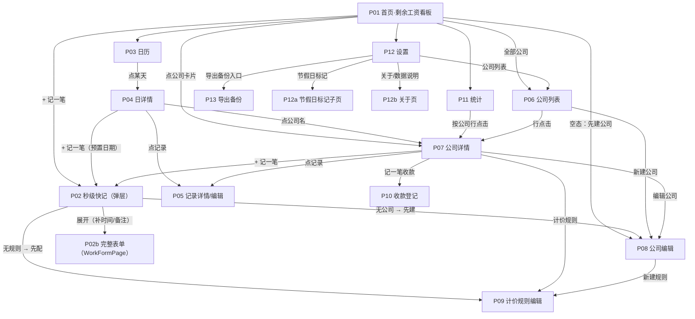

# 07 · UI 实现规格（基础版 · 13 页）

> **本文件的定位**：PRD §6.3 给出「有哪些页面、放什么内容」，本规格补足**实现级细节**——每页的控件与字段、与数据层方法的接线点、交互序列（含二次确认）、空态/异常态、导航出口、AC 映射。
>
> **本文不新增任何功能**。凡 PRD 未定义之处，一律登记为 §7 待决项（G-xx），**不自行裁定**。
> **本文不含**技术选型、状态管理库选型、UI 框架选型、数据库 DDL、排期。

---

## 0. 范围与接线总则

### 0.1 范围纪律

| 项 | 边界 |
|----|------|
| 覆盖页面 | PRD §6.3 全部 **13 个页面**（见 §3 页面规格） |
| 覆盖功能 | 基础版 B1~B10（公司管理 / 计价规则 / 工作记录 / 收款 / 看板 / 日历 / 统计 / 导出备份 / 离线 / 节假日标记） |
| **不做** | 借支登记页、账期对账页、对账单预览页（随二期 E1/E4/E7）；云备份 / 账号 / 多端同步（E5） |
| 越界处理 | 发现 PRD 缺口或矛盾 → 登记 §7 待决项，**不改 PRD、不扩范围** |

### 0.2 数据层接线总则（所有页面共用）

| # | 纪律 | 说明 |
|---|------|------|
| 1 | **单例访问** | 统一通过 `AppDatabase.instance`；UI 层**不直接写 SQL**、不 import `db/database_schema.dart` 之外的 schema 细节 |
| 2 | **派生值不落库、不缓存为真相** | 剩余/应收/已收/小计一律**每次从数据层读**（`aggregate` / `aggregateByCompany` / `ReceivableService`）；UI 可缓存渲染结果，但**缓存必须可丢弃可重建**（03 §7.2 红线） |
| 3 | **口径唯一** | 五处（看板 / 公司详情 / 统计 / 日历下钻 / 导出文件）必须走**同一聚合函数**（AC-33 / AC-61）；UI **不得**自己用 `receivable()` 局部求和替代 `aggregate()` |
| 4 | **软删默认过滤** | 所有"当前有效数据"读取用默认参数；**仅导出备份**显式 `includeDeleted: true`（见 §4.3） |
| 5 | **写入走 Model** | 构造 `Company` / `PricingRule` / `WorkRecord` / `PaymentRecord` / `HolidayMark` / `Ledger` 后调 `upsertXxx` / `updateXxx` / `softDeleteXxx(id, now)`；`updatedAt` 由 UI 传 `DateTime.now()` |
| 6 | **批量写入用事务** | 多表联动（如新建公司 + 默认规则、导入恢复）必须用 `AppDatabase.instance.transaction((txn) async { ... })`，事务内一律用 `...On(txn, ...)` 变体 |
| 7 | **刷新策略（本规格约定）** | 采用**页面级 `FutureBuilder` / `setState` + 显式 `_reload()`**：任何写操作成功后调 `_reload()`；跨页返回时由**调用方**在 `await Navigator.push(...)` 之后无条件 `_reload()`（不依赖返回值）。（状态管理库未定 → §7 G-05） |
| 8 | **时间注入** | 所有"现在"经单一入口取（`DateTime.now()`）；禁止在 UI 多处各取一次导致同一操作跨秒不一致 |

### 0.3 校验总则

- 表单校验**复用** `services/validators.dart`（`Validators.*`），UI **不重复实现**规则；判据与导入侧 `ImportService` 共用同一谓词（避免两套标准）。
- 保存按钮的可用性 = `Validators.xxx(model).isEmpty`；校验不通过时在对应字段下方显示错误文案，**不弹全局 Toast**。

---

## 1. 全局约定

### 1.1 金额显示（数据层「分」→ UI「元」，**禁浮点**）

| # | 规则 |
|---|------|
| 1 | 数据层与备份文件一律**整数「分」**（03 §4.6 / §6.2 规则 2）；UI 层只做**显示换算**，**绝不**把金额转成 `double` 参与任何运算或比较 |
| 2 | **禁止**（**作用域 = UI 层显示与换算**）在 UI 中走 `fen / 100`、`(fen/100).toStringAsFixed(2)`、`int.parse(yuanStr) * 100` 之类浮点路径——UI 显示与换算一律整数运算（见规则 3 `fenToDisplay`）。**例外（不在本禁令作用域内）**：`export_service.dart:293` 的 `_yuan(int fen) => (fen / 100).toStringAsFixed(2)` 属**导出层 CSV 格式化**（03 §6.3 要求"两位小数、无 ¥、无千分位"），其输入为已固化的整数分、仅做一次性字符串格式化，不参与金额运算与比较，**保持原样、不得按本禁令修改** |

> **★ 阶段⑤ 双回流 R47 豁免（呈现层无量纲比例）**：**呈现层无量纲比例**（如占比条 `amountFen / totalFen`）**显式豁免**本「禁浮点」条款（已裁定）—— 它既非"金额"也非"倍率"，不属本禁令作用域；同步登记于 `02 §D.0.2` 禁令 6。
| 3 | 统一格式化函数（UI 层唯一入口，如 `ui/format/money.dart`）：

```dart
/// 分 → 显示串。全整数运算，无浮点。
/// 24000 → "¥240.00"；-200 → "-¥2.00"；123456789 → "¥1,234,567.89"
String fenToDisplay(int fen) {
  final neg = fen < 0;
  final v = fen.abs();
  final yuan = v ~/ 100;      // 整数部分（元）
  final cents = v % 100;      // 小数部分（分）
  final grouped = _thousands(yuan);
  final s = '¥$grouped.${cents.toString().padLeft(2, '0')}';
  return neg ? '-$s' : s;
}
```

| 4 | **场景化格式**（同一数值不同位置用不同格式，仍全整数）： |
|----|--------------------------------------------------------|
| 位置 | 格式 | 示例 |
| 看板顶部全局剩余 / 卡片剩余 | 千分位 + 两位小数 | `¥12,345.60` |
| 列表内金额（工作记录 / 收款 / 明细） | 千分位 + 两位小数（窄屏可省略千分位） | `¥160.00` |
| 编辑页预览 / 输入框 | 输入框只接受"元"字符串（见下），预览用 `fenToDisplay` | `¥160.00` |
| CSV 导出 | 两位小数、无 ¥、无千分位（03 §6.3） | `160.00` |

| 5 | **金额输入控件（"元"→"分"）**：输入框类型为带小数点的数字键盘，**正则白名单** `^\d{1,9}(\.\d{1,2})?$`；解析走整数：`yuanStr.split('.')` → 整数部分 × 100 + 小数部分补零到 2 位；**不得**用 `double.parse` 二次乘法（`0.1*100=10.000000000000002` 类误差）。 |
|----|--------------------------------------------------------------------------------------------------|
| 6 | **负数金额**：UI 允许展示负剩余（"多收/记错"，AC-24 / §5.2），但**输入框不接受负号**（金额恒正，方向由业务语义决定）。 |
| 7 | 金额为 **0** 时的呈现：`¥0.00`（**不**显示为空白或 `-`）；状态角标按 §5.2 判定（如"已结清"）。 |

### 1.2 倍率显示（整数「×10」）

- 存储 `int`（`15` = 1.5 倍）；显示 `${x ~/ 10}.${x % 10}` → `1.5`；整倍数显示 `1.0` / `3.0`（保留 1 位小数，与 03 §6.2 一致）。
- **禁止** `x / 10`。
- 倍率输入：允许 1 位小数，范围以 `Validators.validRate` / `validHalfDayRatio` 为准（`halfDayRatio` 1~9，即 0.1~0.9 折算比）。

### 1.3 日期 / 时间 / 数量

| 项 | 规则 |
|----|------|
| 日期 | 业务日期**只到日**（`workDate` / `paymentDate` / `holidayMark.date`）；显示 `yyyy-MM-dd`；比较只比年月日（**禁止**用带时分秒的 `DateTime` 直接 `==` 判断"同一天"） |
| 起止时间 | `startTime` / `endTime` 的**日期部分必须一致、仅时间部分有意义**（`AmountInput` 契约原文，amount_engine.dart:25-27）；**落库仅存 `HH:mm`**（`database_schema.dart:78-79`），读回时日期部分**恒为 `1970-01-01` 占位符**（`database.dart` 的 `_parseHhmm`）——上文"日期部分必须一致"是**内存 `DateTime` 对象**的构造契约，**磁盘上并无真实日期**。UI 的选择器控件**只选时:分**，由 UI 把所选时分挂到**同一个 `workDate`** 上再落库 |
| 跨夜 | 由 UI 显式开关（`overnight`）驱动，**不由"结束<开始"自动推断**；结束<开始且未开跨夜 → 走 AC-11 提示分支（见 §3.5） |
| 数量 `qtySnapshot` | 物理量 `double`（4.5 小时 / 0.5 天 / 7 件）——**仅用于显示与输入**；金额计算由 `AmountEngine` 内部整数对完成，UI **不得**用 `qty × 单价` 自行算金额 |
| 数量显示 | 时价：`4.5 小时`（去尾零：`4` 显示为 `4 小时`）；日价：`1 天` / `0.5 天`；计件：`7 趟`（整数） |
| 数量输入 | 时价：小时数（1 位小数）**或**起止时分（二选一，手填时长优先，03 §4.4）；日价：整天 / 半天开关；计件：件数（1 位小数，支持 `7.5 ㎡`） |

### 1.4 颜色（标记色）

- `Company.color` 存 **6 位 RGB（不含 alpha）**，如 `0xE53935`（I-2 约定）。
- **渲染时必须补 alpha**：`Color(0xFF000000 | company.color)`；**禁止**直接 `Color(color)`（会得到 `0x00E53935` 全透明）。
- 调色板：UI 提供 12 个预设色（高对比、色盲友好）供选；新建公司时按"已用色"轮转分配，避免同日多公司撞色（AC-35 需要色点可区分）。

### 1.5 枚举文案（唯一来源 `services/enum_codec.dart`）

| 枚举 | UI 文案（来自 `EnumCodec`） |
|------|--------------------------|
| `PricingMethod` | 时价 / 日价 / 计件 |
| `RecordStatus` | 草稿 / 已确认 / 已结算 |
| `AmountSource` | 自动 / 手工覆盖 |
| `PaymentMethod` | 现金 / 微信 / 支付宝 / 银行 / 其他 |
| `HolidayType` | 法定节假日 / 调休上班 / 自定义 |
| `LedgerMode` | 本地 / 云端 |
| 启用状态 | 启用 / 停用 |

> UI **不得**在页面内硬编码这些中文字面量——必须调 `EnumCodec.*`，否则与备份文件/导入校验的文案映射漂移（导出与导入共用同一映射，见 export_service.dart:6）。

### 1.6 空态 / 异常态总则

| 场景 | 呈现 |
|------|------|
| 无数据（无公司 / 无记录 / 无收款 / 无节假日标记） | 居中插图 + 一句大白话 + 主行动按钮（例：AC-39"还没有记录，点下面 + 记一笔"）；**不使用**"暂无数据"这类空泛文案 |
| 加载中 | 骨架屏或居中进度圈；**加载失败**必须给"重试"按钮，不白屏 |
| 写入失败 | 底部 SnackBar 显示可读原因 + 保留用户输入（**不得**清空表单） |
| 金额为 0 | 正常显示 `¥0.00`（不是空态） |
| **脏数据行**（坏行） | 见 §4.4（I-9 决策：跳过坏行 + 顶部告警条） |
| 软删 / 停用实体 | 见 §4.1（I-10 决策：显示并标注，金额照常计入） |

### 1.7 导航总则

- 载体：手机（D3）；主导航为**底部 4 个 Tab**（`看板 / 日历 / 统计 / 设置`），`公司` 走 Tab 内入口或设置页入口（见 §5 导航图）。
- 下钻用 `Navigator.push`（页面栈），返回用系统返回键 + 页面左上返回箭头。
- 弹层用于**高频轻量录入**（秒级快记、收工即记）；整页用于**结构化录入**（补记、编辑、公司、规则）。
- 任何**破坏性操作**（删除、导入覆盖）必须二次确认（`AlertDialog`，确认按钮用警示色，且确认按钮文案写明后果，不用"确定/取消"）。

### 1.8 数据刷新与一致性（AC-33 落地）

| # | 规则 |
|---|------|
| 1 | 写入成功后：本页 `_reload()`；**同时**标记看板/日历/统计为"需刷新"（用简单的全局脏标记或直接下次进入时 `_reload()`） |
| 2 | **不得**在手写代码里出现"剩余 = 应收 − 已收"这类算式；一律取 `ReceivableAggregate.remaining` / `ReceivableSummary.remaining` |
| 3 | 开发期自检（`assert` / 测试）：`aggregate(null).remaining == Σ aggregateByCompany().remaining`，且 == 看板卡片之和；不等即缺陷（AC-33） |

### 1.9 可用性基线（D3 场景：户外、手上有活）

| 项 | 要求 |
|----|------|
| 字号 | 金额类数字 ≥ 24sp（看板主数字 ≥ 40sp）；正文 ≥ 15sp |
| 点击区 | 行高 ≥ 56dp；主按钮高度 ≥ 52dp |
| 单手 | 主行动按钮（`+ 记一笔`）放**右下悬浮**；弹层底部按钮在拇指区 |
| 步数 | 秒级快记 ≤ 3 步（AC-66）；补记 ≤ 8 步（AC-67） |
| 键盘 | 金额/数量输入默认弹数字键盘；保存按钮在键盘弹出时**不被遮挡** |
| 离线 | 全程无网络依赖；**不得**出现任何"需要联网/登录"的阻断或提示（AC-40/AC-44） |

---

## 2. 页面 ↔ 数据层接线点总表

> 页面规格（§3）中不再重复方法签名，只引用下表编号。

| 接线编号 | 方法 / 服务 | 用途 | 关键默认值（**必须显式处理**） |
|---------|-----------|------|---------------------------|
| **A1** | `AppDatabase.instance.aggregate(String? companyId)` → `ReceivableAggregate(companyId, receivable, received, remaining)` | 单公司或全局剩余（**唯一权威金额来源**） | `companyId == null` → 全局合计 |
| **A2** | `AppDatabase.instance.aggregateByCompany()` → `List<ReceivableAggregate>` | 看板 / 公司列表**一次查完**（避免 N+1） | **仅返回有数据的公司**；未出现的公司须按"全 0"补齐，**不得**判为"公司不存在" |
| **A3** | `listCompanies({ledgerId, includeDeleted=false, includeDisabled=false})` | 公司元数据 | ⚠️ **默认排除停用公司** → 看板/列表**必须显式传 `includeDisabled: true`**（I-10，见 §4.1） |
| **A4** | `listPricingRules({companyId, includeDeleted=false, includeDisabled=false})` | 规则选择器 / 规则管理 | 快记选择器用**默认**（只要启用的）；规则管理页传 `includeDisabled: true` |
| **A5** | `listWorkRecords({companyId, startDate, endDate, includeDeleted=false, includeDraft=true})` | 日历 / 日详情 / 公司详情列表 | 日期过滤按**归属日**闭区间；`includeDraft` 默认 true（列表要显示草稿 → AC-32 仅在派生口径排除） |
| **A6** | `listPaymentRecords({companyId, startDate, endDate, includeDeleted=false})` | 收款列表 | 日期过滤按**收款日期**闭区间 |
| **A7** | `listHolidayMarks({ledgerId, startDate, endDate})` | 日历倍率渲染 | `endDate` 建议传"当月最后一天"以减少读取量（无软删概念） |
| **A8** | `getLedger(id)` / `upsertLedger(x)` / `listLedgers()` | 账本（基础版恒 1 个，`mode = local`） | 首启需**创建默认账本**（见 §3.12 设置页 与 §7 **G-12**） |
| **A9** | `upsertCompany` / `updateCompany` / `softDeleteCompany(id, at)` | 公司写 | 停用 = `updateCompany(enabled:false)`（**不是**删除，AC-19） |
| **A10** | `upsertPricingRule` / `updatePricingRule` / `softDeletePricingRule(id, at)` | 规则写 | 改价**只写 `pricing_rule` 表**，绝不触碰 `work_record` |
| **A11** | `getWorkRecord(id)` / `upsertWorkRecord` / **`updateWorkRecordMeta({id, workDate?, note?, status?, updatedAt})`** + **`replaceWorkRecordSnapshot({id, rateSnapshot, rateDetailSnapshot, amountSnapshot, amountSource, autoReferenceAmount?, …})`** / `softDeleteWorkRecord(id, at)` | 工作记录写 | ✅ **批次 0-A 已拆签名**（旧 `updateWorkRecord(WorkRecord)` 已删，护栏 I-8 = 已解除）；UI **不回落整对象写**：Meta 走 `updateWorkRecordMeta`、快照走 `replaceWorkRecordSnapshot`（均含 `On` 事务变体；二次确认见 §4.2 U5） |
| **A12** | `getPaymentRecord(id)` / `upsertPaymentRecord` / `updatePaymentRecord` / `softDeletePaymentRecord(id, at)` | 收款写 | 金额 >0 由 `Validators.payment` 把关（AC-25） |
| **A13** | `getHolidayMarkByDate(ledgerId, date)` / `upsertHolidayMark` / `updateHolidayMark` / `deleteHolidayMark(id)` | 节假日标记 | ⚠️ **硬删**（无软删，与其它实体不对称）→ UI 需二次确认（§7 G-10）；⚠️ `upsertHolidayMark` 为 **INSERT OR REPLACE 语义** → 同 `(ledger_id, date)` 会静默删旧行、**id 漂移**（§7 **G-13**） |
| **A14** | `transaction<T>((txn) async {...})` + 所有 `...On(txn, ...)` 变体 | 多表原子写入 | 事务内**必须**用 `...On` 变体，否则读不到未提交写入 |
| **A15** | `AmountEngine().compute({rule, input})` → `AmountResult` | 金额引擎（快照五件套） | 返回值含 `isDraft` / `needsOvernightConfirm` / `isInvalidInput` 三个**必须分支处理**的标志 |
| **A16** | `ReceivableService().companySummary(...)` / `.globalRemaining(...)` | 纯函数口径（用于**离线/无 DB** 场景与测试） | UI 首选 A1/A2（SQL 聚合）；A16 仅用于测试与本地小集合校验，**不得**与 A1 口径不一致 |
| **A17** | `ExportService().toJson(data, {exportedAt, appVersion})` / `.workRecordsCsv(...)` / `.paymentRecordsCsv(...)` / `.assertExportConsistency(...)` | 导出 | 导出前必须组装**全量** `BackupData`（见 §4.3） |
| **A18** | `ImportService().validate(map)` / `.parse(map)` / `.planImport({...})` / `.softWarnings(data, {now})` | 导入 | `validate` **永不抛异常**，返回错误清单（AC-64） |
| **A19** | `Validators.*` | 表单校验 | 与导入侧共用同一谓词 |
| **A20** | `EnumCodec.*` | 枚举 ↔ 中文文案 | 唯一文案来源 |

---

## 3. 页面规格（13 页）

> 统一模板：**目标/首屏 → 控件清单 → 数据接线 → 交互序列 → 空态/异常态 → 导航出口 → AC**。

---

### P01 · 首页 · 剩余工资看板（P0）

**目标**：打开 App 第一眼看到「**各公司还欠我多少**」（PRD §6.1）。

**首屏结构（自上而下）**
1. 顶部大数字：全局「还欠我」`fenToDisplay(aggregate(null).remaining)`（≥40sp）
2. 公司卡片列表（滚动）
3. 右下悬浮主按钮 `+ 记一笔`
4. 底部 4 Tab：看板 / 日历 / 统计 / 设置

**控件清单**

| 控件 | 类型 | 绑定 / 来源 | 校验 | 备注 |
|------|------|-----------|------|------|
| 全局剩余数字 | 文本（大） | `A1(companyId: null).remaining` | — | 负数 → 前缀"多收"徽标（§5.2 多收） |
| 公司卡片 | 列表项（可点） | `A2`（金额）+ `A3`（元数据，`includeDisabled: true`） | — | 一行一公司 |
| ├ 公司名 + 短名 | 文本 | `company.shortName ?? company.name` | — | 短名空时取名称前 2 字（模型默认） |
| ├ 标记色点 | 色块 | `Color(0xFF000000 \| company.color)` | — | §1.4 |
| ├ **剩余**（最大字号） | 文本 | `aggregate.remaining` | — | ≥28sp |
| ├ 小字：应收 / 已收 | 文本 | `aggregate.receivable` / `.received` | — | `¥X · ¥Y` |
| ├ 状态角标 | Chip | 由 `应收/已收` 判定（PRD §5.2 严格等号） | — | `未开工/未收/部分收款/已结清/多收·待核对` |
| ├ 最近收款时间 | 文本（小） | `A6(companyId)` 首条 `paymentDate` | — | 无收款 → 不显示该行 |
| └ "已 X 天未收款" | 文本（小） | `今天 − 最近收款日`（**纯派生**） | — | 仅当 `remaining > 0` 且存在最近收款时；**不标红、不推送**（PRD §1.4-2）。无收款记录 → 显示"从未收款" |
| 停用/已删角标 | Chip（灰） | `company.enabled == false` / `deletedAt != null` | — | §4.1 |
| `+ 记一笔` | 悬浮按钮 | → P02 快记弹层 | — | 拇指区 |
| 卡片点击 | 行点击 | → P07 公司详情 | — | |
| 空态主按钮 | 按钮 | → P08 公司编辑（新建公司） | — | 无任何公司时 |
| **全部公司** | 列表项 / 卡片区尾部入口按钮 | → P06 公司列表（**全部公司，含停用 / 已归档**） | — | **M-03 修复补入口**；保证 P06 有入边（见 §4.1） |

**数据接线**：`A1(null)`（全局，**权威**）、`A2`（各公司金额，一次查完）、`A3(includeDisabled: true, includeDeleted: true)`（元数据全集，见 §4.1 合并规则）、`A6`（最近收款时间，按公司分组取首条）。写：无。

**交互序列**
1. 进入 → 并行发起 `A1` / `A2` / `A3` / `A6` → 组装卡片 → 渲染
2. 点卡片 → P07（公司详情）
3. 点 `+ 记一笔` → P02（弹层）
4. 从任何子页返回 → `_reload()`

**空态 / 异常态**
- **无公司**：整屏空态 + 「先建一个公司」按钮 → P08。
  - **★ 阶段⑤ 双回流 R18**：本行**只规定按钮文案**（标题**不受**本行约束）→ 空态**标题**定「**还没有公司**」（避免与按钮两遍同一句话）；`09 §6.7` 已同步更正。
- **有公司但全 0**（未开工）：卡片区正常显示，每卡显示"还没记过账"，全局数字 `¥0.00`。
- **有草稿但无有效记录**：卡片显示 `¥0.00`，卡片下方小字"有 N 条草稿未完成"→ 点击进 P07 的草稿筛选。

**导航出口**：→ P02 / **P06（全部公司）** / P07 / P08 / 底部 Tab（P03/P11/P12）

**AC 映射**：AC-31、AC-32、AC-33、AC-39、AC-44

---

### P02 · 秒级快记页（弹层，P0）

**目标**：收工随手记，**≤3 步**落库（AC-66）。

**首屏结构**：底部弹层，自下而上：公司选择（默认上次）→ 规则选择（默认上次）→ **大字数量输入**（自动聚焦数字键盘）→ 实时金额预览 → `保存`。

**控件清单**

| 控件 | 类型 | 绑定 / 字段 | 校验 | 备注 |
|------|------|-----------|------|------|
| 公司选择 | 下拉 / 横向 Chip | `Company.id`（上次公司优先） | 必填 | 数据源 `A3` **默认参数**（只含启用公司，停用公司不进快记 → AC-19） |
| 规则 / 工序选择 | 下拉 | `PricingRule.id`（上次规则优先） | 必填 | 数据源 `A4(companyId)` **默认参数**（只含启用规则） |
| 数量输入 | 数字输入（大字 ≥32sp） | `AmountInput.manualHours` / `fullDay` / `pieceCount`（按 `rule.method` 切换） | 见 §1.3 | 时价 → 小时；日价 → 整天/半天开关；计件 → 件数 |
| 归属日 | 只读文本（值可由入口预置） | `workDate`（**默认今天**，可由入口预置 P04） | — | **默认今天**；可由入口预置（P04）；需改日期 → 展开为补记（P02→P03 流程）——**R67 订正**：原文把归属日写死为单一时点，属**过强措辞**（与 `02 AC-P02-10` 不符） |
| 金额预览（实时） | 文本（大字） | `AmountEngine.compute(...).amount`（**实时算，不落库**） | — | 实时预览让用户"看见钱" |
| 倍率提示 | Chip | `AmountResult.rateDetail`（命中项 + 取用倍率） | — | 命中时显示"加班 1.5 倍"，未命中不显示 |
| 草稿提示 | 提示条 | `AmountResult.isDraft` | — | 数量为 0/空 → 保存后为**草稿**（AC-12），提示"已存为草稿，补上时长再算金额" |
| 跨夜确认 | `AlertDialog` | `AmountResult.needsOvernightConfirm` | — | AC-11：`结束<开始` 且未开跨夜 → 弹"结束时间早于开始时间，是否跨夜？"（[是]→设 `overnight=true` 重算；[否]→回填时长） |
| 非法输入 | 字段错误 | `AmountResult.isInvalidInput` | — | 阻止保存 + 字段下方红字（不用 Toast） |
| `保存` | 主按钮 | 落库 | 公司/规则/数量齐全 | 保存成功 → 关闭弹层 + Toast "已记上"（**不**跳页） |
| `展开（补时间/备注）` | 次按钮 | → 切 P02b 完整表单 | — | 即"事后补记"路径（PRD §4.1） |
| 倍率上下文（只读，不展示） | — | `D.isWeekend` / `D.isHoliday`（由 `workDate` + `holiday_mark` 判定后随快照冻结） | — | 首次固化时算好并冻结；编辑不重算（R-G05）；命中时下方显示倍率提示（`:265`）。**★ 阶段⑤ 双回流 R49 补列**（逐字取自 `16-WaveD1-实现设计.md §3.5` 钉死源）：补齐「新建 / 编辑重算路径须构造并冻结 `D.isWeekend` / `D.isHoliday`」的落点 |

**数据接线**：读 `A3` / `A4` / `A8`（账本币种）；算 `A15`；写 `A11: upsertWorkRecord`（**新建走 upsert，不走 update**——新建即固化快照，底线 2）。

**交互序列（秒级快记主路径，≤3 步）**
1. 打开弹层（默认：今天 + 上次公司 + 上次规则 + 上次数量）→ `A15` 预演金额
2. 输入数量 → 每次变更重跑 `A15` → 更新预览与倍率提示
3. `保存` → 构造 `WorkRecord`（`id` 见 §7 G-06；`status = confirmed`；`amountSource = auto`；五件套取自 `AmountResult`）→ `upsertWorkRecord` → 关弹层
   - 若 `isDraft` → `status = RecordStatus.draft`

**空态 / 异常态**
- **无公司**（首次使用）：弹层顶部提示"还没有公司，先建一个"→ 直达 P08；不允许无公司保存。
- **公司下无启用的规则**：规则下拉空 → 提示"该公司还没配计价规则"→ 直达 P09 规则编辑页（携带 `companyId`）。
- **上次记录的公司已停用/已删**：回退到"第一个启用公司"，**不报错**。

> **★ 阶段⑤ 双回流 R62 · 草稿行为分场景（主理人裁定 Q-2 = A，`by design`）**：**P02b 完整表单不落草稿（数量为 0 → 阻止保存）**；**P02 秒级快记弹层**数量为 0/空 → **允许落草稿**（`status = draft`、`amount = 0`）。**两入口分场景为 `by design`，非缺陷**。依据 = 主理人 §1-F3/F4（`quick_add_sheet.dart:16` 逐字「草稿分支（主理人 Q-2 = A）：数量为 0/空 → 允许落草稿」；`work_form_page.dart:465` 逐字 `if (r.isDraft) return '数量为 0，请填写数量';`）。上游落点另见 `02 §D.2` 的 `AC-P02-04` 备注列（A 组）。

**导航出口**：→ P08（新建公司）/ P09（新建规则）/ 展开→完整补记表单

**AC 映射**：AC-01、AC-04~AC-07、AC-11、AC-12、AC-19、AC-65、AC-66

---

### P03 · 日历页（P0）

**目标**：一眼看到「哪些天做了工、对应哪些公司」（PRD §4.2）。

**首屏结构**：顶部月份切换（`‹ 2026年9月 ›`）+ 星期表头 + 月历网格（每格：日期 + **公司色点** + 当日小计）。

**控件清单**

| 控件 | 类型 | 绑定 / 来源 | 备注 |
|------|------|-----------|------|
| 月份切换 | 左右箭头 + 标题 | `year` / `month` 状态 | 支持跨年翻月（AC-36） |
| 月历格子 | 网格项 | 见下 | 空白天灰底 |
| ├ 公司色点 | 圆点行 | `distinct(公司标记色)` | **一天多公司 = 多个色点**（AC-02/35）；>4 个显示 `+N` |
| ├ 当日小计 | 文本（小） | `Σ 有效工作记录金额快照`（`status ∈ {confirmed, settled}`、未软删） | 草稿**不计入**（AC-32）；为 0 不显示 |
| └ 节假日标记 | 角标 / 底色 | `A7` 命中当日 | 节假日/调休不同底色；点击可查看/编辑（**入 P12a**）——**R71 订正**：原文把该入口指向 **P12（整页）**，与 `02 AC-P03-06`「入 P12a」不符，**以 `02` 为准** |
| 今天 | 高亮描边 | — | 便于定位 |
| 格点击 | 行点击 | → P04 日详情 | 有记录才可点（无记录给轻提示或直接进空态日详情） |

**数据接线**：读 `A5(startDate: 月初, endDate: 月末)`（一次拉当月，UI 内按 `workDate` 分组；**不**另存汇总 → PRD 底线 1）、`A3`（色点用颜色，**`listCompanies({includeDisabled: true, includeDeleted: true})`**，**双 `true` 超集**——日历 / 日详情需展示**已归档公司**的历史记录，故必须含归档，见 §4.1）、`A7`（当月节假日）。

> **★ 阶段⑤ 双回流 R37（文档对齐代码）**：本节 `A3` 传参**补齐为双 `true` 超集**。依据 = 主理人 §1-F2（实跑 `calendar_page.dart:95` / `day_detail_page.dart:88` / `stats_page.dart:121` 三处逐字 `listCompanies(includeDisabled: true, includeDeleted: true)`）。**原文（已过时，保留可溯）**：原只写「色点用颜色，`includeDisabled: true`」（**缺 `includeDeleted: true`**，为**单 `true` 的非超集措辞**）。上游落点另见 `02 §D.3`（A 组）。

**交互序列**
1. 进入 → 拉当前月 `A5` + `A3` + `A7` → 按日分组 → 渲染
2. 翻月 → 重新拉该月（**重新查询，不用缓存跨月**）
3. 点某天 → P04

**空态 / 异常态**
- **当月无任何记录**：网格正常、无小计（AC-39 的一部分）；底部给一行提示"本月还没记工"。
- **某公司已停用但历史有记录**：色点**照常显示**（停用只影响"新记"，不影响历史 → AC-19 / 03 §8 约束 2）。

**导航出口**：→ P04；← 底部 Tab

**AC 映射**：AC-02、AC-03（同日多段仍算 1 天）、AC-32、AC-34、AC-35、AC-36、AC-39、AC-51

---

### P04 · 日详情页（P0）

**目标**：当天各公司分组 → 组内记录列表（可视觉折叠）。

**控件清单**

| 控件 | 类型 | 绑定 / 来源 | 备注 |
|------|------|-----------|------|
| 日期标题 + 当日合计 | 文本 | `Σ 当日有效记录金额` | 合计 = 各组小计之和（自检） |
| 公司分组头 | 可折叠分组 | `companyId` 分组 | 显示「公司名 · 当日小计」 |
| ├ 组内记录行 | 列表项 | `WorkRecord` | 显示：工序/规则名 + 数量 + 金额 + 状态角标 |
| └ 折叠开关 | 图标按钮 | — | **同公司同规则多段**才出现折叠（Q2/Q15：**不合并存储**，仅视觉折叠） |
| 记录行点击 | 行点击 | → P05 记录详情/编辑 | |
| `+ 记一笔` | 按钮 | → P02（预置 `workDate` = 本日） | 事后补记入口（AC-67） |
| 草稿行 | 列表项（虚线边框） | `status == draft` | 显示"草稿·未完成"，金额显示 `—`（不计入应收） |
| 软删记录 | **不显示** | `deletedAt != null` | 默认过滤 |

**数据接线**：读 `A5(startDate: 当日, endDate: 当日)`、`A3(includeDisabled: true)`（拿分组名/色，含停用）、`A4(companyId)`（规则名 —— **★ 阶段⑤ 双回流 R39 补列**：本节原**漏列**本调用，而「├ 组内记录行」要求显示"工序/规则名"）；写 `A11.softDeleteWorkRecord(id, now)`（删除需二次确认）。

**交互序列**
1. 进入 → `A5` 当日 + `A3` → 按公司分组 → 组内按 `createdAt` 升序
2. 点记录 → P05
3. 左滑/长按记录 → 菜单：编辑 / 删除（二次确认："删除后不计入应收，且不可在 App 内恢复，是否删除？"）
4. 点 `+ 记一笔` → P02（预置日期）

**空态 / 异常态**
- **当天无记录**：空态 + "这天还没记工" + `+ 记一笔`。
- **当天只有草稿**：合计显示 `¥0.00` 并附小字"（不含 N 条草稿）"——防止用户以为草稿金额被吞。
- **规则已被软删（`pricingRuleId` 悬空）**：记录仍显示；规则名显示为**快照兜底**（`qtyUnitSnapshot` + `methodSnapshot` + 备注），并标"规则已删除"灰色小字（弱引用允许悬空 → 03 §3.3）。

**导航出口**：→ P02 / P05 / P07（点公司名）

**AC 映射**：AC-02、AC-03、AC-32、AC-67

---

### P05 · 记录详情 / 编辑页（P0）— **I-8 快照护栏唯一触发点**

**目标**：查看"金额怎么算出来的"，并安全地修改。

**首屏结构**
1. 金额算法展开区（可折叠）：
   `基础单价 ¥40.00 × 倍率 1.5 = 实际单价 ¥60.00`；`实际单价 ¥60.00 × 数量 2 小时 = 金额 ¥120.00`
2. 字段区（分两组，**视觉上分组**，见 §4.2）
3. 底部：`保存` / `删除`

**控件清单**

| 控件 | 类型 | 绑定字段 | 组 | 校验 / 交互 |
|------|------|---------|----|-----------|
| 归属日 | 日期选择 | `workDate` | **Meta** | 必填（AC-09）。改归属日 = **纯 Meta**（R-G05 终版）：**不影响金额**（**AC-10**：日历显示在结束日、**金额不变**），直接落库；**不迁移 `startTime`/`endTime`、不重算、不需二次确认**（`updateWorkRecordMeta` 一次调用） |
| 备注 | 文本 | `note` | **Meta** | 可空 |
| 状态：打标"已结算" | 开关 / Chip | `status`（`confirmed ⇄ settled`） | **Meta** | 纯手动打标，**不改变金额**（AC-69 / Q14） |
| 数量（时价小时 / 日价整天半天 / 计件件数） | 数字 / 开关 | `qtySnapshot` 派生来源 | **Snapshot** | 改后触发**重算**（AC-68），保存前显示"¥旧 → ¥新" |
| 起止时间 | 时:分 选择 ×2 | `startTime` / `endTime` | **Snapshot** | 见 §1.3；`结束<开始` → AC-11 提示 |
| 跨夜 | 开关 | `overnight` | **Snapshot** | 显式标记 |
| 实际单价（本条） | 数字（元） | `rateSnapshot`（分） | **Snapshot** | **动作 A**：改动 = 高危 → **必须二次确认**；改后按新快照重算、**金额来源仍为 `auto`**（R-G01 / §4.2） |
| 手工覆盖金额 | 数字（元） | `amountSnapshot` + `amountSource = manual` | **Snapshot** | **动作 B**：Q5 允许覆盖（"抹零"刚需）→ **必须二次确认**（R-G01）；覆盖后 `autoReferenceAmount` 保留覆盖时的自动值 |
| `恢复自动计算` | 按钮 | `amountSource → auto`，金额取 `autoReferenceAmount` | **Snapshot** | AC-18；无 `autoReferenceAmount` 时置灰 |
| 金额来源 | 只读 Chip | `AmountSource` | — | `自动` / `手工覆盖`（对账时要能看出这条是人改的） |
| 五件套只读区（展开） | 只读列表 | `methodSnapshot` / `qtyUnitSnapshot` / `rateSnapshot` / `rateDetailSnapshot` / `amountSnapshot` | — | 便于对账与客服排查 |
| `保存` | 主按钮 | 见 §4.2 分组调用 | — | 有变更才可点 |
| `删除` | 次按钮（警示色） | `softDeleteWorkRecord` | — | 二次确认 |

**数据接线**：读 `A11.getWorkRecord(id)`、`A4(companyId: ..., includeDisabled: true)`（只看，**不用于重算**）；算 `A15`（重算时输入 `rule` 由**本条快照**重建，见 §4.2）；写 `A11`（**必须**走拆签名接口，§4.2）、`A14`（如需多写）。

**交互序列（关键：改数量 → 重算）**
1. 进入 → `getWorkRecord` → 展开算法区
2. 改数量/起止 → 触发 `A15.compute(rule: 由本条快照重建的 Rule, input: 新数量 + 本条 rateDetailSnapshot 的命中项)` → 若 `isDraft` → 提示将转草稿
3. 显示预览：`金额 ¥120.00 → ¥180.00`（旧值来自 `amountSnapshot`，新值来自重算）
4. `保存` → **按 §4.2 分组调用**（有金额相关变更 → `replaceWorkRecordSnapshot`；仅 Meta 变更 → `updateWorkRecordMeta`）

> **★ 阶段⑤ 双回流 R54 · 「改数量 / 起止时间」按来源分派口径（唯一口径，逐字取自主理人裁定单 §2.2 R54）**：`AC-P05-04`「改数量/起止 → 按本条快照单价重算」**的前提是该条 `金额来源 = 自动`**（或用户已清空金额输入框）；**若为「手工覆盖」且金额框仍有值 → 手工值优先、金额不变**，`金额来源` 保持 `手工覆盖`，`自动参考值` 按新数量重算留作参考；改回自动走**显式「恢复自动计算」（`AC-18`）**。依据 = 主理人 §1-F5（`record_detail_page.dart:168`/`:209`/`:287-310`/`:461-463`/`:660`：`_target()` 把 `manualAmount: yuanToFen(_amountCtrl.text)` 传入引擎；对 `amountSource == manual` 的记录把金额框回填为 `fenToYuanPlain(rec.amountSnapshot)`）。**★ 行号订正（`2026-10-13`）**：原引（已过时，保留可溯）**`:199`** —— 现盘 `manualAmount:` 实位于 **`:209`**（`:199` 为 `holidayRate: rd.holidayRate,`）。上游落点另见 `02 §D.5` 的 `AC-P05-04`（A 组）。

**空态 / 异常态**
- 记录已被软删（从外部进入）：只读展示 + 提示"该记录已删除"。
- 重算遇到非法输入（`isInvalidInput`）：字段红字，保存置灰。
- 重算得到草稿（`isDraft`）：黄色提示"数量为 0，保存后将变为草稿且不计入应收"。

> **★ 阶段⑤ 双回流 R64 · 三分支必须保留完整 `rateDetailSnapshot`（对治 C-01）**：「**『数量归零转草稿』/『待确认跨夜』/『非法输入』三分支下，写回时必须保留本条完整 `rateDetailSnapshot`（含 `appliedRate`），不得用引擎占位值覆盖**」。依据 = 主理人裁定单 §2.1 R64（代码侧已护：`record_detail_page.dart:232-233` 三分支一律保留冻结 `rd`；**`app/**` 不改**，仅补条文）。上游落点另见 `02 §D.5` 的 `AC-P05-11`（A 组；**主理人 `2026-10-13` 归位订正** —— 原引（已过时，保留可溯）**`AC-P05-05`**：该条主题为「动作 A 改单价」，与本铁律「写回快照取值」不同域，已归位至 `AC-P05-11`）。
>
> **★ 阶段⑤ 双回流 R65 · 已知限制 `LL-1`（转草稿时 `autoReferenceAmount` 语义未规定）**：**「转草稿时 `autoReferenceAmount` 语义未规定」**——实例 `LL-1`：草稿保存会把 `autoReferenceAmount` 写为 `null`（`amount_engine._draft` 未设该值），使草稿日后「恢复自动计算」不可用。**本版不做**（改码会作废 `590/0` 基线）；**`app/**` 不改**。依据 = 主理人裁定单 §2.2 R65（**乙：零改动 + 记 `LL-1` 已知限制**）。上游落点另见 `02 §D.5`（A 组）。

**导航出口**：← P04/P07/D1（公司详情列表）

**AC 映射**：AC-08、AC-09、AC-10、AC-13~AC-18、AC-68、AC-69

---

### P06 · 公司列表页（P0）

**目标**：看全部公司 + 各家剩余/状态。

**控件清单**

| 控件 | 类型 | 绑定 | 备注 |
|------|------|------|------|
| 公司行 | 列表项 | `A2` + `A3(includeDisabled: true, includeDeleted: true)` | **口径同看板**（§4.1） |
| ├ 名称 / 短名 / 色点 | 文本 / 色块 | `Company` | |
| ├ 剩余 / 应收 / 已收 | 文本 | `ReceivableAggregate` | |
| ├ 状态角标 | Chip | `Company.enabled` / `deletedAt` / 账目状态 | 启用 / **已停用** / **已删除** |
| `新建公司` | 浮动按钮 | → P08 | |
| 行点击 | 行点击 | → P07 | |
| 停用/删除 | 行内菜单 | `A9.updateCompany(enabled:false)` / `softDeleteCompany(id, now)` | 见 P08 |

**数据接线**：`A2`、`A3`（**显式** `includeDisabled: true, includeDeleted: true`）。

**空态 / 异常态**：无公司 → 空态 + `新建公司`；全部公司剩余为 0 → 正常显示（不自作折叠）。

**导航入口**：← P01 看板「全部公司」/ P12 设置「公司列表」（**M-03 修复：两处入口**）

**导航出口**：→ P07 / P08

**AC 映射**：AC-19、AC-20、AC-33

---

### P07 · 公司详情页（P0）

**目标**：一家公司的全部账目与剩余。

**首屏结构**：`公司名 + 剩余（大字）` → `应收 / 已收` → **计价规则区块** → 分段切换：`工作记录 | 收款记录` → 列表；**动作按钮（`+ 记一笔` / `记一笔收款`）下沉至页面底部固定栏**，不在首屏结构内顺排。

> **★ 阶段⑤ 双回流 R17（主理人裁定单 §2.1 R17，逐字照抄）**：P07 首屏**最终形态** = `公司名（含简称括号）→ 剩余大字 → 应收/已收 → 状态角标`（**头部四件连续**）→〔条件〕停用/归档/降级横幅 → **计价规则区块** → **工作记录 / 收款记录 分段切换** → 列表；**动作按钮（`+ 记一笔` / `记一笔收款`）下沉至页面底部固定栏**，**不在首屏结构内顺排**。依据 = 主理人 §1-F6（`company_detail_page.dart:234-257`/`:265`/`:230`：`Column(_buildHeader(), ..._buildBanners(), _buildRulesSection(), TabBar, Expanded(TabBarView))` + `bottomNavigationBar: _buildActionBar()`）。**原文（已过时，保留可溯）**：**首屏结构**：`公司名 + 剩余（大字）`→ `应收 / 已收` → 分段切换：`工作记录 | 收款记录` → 列表。（**未列「计价规则区块」、未注明动作按钮下沉**，属**不完整措辞**）

**控件清单**

| 控件 | 类型 | 绑定 | 备注 |
|------|------|------|------|
| 剩余（大字） | 文本 | `A1(companyId)` | ≥32sp；负 → "多收·待核对" |
| 应收 / 已收 | 文本 | `A1(companyId)` | |
| 状态角标 | Chip | PRD §5.2 判定 | 未开工/未收/部分收款/已结清/多收 |
| 分段切换 | Tab | 工作记录 / 收款记录 | |
| 工作记录列表 | 列表 | `A5(companyId)` | 显示归属日 + 工序 + 金额 + 状态；草稿可筛 |
| 收款记录列表 | 列表 | `A6(companyId)` | 显示收款日期 + 金额 + 方式 + 备注 |
| 记录行点击 | 行点击 | 工作记录 → P05；收款 → P10（编辑态） | |
| `记一笔收款` | 按钮 | → P10 | 收款登记 |
| `+ 记一笔` | 按钮 | → P02（预置公司） | |
| `编辑公司` | 图标 | → P08 | |
| `计价规则` | 入口 | → P09 | 显示规则条数 |
| 停用公司横幅 | 提示条 | `enabled == false` | "该公司已停用，不再出现在快记里；历史账目不受影响" + `重新启用`（`updateCompany(enabled:true)`） |
| 已删除横幅 | 提示条（警示） | `deletedAt != null` | "该公司已删除（= 归档），账目仍计入剩余，请处理"（§4.1 / **R-G04**） |

**数据接线**：`A1`、`A3`、`A5`、`A6`、`A9`；写 `A11.softDeleteWorkRecord` / `A12.softDeletePaymentRecord`（删除需二次确认）。

**空态 / 异常态**
- 无工作记录：空态 + `+ 记一笔`。
- 无收款记录：空态 + `记一笔收款` + 提示"老板给钱后记一笔，剩余会自动减"。
- 该公司从未有记录（新公司）：显示 `¥0.00` + "还没开始记账"。

**导航出口**：→ P02 / P05 / P08 / P09 / P10

**AC 映射**：AC-19、AC-21~AC-23、AC-31、AC-33

---

### P08 · 公司编辑页（P0，新建 / 编辑共用）

**控件清单**

| 控件 | 类型 | 绑定字段 | 校验（`Validators.company`） | 备注 |
|------|------|---------|---------------------------|------|
| 名称 | 文本（必填） | `name` | `validName` | 大白话示例占位："某某装饰 / C 工地张工头" |
| 简称 | 文本 | `shortName` | — | 空则取名称前 2 字 |
| 标记色 | 调色板 | `color`（6 位 RGB） | — | §1.4；取"未使用色"轮转 |
| 联系方式 | 文本 | `contact` | — | 方便要钱时直接拨 |
| 默认计价规则 | 下拉 | `defaultRuleId` | — | 数据源 `A4(companyId, includeDisabled: true)`；可空 |
| 备注 | 文本 | `note` | — | |
| 启用状态 | 开关 | `enabled` | — | 关闭 = 停用（**不是删除**） |
| `保存` | 主按钮 | `upsertCompany`（新建）/ `updateCompany`（编辑） | — | 新建时 `ledgerId` 取当前账本 |
| `停用` | 次按钮 | `updateCompany(enabled:false)` | — | 二次确认文案说明"历史账目不受影响，只是不再出现在快记里" |
| `删除公司` | 危险按钮 | `softDeleteCompany(id, now)` | — | **必须**二次确认，文案含影响条数（AC-20）：先 `A5`/`A6` 统计条数 → "将连同 N 条工作记录、M 笔收款一并归档，是否继续？"；**默认归档（软删）**（Q13） |

**数据接线**：`A9`、`A4`、`A8`（`ledgerId`）、`A5`/`A6`（统计影响条数）；多表写用 `A14`。

**空态 / 异常态**：名称空 → 字段红字 + 保存置灰；新建公司下无规则 → 提示"建议先配一条计价规则"（可跳过）。

**导航出口**：← 上级页；→ P09（新建规则）

**AC 映射**：AC-19、AC-20

---

### P09 · 计价规则编辑页（P0，新建 / 编辑共用）

> **与 U-3 的一致性（★ 阶段⑤ 双回流 R61 页首追加，逐字取自 `16-WaveD1-实现设计.md §3.5`）**：本节即 U-3 裁定的"用户可见价目表管理页"落点（`DECISIONS.md` D-7）；`ensureRule` 自动建规则**保留为兜底**，与手工规则**共存**（共存规则见 `02 §D.8`）。**本规格不存在"不做规则管理页"的口径**（`02:899`）。

**控件清单**

| 控件 | 类型 | 绑定字段 | 校验（`Validators.pricingRule`） | 备注 |
|------|------|---------|--------------------------------|------|
| 规则名 / 工序 | 文本（必填） | `name` | 非空 | 如"木工""司机趟次""拆墙" |
| 计价方式 | 单选（3 项） | `method` | 必选 | 时价 / 日价 / 计件；**切换时联动**下方字段可见性 |
| 基础单价 | 金额输入 | `baseRate`（分） | `validBaseRate`（>0） | 单位随方式变：元/小时、元/天、元/件 |
| 计价单位 | 文本 | `unit` | **计件必填** | 小时/天/件/㎡/趟 |
| 标准工时 | 数字（小时） | `standardHours` | — | 仅用于加班判定提示，可空 |
| 半天折算比 | 数字（×10） | `halfDayRatio` | `validHalfDayRatio`（1~9） | 仅日价可见；默认 5 = 0.5 |
| 加班倍率 | 数字（×10） | `overtimeRate` | `validRate`（≥10） | 默认 15 = 1.5 |
| 周末倍率 | 数字（×10） | `weekendRate` | `validRate` | 默认 10 = 1.0 |
| 节假日倍率 | 数字（×10） | `holidayRate` | `validRate` | 默认 10 = 1.0；配合 P12 节假日标记（AC-51） |
| **倍率口径说明（只读）** | 说明文字 | — | — | 固定文案："同时命中多个倍率时**取最高档，不叠加**"（Q12 / AC-65）——必须在页面上明示，否则用户无法预期 |
| 生效日期 | 日期 | `effectiveDate` | — | 页面注明"**仅作提示，不影响历史记录**" |
| 启用状态 | 开关 | `enabled` | — | |
| `保存` | 主按钮 | `upsertPricingRule` / `updatePricingRule` | — | ⚠️ 编辑已有规则时，**必须**显示提示横幅（AC-13）："改动**只影响以后新建的记录**，已记的历史金额不会变" |
| `删除规则` | 危险按钮 | `softDeletePricingRule(id, now)` | — | 二次确认；提示"历史记录不受影响"（弱引用允许悬空） |

**数据接线**：`A10`、`A4(companyId, includeDisabled: true)`。

**空态 / 异常态**：公司无启用规则时（从公司详情进入）：空态 + `新建规则`；计件未填单位 → 字段红字。

**导航出口**：← P07 / P08 / P02（从快记空态直达）

**AC 映射**：AC-13、AC-14、AC-15、AC-19、AC-65

**页脚说明**

**自动规则的倍率口径（R60 回填）**：`ensureRule` 自动创建的规则（`pricing_bootstrap.dart:57-67`）**沿用模型默认倍率**（加班 1.5、周末 1.0、节假日 1.0、半天折算比 0.5），**不复用**任何手工规则的倍率；其复用判据为 `(companyId, method, baseRate, unit)` **四元组（不含倍率）**（`pricing_bootstrap.dart:30`）。故**用户在 P09 配置的倍率只作用于被选中的那一条规则**；P02 录入时**应优先让用户显式选择规则**（`07:261`），`ensureRule` 仅作兜底。

> **★ 阶段⑤ 双回流 R60 出处标注**：以上段落**逐字取自** `16-WaveD1-实现设计.md §3.5`（唯一措辞源、主理人钉死）；主理人裁定 **A**（保持 `ensureRule` 现状 + 显式规则下拉为正本；守 `02 §D.8:643`「不改 `pricing_bootstrap.dart`」）。同批上游落点（`02 §D.8` 共存规则表追加一行）属 **A 组（exec-02）** 职责。**★ 主理人订正（`2026-10-13`）**：本注 v1 曾把 **`02 §D.2`** 亦列为同批落点（原文（已过时，保留可溯）：『**同批另两落点（`02 §D.8` 共存规则表追加一行 / `02 §D.2` 数据接线补一句）属 A 组（exec-02）职责**』）—— 与裁定单 §2.2 R60「**`02 §D.2` 的第三落点本次不做**」冲突，**以裁定单为准**：`02 §D.2` **本轮不做**（`16 §3.5` 为口径载体、为收敛改动面只做两处）。

---

### P10 · 收款登记页（P0，新建 / 编辑共用）

**控件清单**

| 控件 | 类型 | 绑定字段 | 校验（`Validators.payment`） | 备注 |
|------|------|---------|----------------------------|------|
| 金额 | 金额输入（必填） | `amount`（分） | `validPositiveAmount`（>0） | AC-25：0 或空 → 阻止保存；**不接受负号**（§1.1-6） |
| 收款日期 | 日期选择 | `paymentDate` | 必填，默认今天 | |
| 公司 | 下拉（必填） | `companyId` | 必填 | 从 P07 进入时预置且锁定 |
| 收款方式 | 单选 / 下拉 | `method` | 可空 | 现金/微信/支付宝/银行/其他（`EnumCodec`） |
| 备注 | 文本 | `note` | — | 占位提示："老板微信转的" |
| 超过剩余确认 | `AlertDialog` | 运行时判定 | — | **AC-24**：`输入金额 > 该公司当前剩余` → 弹窗"这次收的钱比公司欠的还多，确认吗？"（说明可能"多给"或"记错"）；确认后保存，剩余为负并显示"多收/记错" |
| `保存` | 主按钮 | `upsertPaymentRecord` / `updatePaymentRecord` | — | 保存成功 → 返回上级 + 上级 `_reload()` |
| `删除` | 危险按钮 | `softDeletePaymentRecord(id, now)` | — | 编辑态才显示；二次确认 |
| 剩余实时提示 | 文本（只读） | `A1(companyId).remaining` | — | 显示"该公司现在还欠 ¥X"；输入金额后显示"记完这笔后将剩 ¥Y"（`remaining − 本次金额`，整数运算） |

**数据接线**：读 `A1`（当前剩余，用于 AC-24 判定与实时提示）、`A3`（公司下拉，默认参数 = 启用公司）；写 `A12`。

**交互序列**
1. 进入 → 拉 `A1(companyId)` → 显示"现在欠 ¥X"
2. 填金额 → 实时显示"记完将剩 ¥(X − 本次)"
3. `保存` → 若 `本次 > X` → AC-24 二次确认 → 确认后落库
4. 返回 → 上级 `_reload()`

**空态 / 异常态**
- **无公司**：提示先建公司；不允许保存。
- **公司应收为 0 时收款**（先收钱后干活）：允许（PRD §5.2 有"多收"态），但**必须**走 AC-24 确认并提示"该公司还没有工作记录，确认是真收到钱？"。
- 保存失败：SnackBar + 保留输入。

**导航出口**：← P07 / P01（从卡片快捷进入）

**AC 映射**：AC-21~AC-25、AC-31

---

### P11 · 统计页（P1）

**目标**：按公司 / 按月 / 按时间段 / 按计价方式汇总。

**控件清单**

| 控件 | 类型 | 绑定 | 备注 |
|------|------|------|------|
| 维度切换 | 分段控件（4 项） | 按公司 / 按月 / 按时间段 / 按计价方式 | |
| 时间段选择 | 起止日期 | `startDate` / `endDate` | 仅"按时间段"维度可见；默认本月 |
| 汇总列表 | 列表 | 见下 | 每行：维度值 + 金额 + 占比条。**★ 阶段⑤ 双回流 R45 补口径**：「**按时间段**」维度的**行粒度 = 按日**（已裁定 · G-C1-A） |
| 合计行 | 文本（固定底部） | `Σ` | 合计必须 == 明细之和（AC-37 自检） |
| 行点击（按公司） | 行点击 | → P07 | |
| 行点击（按月/时间段） | 行点击 | → 展开该区间记录列表（复用 P04 组件） | 可选 |
| 空态 | 文案 | — | "这段时间还没记工" |

**数据接线**：读 `A5`（按 `startDate`/`endDate` 拉记录，**含草稿**再在 UI 内排除；或传 `includeDraft: false`）→ 在 UI 内按维度分组求和。
> ⚠️ **口径纪律**：统计的"金额"字段必须与 `amountSnapshot` 同源、并且**排除草稿与软删**（AC-32）；分组求和结果须与 `A1`/`A2` 的应收口径**可交叉验证**（AC-37：各维度合计 == 明细之和；若统计"按公司"维度，其各公司金额必须 == `A2` 的应收）。

**按计价方式维度**：以 `methodSnapshot` 分组（AC-38：时价段与计件段分别归集，合计仍等于总额）。

**空态 / 异常态**：无数据 → 空态；时间段跨年正常支持；结束 < 开始 → 字段红字 + 不查询。

**导航出口**：→ P07

**AC 映射**：AC-37、AC-38

---

### P12 · 设置页（P1）

**控件清单**

| 控件 | 类型 | 说明 / 接线 |
|------|------|-----------|
| 节假日标记入口 | 列表项 | → 节假日标记子页（可用弹层或子页，见下） |
| **公司列表** | 列表项 | → P06 公司列表（管理全部公司，含停用 / 已归档；**M-03 修复补入口**） |
| 导出备份入口 | 列表项（**带角标**） | → P13；右侧显示"上次备份：X 天前"（无记录 → "从未备份"红色文字）——**A8 前提的 UI 主动提醒**（PRD §1.4-3） |
| **关于 / 数据说明** | 列表项 | → 关于页；**必须**包含三条文案（见下） |
| 账本名称 | 文本 | `Ledger.name` 编辑（`A8.upsertLedger`） |
| 币种（只读） | 文本 | `Ledger.currency` = `CNY`（Q7 预留，基础版不可改） |

> **★ 阶段⑤ 双回流 R36 补登（授权依据 · G-C1-D）**：上表「导出备份入口」**直接接线 `ExportBackupPage`**（**非占位**）—— 依据：P13 骨架已落盘、签名冻结，**直接接线更完整**且满足 AC-P12-03 意图。

**关于 / 数据说明（内容要求，三条缺一不可）**

1. **数据只存本机**：说明"账目只保存在这台手机上，不上传、不需要登录"（AC-44）。
2. **必须自己备份**：说明"手机丢失/换机/误删后**无法找回**，请定期到「导出备份」导出文件"（A8 前提、PRD §1.4-3）。
3. **基础版不含借支**：说明"基础版剩余 = 应收 − 已收，**不包含借支**；如公司有预支，请临时记为一笔收款并在备注写"借支"，二期会正式支持"（03 §5.2 对策 1 + 对策 2 推荐做法）。

**节假日标记子页**

| 控件 | 类型 | 绑定 | 备注 |
|------|------|------|------|
| 日期 | 日期选择 | `HolidayMark.date` | |
| 类型 | 单选 | `type`：法定节假日 / 调休上班 / 自定义 | `EnumCodec.holidayType` |
| 倍率 | 数字（×10） | `rate` | **仅预填展示，实际计算取规则 `holidayRate`**（预填自账本最早启用规则的 `holidayRate`，见 `02 §D.10` AC-P12-08 口径）；**本值不影响金额**。**★ 阶段⑤ 双回流 R48 回填**（逐字取自 `16-WaveD1-实现设计.md §3.5`）；**★ R46 同落点合并**：默认取**全账本最早启用规则**的 `holidayRate`，**无则 1.0**（原字面「默认取计价规则的节假日倍率」保留可溯）；显示 `3.0` 形式 |
| 标记列表 | 列表（按月） | `A7` | 可编辑 / 删除 |
| `保存` | 主按钮 | **编辑 = `updateHolidayMark`**（按 id 原地更新）；**新建 = `upsertHolidayMark`** | ⚠️ **G-13**：`upsertHolidayMark` 为 `INSERT OR REPLACE`（同 `(ledger_id, date)` 会**换 id**）→ **编辑禁止**用 upsert；新建前先 `getHolidayMarkByDate(ledgerId, date)` 判重，命中则转为编辑 |
| `删除` | 危险按钮 | `deleteHolidayMark(id)` | ⚠️ **硬删**（无软删）→ 必须二次确认："删除后该日新建记录将不再套用节假日倍率"（§7 G-10） |
| 效果说明（只读） | 说明文字 | — | "标记只影响**以后新建**的记录；已记的历史金额不变"（AC-51） |

> **★ 阶段⑤ 双回流 R63 · 倍率控件只读化 = 可选优化、本版不改**：**P12a 倍率控件只读化（R63）为可选优化，本版不改**；`HolidayMark.rate` 已由 **R48** 明确**不参与金额计算、仅预填展示**（见 `03 §2.6` / `§4.6`），故「控件可录入 vs 本值不影响金额」的张力**已由文档消除**。依据 = 主理人另裁（采纳简报候选 **C**：**只改文档、`app/**` 不改**）。上游落点另见 `02 §D.10`（A 组）。

**数据接线**：`A7`、`A8`、`A13`。

**空态 / 异常态**：无标记 → 空态 + 说明"标了节假日，当天记工自动按节假日倍率算"。

**导航出口**：→ **P06（公司列表）**、P13、节假日标记子页、关于页

**AC 映射**：AC-44、AC-51

---

### P13 · 导出备份页（P0）— **I-4 全量读唯一落点**

**目标**：基础版唯一"防丢"手段（PRD §1.4-3，P0）。

**首屏结构**：`上次备份：X 天前`（大字）→ `导出全量备份（JSON）`（主按钮）→ `导出明细（CSV）` → `导入恢复`（次按钮，警示色）→ 说明文字。

**控件清单**

| 控件 | 类型 | 说明 / 接线 |
|------|------|-----------|
| 上次备份时间 | 文本 | 本地记录（**不在备份文件内**，见 §7 G-07）；无记录 → "从未备份"（红色） |
| `导出全量备份（JSON）` | 主按钮 | 组装 `BackupData`（**全量**，§4.3）→ `A17.toJson` → 落盘/分享 → 成功后更新"上次备份时间" |
| `导出明细（CSV）` | 次按钮 | `A17.workRecordsCsv` + `A17.paymentRecordsCsv` → 2 个文件（落盘/分享方式见 §7 G-08）。**★ 阶段⑤ 双回流 R51 补口径**（依据 `15 §11` 偏差 3）：CSV **过滤口径 = 与 JSON 同源取全量**（**含软删 / 含草稿**），守「导出即全量」一致口径；若主理人要求"人类明细只看有效"，改为 `includeDeleted:false, includeDraft:false` 一行即可 |
| `导入恢复` | 次按钮（警示） | → 导入流程（见下） |
| 格式说明（只读） | 说明文字 | "JSON = 完整备份，可用来恢复；CSV = 表格明细，只能看、不能用来恢复"（Q19） |
| 风险说明（只读） | 警告条 | "恢复会**覆盖**本机数据，操作前会自动备份一份当前数据" |

**导出交互序列（JSON）**
1. 点 `导出全量备份` → 组装 `BackupData`（**逐表显式全量读**，§4.3）
2. **全量自检断言**（N-2 硬约束）：逐表断言 `备份条目数 == listXxx(includeDeleted: true, includeDisabled: true).length`；不等 → 报错并**中止导出**（不产出半份文件）
3. `A17.toJson(data, exportedAt: now, appVersion: <App 版本>)`
4. 跑 `A17.assertExportConsistency(...)`（03 §6.5 断言 1：`Σ导出有效工作记录金额 == App 内该集合应收合计`）→ 失败 → 报错 + **不更新**"上次备份时间"
5. 写临时文件 → 系统分享 / 保存到设备（Android 走 SAF 让用户选目录）
6. 成功 → 更新"上次备份时间" → Toast "备份完成，建议存到微信/网盘"

**导入交互序列（破坏性操作，必须逐步确认）**
1. 点 `导入恢复` → 选文件（仅 `.json`；选到 CSV → 直接提示"CSV 只能看，不能用来恢复"）
2. 读文件 → `jsonDecode` → 非 JSON / 解析失败 → 提示"这个文件不是备份文件"（不继续）
3. `A18.validate(map)`：
   - **有错误** → 全屏错误页：标题"备份文件有问题，未导入任何数据"；错误清单（最多列 10 条 + "共 N 条"）；若错误含 `schema_version 高于当前支持版本` → 专项文案"备份文件来自更新版本，请先升级 App"；按钮：`返回`（**绝不部分导入**，AC-64）
   - **通过** → 继续
4. 预览卡片：`导出于 <exported_at>` / `App 版本 <app_version>` / **六表条数**（**账本 1 条 + 公司 N、规则 N、工作记录 N、收款 N、节假日 N**，共 6 张表）
5. `A18.softWarnings(data, now)` → 有软警告 → **黄色提示条**列出（如"有 3 条记录的规则已不存在""有 2 条手工覆盖记录缺少自动参考值"），允许继续
6. **冲突策略选择**（单选，默认 = 覆盖，来自 `ImportStrategy`）：
   | 选项 | `ImportStrategy` | UI 文案（说清后果） |
   |------|-----------------|-------------------|
   | 覆盖（推荐） | `overwrite` | "用备份文件里的版本覆盖本机同一条记录；**操作前自动把当前数据备份一份**" |
   | 合并 | `merge` | "本机已有的不动，只导入本机没有的（两台手机各记一半时用）" |
   | 拒绝 | `reject` | "只要发现重复就中止，先给我看看清单（最安全）" |
7. `A18.planImport(localIds: 本机现有 id 集合, incomingIds: 备份文件 id 集合, strategy: 选中策略, warnings: 第 5 步的 softWarnings 结果)` → 得到 `ImportPlan`：
   - **入参名以 `import_service.dart:409-414` 为准** = `localIds` / `incomingIds` / `strategy` / `warnings` 四个具名参数；**`conflicts` 是返回值 `ImportPlan` 的字段、不是入参**（原稿误写为 `conflicts: 本地 id 集合`，参数名不存在会导致编译失败）。
   - **`localIds` 来源**：本机现状**六表全量 id 并集**——**取 id 时必须传 `includeDeleted: true`**，否则本机**已软删记录**（其同 id 在备份中可能仍是活跃记录）取不到 id → **冲突集算漏 → 「拒绝」策略可能漏判**（与 AC-63「不静默覆盖」有缝）。具体：`listCompanies(includeDeleted: true)` / `listPricingRules(includeDeleted: true)` / `listWorkRecords(includeDeleted: true, includeDraft: true)` / `listPaymentRecords(includeDeleted: true)` / `listHolidayMarks(...)`（`holiday_mark` **无软删概念**，无需传）的 `id` 全集，并含当前 `ledgerId`。
   - **`incomingIds` 来源**：`A18.parse(map)` 返回的 `BackupData` 六表 id 汇总（`data.ledger.id` + `companies` / `pricingRules` / `workRecords` / `paymentRecords` / `holidayMarks` 各表元素的 `id`）。
   - `plan.abort == true`（策略 = 拒绝 且 `plan.conflicts` 非空）→ 提示"发现 N 条重复记录，已中止" + 冲突清单（最多 10 条 + 共 N 条）→ `返回`
   - `plan.conflicts` 非空且策略 ≠ 拒绝 → 提示"有 N 条重复，将按「<策略文案>」处理"
8. 策略 = 覆盖 → **先自动导出当前数据**一份（文件名带时间戳，如 `worklog-auto-backup-20260930-1750.json`）→ 提示"已自动备份当前数据"
9. **二次确认对话框**："导入将<b>改变本机账目</b>，是否继续？" [继续导入]（警示色）/ [取消]
10. 执行：`A14.transaction`，事务内用 `...On(txn, ...)` 批量 upsert（**全成或全回滚**，不留半成品）
11. **导入后断言**（03 §6.5 断言 2）：`Σ 本机有效工作记录金额 == 备份文件同集合合计`、`Σ 收款` 同理、记录条数（含软删）一致
    - 通过 → Toast "导入完成，已导入 N 条记录" → 全局刷新（看板/日历/统计）
    - 失败 → 已回滚 → 错误对话框 + 差异清单（哪张表差多少）
12. 完成后回 P13，刷新"上次备份时间"

**空态 / 异常态**

| 场景 | 呈现 |
|------|------|
| 从未备份 | "上次备份：从未备份" + 红色警示；设置页入口带红点 |
| 备份文件不是本产品格式 | "这个文件不是本产品的备份文件"（`format` 校验失败） |
| schema_version 过高 | "备份文件来自更新版本，请先升级 App" |
| 文件缺表 | 错误清单列出缺失的表名（不部分导入） |
| 导入中断（进程被杀） | 事务回滚 → 数据仍为导入前状态（AC-43 同源保障） |
| 导出磁盘/权限失败 | SnackBar"保存失败，请检查存储权限"+ 可重试 |

**导航出口**：← P12

**AC 映射**：AC-60、AC-61、AC-62、AC-63、AC-64、AC-43（异常不丢数据）

---

## 4. 四项开放项的 UI 决策（本规格重点）

### 4.1 I-10 —— 停用公司口径：**决策 = 显示并计入，不隐藏**

**风险（原文）**：`listCompanies()` 默认 `includeDisabled=false`；若看板/列表用它迭代再逐个 `aggregate()` 取值，会**漏掉停用公司仍欠的钱** → **剩余显示偏小**，而这是本项目**唯一不可容忍的方向**。

**决议（三条，写死）**

| # | 决策 | 理由 |
|---|------|------|
| **D1** | **金额来源唯一 = `aggregateByCompany()`（A2）**，**一次查完全部公司**，不逐公司循环 `aggregate()` | ① 天然无 N+1；② 与 `aggregate()` 同 SQL 同过滤器，**AC-33 一致性免费成立**；③ 不受 `company.enabled` / `company.deleted_at` 影响 → **不可能漏算** |
| **D2** | **元数据来源 = `listCompanies(includeDisabled: true, includeDeleted: true)`（A3 显式传参）**，与备份全量口径**同形** | 一份读法覆盖"启用 + 停用 + 已删"三类，避免两套调用口径 |
| **D3** | **合并规则 = 以 A2 的 `companyId` 为主键全集**：<br>① A2 有 / A3 有 → 正常公司卡片<br>② A2 有 / A3 无（理论上不出现，A3 已含软删；若出现 → 显示占位"未知公司（id 前 8 位）"）<br>③ A2 无 / A3 有且启用 → 显示箭头卡片（剩余 `¥0.00`，"还没记过账"）<br>④ A2 无 / A3 有且**停用 或 已归档（软删）** → **不显示**（金额为 0，无信息量；收进"已停用 / 已归档公司"折叠区） | **「有账必列」**——只要欠钱就必出现（**同时覆盖"停用"与"已归档"两种状态**）；无账且非启用的收进折叠区，避免列表噪音 |

> **已定依据（R-G04，主理人裁决；取代原 §7 G-04 的"语义未定"表述）**：公司「**删除**」= **归档（软删除 `deleted_at`）**——**不级联删除、不物理删除**（依 Q13）；已归档公司的历史记录与派生金额**照常计入**。且「**停用 `enabled = 0`**」与「**归档 `deleted_at != null`**」**两种状态并存、互不替代**（可同时成立）。本节「有账必列」**同时覆盖**这两类：只要该公司还有欠款（金额非零 / `remaining > 0`），无论它是**停用**还是**已归档**，都**必须显示并计入**。

**停用 / 已归档（软删除）公司的呈现（写死）**

| 类型 | 是否显示 | 角标 | 金额是否计入全局剩余 | 是否进快记下拉 |
|------|---------|------|------------------|--------------|
| 启用（`enabled=true, deletedAt=null`） | ✅ 正常卡片 | — | ✅ | ✅ |
| **停用**（`enabled=false, deletedAt=null`） | ✅ **显示**（有账时） | 灰色「已停用」 | ✅ **计入** | ❌ 不出现（AC-19） |
| **已归档**（= 「删除」，软删 `deletedAt != null`，**R-G04 已定**） | ✅ **显示**（有账时） | 灰色「已删除」 | ✅ **计入** | ❌ 不出现 |
| 无账且停用 / 已归档 | ❌ 折叠进"已停用 / 已归档公司"区 | — | 金额为 0，无影响 | ❌ |

**理由（一句话）**：**停用 ≠ 账目失效**——停用只表示"不再新记"，公司欠我的钱一分没少。把停用公司从看板摘掉，用户会以为老板不欠了，这比"多显示一行"的代价大得多。

**强制约束（代码评审检查项）**

1. **禁止**看板 / 公司列表出现 `listCompanies()` **裸调用**（无 `includeDisabled:` 具名参数）——违反即打回。
2. 全局剩余**必须**取 `aggregate(null).remaining`（单查），**不得**用"卡片剩余求和"作为真值（求和只用于自检断言）。
3. 开发期断言：`aggregate(null).remaining == Σ A2.remaining == Σ 卡片显示剩余`。

> **与 §7 G-04 的关系（已收敛，不再自相矛盾）**：R-G04 已裁定「删除 = 归档（软删除 `deleted_at`）」，故本节"显示并计入归档公司"是**依据已定语义**的实现，**不是"对未决语义写死"**。`aggregateByCompany()` **含已归档公司**的有效记录（SQL 不过滤公司状态），正是该语义的**预期行为**。**残留待决项**（G-04 已由"语义未定"收窄为"恢复入口缺失"）：当前 DB 层**没有**"恢复已归档公司"的方法（只有 `softDeleteCompany`），UI 只能"显示并标注"，用户无法自助恢复 → 待 Dev 决定是否补 `restoreCompany`。

---

### 4.2 I-8 —— 快照护栏：**决策 = 拆签名（方案①）+ UI 契约，且列为实施前置阻塞项**

**现状（原文）**：`updateWorkRecord(WorkRecord x)` 把传入对象**原样**写回，含四个金额快照字段（`amountSnapshot` / `rateSnapshot` / `rateDetailSnapshot` / `autoReferenceAmount`）；本轮只做了"文档契约 + 书面承诺"，**未加运行期护栏**。I-8 要求：**首个上层调用 `updateWorkRecord(On)` 之前必须落地护栏**。

**决议**

| # | 决策 |
|---|------|
| **D1** | **采用方案①「拆签名」**（I-8 承诺的步骤①），UI 层只用拆出的两个方法：<br>`updateWorkRecordMeta({required String id, DateTime? workDate, String? note, RecordStatus? status, required DateTime updatedAt})` —— **参数类型上不含任何金额快照字段**<br>`replaceWorkRecordSnapshot({required String id, required int rateSnapshot, required RateSnapshot rateDetailSnapshot, required int amountSnapshot, required AmountSource amountSource, int? autoReferenceAmount, double? qtySnapshot, String? qtyUnitSnapshot, DateTime? startTime, DateTime? endTime, bool? overnight, required DateTime updatedAt})` —— **显式覆盖快照**，UI 侧**两个高危覆盖入口**（**动作 A「改单价」/ 动作 B「手工覆盖金额」**，见 U5）必须二次确认 |
| **D2** | **同时保留方案②「运行期断言」作为兜底**（防御性）：`updateWorkRecordMeta` 内部先 `getWorkRecord(id)` 读库内现值，断言四个快照字段与库内一致，不一致即抛错。两方案不互斥，建议**都做**（①给编译期保护，②给运行期兜底） |
| **D3** | **本规格的实施前置**：D1/D2 属 **DB 层改动**（`app/lib/db/database.dart`），**不在 UI 层范围内**。UI 层开工**前**必须先落地拆签名（或断言），否则 UI 不得接入记录编辑 → 登记为**阻塞项**（§7 G-11，与 I-8 "首个上层调用前必须落地护栏"一致） |

**UI 侧契约（写死，防"类型上拿到快照随意覆盖"）**

| # | 约束 | 说明 |
|---|------|------|
| **U1** | 编辑页**不复用 `WorkRecord` 作为表单模型** | 新增 `WorkRecordEditModel`（仅含可编辑字段 + 只读展示字段），**禁止**把 `WorkRecord` 实例直接双向绑定到表单控件——那样必然写出 `updateWorkRecord(workRecord)`，即把四个快照原样回写、一次漏字段就清零 |
| **U2** | 保存时**按变更分组调用**，不"整对象提交" | ① 仅 Meta 变更 → `updateWorkRecordMeta(...)`；② 有金额相关变更 → `replaceWorkRecordSnapshot(...)`；③ 两类都变 → 一个 `A14.transaction` 内先 Meta 后 Snapshot（或单次 Snapshot + Meta 字段合并到同一更新，实现二选一，**但必须原子**）。**注（R-G05 终版）**：**改归属日 `workDate` 不进入本分支**——它只写 `attribution_date`（**纯 Meta**，见 U4 分组表），**不重算、不迁 `startTime`/`endTime`** |
| **U3** | **重算禁止读当前 `pricing_rule`** | 改数量后的重算，`rule` 必须由**本条快照**重建：`PricingRule(baseRate: 由 rateSnapshot 与实际倍率反推, method: methodSnapshot, unit: qtyUnitSnapshot, overtimeRate/weekendRate/holidayRate: 取自 rateDetailSnapshot, halfDayRatio: 由 qtySnapshot 与 methodSnapshot 的情形决定)`。**绝不可** `listPricingRules()` 取当前规则重算——那是"改价回改历史"（底线 2）。**注（R-G05 终版）**：**改 `workDate` 不触发重算**（纯 Meta，见 U2）——`D` 已于「首次固化」时点冻结、随后不变。本约束只适用于**真正重算**的入口（**AC-68** 改数量/起止时间、**AC-16 动作 A** 改单价、**AC-18** 恢复自动计算），`rule` **一律由本条快照重建**、**绝不得读当前 `pricing_rule`** |
| **U4** | 字段可编辑性分组（UI 上**视觉分组**，不可混排） | 见下表 |
| **U5** | **两个 Snapshot 覆盖入口（动作 A「改单价」/ 动作 B「手工覆盖金额」）都必须二次确认**（R-G01："两者都需二次确认"） | 动作 A 对话框文案含三点：① 只改**这一条**；② **不影响**其他历史记录；③ **不影响**公司/规则的单价设置。确认按钮文案 = "只改这一条"（非"确定"）。动作 B 对话框："这会**手工覆盖**这条的金额（原自动值 ¥X 会保留，可恢复自动计算）" |

> **⚠️ 硬契约（`replaceWorkRecordSnapshot` 的 `null` 语义，DB 层已实现、UI 层最易踩）**：`updateWorkRecordMeta` 的 `null` = **保留现值**；而 **`replaceWorkRecordSnapshot` 的可空列传 `null` = 清空（写 `NULL`）**。⇒ **调用 `replaceWorkRecordSnapshot` 时必须显式传全每个可空字段的期望终态**（漏传 = 清空）。这是 UI 最容易出的**静默数据丢失**，务必在封装层用必传参数或显式默认值守住。

**字段分组表（U4）**

| 组 | 字段 | 编辑后 | 调用 | 二次确认 |
|----|------|-------|------|---------|
| **Meta 组**（非金额） | `note`（备注）、`status`（草稿/已确认/已结算打标）、**`workDate`（归属日）** | 直接落库 | `updateWorkRecordMeta` | ❌ 不需要 |
| **Snapshot 组** | 数量（时长/天/件）、起止时间、`overnight`、`sortOrder`（无） | **重算**（用本条快照单价 × 数量；倍率已含在 `rateSnapshot`，**不引用日期**）→ 预览"旧 → 新" | `replaceWorkRecordSnapshot` | ❌ 不需要（但要**展示金额变化**） |
| **Snapshot 组 · 高危（动作 A）** | **实际单价（本条）**（`rateSnapshot`） | 改单价 → 按新单价重算 → **`amountSource` 保持 `auto`**、**`autoReferenceAmount = null`**（auto 态无需参考值；R-G01 细化） | `replaceWorkRecordSnapshot` | ✅ **必须**（U5） |
| **Snapshot 组 · 手工（动作 B）** | 手工覆盖金额 / 恢复自动计算 | 直接改 `amountSnapshot` + `amountSource`（B：`manual`） | `replaceWorkRecordSnapshot` | ✅ **必须**（U5；R-G01"两者都需二次确认"） |

**「改本条单价」与「手工覆盖金额」的落库口径（已定 = R-G01，见 PRD v3.1 AC-16 口径说明）**

> **裁定（R-G01，已决；取代原稿"遵 AC-16 文字 → `manual`"的默认）**：「**改单价**」与「**手工覆盖金额**」是**两个互相独立的动作**，P05 **都必须提供**；两者**都只影响本条**、**都需二次确认**、都走 `replaceWorkRecordSnapshot`。

| 动作 | 用户操作 | 落库结果 | 二次确认 |
|------|---------|---------|---------|
| **A · 改单价** | 改本条「实际单价」（`rateSnapshot`） | 按**新快照**重算 → `amountSnapshot = 重算值`、**`amountSource = auto`**、**`autoReferenceAmount = null`**（**不写该字段**） | ✅ **必须** |
| **B · 手工覆盖金额** | 直接输入金额 | `amountSnapshot = 输入值`、**`amountSource = manual`**、**`autoReferenceAmount = 覆盖时的自动值`**（保留"恢复自动计算"能力） | ✅ **必须** |

- 二者**正交**：动作 A 之后金额来源仍为 `auto`（金额可用"单价 × 数量 × 倍率"解释）；动作 B 之后为 `manual`。
- **`autoReferenceAmount` 语义（R-G01 细化）**：**仅手工覆盖（动作 B）时写**（= 覆盖时的自动值，供"恢复自动计算"）；**动作 A 改单价时置 `null`**（auto 态下 `amountSnapshot` 本身即自动值，再存参考值冗余）——与 `03 §2.4` / `work_record.dart:30`（该字段语义 = 手工覆盖时保留的自动值）一致。
- `恢复自动计算`（AC-18）= 动作 B 的逆操作：`amountSource → auto`、金额按**本条快照单价 × 数量**重算（**AC-18 原文口径**；非"直接取回 `autoReferenceAmount`"）。
- 原 G-01 的"PRD AC-16 vs 03 §4.5 矛盾"已由 R-G01 收敛：**动作 A 采用 03 §4.5 的"改快照 + 仍 `auto`"口径**，**动作 B 采用 AC-16 原意的"手工覆盖 = `manual`"口径**，两者不再冲突（`import_service` / `AmountSource` 命名不变）。

**改「归属日 `workDate`」的落库口径（已定 = R-G05 · 终版 = 纯 Meta）**

> **原则**：`workDate` 是**位置 / 统计归属**字段，**不是金额输入**（AC-09 / AC-10）。**倍率上下文 `D` 锚定于记录「首次固化」时点**——固化时由当时的 `workDate` 推出 `D`、写入 `rateDetailSnapshot` 并**冻结**（`03 §4.1`；`database_schema.dart:82-88` 的 `rate_weekend_hit` / `rate_holiday_hit` / `rate_applied` 即**冻结命中结果**）。**⇒ `D` 不是运行期函数；改 `workDate` 之后根本不重新求值 `D`。**

- **规则（R-G05）：改归属日 = 纯 Meta** —— `updateWorkRecordMeta(id: id, workDate: 新日期, updatedAt: t)` **一次调用、只写 `attribution_date`**；**金额快照一律冻结不动**（**不重算、不迁 `startTime` / `endTime`、不走 `replaceWorkRecordSnapshot`、不需事务双写、不需二次确认**）。
- **依据链**：① `work_record.dart:3`「金额所需一切参数落库即固化」；② **`AC-68` 只列举「改数量 / 起止时间」要重算，从未列举「改归属日」**；③ `AC-09` 改归属日只讲「统计归属」变；④ **`AC-10`**（`02-PRD.md:501`）要求「改归属日 → **金额不变**」——**只改 Meta 与之一致**。
- ⚠️ **存储事实（对治 v2 之错：曾误设"`D` 取自 `startTime` 日期部分"）**：`start_time` / `end_time` 列**只存 `HH:mm`**（`database_schema.dart:78-79`），读回时**日期部分恒为 `1970-01-01` 占位符**（`database.dart` 的 `_parseHhmm` 返回 `DateTime(1970,1,1,h,m)`）——**它承载不了"班次开始日"，无法作为 `D` 的日期源**。记录里**唯一的日期字段是 `attribution_date`**（`database_schema.dart:74`）。
- **日期错填的处理（不在本轮范围）**：记录若 `attribution_date` 填错、又想按"当天倍率"计价 → 走**显式动作 B（手工覆盖金额）**；见 **§7 G-15 / G-16**（`D` 未定义 → 已由 R-G05 闭结；跨夜记录无法按结束日倍率计价 → PM / 二期）。
- **⚠️ 硬约束：本裁决不改变 DB 层签名** —— `updateWorkRecordMeta` / `replaceWorkRecordSnapshot` 的签名**保持 §4.2 冻结原样**；**不引入任何新 DB 方法**。

---

### 4.3 I-4 —— 导出备份「全量读」：**决策 = 逐表显式传参 + 全量断言 + 失败即中止**

**风险（原文）**：`BackupData` 组装若用 `listCompanies()` / `listPricingRules()` 的**默认值**（默认排除停用/软删），会**漏停用记录 → 备份非全量**（违 03 §6.2 规则 4）。**N-2 硬约束**：必须显式 `includeDeleted: true, includeDisabled: true`，并加**全量断言**。

**决议：`BackupData` 组装的**唯一**写法（照抄，不得简写）**

```dart
final ledgerId = currentLedgerId;   // ⚠️ 依赖 §7 G-12：账本初始化必须先落地；G-12 未落地时 currentLedgerId 为空
final data = BackupData(
  ledger:        (await db.getLedger(ledgerId))!,                 // ⚠️ 依赖 G-12：getLedger 可能返回 null，此处 `!` 在 G-12 未落地时会首启崩溃
  companies:     await db.listCompanies(ledgerId: ledgerId,
                    includeDeleted: true, includeDisabled: true), // ⚠️ 两个 true 都必写
  pricingRules:  await db.listPricingRules(
                    includeDeleted: true, includeDisabled: true), // ⚠️ 不传 companyId = 全部公司
  workRecords:   await db.listWorkRecords(
                    includeDeleted: true, includeDraft: true),    // ⚠️ 草稿也要备份，否则导入后草稿丢失
  paymentRecords:await db.listPaymentRecords(includeDeleted: true),
  holidayMarks:  await db.listHolidayMarks(ledgerId: ledgerId),   // 无软删概念
);
```

**全量断言（导出前，任一失败即中止导出，不产出半份文件）**

| # | 断言 | 依据 |
|---|------|------|
| 1 | `data.companies.length == (await db.listCompanies(ledgerId: ledgerId, includeDeleted: true, includeDisabled: true)).length` | N-2 硬约束（防组装时误用默认参数） |
| 2 | `data.pricingRules.length == (await db.listPricingRules(includeDeleted: true, includeDisabled: true)).length` | 同上 |
| 3 | `data.workRecords.length == (await db.listWorkRecords(includeDeleted: true, includeDraft: true)).length` | 同上（**含草稿**） |
| 4 | `data.paymentRecords.length == (await db.listPaymentRecords(includeDeleted: true)).length` | 同上 |
| 5 | 导出后 `A17.assertExportConsistency(...)`：`Σ 导出文件有效工作记录金额 == App 内该集合应收合计`（**定点精确相等**，非容差） | 03 §6.5 断言 1 / AC-61 |

**导入侧的对应要求（AC-62 往返无损）**

- 导入只接受 `format == 'worklog-app-backup'` 的 JSON（Q19）；CSV 仅作人读。
- 导入后断言（03 §6.5 断言 2）：`Σ 本机有效工作记录金额 == 备份文件同集合合计`、收款同理、**记录条数（含软删）一致**。
- **往返等价**（03 §6.5 断言 3）：开发/测试期跑"导出 → 清空 → 导入 → 再导出"，两份 JSON **逐字节等价**（时间戳类字段除外）→ 这是"备份真的全量"的最硬证据。

> **易漏点清单（写进验收）**：① `workRecords` 忘传 `includeDraft: true` → 草稿丢失；② `companies` 忘传任一 `true` → 停用/已删公司丢失 → **导入后剩余变**；③ `pricingRules` 忘传 `companyId: null`（传了某个公司）→ 只有一家公司的规则被备份。

---

### 4.4 I-9 —— 脏行隔离：**决策（建议）= 跳过坏行 + 顶部显式告警（不整表失败，也不静默）**

**现状（原文）**：行映射路径 `rows.map(_workRecordFromRow)` 遇坏行抛 `FormatException` → **整表读取失败**（且 R2-04 把 `_asAmountColumn` 从"静默截断"改为"抛错"后，这个面略有扩大）。I-9 候选方案：① 逐行 try-catch 隔离、坏行跳过并计数上报；② 暴露"跳过坏行/只读健康行"入口；③ 结合聚合路径硬化。

**决议（建议采用方案 ①+③）**

| # | 决策 | 理由 |
|---|------|------|
| **D1** | **不整表失败**：列表读取遇坏行 → **跳过该行 + 计数**，其余正常展示 | 整表失败 = 用户**完全看不到账**（手机是唯一账本）→ 可用性灾难，比"少显示一行"严重得多 |
| **D2** | **不静默**：页面顶部**黄色告警条**「有 N 条数据异常，未显示也未计入剩余」+ 「查看详情」→ 列出 `id + 列名 + 坏值`（错误消息已含列名与坏值，可定位，见 00 台账 I-9） | 静默跳过会**少算钱**（尤其 `payment_record.amount` 坏 → 少算"已收" → **剩余虚增**，本项目唯一不可容忍方向）。必须让用户知道"这个数字不完整" |
| **D3** | **看板数字免疫（DB 层实现 = 抛错，UI 必须 `catch`）**：看板剩余走 SQL 聚合路径（`aggregate` / `aggregateByCompany`）→ 行映射坏行不影响看板数字；但聚合遇坏值会**抛 `FormatException`**（`_asAggregateInt`：非 `num` / REAL 非整 / `NaN` / `±Infinity` 一律抛）→ **看板必须 `catch` 该异常 → 降级呈现（应收可信、已收标"读取失败"）+ 顶部告警 + 引导导出备份**，不得冒到白屏（对齐 §1.6 E-17） | 兼顾"可用"与"不静默"；聚合**无「行」可逐行隔离**（行级隔离入口见 D4/`LenientRead`），返回一个"带标记但数字错"的合计会违 **AC-33**（合计 == 明细之和），故**抛错**是**正确设计** |
| **D4** | **前置依赖已满足（批次 0-A，2026-10-01）**：DB 层已提供 `listWorkRecordsLenient` / `listPaymentRecordsLenient`（返回 `LenientRead<T>` = 健康行 + 被跳过坏行清单）→ §7 **G-02 已落地** | UI 无法自行 try-catch 掉 DB 层内部的 `rows.map(...)` 抛错（异常在 DB 层方法体内冒泡），故由 DB 层入口承接 |
| **D5** | **降级路径**：若 DB 层暂不补入口 → UI 只能退化为"整表失败 + 重试按钮 + 提示'数据可能异常，建议导出备份后重装'"，**不推荐**，且必须在页面上说明"账目数字可能不完整，请勿据此对账" | 诚实降级，不假装正常 |

> **★ 阶段⑤ 双回流 R24 · 顺延登记（降级态「理想档」三页统一措辞）**：**理想档** = `listWorkRecordsLenient` / `listPaymentRecordsLenient` **行级隔离**（D1/D2/D4）+ 顶部「有 N 条数据异常，未显示也未计入剩余」告警条，须在 **P-DEBT / P07 / P01 三页统一**——本波**顺延登记**、**未排期**；顺延依据 = `11 §9.7` R24（与 `11 §10.4`「本波只做 D5 退让档」一致）。**本波采 D5 退让档**（不白屏 + 告警条 + 导出引导 + 重试）；理想档顺延 Wave B+。**`app/**` 不改**（改码会作废已冻结的 `590/0` 基线）。

**UI 呈现规范**

| 位置 | 呈现 |
|------|------|
| 列表页（日详情/公司详情/收款列表） | 顶部黄色告警条（可折叠）：`⚠ 有 N 条数据异常，未显示` + `查看详情` |
| 告警详情弹层 | 每条一行：`记录 id（前 8 位）· 列名 · 坏值`；底部 `复制全部` 便于求助 |
| 看板 / 统计 | 聚合抛 `FormatException`（见 D3 / §7 G-03）→ **`catch` 后降级呈现（应收可信、已收标"读取失败"）+ 顶部黄色告警条"账目数字可能不完整，请勿据此对账" + 引导导出备份**（不白屏，对齐 §1.6 E-17）。**★ 阶段⑤ 双回流 R29**：本行文案统一为 **D5 完整句**口径（`11 §10.6`「三页一律用 D5 完整句」；code 四处已统一：`company_detail_page.dart:378` / `debt_list_page.dart:498` / `overview_page.dart:355` / `stats_page.dart:628`）。**原文（已过时，保留可溯）**：告警条原写"账目数字可能不完整"，**缺"请勿据此对账"半句** |
| 导出备份页 | 导出前若检测到坏行 → 黄色提示"备份包含 N 条异常数据，仍会原样导出"（**全量原则不因坏行打折**） |

---

## 5. 导航关系



**入口可达性自检**：13 页**全部**可达（逐条对照上图）—— P01 看板（根）经「全部公司」→ **P06 公司列表**；P12 设置页经「公司列表」→ **P06 公司列表**（两处入口均已在图中落边，**M-03 修复**）；P06 → P07 / P08；P13 由 P12 进入；P12a / P12b 由 P12 进入（子页，不计入 13 页）。**无孤立节点，且无"只有出边、无入边"的节点**。

---

## 6. 空态 / 异常态总表

| 编号 | 场景 | 涉及页面 | 呈现 | 依据 |
|------|------|---------|------|------|
| E-01 | 无公司 | P01、P02、P06 | 空态 + "先建一个公司" → P08 | AC-39 类 |
| E-02 | 无计价规则 | P02、P07、P09 | "该公司还没配计价规则" → P09 | B2 前置 |
| E-03 | 无记录（当日/当月/该公司） | P01、P03、P04、P07 | 各页空态文案 + 主行动按钮 | AC-39 |
| E-04 | 无收款 | P07 收款 Tab | "老板给钱后记一笔，剩余会自动减" | AC-21 |
| E-05 | 无节假日标记 | P12a | 空态 + 说明标记的作用 | AC-51 |
| E-06 | 金额为 0（数量为 0） | P02、P05 | 转**草稿** + 提示"不计入应收"；不阻止保存 | AC-12 |
| E-07 | 结束时间 < 开始时间且未开跨夜 | P02、P05 | 弹"是否跨夜？"，不静默算负数 | AC-11 |
| E-08 | 收款超过剩余 | P10 | 二次确认 + 提示"多收/记错" | AC-24 |
| E-09 | 收款金额为 0 | P10 | 字段红字、阻止保存 | AC-25 |
| E-10 | 删除公司/记录/规则 | P04、P05、P07、P08 | 二次确认 + **告知影响条数**；默认软删 | AC-20 |
| E-11 | **脏数据行 / 聚合坏值** | P04、P07、P13（及看板告警） | 列表：跳过坏行 + 顶部黄色告警条 + 详情；**看板 / 统计：`catch` 聚合抛出的 `FormatException` → 降级呈现 + 告警 + 引导导出备份**（§4.4 D3） | I-9 / §4.4 |
| E-12 | 停用公司仍欠钱 | P01、P06、P07 | **显示** + 「已停用」角标 + 金额计入 | **I-10 / §4.1** |
| E-13 | 已归档（= 「删除」）公司仍有账 | P01、P06、P07 | **显示** + 「已删除」角标 + 警示横幅 | **I-10 / §4.1 / R-G04** |
| E-14 | 导入文件格式错 / 缺表 / 版本过高 | P13 | 全屏错误页 + 错误清单 + **不部分导入** | AC-64 |
| E-15 | 导入 id 冲突 | P13 | 策略三选 + 冲突条数与清单 | AC-63 |
| E-16 | 导出/导入校验失败 | P13 | 报错 + 不更新"上次备份时间" / 事务回滚 | AC-61/AC-62 |
| E-17 | 加载失败（DB 异常） | 全部 | 错误态 + `重试` 按钮，不白屏 | §1.6 |
| E-18 | 从未备份 | P12、P13 | 红色"从未备份" + 设置页入口红点 | A8 前提 |

---

## 7. 待决项登记（发现的 PRD/设计缺口 → **不自行裁定**）

| # | 缺口 | 影响 | 本规格的临时处理 | 建议归属 |
|---|------|------|----------------|---------|
| **G-01** | **AC-16「改本条单价」落库口径 — 已由 R-G01 裁定闭结**：PRD v3.1 已澄清「改单价」与「手工覆盖金额」为**两个独立动作**——**动作 A 改单价 → `amountSource = auto` + 按新快照重算**；**动作 B 手工覆盖 → `manual`**；两者都只影响本条、都需二次确认 | P05「实际单价」语义、`AmountSource` 标签、"恢复自动计算"行为 | 按 R-G01 实现（见 §4.2 两动作表）；两者都走 `replaceWorkRecordSnapshot` | **已决（R-G01）** |
| **G-02** | **I-9 DB 层「跳过坏行并收集」入口 — 已落地（批次 0-A，2026-10-01）**：`listWorkRecordsLenient` / `listWorkRecordsLenientOn` / `listPaymentRecordsLenient` / `listPaymentRecordsLenientOn` 已成对提供（配套 `LenientRead` / `SkippedRow` / `_parseLenient`） | 原「E-11 无法实现『跳过 + 不静默』」**已解除** | 按批次 0-A 入口实现「跳过坏行 + 计数上报」；**运行证据 = `tool/verify_db.dart` §8 五条容错读断言**（当前 84/0） | **已落地（批次 0-A）**（I-9 / AC-32） |
| **G-03** | **聚合路径遇坏值抛错**（DB 层**最终实现 = 抛 `FormatException`**，非"标记"）：`_asAggregateInt`（**G-03 硬化**）对非 `num` / REAL 非整 / `NaN` / `±Infinity` **一律抛**；`_sumInt` 与 `aggregateByCompanyOn` 都走它 → `payment_record.amount` 被外部改坏 → 看板聚合**直接抛错**（**不再静默按 0 计**）。⚠️ **该缺口的第二段（由 M-01 修复闭合）**：`reviewer-0a`（P1）发现 **SQLite `SUM()` 会把 TEXT/BLOB 先洗成 REAL `0.0`** → 使 `_asAggregateInt` 的「非 `num` → 抛」分支在**聚合路径上不可达** → 脏**非数值**金额仍被**静默算 0 → 少算已收 → 剩余虚增**，且与行映射路径（**抛错**）**行为不一致**；修复 = 聚合前加 **`typeof NOT IN ('integer','real')` 类型前置守卫**（developer-2-2 实施中：4 条用例 + 变异证伪） | 看板数字的正确性 / 可用性 | **看板必须 `catch` 该异常 → 降级呈现（应收可信、已收标"读取失败"）+ 顶部告警 + 引导导出备份**，不得白屏（§4.4 D3 / §1.6 E-17）；**认可"抛错"设计**（聚合无"行"可逐行隔离，返回"带标记但数字错"的合计会违 **AC-33**）。**M-01 闭合后 G-03 才算真闭结** | **Dev（DB 层）**（M-01 **已由 `reviewer-0a` P1 独立会话复验：真闭合，2026-10-01**）；UI 侧 `catch` + 降级 = 本规格契约 |
| **G-04** | **公司软删语义 — 已由 R-G04 裁定闭结**（删除 = 归档软删 `deleted_at`；停用 `enabled=0` 与归档并存；不级联删除、不物理删除，依 Q13）；**残留**：DB 层无"恢复已归档公司"方法（只有 `softDeleteCompany`） | E-13 只能"显示并标注"，用户**无法自助恢复** | 显示 + 「已删除」角标 + 横幅"请处理"（无恢复按钮）；不提供级联删除入口 | 语义部分 **已决（R-G04）**；残留 **Dev**（是否补 `restoreCompany`） |
| **G-05** | **UI 状态管理与刷新机制未定**（pubspec 无状态管理库） | 全局刷新一致性（AC-33） | 按 §0.2-7 约定：`FutureBuilder`/`setState` + 显式 `_reload()` + 全局脏标记 | **Dev（实现细节）** |
| **G-06** | **无 UUID 生成能力**：`pubspec.yaml` 无 `uuid` 依赖；而 `ImportService` 硬校验 id 为 **UUID 正则**（import_service.dart:61-63） | ① 所有新建实体需要 id；② **若 UI 生成的 id 不是 UUID 格式，则自己导出的备份将无法导入** → **AC-62 往返闭环断裂** | 实施前须引入 UUIDv4 生成（`uuid` 依赖或自实现），且**必须满足** `ImportService._uuid` 的正则 | **Dev（依赖决策）** |
| **G-07** | **UI 本地偏好的存储位置未定**："上次备份时间"、"上次公司/规则/数量"（快记默认）、"已用颜色"——均**不属于六表**，也不应进备份 | P01/P02/P12/P13 的部分功能 | 需引入轻量 key-value 本地存储（如 `shared_preferences`）或建一张 UI 偏好表；**不得**塞进六表污染备份 | **Dev（依赖决策）** |
| **G-08** | **CSV 双文件的落盘/分享方式未定**（打包 zip 还是分两次分享） | P13 的 `导出明细（CSV）` | 先按"两个文件分别分享"实现（简单），若体验差再打包 | **Dev（实现细节）** |
| **G-09** | **A8 备份提醒阈值与位置未定**（"上次备份 X 天前"阈值多少？要不要在 P01 也提示？） | 数据防丢强度 | P12/P13 显示天数 + 从未备份标红；**暂不在 P01 提示**（避免打扰） | **PM（可后置）** |
| **G-10** | **节假日标记是硬删**（`deleteHolidayMark`，无软删），与其它实体软删不对称；备份内也无 `deleted_at`（holiday_mark 表无该列） | P12a 删除行为、备份完整性 | 删除**必须**二次确认；备份按表原样导出（无需 `includeDeleted`） | **Dev 确认**（是否有意为之） |
| **G-11** | **I-8 拆签名 — 已落地并解除**（批次 0-A，2026-10-01）：DB 层 `updateWorkRecordMeta` / `replaceWorkRecordSnapshot` **已实现**（旧 `updateWorkRecord(WorkRecord)` 已删）。独立审查 `reviewer-0a`（**P1 独立会话**）签署：签名与 **`07:752` 冻结签名逐字一致** + **编译期保护**有反例证明（rc=254）+ **运行期断言 load-bearing**（变异 B 注入快照写入→真抛自身断言；变异 C 注入+删断言→76/1） | 原「P05 **无法实施**」**已解除**（UI 可接入拆签名接口） | 本规格按拆签名后的接口写；P05 **可实施** | **已解除**（批次 0-A，2026-10-01；**并经第二轮独立复验（P1）确认**） |
| **G-12** | **首次启动的账本初始化未定义**（谁创建 `Ledger`？"关于页"与设置页需要 `ledgerId`） | 全部页面都要 `ledgerId` | 本规格假定 bootstrap 已创建默认账本（`name='我的账本'`, `currency='CNY'`, `mode=local`）；缺失则 UI 阻塞 | **Dev（bootstrap）· 阻塞** |
| **G-13** | **`upsertHolidayMark` 为 `INSERT OR REPLACE` 语义**：同 `(ledger_id, date)` 命中时**先删旧行、再插新行** → **id 漂移**（旧 id 消失、生成新 id）。P12a 节假日标记「编辑」若直接走 `upsertHolidayMark` 会**换 id** | ① 任何按 `HolidayMark.id` 持有的引用（页面栈内对象、选中态）会**失效**；② 与"软删 / 稳定 id"的整体约定**不对称**；③ 备份 / 导入按 id 对齐时可能出现"同一天两条" | §3.12 P12a 硬契约：**「编辑已有标记」必须走 `updateHolidayMark`（按 id 原地更新），不得用 `upsertHolidayMark` 覆盖**；「新建」才用 `upsertHolidayMark`，且**先 `getHolidayMarkByDate(ledgerId, date)` 判重**，命中则转为编辑 | **Dev（DB 层）**（建议把 `upsertHolidayMark` 改为 `ON CONFLICT(ledger_id,date) DO UPDATE` 以保 id） |
| **G-14** | **文件读写 / 选择 / 分享的底层依赖缺失**：`pubspec.yaml` 仅含 `flutter` / `cupertino_icons` / `sqflite` / `sqflite_common`，**无 `path_provider` / `share_plus` / `file_picker`** | P13「导出落盘 / 分享」需 `path_provider`（可写目录）+ `share_plus`（系统分享）；「导入选文件」需 `file_picker`（或 SAF Intent）。**缺任一则该页无法实现**（原 G-08 只提"CSV 分享方式未定"，未覆盖底层依赖缺失） | 记为**实施前置依赖**：UI 实施 P13 前须由 Dev 决策并加入上述依赖（或明确替代方案，如用 platform channel 直连 SAF） | **Dev（依赖决策）· 阻塞 P13** |
| **G-15** | **`03 §4.1` 的「日期上下文 `D`」此前未定义 — 已由 R-G05 闭结**：`03:290/304/305` 使用 `D.是周末` / `D.是节假日`，但 `D` **从未定义**；`amount_engine.dart:42-44/55-56` 表明 `isWeekend` / `isHoliday` 是**调用方传入的布尔量**（引擎不查日历），且 `grep` 全 `lib/`（除引擎自身）**零调用方** | 「改归属日是否重算」的判定无据可依 | 按 R-G05：`03 §4.1` **已补 `D` 定义 = 「首次固化」时点的快照**（由当时的 `workDate` 推出并冻结入 `rateDetailSnapshot`，**非运行期函数**）；改归属日只写 `attribution_date`（纯 Meta） | **已决（R-G05）** |
| **G-16** | **跨夜记录无法按「结束日」倍率计价（残留）**：AC-10 允许把跨夜记录归属日改为**结束日**，但 `D`（倍率上下文）**固化于「首次固化」时点**（当时 `workDate` = 开始日）→ 该记录**只能按开始日**的周末/节假日倍率计价，**无法**按结束日倍率 | 跨越周末/节假日边界的跨夜记录，用户若期望"按结束日算"**无法满足**（当前按 AC-10：只改 `work_date`、金额不变） | 按 AC-10 处理（金额不变）；不新增"按结束日倍率计价"开关；确需重算 → 走**动作 B（手工覆盖）** | **PM / 二期**（是否提供"按结束日倍率计价"独立开关） |
| **G-17** | **`AppDatabase` 27/56 个公开方法无运行级证据**（`verify_core` 闭包**不含 `lib/db/database.dart`**；`verify_db` 覆盖 **29/56**）——具体缺：`close`、`updateLedger`/`On`、`updatePaymentRecord`/`On`、`softDeletePaymentRecord`/`On`、`softDeletePricingRule`/`On`、`updateHolidayMark`/`On`、`deleteHolidayMarkOn`、`upsertLedgerOn` / `upsertHolidayMarkOn` / `upsertPricingRuleOn` 及多数 `...On` 读变体 | 上述方法**无回归证据** → 其行为变更不会被 `verify_*` 捕获（对治「静态通过 ≠ 运行无回归」） | 由测试补齐（把 `verify_db` 覆盖扩到上述方法）；批次 0-A 已枚举覆盖边界（`lib/**/*.dart` = 16 文件 / `verify_db` 闭包 10-16） | **Dev（测试补齐）· 不阻断** |

**缺口统计：17 项** —— **阻塞项 1 项（G-14）** + **实施前置缺口 2 项（G-06 / G-12）** + 其余 Dev 决策 / 实现项（G-03 / G-05 / G-07 / G-13 / **G-17（测试补齐·不阻断）**）；**已落地（批次 0-A）：G-11（拆签名）+ G-02（行级隔离入口）**；**G-01 / G-15 已由 R-G01 / R-G05 闭结**；**G-04 的语义部分已由 R-G04 闭结**，仅残留"恢复入口"；**G-09 / G-16 涉 PM**。

> **★ 阶段⑤ 双回流 R43 登记（G-07 的本轮处置）**：**AC-P12-03 本轮走「无记录 → 从未备份」分支**；**已知限制**：导出成功后**本会话内**该行更新为"刚刚备份"，但**重启后仍显「从未备份」**（`shared_preferences` 未获批准 · U-1；与 `02 §D.10:713` 一致）。

---

## 8. AC 覆盖自检（页面 ↔ 验收标准）

| 页面 | 覆盖 AC |
|------|--------|
| P01 看板 | AC-31、32、33、39、44 |
| P02 快记 | AC-01、04~07、11、12、19、65、66 |
| P03 日历 | AC-02、03、32、34、35、36、39、51 |
| P04 日详情 | AC-02、03、32、67 |
| P05 记录详情/编辑 | AC-08、09、10、13~18、68、69 |
| P06 公司列表 | AC-19、20、33 |
| P07 公司详情 | AC-19、21、22、23、31、33 |
| P08 公司编辑 | AC-19、20 |
| P09 规则编辑 | AC-13、14、15、19、65 |
| P10 收款登记 | AC-21、22、23、24、25、31 |
| P11 统计 | AC-37、38 |
| P12 设置 | AC-44、51 |
| P13 导出备份 | AC-43、60、61、62、63、64 |
| 全局约定（§1） | AC-33（口径）、AC-40/44（离线）、AC-51（倍率取最高档文案） |

**基础版 AC 覆盖缺口检查**

| AC | 覆盖页面 | 状态 |
|----|---------|------|
| AC-01~AC-25 | 见上表 | ✅ |
| AC-31~AC-39 | 见上表 | ✅ |
| AC-40、AC-43、AC-44 | P12/P13 + §1.9 离线基线 | ✅ |
| AC-51 | P03（渲染）+ P12a（标记）+ P09（倍率配置）+ **P02（新建构造 D）** | ✅ —— **★ 阶段⑤ 双回流 R49**：原覆盖页为「P03 + P12a + P09」（**不含 P02**），今补 **P02（新建构造 `D`）**（逐字取自 `16-WaveD1-实现设计.md §3.5`；旧字面保留可溯） |
| AC-60~AC-64 | P13 | ✅ |
| AC-65~AC-69 | P02/P05/P09 | ✅ |
| AC-26~AC-30、AC-45~AC-50、AC-52~AC-59 | — | 随二期，**不在本规格范围**（PRD §7.6/§7.7 已标"随二期"） |

---

## 9. 与既有文档的一致性声明

| 本规格内容 | 依据 | 一致性 |
|-----------|------|--------|
| 13 个页面 | `02-PRD.md` §6.3 | 一致（含 v3 补的「公司列表页」与「导出备份页」） |
| 页面导航 | `02-PRD.md` §6.2 信息架构树 | **调整**（**非"一致"**）：本节在 §6.2 基础上新增 P12a/P12b（设置子页，归入 §6.2 "设置" 节点内），并为 **P06 公司列表补 P01 / P12 两处入口**（M-03）；其余层级与 §6.2 保持一致 |
| 金额显示 | `03` §4.6 / §6.2 规则 2 | 一致（整数分、统一舍入、显示层换算） |
| 金额引擎输入契约 | `app/lib/services/amount_engine.dart:25-27`（起止时间**日期部分必须一致、仅时间部分有意义**） | 一致 |
| 聚合口径与默认参数语义 | `app/lib/db/database.dart`（方法名以 DB 层为准） | 一致（本规格 §4.1/§4.3 显式化，防误用默认值） |
| 导入校验与冲突策略 | `app/lib/services/import_service.dart:31-55, 69-106, 409` | 一致（`ImportStrategy` 三选、`ImportPlan.abort/conflicts/warnings`） |
| 导出/导入断言 | `03` §6.5 | 一致（本规格 §4.3 落到 UI 交互） |
| 停用/删除语义 | `03` §8 约束 2/3；`02-PRD.md` AC-19 / AC-20（**v3.1 已明确「删除 = 归档软删」，R-G04**） | **本规格 §4.1 在 R-G04 已定语义上补充"UI 显示口径"**（I-10 要求） |
| AC-16「改单价」口径 | `02-PRD.md` AC-16（**v3.1 R-G01 拆两独立动作**）；`03` §4.5 | **本规格 §4.2 落为「动作 A / 动作 B」两动作表**，与 R-G01 一致 |
| 快照护栏 | `app/lib/db/database.dart`（**批次 0-A 已落地**：`updateWorkRecordMeta` / `replaceWorkRecordSnapshot` 拆签名；旧 `updateWorkRecord` 已删）；`00-开放问题.md` I-8 | **本规格 §4.2 明确了「UI 契约」**（I-8 要求）；**I-8 / G-11 已解除**（批次 0-A） |

---

## 10. 认知小结（交接用，≤10 行）

- **关键发现**：13 页中真正有"设计风险"的只有 2 页——**P01/P06**（公司集合口径，漏算即剩余偏小）与 **P05**（快照护栏 + 重算必须用本条快照而非当前规则）。其余 11 页都可按 PRD §6.3 直译。
- **四项开放项决策**（一句话）：I-10 = **显示并计入**（"有账必列"，禁裸调 `listCompanies()`）；I-8 = **拆签名 + UI 契约**（编辑页不复用 `WorkRecord` 做表单模型，且列为**阻塞项**）；I-4 = **逐表显式全量读 + 5 条断言 + 失败即中止**；I-9 = **跳过坏行 + 顶部显式告警**（不整表失败、不静默）。
- **已建立的联系**：§4.1 的"有账必列"与 §4.3 的"全量读"其实是**同一个口径问题的两处**（company 的 enabled/deleted 过滤），前者决定"显示什么"，后者决定"备份什么"，本规格用**同一条读法**（`includeDisabled: true, includeDeleted: true`）统一，避免两套口径。
- **新发现的实质缺口 17 项**：**阻塞项 1 项（G-14）** + **实施前置缺口 2 项（G-06 / G-12）**——G-14（无 `path_provider`/`share_plus`/`file_picker` → **P13 导出/导入无法实现**）为**阻塞**；**已落地（批次 0-A）：G-11（I-8 拆签名，`reviewer-0a` P1 签署）+ G-02（`listWorkRecordsLenient` / `listPaymentRecordsLenient` 行级隔离入口，`verify_db` §8 五条容错读断言）**；G-06（无 UUID 生成 → 自己导出的备份无法导入，**AC-62 闭环断裂**）、G-12（账本初始化未定义 → 全页缺 `ledgerId`）为**实施前置**；**G-15**（`03 §4.1` 的 `D` 未定义）**已由 R-G05 闭结**（`D` 定义 = **「首次固化」时点的快照**，由当时 `workDate` 推出并冻结，**非运行期函数**）；**G-16**（跨夜记录无法按**结束日**倍率计价，根因 = `D` **固化于首次固化时点**）为 **PM / 二期** 残留；**G-17**（`AppDatabase` 27/56 公开方法无运行级证据）为 **Dev（测试补齐）· 不阻断**。
- **候选方向**：① 建议 Dev 优先落 **G-12 / G-14**（"UI 开工即撞"；G-14 直接阻塞 P13；**G-11 已解除**）；② G-01 已由 **R-G01** 闭结（动作 A 改单价 → `auto`；动作 B 手工覆盖 → `manual`；两者都需二次确认），07 已按裁定同步 §4.2 / P05 / §7；③ G-03 已由 DB 层**抛 `FormatException`** 落地（`_asAggregateInt`，非静默兜底）；UI 侧契约 = **`catch` + 降级呈现 + 告警**（§4.4 D3 / §7 G-03）；④ G-13（`upsertHolidayMark` id 漂移）建议 DB 层改为 `ON CONFLICT(ledger_id,date) DO UPDATE`。
- **交接提醒**：本规格为**草稿**，未冻结；UI 实施前需 ① Reviewer 审查 ② PM 确认 §7 待决项归属 ③ Dev 落地**阻塞项 G-14** 与**实施前置项 G-06 / G-12**（**G-11 / G-02 已落地**，批次 0-A）。

---

## 11. 变更记录（阶段⑤ 双回流 · B 组 / exec-07）

| 日期 | R 编号 | 一句话摘要 | 依据 |
|------|--------|-----------|------|
| 2026-10-13 | R17 / R24 / R29 / R37 / R54 / R60 / R62 / R63 / R64 / R65 | 阶段⑤ 双回流 B 组（`docs/07-UI实现规格.md`）定点回填：**R17** P07 首屏结构补「计价规则区块」于分段切换之前 + 注明动作按钮下沉至页面底部固定栏；**R24** §4.4 降级态「理想档」三页统一**顺延登记**（未排期）；**R29** §4.4「看板/统计」告警条统一为 **D5 完整句**；**R37** §3.3（P03）`A3` 补双 `true` 超集（`includeDeleted: true`）；**R54** §3.5（P05）改数量/起止按 `金额来源` 分派口径；**R60** §3.9（P09）新增**页脚说明·自动规则倍率口径**（逐字取自 `16 §3.5`）；**R62** P02 段草稿行为**分场景 `by design`**（Q-2 = A）；**R63** §3.12（P12a）倍率控件只读化=**可选优化本版不改**；**R64** §3.5 三分支必须保留完整 `rateDetailSnapshot`；**R65** §3.5 登记已知限制 `LL-1`。订正处**旧字面一律以「原文（已过时，保留可溯）」保留** | `_scratch/phase5-exec/主理人裁定-档2档3.md` §2.1/§2.2；逐字源 `16-WaveD1-实现设计.md §3.5`（R60）；主理人现盘 §1-F2/F3/F4/F5/F6 |
